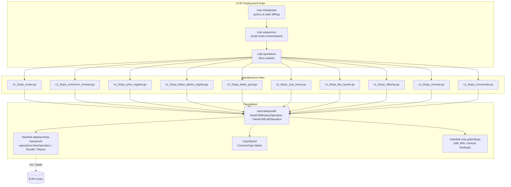
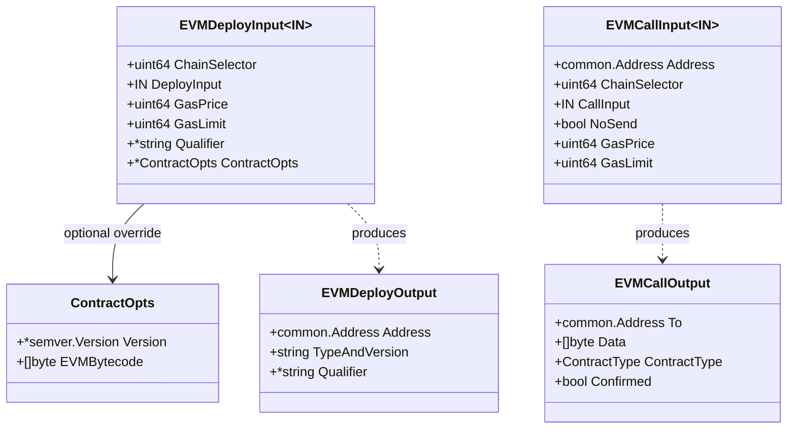
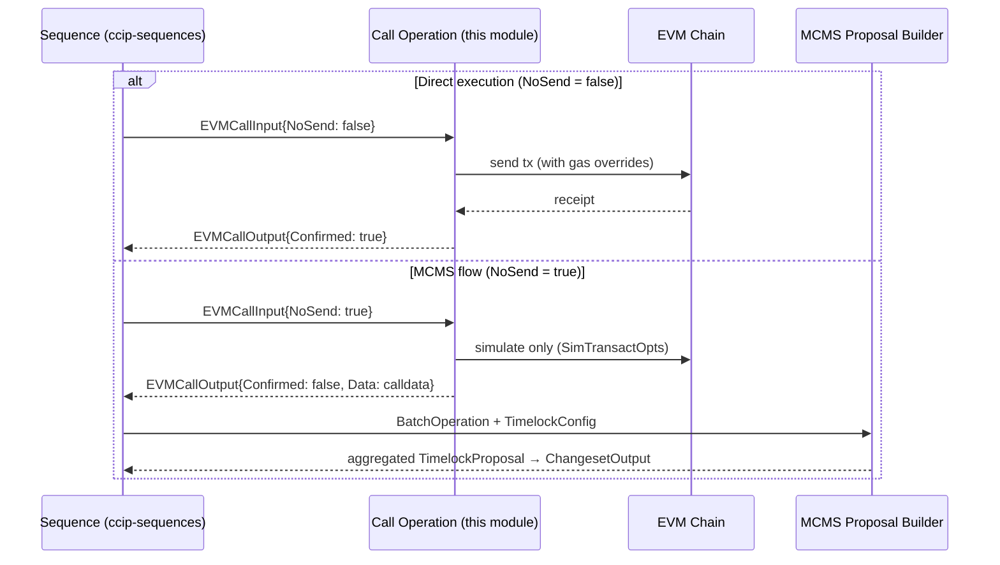
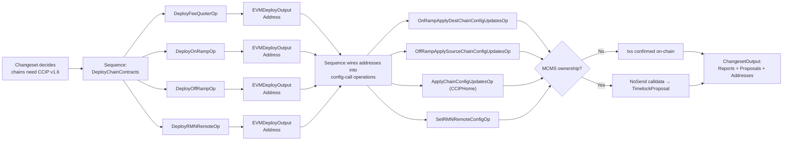

# CCIP Operations (`chainlink/deployment/ccip/operation/evm`)

## 1. Introduction

The **ccip-operations** module is the lowest executable layer of the [CCIP Deployment Suite](../CCIP_Deployment_Suite.md). It packages every individual, on-chain action that the deployment framework can take against CCIP smart contracts — deploying a contract, calling a state-mutating function, or batch-reading configuration — into discrete, self-describing **operations**.

An *operation* in this context is a unit of work built on the [`chainlink-deployments-framework/operations`](https://github.com/smartcontractkit/chainlink-deployments-framework) primitives: it has a name, a semantic version, a description, a typed input, a typed output, and a chain dependency (`cldf_evm.Chain`). Operations never make policy decisions on their own; they are composed into **sequences** (see [ccip-sequences](ccip-sequences.md)), which are in turn orchestrated by **changesets** (see [ccip-changesets](ccip-changesets.md)).

### Key properties

| Property | Description |
|---|---|
| **Granularity** | One operation ≈ one on-chain transaction (deploy or call) or one read-only query. |
| **Observability** | Every operation records structured logs and an `operations.Report` entry (`ExecutionReports`) that flows up through sequences and changesets. |
| **MCMS-safety** | Call operations support a `NoSend` mode that *prepares* transaction calldata without broadcasting, enabling [MCMS timelock proposals](#mcms-and-nosend-mode) to be generated instead of direct sends. |
| **Reproducibility** | Inputs are JSON-serializable; chain selectors are validated against the chain dependency to prevent cross-chain false reports. |
| **Version-pinning** | Operations pin exact generated gobinding packages (`v1_2_0`, `v1_5_0`, `v1_5_1`, `v1_6_0`, `v1_6_3`), so each CCIP contract release gets its own operation set. |

## 2. Position in the Deployment Suite

```
ccip-changesets (policy / state diffing)      →  chainlink/deployment/ccip/changeset
        │  invokes
        ▼
ccip-sequences (multi-chain orchestration)    →  chainlink/deployment/ccip/sequence
        │  executes
        ▼
ccip-operations (single on-chain actions)   ◄── THIS MODULE
        │  built with                              chainlink/deployment/ccip/operation
        ▼
opsutils (deploy/call envelopes)              →  chainlink/deployment/ccip/internal/opsutils
chainlink-deployments-framework/operations    →  Operation, Sequence, Bundle, Report
ccip-shared (contract types, bindings)        →  chainlink/deployment/ccip/shared
```

- **Above:** [ccip-sequences](ccip-sequences.md) fans operations out across chains (e.g. `DeployChainContracts` runs `DeployFeeQuoterOp`, `DeployOnRampOp`, `DeployOffRampOp`, `DeployRouter` per chain) and [ccip-changesets](ccip-changesets.md) decide *what* to run based on on-chain state.
- **Below:** the internal [`opsutils`](#31-the-opsutils-envelope) package wraps the generic `operations.NewOperation` factory with EVM deploy/call envelopes, and [ccip-shared](ccip-shared.md) supplies the `deployment.ContractType` labels (`shared.Router`, `shared.FeeQuoter`, …) used to tag deployed contracts.
- **Domain types** consumed by read operations (e.g. `EVM2EVMOnRampDynamicConfig`) come from the `chainlink-ccip` gobindings, described in [CCIP Cross-Chain Protocol](../CCIP_Cross-Chain_Protocol.md).

### Architecture diagram



## 3. Core Concepts

### 3.1 The `opsutils` envelope

Every operation in this module is produced by one of two factories from [`chainlink/deployment/ccip/internal/opsutils/evm.go`](../repo/chainlink/deployment/ccip/internal/opsutils/evm.go):

**Deploy operations** (`NewEVMDeployOperation`) — deploy contract bytecode and return the new address:

```go
opsutils.NewEVMDeployOperation(
    "DeployRouter",                        // name
    semver.MustParse("1.0.0"),             // op version
    "Deploys Router 1.2 contract...",      // description
    shared.Router,                         // ContractType label
    router.RouterMetaData,                 // ABI metadata
    &opsutils.ContractOpts{                // default bytecode + contract version
        Version: &deployment.Version1_2_0,
        EVMBytecode: common.FromHex(router.RouterBin),
    },
    func(input DeployRouterInput) []any {  // constructor args
        return []any{input.WethAddress, input.RMNProxy}
    },
)
```

**Call operations** (`NewEVMCallOperation`) — invoke a state-mutating function on an existing contract:

```go
opsutils.NewEVMCallOperation(
    "RouterApplyRampUpdatesOp",
    semver.MustParse("1.0.0"),
    "Updates OnRamps and OffRamps on the Router contract",
    router.RouterABI,
    shared.Router,
    router.NewRouter,                      // binding constructor
    func(r *router.Router, opts *bind.TransactOpts, in RouterApplyRampUpdatesOpInput) (*types.Transaction, error) {
        return r.ApplyRampUpdates(opts, in.OnRampUpdates, in.OffRampRemoves, in.OffRampAdds)
    },
)
```

Both envelopes validate that the input `ChainSelector` matches the chain dependency, clone the deployer's `TransactOpts` (so gas overrides never leak between operations), confirm transactions on-chain, and emit structured logs through the `operations.Bundle` logger.

### 3.2 Input / output envelopes



Notes:

- `ContractOpts` supplied in `EVMDeployInput` **override** the operation's default bytecode/version — this is how operators deploy a different contract binary under the same ABI (e.g. a patched `FeeQuoter`).
- `EVMCallOutput.Data` contains the raw calldata. When `NoSend = true`, the call is *simulated* (`cldf.SimTransactOpts()`), `Confirmed` stays `false`, and the calldata is what gets embedded into an MCMS batch operation.

### 3.3 MCMS and `NoSend` mode

Under MCMS (multi-chain multisig) ownership, node operators must not send transactions directly. Sequences execute call operations with `NoSend: true` and then feed the resulting `EVMCallOutput` records into `opsutils.AddEVMCallSequenceToCSOutput`, which:

1. Skips already-confirmed operations (`Confirmed == true`),
2. Converts each prepared calldata blob into an `mcmstypes.BatchOperation`,
3. Builds and aggregates an `mcmslib.TimelockProposal` attached to the changeset output.



Gas-boost retries (`RetryCallWithGasBoost`, `RetryDeploymentWithGasBoost`) are `operations.ExecuteOption`s that mutate the `GasLimit`/`GasPrice` inputs between attempts; gas boosting is skipped for `NoSend` calls since nothing is broadcast.

### 3.4 Version organization

The module mirrors CCIP contract release lines. Each sub-directory binds to the **exact** generated gobinding package for that release, so an operation only ever targets one contract version:

| Directory | CCIP line | Contents | Sub-module doc |
|---|---|---|---|
| `operation/evm/v1_2` | 1.2 legacy | Router deploy & ramp wiring | [ccip-operations_evm_v1_2](ccip-operations/ccip-operations_evm_v1_2.md) |
| `operation/evm/v1_5` | 1.5 / 1.5.1 | Read-only migration & inventory ops (OnRamp, PriceRegistry, TokenAdminRegistry, TokenPool) | [ccip-operations_evm_v1_5](ccip-operations/ccip-operations_evm_v1_5.md) |
| `operation/evm/v1_6` | 1.6 / 1.6.3 | Core CCIP v1.6 deploys & config (OnRamp, OffRamp, FeeQuoter, CCIPHome, RMNRemote) | [ccip-operations_evm_v1_6](ccip-operations/ccip-operations_evm_v1_6.md) |

Dependency-wise, this module lives in the `chainlink/deployment` Go module ([`chainlink/deployment/go.mod`](../repo/chainlink/deployment/go.mod)), which pins `chainlink-deployments-framework v0.123.3`, the `chainlink-ccip` gobindings, `mcms`, and `chain-selectors`.

## 4. Sub-modules

> The detailed pages below were generated from the module's core components and saved under `ccip-operations/`:

### 4.1 [EVM v1.2 — Router operations](ccip-operations/ccip-operations_evm_v1_2.md)

**Docs file:** [`ccip-operations/ccip-operations_evm_v1_2.md`](ccip-operations/ccip-operations_evm_v1_2.md)

Legacy-line router support: `DeployRouter`, `DeployTestRouter`, `RouterApplyRampUpdatesOp`, and `UpdateWrappedNativeAddressOnRouterOp`. These remain in use because the Router (the user-facing CCIP entrypoint) is intentionally version-stable across 1.5→1.6 lanes.

### 4.2 [EVM v1.5 — Migration & inventory read operations](ccip-operations/ccip-operations_evm_v1_5.md)

**Docs file:** [`ccip-operations/ccip-operations_evm_v1_5.md`](ccip-operations/ccip-operations_evm_v1_5.md)

Read-only operations that extract the entire configurable state of a 1.5.x deployment — OnRamp dynamic config, fee-token configs, token-transfer fee configs, token pools, price-registry fee tokens, TokenAdminRegistry tokens, token-pool supported chains — used by the [v1.5 → v1.6 migration sequences](ccip-sequences.md). Includes the bounded-concurrency batch fetcher (`onRampBatchConcurrency = 10`) built on `errgroup`.

### 4.3 [EVM v1.6 — Core contract deploy & configuration operations](ccip-operations/ccip-operations_evm_v1_6.md)

**Docs file:** [`ccip-operations/ccip-operations_evm_v1_6.md`](ccip-operations/ccip-operations_evm_v1_6.md)

The mainline CCIP v1.6 operations: deploying OnRamp, OffRamp, FeeQuoter (with `DefaultFeeQuoterParams` and family-aware `DefaultFeeQuoterDestChainConfig`), RMNRemote/RMNProxy wiring, and CCIPHome / CapabilitiesRegistry DON management (`AddDONOp`, `UpdateDONOp`, `ApplyChainConfigUpdatesOp`).

## 5. End-to-end data flow

The typical flow in which this module participates (bootstrapping a fresh v1.6 chain):



Read operations (v1.5 sub-module) follow the inverse flow: they are invoked by migration sequences *before* any writes, producing typed Go structs (e.g. `EVM2EVMOnRampDynamicConfig`, `[]common.Address` fee tokens) that become inputs to v1.6 deploy operations.

## 6. Related modules

- [CCIP Deployment Suite](../CCIP_Deployment_Suite.md) — parent overview of the deployment framework suite.
- [ccip-changesets](ccip-changesets.md) — policy layer that consumes operations via sequences; includes per-version changesets (v1_5, v1_6, solana, crossfamily).
- [ccip-sequences](ccip-sequences.md) — multi-chain orchestration that composes these operations; includes the 1.5→1.6 migration sequences that consume the v1.5 read ops.
- [ccip-shared](ccip-shared.md) — shared `ContractType` labels (`shared.Router`, `shared.FeeQuoter`, `shared.RMNRemote`, …), token pool abstractions, and deployer-group batching used by the operations in this module.
- [CCIP Cross-Chain Protocol](../CCIP_Cross-Chain_Protocol.md) — the on-chain protocol domain types (`types-ccip`) that correspond to the contracts these operations deploy and configure.
- [Deployment Framework Core & Product Deployments](../Deployment_Framework_Core___Product_Deployments.md) — the generic (non-CCIP) changeset/operation framework (`chainlink/deployment/common`) that inspired this pattern.
- [Plugin Process Framework (Loop)](../Plugin_Process_Framework_(Loop).md) — the gRPC plugin layer the *node* uses at runtime; operations deploy the contracts that runtime then interacts with.
