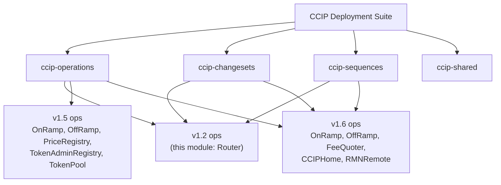
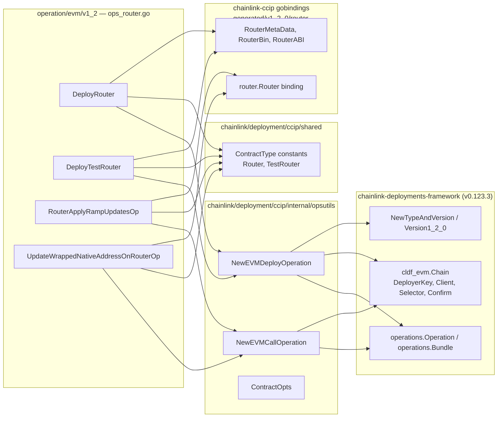
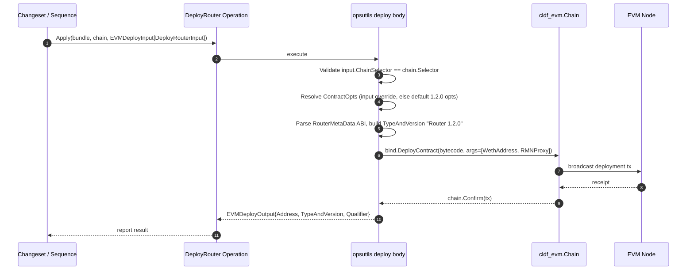
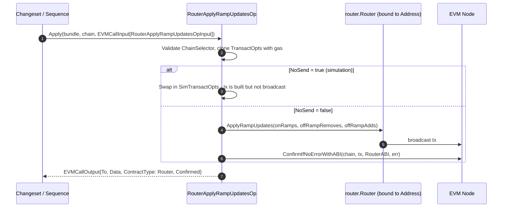
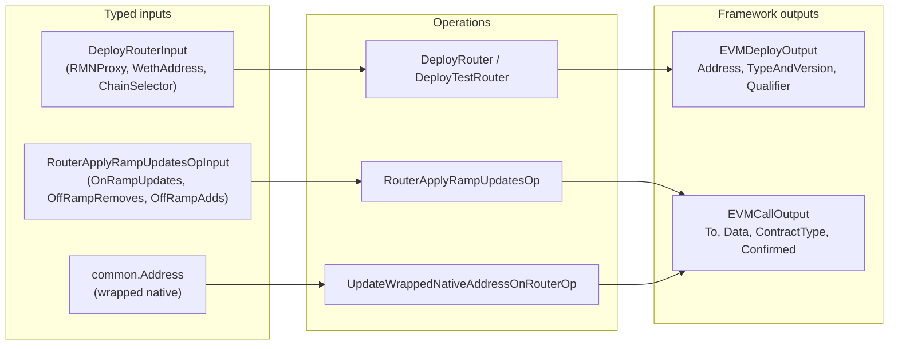

# CCIP Operations — EVM v1.2 (Router)

## Introduction

The `ccip-operations_evm_v1_2` module is the version-scoped leaf package of the [CCIP operations suite](../ccip-operations.md) that owns the atomic on-chain **operations for the CCIP Router contract at release version 1.2.0** on EVM chains. It lives in a single source file, `chainlink/deployment/ccip/operation/evm/v1_2/ops_router.go`, and exposes four framework operations:

| Operation | Kind | Purpose |
|---|---|---|
| `DeployRouter` | Deploy | Deploys the Router 1.2 contract on a specified EVM chain |
| `DeployTestRouter` | Deploy | Deploys the TestRouter 1.2 contract (same bytecode, registered as `TestRouter`) |
| `RouterApplyRampUpdatesOp` | Call | Adds/removes OnRamps and OffRamps on a deployed Router (`applyRampUpdates`) |
| `UpdateWrappedNativeAddressOnRouterOp` | Call | Updates the wrapped native token address on a Router (`setWrappedNative`) |

In the deployment framework's terminology, an *operation* is the smallest self-describing, versioned execution unit: a typed function that either deploys a contract or sends a state-changing transaction against a single chain handle (`cldf_evm.Chain`). Operations never compose chains themselves — that is the job of [sequences](../ccip-sequences.md) and [changesets](../ccip-changesets.md), which consume the operations defined here.

This package exists so that deployment automation targeting current CCIP releases can still **deploy and wire legacy Router v1.2 instances** (for example, when integrating a legacy Router into lanes served by newer OnRamp/OffRamp contracts deployed by the [v1.6 operations](ccip-operations_evm_v1_6.md)).

For the domain-level view of the contracts these operations interact with (OnRamp, OffRamp, CommitStore, FeeQuoter types), see [types-ccip](../../CCIP_Cross-Chain_Protocol/types-ccip.md).

---

## Architecture

### Position in the CCIP Deployment Suite



Operations produced here are typically orchestrated by changesets/sequences (see [ccip-changesets](../ccip-changesets.md) and [ccip-sequences](../ccip-sequences.md)) rather than invoked directly by end users.

### Dependency graph

The module is a thin composition layer. The heavy lifting is delegated to three dependency groups:



Key dependency relationships:

1. **`chainlink/deployment/ccip/internal/opsutils`** — provides the generic EVM operation factories (`NewEVMDeployOperation`, `NewEVMCallOperation`) and the `ContractOpts` struct (`Version *semver.Version`, `EVMBytecode []byte`). All four operations in this module are created through these factories; this module only supplies the names, descriptions, contract artifacts, ABI, and typed inputs.
2. **`chainlink/deployment/ccip/shared`** — supplies the `deployment.ContractType` constants `Router` and `TestRouter` (defined in `chainlink/deployment/ccip/shared/types.go`). These are the registry keys under which deployed addresses are recorded and later discovered by state views (see [ccip-shared](../ccip-shared.md)).
3. **`chainlink-deployments-framework` / `chainlink-ccip` gobindings** — the framework supplies the `operations.Operation` abstraction, the `cldf_evm.Chain` execution context, and `TypeAndVersion` registration; the `chainlink-ccip/chains/evm/gobindings/generated/v1_2_0/router` package supplies the Router's ABI metadata (`RouterMetaData`), runtime bytecode (`RouterBin`), ABI string (`RouterABI`), the `NewRouter` binder, and the typed `router.RouterOnRamp` / `router.RouterOffRamp` structs. Both are pinned via `chainlink/deployment/go.mod`.

---

## Component reference

All components are defined in `chainlink/deployment/ccip/operation/evm/v1_2/ops_router.go`.

### `DeployRouterInput`

Constructor-argument payload shared by the two deployment operations:

| Field | Type | Description |
|---|---|---|
| `RMNProxy` | `common.Address` | Address of the RMN proxy the Router will delegate RMN interactions to |
| `WethAddress` | `common.Address` | Wrapped native token address for the target chain |
| `ChainSelector` | `uint64` | CCIP chain selector of the target chain (validated against the chain handle at execution time) |

The deployment operations flatten this struct into constructor args in the order **`[WethAddress, RMNProxy]`**:

```go
func(input DeployRouterInput) []any {
    return []any{input.WethAddress, input.RMNProxy}
}
```

### `RouterApplyRampUpdatesOpInput`

Payload for wiring lanes into a deployed Router:

| Field | Type | Description |
|---|---|---|
| `OnRampUpdates` | `[]router.RouterOnRamp` | OnRamp entries to add or update |
| `OffRampRemoves` | `[]router.RouterOffRamp` | OffRamp entries to remove |
| `OffRampAdds` | `[]router.RouterOffRamp` | OffRamp entries to add |

The wrapper input additionally requires the target Router `Address` (and chain selector) via the generic `EVMCallInput[IN]` envelope supplied by `opsutils`.

### Operation catalog

| Operation | Registered name | Op version | Contract artifact | Behaviour |
|---|---|---|---|---|
| `DeployRouter` | `DeployRouter` | `1.0.0` | `shared.Router`, Router 1.2.0 bytecode | Deploys Router and returns address + `TypeAndVersion` (`"Router 1.2.0"`) |
| `DeployTestRouter` | `DeployTestRouter` | `1.0.0` | `shared.TestRouter`, Router 1.2.0 bytecode | Identical bytecode and constructor; registered under the `TestRouter` type so test environments can distinguish it in state views (per the comment in `shared/types.go`: *"test router maps to a regular router contract"*) |
| `RouterApplyRampUpdatesOp` | `RouterApplyRampUpdatesOp` | `1.0.0` | `shared.Router`, `router.RouterABI` | Sends `ApplyRampUpdates(onRamps, offRampRemoves, offRampAdds)` |
| `UpdateWrappedNativeAddressOnRouterOp` | `UpdateWrappedNativeAddressOnRouterOp` | `1.0.0` | `shared.Router`, `router.RouterABI` | Sends `SetWrappedNative(wrappedNativeAddress)` with a plain `common.Address` input |

> **Versioning note:** each operation is registered with semver `1.0.0` — this is the *operation API version*. The *contract* version is pinned separately through `opsutils.ContractOpts{Version: &deployment.Version1_2_0}` and surfaces in the recorded `TypeAndVersion` string as `Router 1.2.0`.

---

## Process flows

### Deployment flow (`DeployRouter` / `DeployTestRouter`)



Failure handling: a chain-selector mismatch, missing contract metadata, or missing/invalid `ContractOpts` aborts before any transaction is sent; a failed deploy or confirmation aborts with the deployer logging the failed `TypeAndVersion` and chain.

### Call flow (`RouterApplyRampUpdatesOp`)



`UpdateWrappedNativeAddressOnRouterOp` follows the identical call path with a `common.Address` input and `SetWrappedNative` as the invoked method.

### Input → operation → output data flow



---

## How the module fits into the overall system

- **Consumers.** The four operations are invoked from [ccip-changesets](../ccip-changesets.md) and [ccip-sequences](../ccip-sequences.md). A typical lane bring-up sequence deploys a Router here, deploys OnRamp/OffRamp via the [v1.6 operations](ccip-operations_evm_v1_6.md), then calls `RouterApplyRampUpdatesOp` to register the new ramps with the Router. Read-style operations for legacy v1.5 contracts (e.g. token-config migration inputs) live in the sibling [v1.5 operations](ccip-operations_evm_v1_5.md) package.
- **MCMS compatibility.** The `EVMCallOutput.Data` field carries the raw calldata of the prepared transaction, and the `NoSend` input flag turns any call operation into a build-only (simulated) invocation. Together these let changesets embed Router updates into Multichain (MCMS) governance proposals instead of executing them directly from the deployer key.
- **State discovery.** Deployment outputs are registered with `TypeAndVersion` (`Router 1.2.0` / `TestRouter 1.2.0`) and an optional `Qualifier`, which is how the shared [state views](../ccip-shared.md) later look up deployed Routers on a chain without hard-coded addresses.
- **Chain-codecs context.** The Router is one of the chain-side CCIP contracts modelled by the runtime side of the protocol; see [CCIP chain codecs](../../CCIP_Cross-Chain_Protocol/ccip/ccip_chain_codecs.md) for how messages flowing through deployed Routers are encoded per chain family.

### Build and dependency context

The module belongs to the `github.com/smartcontractkit/chainlink/deployment` Go module. `chainlink/deployment/go.mod` pins the two external pillars used here:

- `github.com/smartcontractkit/chainlink-deployments-framework v0.123.3` — `operations` framework, EVM chain handles, `TypeAndVersion` registry helpers;
- `github.com/smartcontractkit/chainlink-ccip/chains/evm` — generated v1.2.0 Router gobindings (ABI, bytecode, binder).

No build- or packaging-specific behaviour affects this module beyond standard Go module builds; the relevant tooling is described in [Deployment Framework Core & Product Deployments](../../Deployment_Framework_Core___Product_Deployments.md).

---

## Design notes

1. **Single-contract scope.** Unlike the v1.5/v1.6 packages, which cover many contracts, the v1.2 package intentionally covers only the Router — the only contract whose 1.2 instance still requires dedicated deployment/upgrade tooling in current pipelines.
2. **Test vs. production Router.** `DeployTestRouter` reuses the production bytecode and ABI but tags the deployment with the `TestRouter` contract type. State views and test harnesses can therefore locate test routers without changing router behaviour.
3. **Safety rails in the generic layer.** Chain-selector cross-validation (input vs. chain handle), mandatory ABI metadata, and mandatory `ContractOpts` are enforced by `opsutils` before deployment, eliminating a class of misconfiguration bugs at the operation boundary.
4. **Simulation-first governance.** The `NoSend`/simulated-transaction path and calldata-bearing call outputs make every call operation directly reusable for MCMS proposal generation, which is the dominant execution mode for production CCIP configuration changes.

---

## Related documentation

- [CCIP Operations (parent)](../ccip-operations.md) — operations framework overview and the full version catalog
- [CCIP Operations — EVM v1.5](ccip-operations_evm_v1_5.md) — legacy read/migration operations for OnRamp, OffRamp, PriceRegistry, TokenAdminRegistry, TokenPool
- [CCIP Operations — EVM v1.6](ccip-operations_evm_v1_6.md) — deploy operations for OnRamp, OffRamp, FeeQuoter, CCIPHome, RMNRemote
- [CCIP Shared](../ccip-shared.md) — contract types, state views, bindings, and deployer groups shared across the suite
- [CCIP Changesets](../ccip-changesets.md) and [CCIP Sequences](../ccip-sequences.md) — orchestration layers that consume these operations
- [types-ccip](../../CCIP_Cross-Chain_Protocol/types-ccip.md) — domain types for CCIP ramp contracts and OCR3 plugins
- [Deployment Framework Core & Product Deployments](../../Deployment_Framework_Core___Product_Deployments.md) — the underlying changeset/operation framework
