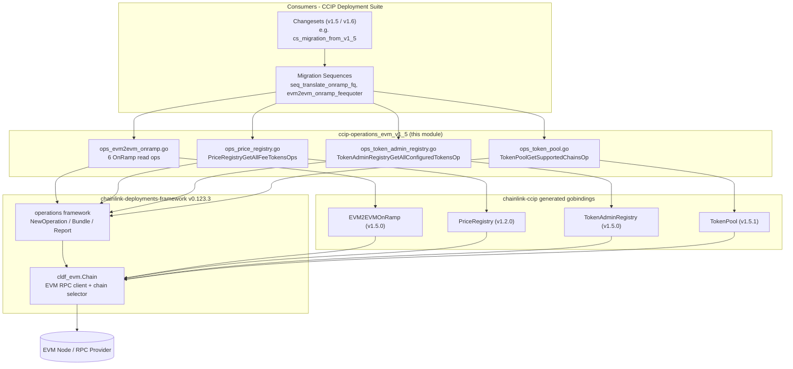
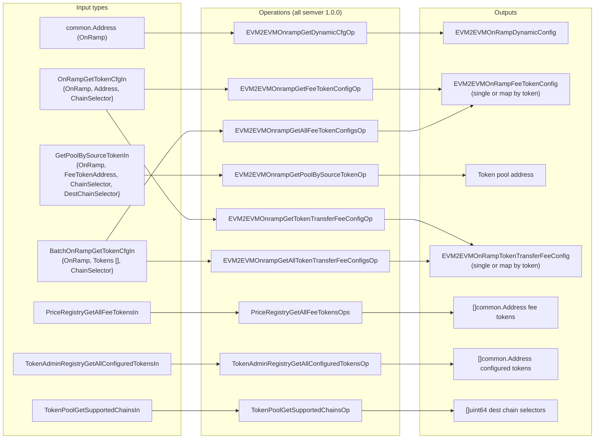
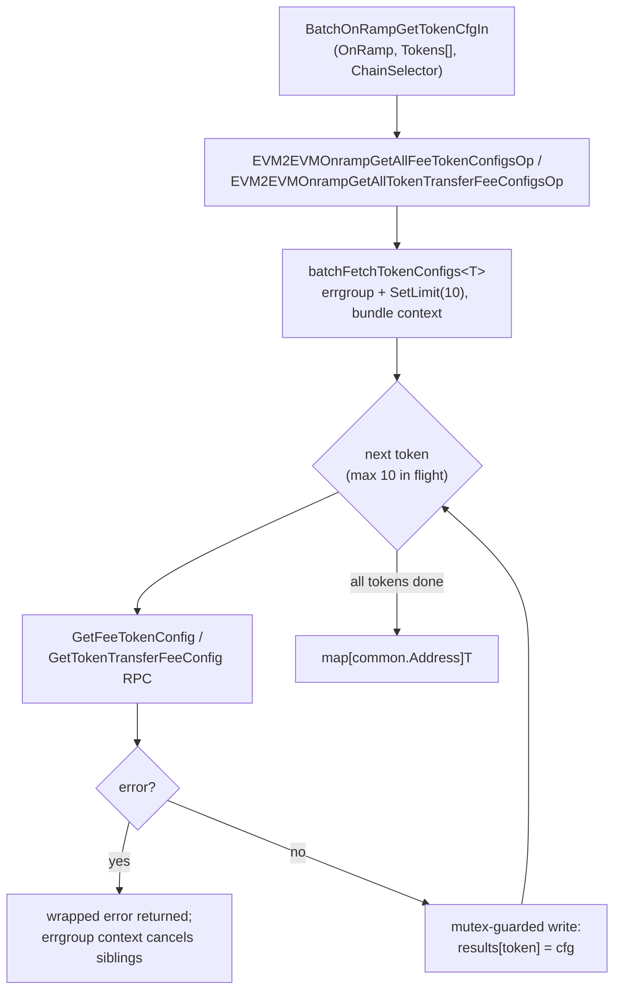
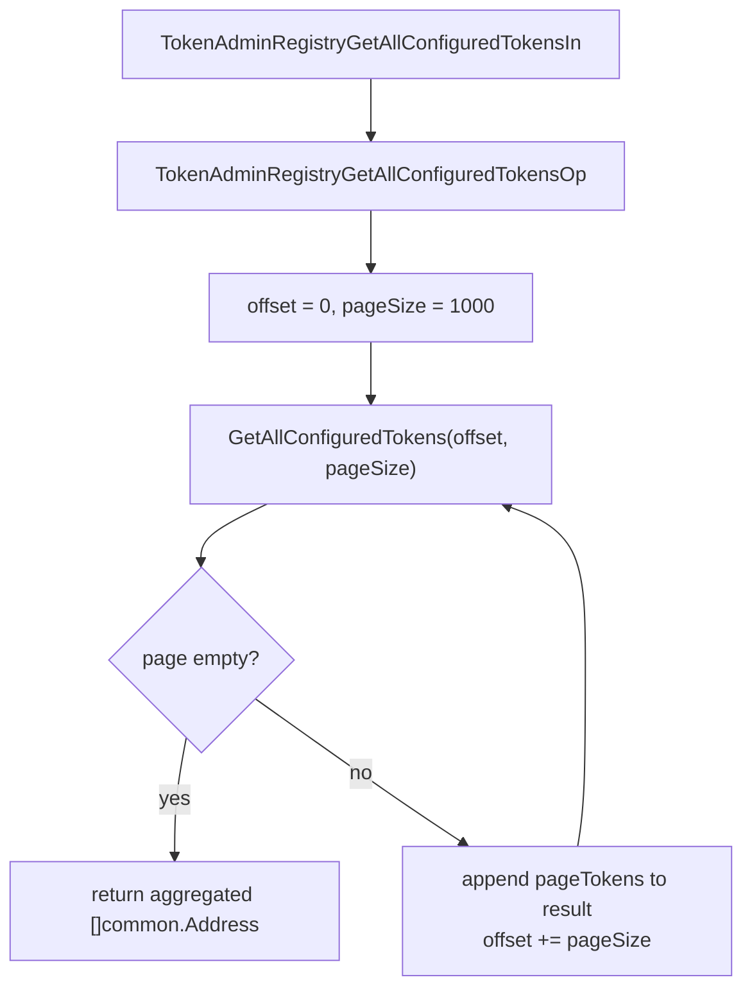
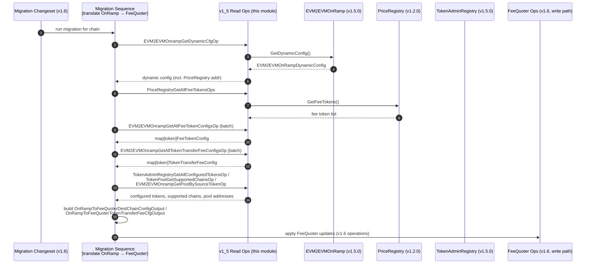

# ccip-operations_evm_v1_5

## Introduction

`ccip-operations_evm_v1_5` is the **EVM v1.5 operations library** of the CCIP Deployment Suite. It provides a set of small, atomic, **read-only on-chain operations** that query the configuration of deployed CCIP v1.5.x EVM contracts — the `EVM2EVMOnRamp`, `PriceRegistry`, `TokenAdminRegistry`, and `TokenPool` — using generated Go bindings from `chainlink-ccip`.

The module's primary consumer is the **v1.5 → v1.6 FeeQuoter migration tooling**: the shared dependency type `MigrateOnRampToFQDeps` ("migrate OnRamp to FeeQuoter") signals that these operations exist to *harvest* fee configuration from v1.5 contracts so it can be re-applied to the v1.6 `FeeQuoter`. All operations are pure queries: they make no state changes, require no transaction signing, and are therefore safe to run against live deployments during migration analysis.

- **Module location:** `chainlink/deployment/ccip/operation/evm/v1_5/`
- **Parent module:** [ccip-operations](../ccip-operations.md) (see also siblings [ccip-operations_evm_v1_2](ccip-operations_evm_v1_2.md) and [ccip-operations_evm_v1_6](ccip-operations_evm_v1_6.md))
- **Chain family:** EVM only (other chain families are handled by their own changesets/operations, e.g. [ccip-changesets_solana](../ccip-changesets/ccip-changesets_solana.md))
- **Framework:** [chainlink-deployments-framework](../../Deployment_Framework_Core___Product_Deployments/deployment-common.md) operations API (`operations.NewOperation`, `operations.Bundle`), pinned at `v0.123.3` in `chainlink/deployment/go.mod`

---

## Scope and Components

The module consists of four files, each targeting one v1.5 contract family:

| File | Contract targeted (binding generation) | Operations | Input types |
|---|---|---|---|
| `ops_evm2evm_onramp.go` | `EVM2EVMOnRamp` (`v1_5_0`) | 6 (2 batched) | `OnRampGetTokenCfgIn`, `GetPoolBySourceTokenIn`, `BatchOnRampGetTokenCfgIn`, `common.Address` |
| `ops_price_registry.go` | `PriceRegistry` (`v1_2_0`) | 1 | `PriceRegistryGetAllFeeTokensIn` |
| `ops_token_admin_registry.go` | `TokenAdminRegistry` (`v1_5_0`) | 1 (paginated) | `TokenAdminRegistryGetAllConfiguredTokensIn` |
| `ops_token_pool.go` | `TokenPool` (`v1_5_1`) | 1 | `TokenPoolGetSupportedChainsIn` |

All nine operations share one dependency struct and one operations-framework integration model:

```go
// Shared dependencies for every operation in this module.
type MigrateOnRampToFQDeps struct {
    Chain cldf_evm.Chain // EVM chain client (RPC) + chain selector
}
```

### Operation catalogue

| Operation ID (semver 1.0.0) | Input | Output | Contract call | Notes |
|---|---|---|---|---|
| `EVM2EVMOnrampGetDynamicCfgOp` | `common.Address` (OnRamp) | `EVM2EVMOnRampDynamicConfig` | `GetDynamicConfig()` | Lenient error handling: only fails when the call errors **and** `PriceRegistry` came back as the zero address |
| `EVM2EVMOnrampGetFeeTokenConfigOp` | `OnRampGetTokenCfgIn` | `EVM2EVMOnRampFeeTokenConfig` | `GetFeeTokenConfig(token)` | Single-token lookup |
| `EVM2EVMOnrampGetPoolBySourceTokenOp` | `GetPoolBySourceTokenIn` | `common.Address` (pool) | `GetPoolBySourceToken(destSelector, token)` | Resolves the token pool registered on the OnRamp for a (dest chain, token) pair |
| `EVM2EVMOnrampGetTokenTransferFeeConfigOp` | `OnRampGetTokenCfgIn` | `EVM2EVMOnRampTokenTransferFeeConfig` | `GetTokenTransferFeeConfig(token)` | Single-token lookup |
| `EVM2EVMOnrampGetAllTokenTransferFeeConfigsOp` | `BatchOnRampGetTokenCfgIn` | `map[token]EVM2EVMOnRampTokenTransferFeeConfig` | `GetTokenTransferFeeConfig` × N | Concurrent batch (limit 10) |
| `EVM2EVMOnrampGetAllFeeTokenConfigsOp` | `BatchOnRampGetTokenCfgIn` | `map[token]EVM2EVMOnRampFeeTokenConfig` | `GetFeeTokenConfig` × N | Concurrent batch (limit 10) |
| `PriceRegistryGetAllFeeTokensOps` | `PriceRegistryGetAllFeeTokensIn` | `[]common.Address` | `GetFeeTokens()` | Uses the v1.2.0 `PriceRegistry` binding (compatible with v1.5 deployments) |
| `TokenAdminRegistryGetAllConfiguredTokensOp` | `TokenAdminRegistryGetAllConfiguredTokensIn` | `[]common.Address` | `GetAllConfiguredTokens(offset, pageSize)` | Paginated, page size 1000 |
| `TokenPoolGetSupportedChainsOp` | `TokenPoolGetSupportedChainsIn` | `[]uint64` | `GetSupportedChains()` | Destination chain selectors the pool serves |

> **Note on `ChainSelector` fields:** input structs carry a `ChainSelector` for caller context, but the binding calls themselves are made through `deps.Chain.Client`; several operations include `deps.Chain.ChainSelector()` in wrapped error messages instead. Treat the input field as informational metadata for reports/logs.

---

## Architecture

### Position in the Deployment Suite

The module sits at the **operations layer** of the CCIP Deployment Suite: changesets orchestrate intent, sequences compose operations into multi-step flows, and operations perform the smallest unit of work against a chain (see [ccip-changesets](../ccip-changesets.md), [ccip-sequences](../ccip-sequences.md), and the framework core in [deployment-common](../../Deployment_Framework_Core___Product_Deployments/deployment-common.md)). For v1.5, this layer is read-only; the corresponding **write** operations for v1.6 contracts (deploy FeeQuoter, OnRamp, OffRamp, CCIPHome, RMNRemote) live in [ccip-operations_evm_v1_6](ccip-operations_evm_v1_6.md).



### Component relationship (inputs → operations → outputs)

`EVM2EVMOnrampGetDynamicCfgOp` is the only operation taking a bare `common.Address`; every other operation wraps its parameters in a dedicated input struct. All operations share `MigrateOnRampToFQDeps`.



---

## Operations Framework Integration

Every operation is declared through the deployment framework's factory, which attaches a stable ID, a semantic version, and a description to the handler:

```go
EVM2EVMOnrampGetDynamicCfgOp = operations.NewOperation(
    "EVM2EVMOnrampGetDynamicCfgOp",     // operation ID (stable, reportable)
    semver.MustParse("1.0.0"),          // operation version
    "Get DynamicConfig from 1.5.0 OnRamps", // description
    func(b operations.Bundle, deps MigrateOnRampToFQDeps, input ...) (..., error) { ... },
)
```

Execution model (as used throughout this module):

1. A caller (sequence/changeset) invokes the operation with an `operations.Bundle` and the shared `MigrateOnRampToFQDeps`.
2. The handler binds the target contract via its generated constructor (`NewEVM2EVMOnRamp`, `NewPriceRegistry`, `NewTokenAdminRegistry`, `NewTokenPool`) using `deps.Chain.Client`.
3. Read-only calls are made (`nil` call options, or a context-carrying `bind.CallOpts` for batch operations).
4. Errors are wrapped with rich context — chain selector, contract address, token address — before being returned so the framework can record them in its operation report.

The framework, gobindings, and their pinned versions are declared in `chainlink/deployment/go.mod` (`chainlink-deployments-framework v0.123.3`, `chainlink-ccip/chains/evm`, `go-ethereum v1.17.4`).

---

## Data Flow

### Single read

Each single-token operation follows the same shape: bind → call → wrap errors with addressing context → return the decoded on-chain struct.

### Concurrent batch fetch (OnRamp fee configs)

The two `GetAll...` operations share a generic helper, `batchFetchTokenConfigs[T any]`, built on `errgroup` with a bounded worker limit (`onRampBatchConcurrency = 10`). This caps concurrent RPC calls so large token lists do not overwhelm the node or provider, while context cancellation stops in-flight work as soon as any token fetch fails.



Key properties of the helper:

- **Generic** over the result type `T`, so one implementation serves both fee-token and token-transfer-fee batching.
- **Fail-fast:** `grp.Wait()` returns the first error; the errgroup context (`grpCtx`) is passed to each RPC call so siblings are cancelled.
- **Thread-safe aggregation:** a `sync.Mutex` guards writes to the shared `results` map.
- **Pre-sized map:** `results` is allocated with `len(tokens)` capacity.

### Pagination (TokenAdminRegistry)

`TokenAdminRegistryGetAllConfiguredTokensOp` walks the registry in fixed-size pages because the full token list can exceed a single RPC response:



The loop terminates on the first empty page and aggregates every page into a single `[]common.Address` slice.

---

## Role in the v1.5 → v1.6 FeeQuoter Migration

This module's raison d'être is captured in its dependency type name: `MigrateOnRampToFQDeps`. During a v1.5 → v1.6 lane/contract migration (see [ccip-changesets_evm_1_6](../ccip-changesets/ccip-changesets_evm_1_6.md) and the migration sequences in [ccip-sequences](../ccip-sequences.md)), the migration sequence harvests the fee-related state that lived *inside* the v1.5 OnRamp and PriceRegistry and translates it into `FeeQuoter` configuration consumed by the v1.6 write operations ([ccip-operations_evm_v1_6](ccip-operations_evm_v1_6.md)).

The consumed outputs map directly onto the migration sequence's translation types (from `seq_translate_onramp_fq.go`):

- `OnRampToFeeQuoterDestChainConfigOutput` — carries `FeeQuoterUpdates` (per dest-chain config), `FeeTokens`, and `FeeTokenPremiumMultipliers` — populated from the OnRamp dynamic config, batch fee-token configs, and price-registry fee-token list.
- `OnRampToFeeQuoterTokenTransferFeeCfgOutput` — carries `FeeQuoterUpdates` of `FeeQuoterTokenTransferFeeConfigArgs` — populated from the batch token-transfer-fee configs.



Because every operation in this module is read-only, the entire harvest phase can be executed and re-executed safely against a live v1.5 deployment before any v1.6 proposal (e.g. an MCMS batch) is built.

---

## Error Handling and Operational Notes

- **Consistent error wrapping.** Every handler wraps low-level binding/call errors with the chain selector, contract address, and (where applicable) token address, so failures in reports are directly actionable.
- **Lenient dynamic-config read.** `EVM2EVMOnrampGetDynamicCfgOp` only surfaces an error when the call failed **and** the returned `PriceRegistry` is the zero address; a successful decode is tolerated even with a non-nil error, reflecting the reality of partially-configured v1.5 OnRamps during migration discovery.
- **RPC load control.** Batch operations never fan out unbounded: concurrency is capped at `onRampBatchConcurrency = 10` and each in-flight call honours the bundle's context.
- **Read-only by construction.** No operation builds or submits transactions; there is no signer, keystore, or MCMS involvement in this module (MCMS handling lives in changesets — see [ccip-changesets](../ccip-changesets.md) and shared MCMS helpers in [ccip-shared](../ccip-shared.md)).
- **Mixed binding generations.** The module deliberately binds contracts at the generation matching the deployed v1.5.x bytecode (`v1_5_0` OnRamp / TokenAdminRegistry, `v1_5_1` TokenPool, `v1_2_0` PriceRegistry). When adding operations, keep the binding version aligned with the contract version being migrated.
- **Type-safe results.** Operations return strongly typed generated structs (`EVM2EVMOnRampDynamicConfig`, etc.) rather than raw ABI tuples, letting downstream translation code stay compile-time checked. Cross-chain domain types these feed into are documented in [types-ccip](../../CCIP_Cross-Chain_Protocol/types-ccip.md).

---

## Dependencies

| Dependency | Role | Reference |
|---|---|---|
| `github.com/smartcontractkit/chainlink-deployments-framework/operations` | Operation/Bundle/Report primitives | `chainlink/deployment/go.mod` (v0.123.3) |
| `github.com/smartcontractkit/chainlink-deployments-framework/chain/evm` (`cldf_evm`) | EVM chain client abstraction (`Chain`, `Client`, `ChainSelector`) | `chainlink/deployment/go.mod` |
| `github.com/smartcontractkit/chainlink-ccip/chains/evm/gobindings/generated/...` | Generated contract bindings for v1.5.x contracts | `chainlink/deployment/go.mod` |
| `github.com/ethereum/go-ethereum` | ABI bindings / `common.Address`, `bind.CallOpts` | `chainlink/deployment/go.mod` (v1.17.4) |
| `github.com/Masterminds/semver/v3` | Operation versioning | `chainlink/deployment/go.mod` |
| `golang.org/x/sync/errgroup` | Bounded concurrent batch fetching | `chainlink/deployment/go.mod` |

---

## Related Documentation

- [ccip-operations](../ccip-operations.md) — parent module: the full EVM operations catalogue across versions
- [ccip-operations_evm_v1_2](ccip-operations_evm_v1_2.md) — v1.2-era operations (e.g. router deployment)
- [ccip-operations_evm_v1_6](ccip-operations_evm_v1_6.md) — v1.6 write operations (deploy OnRamp/OffRamp/FeeQuoter/CCIPHome/RMNRemote) that consume this module's harvested state
- [ccip-sequences](../ccip-sequences.md) — migration sequences (`seq_translate_onramp_fq`, `evm2evm_onramp_feequoter`) that compose these operations
- [ccip-changesets_evm_1_5](../ccip-changesets/ccip-changesets_evm_1_5.md) — v1.5 changesets operating on the same contract generation
- [ccip-changesets_evm_1_6](../ccip-changesets/ccip-changesets_evm_1_6.md) — the v1.6 changesets (including `cs_migration_from_v1_5`) that drive the migration end-to-end
- [ccip-shared](../ccip-shared.md) — shared bindings, deployer groups, and token-pool helpers used alongside these operations
- [types-ccip](../../CCIP_Cross-Chain_Protocol/types-ccip.md) — cross-chain domain types referenced by CCIP tooling
- [deployment-common](../../Deployment_Framework_Core___Product_Deployments/deployment-common.md) — the underlying changeset/operation deployment framework
