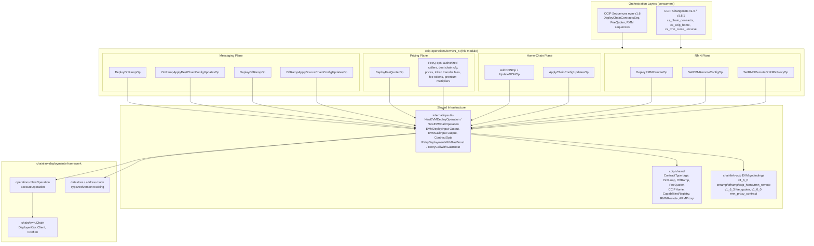
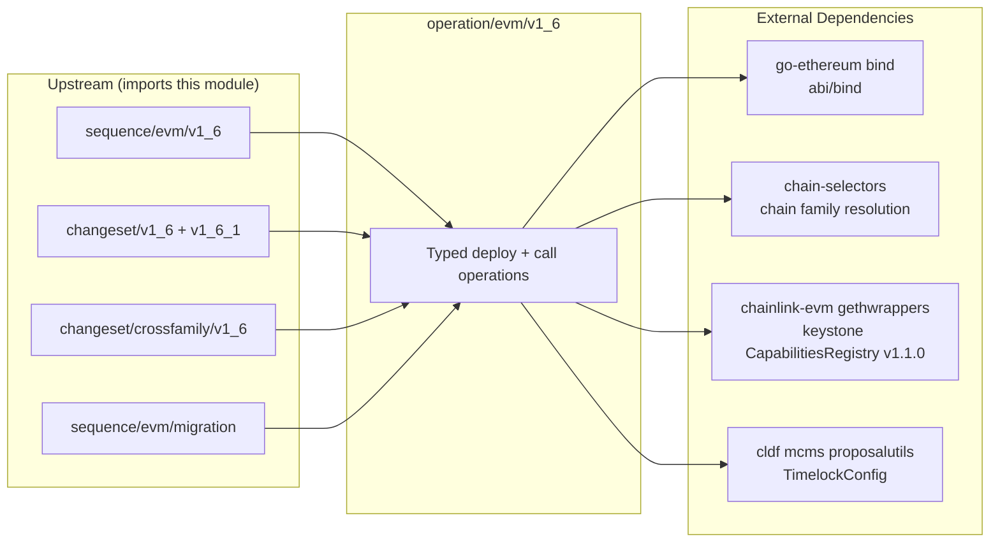
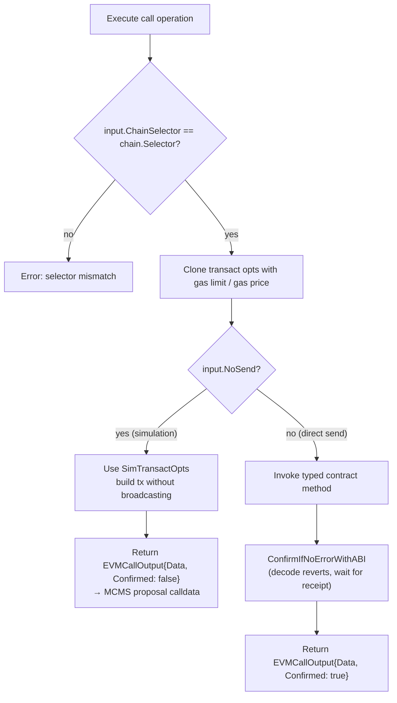
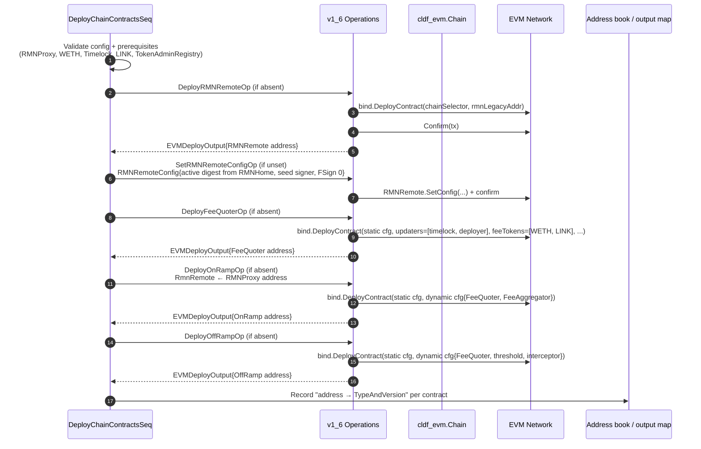
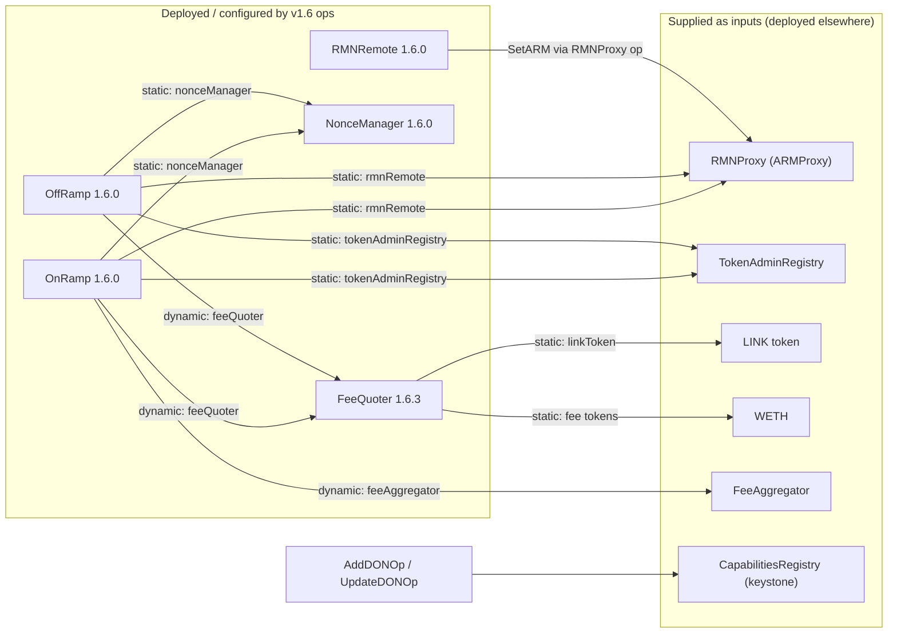

# CCIP Operations — EVM v1.6 (`ccip-operations_evm_v1_6`)

## Introduction

`chainlink/deployment/ccip/operation/evm/v1_6` is the **atomic, contract-level execution layer** for deploying and configuring Chainlink CCIP v1.6 onchain contracts on EVM chains. Each exported symbol is a *deployment framework Operation* — a small, idempotent, independently executable unit (deploy a contract, or call one configuration method on it) built on the [chainlink-deployments-framework](../../Deployment_Framework_Core___Product_Deployments.md) `operations` package.

The module is consumed almost exclusively by **[CCIP Sequences](../ccip-sequences.md)** (which orchestrate operations into multi-contract, multi-chain workflows) and **[CCIP Changesets](../ccip-changesets.md)** (which wrap sequences/operations into state-transformation functions executed against an environment, typically under MCMS governance). It depends on shared infrastructure in [CCIP Shared](../ccip-shared.md) and generic EVM operation builders in `internal/opsutils`.

This module is the v1.6 counterpart of [CCIP Operations — EVM v1.2](ccip-operations_evm_v1_2.md) and [CCIP Operations — EVM v1.5](ccip-operations_evm_v1_5.md). It targets the `v1_6_0` / `v1_6_3` generated Go bindings from the `chainlink-ccip` contract repository.

---

## Module Structure

```
chainlink/deployment/ccip/operation/evm/v1_6/
├── ops_onramp.go      # OnRamp deploy + dest-chain config updates
├── ops_offramp.go     # OffRamp deploy + source-chain config updates
├── ops_fee_quoter.go  # FeeQuoter deploy + price/fee/allowlist configuration
├── ops_ccip_home.go   # DON registration + home-chain config updates
└── ops_rmnremote.go   # RMNRemote deploy, config, and RMNProxy wiring
```

Each file pairs:

- **Deployment operations** (`NewEVMDeployOperation`) that deploy a contract with constructor arguments derived from a typed input struct, and
- **Call operations** (`NewEVMCallOperation`) that invoke specific configuration methods on a deployed contract.

---

## Architecture

The module sits between the orchestration layers (sequences/changesets) and the onchain contracts. All operations are generic instances of the two operation factories in `internal/opsutils`, which in turn delegate to the deployment framework's `operations.NewOperation` and go-ethereum's `bind` package.



### Dependency graph



Key module-level dependencies (see `chainlink/deployment/go.mod`):

| Dependency | Role |
|---|---|
| `smartcontractkit/chainlink-deployments-framework` (v0.123.3) | `operations.Operation`, `cldf_evm.Chain`, datastore, MCMS proposal utils |
| `smartcontractkit/chainlink-ccip/chains/evm` | Generated ABI/bytecode/bindings (`v1_6_0`, `v1_6_3`) |
| `smartcontractkit/chain-selectors` | Maps destination chain selectors to chain families (EVM/Solana/Aptos/TON/Sui) |
| `smartcontractkit/chainlink-evm/gethwrappers` | Keystone `CapabilitiesRegistry` bindings used by the CCIPHome DON operations |
| `go-ethereum` | `bind.DeployContract`, `bind.TransactOpts`, transaction types |

---

## Operation Catalog

Every operation is registered with a name, an operation version (`1.0.0`), a description, and a typed input/output. Operation versions describe the *operation implementation*, not the contract version — contract versioning is handled via `opsutils.ContractOpts` and the generated binding packages.

### OnRamp (`ops_onramp.go`)

| Operation | Kind | Target method / binding | Input type |
|---|---|---|---|
| `DeployOnRampOp` | Deploy | `onramp.OnRamp` @ `deployment.Version1_6_0` | `DeployOnRampInput` |
| `OnRampApplyDestChainConfigUpdatesOp` | Call | `OnRamp.ApplyDestChainConfigUpdates` | `[]onramp.OnRampDestChainConfigArgs` |

`DeployOnRampInput` supplies the constructor arguments: chain selector plus addresses for `TokenAdminRegistry`, `NonceManager`, `RmnRemote`, `FeeQuoter`, and `FeeAggregator`. Deployment initializes the static config (selector, RMN remote, nonce manager, token admin registry), the dynamic config (fee quoter, fee aggregator), and an empty destination-chain config list (populated later via `OnRampApplyDestChainConfigUpdatesOp`).

### OffRamp (`ops_offramp.go`)

| Operation | Kind | Target method / binding | Input type |
|---|---|---|---|
| `DeployOffRampOp` | Deploy | `offramp.OffRamp` @ `deployment.Version1_6_0` | `DeployOffRampInput` |
| `OffRampApplySourceChainConfigUpdatesOp` | Call | `OffRamp.ApplySourceChainConfigUpdates` | `[]offramp.OffRampSourceChainConfigArgs` |

`DeployOffRampInput` combines the chain selector, `OffRampParams`, and prerequisite addresses (`FeeQuoter`, `RmnRemote`, `NonceManager`, `TokenAdminRegistry`). `OffRampParams` carries:

- `GasForCallExactCheck` (uint16) — must be non-zero unless `Validate(true)` is used;
- `PermissionLessExecutionThresholdSeconds` (uint32) — must be non-zero;
- `MessageInterceptor` — optional interceptor contract.

`DefaultOffRampParams()` returns `GasForCallExactCheck = 5000` and `PermissionLessExecutionThresholdSeconds` derived from `globals.PermissionLessExecutionThreshold` (**1 hour**, defined in `chainlink/deployment/ccip/changeset/globals/config.go`). Deployment initializes static config, dynamic config, and an empty source-chain config list.

### FeeQuoter (`ops_fee_quoter.go`)

The FeeQuoter has the richest surface — one deploy operation plus six configuration operations:

| Operation | Kind | Target method | Purpose |
|---|---|---|---|
| `DeployFeeQuoterOp` | Deploy | `fee_quoter.FeeQuoter` @ `Version1_6_3` (default, overridable via `ContractOpts`) | Deploy with static config, price updaters, fee tokens, price feeds, transfer fee configs, premium multipliers |
| `FeeQApplyAuthorizedCallerOp` | Call | `ApplyAuthorizedCallerUpdates` | Manage authorized price-updater callers |
| `FeeQuoterApplyDestChainConfigUpdatesOp` | Call | `ApplyDestChainConfigUpdates` | Per-destination-chain limits and fees |
| `FeeQuoterUpdatePricesOp` | Call | `UpdatePrices` | Gas price and token price updates (`InternalPriceUpdates`) |
| `FeeQuoterApplyTokenTransferFeeCfgOp` | Call | `ApplyTokenTransferFeeConfigUpdates` | Add/update/remove token transfer fee configs (`ApplyTokenTransferFeeConfigUpdatesConfigPerChain`) |
| `FeeQuoterApplyFeeTokensUpdatesOp` | Call | `ApplyFeeTokensUpdates` | Add/remove supported fee tokens (`ApplyFeeTokensUpdatesInput`) |
| `FeeQApplyPremiumMultiplierWeiPerEthUpdateOp` | Call | `ApplyPremiumMultiplierWeiPerEthUpdates` | Token premium multipliers |

Input types:

- **`DeployFeeQInput`** — chain selector, `FeeQuoterParams`, `LinkAddr`, `WethAddr`, and `PriceUpdaters`. The constructor seeds the fee-token list with `[WETH, LINK]` and premium multipliers for both.
- **`FeeQuoterParams`** — validated via `Validate()`: `MaxFeeJuelsPerMsg` must be non-nil and positive; `TokenPriceStalenessThreshold` must be non-zero. `DefaultFeeQuoterParams()` provides: `MaxFeeJuelsPerMsg = 200e18` Juels (200 LINK), staleness threshold = 24 h, LINK premium multiplier = `9e17` (0.9 ETH), WETH premium multiplier = `1e18` (1.0 ETH).
- **`ApplyTokenTransferFeeConfigUpdatesConfigPerChain`** — bundles `TokenTransferFeeConfigs` (upserts) and `TokenTransferFeeConfigsRemove`; it is the input type surfaced by the [FeeQuoter token-transfer configuration sequence](../ccip-sequences.md).

**Default destination-chain configuration.** `DefaultFeeQuoterDestChainConfig(configEnabled, destChainSelector...)` produces a fully populated `FeeQuoterDestChainConfig`. When a destination selector is provided, the chain family is resolved with `chain-selectors` and family-specific values are applied:

| Chain family | `ChainFamilySelector` | `NetworkFeeUSDCents` | `DefaultTokenFeeUSDCents` |
|---|---|---|---|
| EVM (non-Ethereum) | `0x2812d52c` | 10 | 25 |
| EVM (Ethereum mainnet / Sepolia / Hoodi) | `0x2812d52c` | 50 | 150 |
| Solana (SVM) | `0x1e10bdc4` | 10 | 35 |
| Aptos | `0xac77ffec` | 10 | 25 |
| TON | `0x647e2ba9` | 10 | 25 |
| Sui | `0xc4e05953` | 10 | 25 |

Common defaults for all families: `MaxNumberOfTokensPerMsg = 10`, `MaxDataBytes = 30,000`, `MaxPerMsgGasLimit = 3,000,000`, `DestGasOverhead` and payload-byte gas parameters from `core/capabilities/ccip/ccipevm`, `DestDataAvailabilityOverheadGas = 100`, `DestGasPerDataAvailabilityByte = 16`, `DefaultTokenDestGasOverhead = 90,000`, `DefaultTxGasLimit = 200,000`, `GasMultiplierWeiPerEth = 11e17` (1.1), `GasPriceStalenessThreshold = 90,000`.

### CCIPHome / CapabilitiesRegistry (`ops_ccip_home.go`)

| Operation | Kind | Contract | Input type |
|---|---|---|---|
| `AddDONOp` | Call | `shared.CapabilitiesRegistry` (CCIPHome ABI, keystone `capabilities_registry_1_1_0` bindings) — `AddDON` | `AddDONOpInput` |
| `UpdateDONOp` | Call | `shared.CapabilitiesRegistry` — `UpdateDON` | `UpdateDONOpInput` |
| `ApplyChainConfigUpdatesOp` | Call | `shared.CCIPHome` — `ApplyChainConfigUpdates` | `ApplyChainConfigUpdatesOpInput` |

- `AddDONOpInput` / `UpdateDONOpInput` carry node identities (`[][32]byte`), `CapabilitiesRegistryCapabilityConfiguration` entries, visibility flags (`IsPublic`, `AcceptsWorkflows` for adds only), and the fault tolerance `F`.
- `ApplyChainConfigUpdatesOpInput` carries `RemoteChainRemoves []uint64` and `RemoteChainAdds []CCIPHomeChainConfigArgs` — the chain-registration surface used by the [CCIPHome changeset](../ccip-changesets.md).

### RMNRemote / RMNProxy (`ops_rmnremote.go`)

| Operation | Kind | Contract | Input type |
|---|---|---|---|
| `DeployRMNRemoteOp` | Deploy | `shared.RMNRemote` @ `Version1_6_0` — constructor `(chainSelector, rmnLegacyAddr)` | `DeployRMNRemoteInput` |
| `SetRMNRemoteConfigOp` | Call | `RMNRemote.SetConfig` | `rmn_remote.RMNRemoteConfig` |
| `SetRMNRemoteOnRMNProxyOp` | Call | `shared.ARMProxy` — `RMNProxy.SetARM` | `common.Address` |

Supporting types:

- **`RMNRemoteConfig`** — `Signers []RMNRemoteSigner` and fault tolerance `F`. Serialised as JSON (`chainSelector`, `rmnRemoteConfigs`).
- **`SetRMNRemoteConfig`** — the changeset/sequence-level configuration struct: a chain selector, an `RMNRemoteConfig`, and an optional MCMS `TimelockConfig` (`cldfproposalutils.TimelockConfig`) indicating whether the call should be proposed through an MCMS timelock rather than sent directly.
- The config operation is designed to copy the **active digest from RMNHome** on the home chain (see `SetRMNRemoteConfigOp` description: *"Setting RMNRemoteConfig based on ActiveDigest from RMNHome"*); the deploy chain sequence seeds a minimal config (`FSign: 0`, placeholder signer) when the chain has no prior configuration.

---

## Generic Operation Infrastructure

All operations in this module are instances created by `chainlink/deployment/ccip/internal/opsutils`. Understanding these two factories explains the behaviour of every operation above.

### Deployment operations

`NewEVMDeployOperation[IN]` returns `*operations.Operation[EVMDeployInput[IN], EVMDeployOutput, cldf_evm.Chain]` and, on execution:

1. Validates that `input.ChainSelector` matches the chain dependency's selector (fails fast on mismatch).
2. Resolves effective `ContractOpts` — the per-execution override (`input.ContractOpts`) wins over the module default (`defaultContractOpts`); `ContractOpts{Version, EVMBytecode}` defines both the onchain `TypeAndVersion` tag and the deployed bytecode.
3. Parses the ABI from the binding metadata and deploys via `bind.DeployContract` with gas-cloned transact options (`CloneTransactOptsWithGas`), constructor args from `makeArgs(input.DeployInput)`.
4. Waits for confirmation via `chain.Confirm(tx)`.
5. Returns `EVMDeployOutput{Address, TypeAndVersion, Qualifier}` — the `TypeAndVersion` string (e.g. `"OnRamp 1.6.0"`) is what consumers record in the address book / datastore, keyed by `cldf.NewTypeAndVersion(shared.OnRamp, deployment.Version1_6_0)`.

`EVMDeployInput[IN]` additionally supports custom `GasPrice`/`GasLimit` and an optional `Qualifier` for multiple deployments of the same contract type on one chain.

### Call operations

`NewEVMCallOperation[IN, C]` returns `*operations.Operation[EVMCallInput[IN], EVMCallOutput, cldf_evm.Chain]` and, on execution:

1. Validates the chain selector, clones transact opts with gas settings.
2. If `input.NoSend` is set, substitutes simulation-only transact opts (`cldf.SimTransactOpts`): the call is *prepared but not sent*.
3. Builds the typed contract binding with `constructor(address, chain.Client)` and invokes the `call` function with the typed input.
4. If sent, confirms with `cldf.ConfirmIfNoErrorWithABI` (which decodes contract-level reverts using the operation's ABI string).
5. Returns `EVMCallOutput{To, Data, ContractType, Confirmed}` — the raw calldata `Data` is what MCMS proposal builders embed into timelock/multisig transactions.

The `NoSend` path is the bridge to MCMS-governed deployments: sequences execute call operations with `NoSend: true` to produce calldata for proposals, or with `NoSend: false` for direct (non-governed) execution.



### Retry and gas boosting

Operations are executed with framework `ExecuteOption`s. `opsutils` provides:

- **`RetryDeploymentWithGasBoost[IN](cfg)`** — retries failed deployments, raising `GasLimit`/`GasPrice` per attempt via `GetBoostedGasForAttempt(cfg, attempt)`. With a nil config it disables retries.
- **`RetryCallWithGasBoost[IN](cfg)`** — same for calls, but skips boosting when `NoSend` is set (nothing is broadcast), falling back to the framework's default retry behaviour.
- **`GasBoostConfigsForChainMap`** — resolves per-chain `GasBoostConfig` from a map keyed by chain selector (used by `DeployChainContractsSeq`).

---

## Deployment Flow

The canonical consumer is `DeployChainContractsSeq` ([CCIP Sequences](../ccip-sequences.md)), which deploys all v1.6 chain contracts concurrently per chain. The diagram below traces one chain through the operations of this module (operations from v1.2 — the TestRouter — and the NonceManager deploy op are invoked alongside).



Important wiring details visible in the sequence:

- The OnRamp/OffRamp `RmnRemote` static-config field is wired to the **RMNProxy** address (not `RMNRemote` directly) — RMNProxy forwards attestation checks to the deployed RMNRemote via `SetRMNRemoteOnRMNProxyOp`.
- The FeeQuoter's initial `PriceUpdaters` include both the MCMS **timelock** and the deployer EOA, so the deployer can set prices immediately and the privileged account can take over later.
- If no `FeeAggregator` address is provided, the deployer key is used so the OnRamp fee aggregator is never the zero address (avoids fund loss on `WithdrawFeeToken`).
- Deployment order per chain: **RMNRemote → (config) → TestRouter → NonceManager → FeeQuoter → OnRamp → OffRamp**; each step is skipped when the address is already provided in `CCIPAddresses`.

### Contract wiring created by this module



---

## Integration Points

| Layer | Component | Relationship |
|---|---|---|
| [Sequences](../ccip-sequences.md) | `DeployChainContractsSeq` | Executes `DeployRMNRemoteOp`, `SetRMNRemoteConfigOp`, `DeployFeeQuoterOp`, `DeployOnRampOp`, `DeployOffRampOp` with retry/gas-boost options; consumes `DeployFeeQInput`, `FeeQuoterParams`, `OffRampParams` via `ChainContractParams` |
| [Sequences](../ccip-sequences.md) | `seq_fee_quoter.go` | `FeeQuoterUpdateTokenTransferConfig` is a `map[chainSelector]opsutils.EVMCallInput[ApplyTokenTransferFeeConfigUpdatesConfigPerChain]` — executed per chain by `FeeQuoterApplyTokenTransferFeeCfgOp` |
| [Sequences](../ccip-sequences.md) | `seq_rmn.go` | `SetRMNRemoteConfig` maps chain selectors to `RMNRemoteConfig` (+ MCMS timelock config) executed by `SetRMNRemoteConfigOp` |
| [Changesets](../ccip-changesets.md) | `cs_chain_contracts.go`, `cs_ccip_home.go`, `cs_rmn_curse_uncurse.go` | Build `EVMCallInput`s from changeset-level update structs (e.g. `OnRampDynamicConfigUpdate`) and invoke call ops, often with `NoSend` to assemble MCMS proposals |
| [State / views](../ccip-shared.md) | `shared/stateview` | Resolves deployed contracts from the datastore using `TypeAndVersion` keys produced by deploy ops (e.g. `OnRamp 1.6.0`) |
| [Migration sequences](../ccip-sequences.md) | `sequence/evm/migration` | v1.5→v1.6 fee-quoter migration reuses the FeeQuoter ops/types to translate and apply destination-chain configuration |

For how operations, sequences, and changesets compose in the underlying framework, see the [Deployment Framework Core documentation](../../Deployment_Framework_Core___Product_Deployments.md). For the offchain CCIP contracts that consume the deployed OnRamp/OffRamp/FeeQuoter interfaces, see [CCIP Cross-Chain Protocol](../../CCIP_Cross-Chain_Protocol.md).

---

## Related Documentation

- [CCIP Operations (parent)](../ccip-operations.md) — operation pattern shared across versions
- [CCIP Operations — EVM v1.2](ccip-operations_evm_v1_2.md) / [v1.5](ccip-operations_evm_v1_5.md) — sibling operation sets (legacy routers, migration sources)
- [CCIP Sequences](../ccip-sequences.md) — orchestration of this module's operations
- [CCIP Changesets](../ccip-changesets.md) — state-transformation wrappers and MCMS flows
- [CCIP Shared](../ccip-shared.md) — contract type tags, bindings, deployer groups, token pools
- [Deployment Framework Core](../../Deployment_Framework_Core___Product_Deployments.md) — operations framework foundation
- [CCIP Cross-Chain Protocol](../../CCIP_Cross-Chain_Protocol.md) — onchain/offchain protocol contracts and plugins
