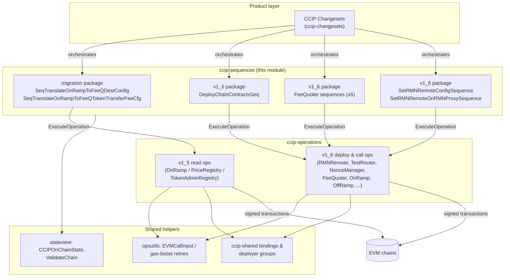
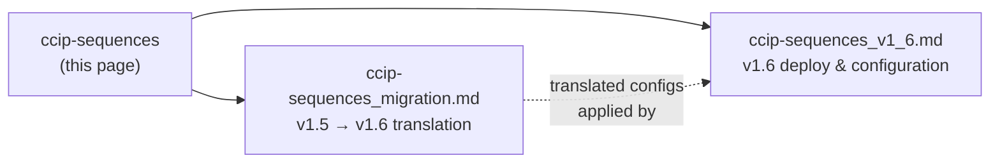
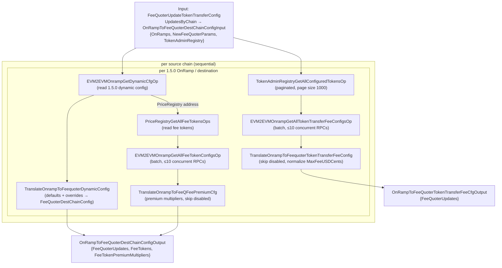
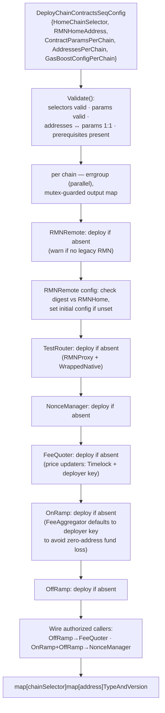
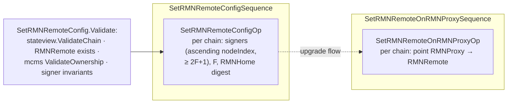

# CCIP Sequences (`ccip-sequences`)

> **Location:** `chainlink/deployment/ccip/sequence/evm/` — Go packages `migration` and `v1_6`, part of the `chainlink/deployment` Go module (`chainlink/deployment/go.mod`) and the [CCIP Deployment Suite](../CCIP_Deployment_Suite.md).

## 1. Overview

`ccip-sequences` is the **sequence layer** of the CCIP deployment framework. A *sequence* is a named, versioned, composable orchestration unit (built on `chainlink-deployments-framework/operations`) that sits between **changesets** (product-level entry points, documented in [ccip-changesets](ccip-changesets.md)) and **operations** (single atomic contract actions, documented in [ccip-operations](ccip-operations.md)). A sequence:

1. Receives a **typed input** describing work for one or many EVM chains (keyed by CCIP **chain selector**),
2. Fans out per-chain work — often concurrently — composing one or more **operations** per chain,
3. Fans the results back into a **typed output** that callers (typically changesets) feed into the next step, an MCMS proposal, or an on-chain state view.

This module provides two families of sequences:

| Family | Package | Purpose |
|---|---|---|
| **Config migration** | `sequence/evm/migration` | Reads existing CCIP **v1.5.0** `EVM2EVMOnRamp` configuration on-chain and translates it into **v1.6 `FeeQuoter`** configuration (destination-chain configs, fee tokens, premium multipliers, token-transfer fee configs). |
| **Deployment & configuration (v1.6)** | `sequence/evm/v1_6` | Deploys the full CCIP v1.6 per-chain contract set idempotently, applies all FeeQuoter configuration categories across many chains, and wires RMN (`RMNRemote` / `RMNProxy`) configuration. |

Both families share the same conventions: validation-first config structs, idempotent re-runs, per-chain parallelism, and gas-boosted retries.

## 2. Where this module fits in the system

**Upstream consumers.** The primary consumers are CCIP changesets, e.g. `InitChainUpgradesChangeset` in `chainlink/deployment/ccip/changeset/v1_6/cs_migration_from_v1_5.go` imports this module (`migrate_seq "…/sequence/evm/migration"`) to obtain `NewFeeQuoterDestChainConfigParams` and to drive the translation sequences as part of the v1.5 → v1.6 upgrade flow. The FeeQuoter update sequences back the configuration changesets in `ccip-changesets_evm_1_6` (see [ccip-changesets](ccip-changesets.md)).

**Downstream dependencies.** Every sequence delegates its on-chain work to the atomic operations of the [ccip-operations](ccip-operations.md) module (`migration_ops` = `operation/evm/v1_5`, `ccipops` = `operation/evm/v1_6`), executes them through the framework's `Bundle`, and uses shared state/validation from [ccip-shared](ccip-shared.md) (`stateview.CCIPOnChainState`, `stateview.ValidateChain`) and the internal `opsutils` package (`EVMCallInput`, gas-boost retry wrappers).

The on-chain contracts being deployed/configured are the CCIP protocol contracts themselves; their runtime semantics are documented in [CCIP Cross-Chain Protocol](../CCIP_Cross-Chain_Protocol.md).

## 3. Key concepts

| Concept | Description |
|---|---|
| **Sequence** | Created with `operations.NewSequence(name, semver, description, handler)`; handler signature: `func(operations.Bundle, map[uint64]cldf_evm.Chain, Input) (Output, error)`. Sequences are the multi-chain orchestration primitives of the [deployment framework](../Deployment_Framework_Core___Product_Deployments.md). |
| **Operation** | A single contract deploy or call (`operations.ExecuteOperation(b, op, chain, input)`); sequences never talk to chains directly — they always compose operations. |
| **Bundle** | Framework-provided execution context (`b.Logger`, `b.GetContext()`) threaded through all operations so logging, tracing and cancellation are consistent. |
| **Chain selector** | CCIP `uint64` identifier of an EVM chain; every input/output map is keyed by it (`map[uint64]…`). |
| **Idempotency** | `DeployChainContractsSeq` skips any contract whose address is already present in the per-chain `CCIPAddresses` input and re-checks RMNRemote config state on-chain before re-sending transactions. |
| **Gas boost & retry** | `opsutils.RetryDeploymentWithGasBoost` / `RetryCallWithGasBoost` wrap operations with per-attempt gas-limit/price escalation driven by `cldfproposalutils.GasBoostConfig` (per chain, resolved via `GasBoostConfigsForChainMap`). |
| **MCMS & `NoSend`** | FeeQuoter/RMN call inputs are `opsutils.EVMCallInput`, which supports `NoSend: true` — transaction calldata is prepared but not broadcast, allowing changesets to aggregate the calls into [MCMS timelock proposals](../Deployment_Framework_Core___Product_Deployments.md). `SetRMNRemoteConfig.MCMSConfig` triggers `mcmschangesets.ValidateOwnership` so a sequence refuses to run against contracts owned by the wrong party. |
| **Name-collision note** | `FeeQuoterUpdateTokenTransferConfig` exists in **both** packages with different shapes: in `migration` it wraps `OnRampToFeeQuoterDestChainConfigInput` (read-side translation input), while in `v1_6` it wraps `ccipops.ApplyTokenTransferFeeConfigUpdatesConfigPerChain` (write-side apply input). Go package qualification disambiguates them. |

## 4. Sequence catalog

| Sequence | Package | Purpose |
|---|---|---|
| `SeqTranslateOnRampToFeeQDestConfig` | `migration` | For each (source, destination) pair, reads the 1.5.0 OnRamp dynamic config, the source `PriceRegistry` fee tokens and per-token fee-token configs; emits `FeeQuoterDestChainConfig`, fee-token lists and premium multipliers. |
| `SeqTranslateOnRampToFeeQTokenTransferFeeCfg` | `migration` | For each (source, destination) pair, enumerates configured tokens from `TokenAdminRegistry`, reads 1.5.0 token-transfer fee configs, skips disabled ones, and emits `FeeQuoterTokenTransferFeeConfigArgs` (with `MaxFeeUSDCents = 0 → MaxUint32` normalization). |
| `DeployChainContractsSeq` | `v1_6` | Deploys the complete per-chain v1.6 contract set — `RMNRemote`, `TestRouter`, `NonceManager`, `FeeQuoter`, `OnRamp`, `OffRamp` — concurrently per chain, initializes RMNRemote config, and wires authorized callers (OffRamp→FeeQuoter; OnRamp+OffRamp→NonceManager). |
| `FeeQuoterApplyDestChainConfigUpdatesSequence` | `v1_6` | Applies destination-chain config updates to FeeQuoter on multiple chains. |
| `FeeQuoterUpdatePricesSequence` | `v1_6` | Updates token & gas prices (`InternalPriceUpdates`) on FeeQuoter across chains. |
| `FeeQUpdateTransferTokenFeeCfgSeq` | `v1_6` | Applies (or removes) token-transfer fee configs on FeeQuoter across chains. |
| `FeeQuoterApplyFeeTokensUpdatesSeq` | `v1_6` | Adds/removes supported fee tokens on FeeQuoter across chains. |
| `FeeQApplyPremiumMultiplierWeiPerEthUpdatesSeq` | `v1_6` | Applies `premiumMultiplierWeiPerEth` values on FeeQuoter across chains. |
| `SetRMNRemoteConfigSequence` | `v1_6` | Sets `RMNRemote` config (signers, `F`, digest) per chain from the active `RMNHome` digest. |
| `SetRMNRemoteOnRMNProxySequence` | `v1_6` | Points `RMNProxy` at the `RMNRemote` address across chains. |

Each sequence exposes a dedicated typed **input/output struct** (e.g. `OnRampToFeeQuoterDestChainConfigOutput`, `FeeQuoterApplyDestChainConfigUpdatesSequenceInput`, `SetRMNRemoteConfig`, `DeployChainContractsSeqConfig`, `CCIPAddresses`) — all detailed in the sub-module pages below.

## 5. Sub-module documentation

Detailed documentation for each sub-module is generated under `CCIP_Deployment_Suite/ccip-sequences/`:

| Sub-module | Document | Scope |
|---|---|---|
| **ccip-sequences_migration** | [ccip-sequences_migration.md](ccip-sequences/ccip-sequences_migration.md) | v1.5.0 → v1.6.0 configuration migration in `sequence/evm/migration/`: the `EVM2EVMOnRampMigrate*` translator adapters (`EVM2EVMOnRampMigrate`, `EVM2EVMOnRampMigrateDestChainConfig`, `EVM2EVMOnRampMigratePremiumMultiplierCfg`, `NewFeeQuoterDestChainConfigParams`) and the two translation sequences (`SeqTranslateOnRampToFeeQDestConfig`, `SeqTranslateOnRampToFeeQTokenTransferFeeCfg`) with their operation fan-out over `ccip-operations` v1.5 read ops (batch reads capped at 10 concurrent RPCs). |
| **ccip-sequences_v1_6** | [ccip-sequences_v1_6.md](ccip-sequences/ccip-sequences_v1_6.md) | v1.6 deployment & configuration in `sequence/evm/v1_6/`: the `ChainContractParams` / `DeployChainContractsSeqConfig` / `CCIPAddresses` validation chain, the idempotent concurrent `DeployChainContractsSeq`, the five FeeQuoter update sequences (dest-chain configs, prices, token-transfer fees, fee tokens, premium multipliers), and RMN configuration (`SetRMNRemoteConfigSequence`, `SetRMNRemoteOnRMNProxySequence`, `SetRMNRemoteConfig` validation). |

## 6. Data flows

### 6.1 Migration translation (v1.5 → v1.6)

The resulting outputs are handed back to the migration changesets, which wrap them in FeeQuoter-apply proposals (via `FeeQUpdateTransferTokenFeeCfgSeq`, `FeeQApplyPremiumMultiplierWeiPerEthUpdatesSeq`, `FeeQuoterApplyFeeTokensUpdatesSeq`) and aggregate them into MCMS timelock proposals.

### 6.2 Chain deployment (`DeployChainContractsSeq`)

Every step is individually idempotent: an already-present address in `CCIPAddresses` short-circuits the corresponding deploy, and RMNRemote config is only sent when the on-chain versioned config digest does not match `RMNHome.GetActiveDigest()`.

### 6.3 RMN configuration

## 7. Related documentation

- [CCIP Deployment Suite](../CCIP_Deployment_Suite.md) — parent module group (changesets, operations, shared utilities).
- [ccip-changesets](ccip-changesets.md) — the changesets that orchestrate these sequences and aggregate MCMS proposals.
- [ccip-operations](ccip-operations.md) — the atomic v1.2/v1.5/v1.6 operations invoked by every sequence in this module.
- [ccip-shared](ccip-shared.md) — on-chain state views (`stateview`), contract bindings, deployer groups and token metadata used for validation here.
- [Deployment Framework Core](../Deployment_Framework_Core___Product_Deployments.md) — the `chainlink-deployments-framework` operations/changeset primitives (`Sequence`, `Operation`, `Bundle`, `Environment`) this module is built on.
- [CCIP Cross-Chain Protocol](../CCIP_Cross-Chain_Protocol.md) — runtime semantics of the OnRamp/OffRamp/FeeQuoter/RMN contracts these sequences deploy and configure.
