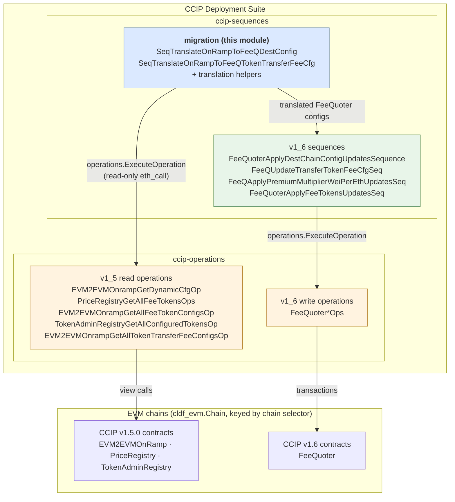
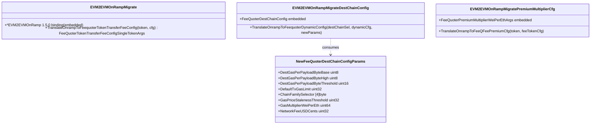
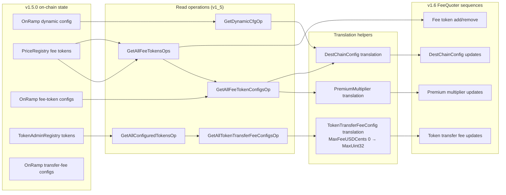

# CCIP Sequences — Migration (v1.5.0 OnRamp → v1.6 FeeQuoter)

> **Module path:** `chainlink/deployment/ccip/sequence/evm/migration`
> **Suite:** [CCIP Deployment Suite](../../CCIP_Deployment_Suite.md) → [ccip-sequences](../ccip-sequences.md)
> **Languages:** Go (EVM-only)

## Introduction

The `migration` package implements the **configuration translation layer** for the CCIP v1.5.0 → v1.6 contract migration on EVM chains. In CCIP v1.6, fee configuration previously spread across the `EVM2EVMOnRamp` (destination chain configs, fee token configs, token transfer fee configs) and the `PriceRegistry` was consolidated into a single **`FeeQuoter`** contract. This package reads the legacy v1.5.0 on-chain state and **translates** it into the v1.6 `FeeQuoter` data structures, without mutating any state.

It consists of two concerns:

1. **Translation helpers** (`evm2evm_onramp_feequoter.go`) — thin adapter types that embed v1.5.0/v1.6.3 contract binding structs and expose `TranslateOnrampToFeequoter*` methods implementing the field-by-field migration mapping.
2. **Migration sequences** (`seq_translate_onramp_fq.go`) — two `operations.Sequence` units that orchestrate read-only v1.5 operations per source chain / destination OnRamp pair, apply the translation helpers, and emit FeeQuoter-shaped outputs ready to be applied by the v1.6 [FeeQuoter sequences](ccip-sequences_v1_6.md).

The sequences follow the Chainlink Deployments Framework model (Changeset → Sequence → Operation). For a framework overview see [Deployment Framework Core & Product Deployments](../../Deployment_Framework_Core___Product_Deployments/deployment-common.md); for the operations consumed here see [ccip-operations — EVM v1.5](../ccip-operations/ccip-operations_evm_v1_5.md).

## Architecture



Key architectural properties:

- **Read-only by design.** The migration sequences only execute view/static calls against v1.5.0 contracts. They produce *data* (translated configs); the actual FeeQuoter writes are performed by the v1.6 sequences (see [ccip-sequences v1.6](ccip-sequences_v1_6.md)).
- **Composability.** Both sequences are `operations.NewSequence` units named and semver-tagged (`1.0.0`), receiving an `operations.Bundle` (logger + context) and a `map[uint64]cldf_evm.Chain` keyed by chain selector.
- **Operations reuse.** All contract I/O is delegated to the shared v1.5 read operations from [`ccip-operations`](../ccip-operations.md); this module contains no direct contract bindings calls.

## Core Components

### 1. Translation helpers — `evm2evm_onramp_feequoter.go`

These types bridge the generated contract bindings of the two protocol versions (`onramp1_5` from `chainlink-ccip/chains/evm/gobindings/generated/v1_5_0` and `fee_quoter` from `.../v1_6_3`):

| Component | Embeds | Purpose |
|---|---|---|
| `EVM2EVMOnRampMigrate` | `*onramp1_5.EVM2EVMOnRamp` | Translates one token's `EVM2EVMOnRampTokenTransferFeeConfig` into `fee_quoter.FeeQuoterTokenTransferFeeConfigSingleTokenArgs`. |
| `EVM2EVMOnRampMigrateDestChainConfig` | `fee_quoter.FeeQuoterDestChainConfig` | Translates a 1.5.0 `EVM2EVMOnRampDynamicConfig` into a populated 1.6 `FeeQuoterDestChainConfig`. |
| `EVM2EVMOnRampMigratePremiumMultiplierCfg` | `fee_quoter.FeeQuoterPremiumMultiplierWeiPerEthArgs` | Copies a fee token's `PremiumMultiplierWeiPerEth` into the FeeQuoter premium-multiplier args. |
| `NewFeeQuoterDestChainConfigParams` | — | Input struct carrying the FeeQuoter destination-chain parameters that have **no v1.5.0 equivalent** and must be supplied explicitly by the operator. |



**Migration rules encoded in the helpers:**

| FeeQuoter field(s) | Source | Rule |
|---|---|---|
| `MaxNumberOfTokensPerMsg`, `DestGasOverhead`, `DestDataAvailabilityOverheadGas`, `DestGasPerDataAvailabilityByte`, `DestDataAvailabilityMultiplierBps`, `MaxDataBytes`, `MaxPerMsgGasLimit`, `EnforceOutOfOrder`, `DefaultTokenFeeUSDCents`, `DefaultTokenDestGasOverhead` | 1.5.0 `EVM2EVMOnRampDynamicConfig` | Copied 1:1. |
| `IsEnabled` | — | Always set to `true`. |
| `DestGasPerPayloadByteBase/High`, `DestGasPerPayloadByteThreshold`, `DefaultTxGasLimit`, `ChainFamilySelector`, `GasPriceStalenessThreshold`, `GasMultiplierWeiPerEth`, `NetworkFeeUSDCents` | `NewFeeQuoterDestChainConfigParams` | New in v1.6; must be provided per destination chain (defaults start from base values, then are overridden from the 1.5 config where applicable). |
| `MinFeeUSDCents`, `DeciBps`, `DestGasOverhead`, `DestBytesOverhead`, `IsEnabled` | 1.5.0 `EVM2EVMOnRampTokenTransferFeeConfig` | Copied 1:1. |
| `MaxFeeUSDCents` | 1.5.0 `EVM2EVMOnRampTokenTransferFeeConfig` | Copied; **if `0` it is substituted with `math.MaxUint32`** (i.e., "no max fee"), since v1.6 interprets zero differently. |
| `Token`, `PremiumMultiplierWeiPerEth` | 1.5.0 `EVM2EVMOnRampFeeTokenConfig` | Copied into the premium-multiplier args. |

### 2. Migration sequences — `seq_translate_onramp_fq.go`

#### `SeqTranslateOnRampToFeeQDestConfig`

- **Name:** `translate-on-ramp-to-feequoter-dest-config` (v1.0.0)
- **Input:** `FeeQuoterUpdateTokenTransferConfig` *(note: this is the **migration package's** input type, distinct from the identically named v1.6 type in [`seq_fee_quoter.go`](ccip-sequences_v1_6.md))*. It maps each source chain selector to an `opsutil.EVMCallInput[OnRampToFeeQuoterDestChainConfigInput]` carrying:
  - `OnRamps` — map of destination chain selector → 1.5.0 OnRamp address,
  - `NewFeeQuoterParams` — per-destination-chain `NewFeeQuoterDestChainConfigParams`,
  - `TokenAdminRegistry` — address used by the token-transfer-fee sequence.
- **Output:** `OnRampToFeeQuoterDestChainConfigOutput`:
  - `FeeQuoterUpdates` — `sourceChain → destChain → fee_quoter.FeeQuoterDestChainConfig`,
  - `FeeTokens` — fee tokens discovered per source chain,
  - `FeeTokenPremiumMultipliers` — translated premium multipliers per source chain.

Per destination OnRamp it executes:

1. `EVM2EVMOnrampGetDynamicCfgOp` — fetches the 1.5.0 dynamic config (also yields the `PriceRegistry` address).
2. `PriceRegistryGetAllFeeTokensOps` — lists fee tokens from that v1.5 PriceRegistry.
3. `EVM2EVMOnrampGetAllFeeTokenConfigsOp` — batch-fetches fee token configs (concurrency capped at 10 via `errgroup` in the ops layer).
4. Disabled fee tokens are skipped; enabled ones are translated into premium-multiplier args. The first enabled token's config is captured as the representative fee-token report — a deliberate simplification documented in the code: *fee-token config is per (dest, token) in 1.5.0 but per destination chain in FeeQuoter, and RDD values are redundant and can be adjusted by the premium multiplier*.

#### `SeqTranslateOnRampToFeeQTokenTransferFeeCfg`

- **Name:** `translate-on-ramp-to-feeQuoter-token-transfer-fee-configs` (v1.0.0)
- **Input:** the same `FeeQuoterUpdateTokenTransferConfig` migration input type.
- **Output:** `OnRampToFeeQuoterTokenTransferFeeCfgOutput`:
  - `FeeQuoterUpdates` — `sourceChain → []fee_quoter.FeeQuoterTokenTransferFeeConfigArgs` (one entry per destination chain, each holding the per-token args).

Per destination OnRamp it executes:

1. `TokenAdminRegistryGetAllConfiguredTokensOp` — discovers all configured tokens (paginated, page size 1000).
2. `EVM2EVMOnrampGetAllTokenTransferFeeConfigsOp` — batch-fetches each token's transfer fee config from the 1.5.0 OnRamp.
3. Tokens with `IsEnabled == false` are skipped; the rest are translated via `EVM2EVMOnRampMigrate.TranslateOnrampToFeequoterTokenTransferFeeConfig`.

## Process Flow

### Destination-chain config translation

```mermaid
sequenceDiagram
    autonumber
    participant C as Changeset / orchestrator
    participant S as SeqTranslateOnRampToFeeQDestConfig
    participant O as v1_5 read operations
    participant R as 1.5.0 OnRamp / PriceRegistry

    C->>S: Bundle, chains, FeeQuoterUpdateTokenTransferConfig
    loop per source chain → per dest OnRamp
        S->>O: ExecuteOperation(EVM2EVMOnrampGetDynamicCfgOp)
        O->>R: GetDynamicConfig()
        R-->>O: EVM2EVMOnRampDynamicConfig (+ PriceRegistry address)
        O-->>S: report
        Note over S: EVM2EVMOnRampMigrateDestChainConfig.<br/>TranslateOnrampToFeequoterDynamicConfig()
        S->>O: ExecuteOperation(PriceRegistryGetAllFeeTokensOps)
        O->>R: GetFeeTokens()
        R-->>S: []fee tokens
        S->>O: ExecuteOperation(EVM2EVMOnrampGetAllFeeTokenConfigsOp)
        O->>R: GetFeeTokenConfig(token) ×N — batched, concurrency ≤ 10
        R-->>S: map[token]FeeTokenConfig
        Note over S: skip disabled tokens;<br/>translate premium multipliers
    end
    S-->>C: OnRampToFeeQuoterDestChainConfigOutput
```

### Token-transfer fee config translation

```mermaid
sequenceDiagram
    autonumber
    participant C as Changeset / orchestrator
    participant S as SeqTranslateOnRampToFeeQTokenTransferFeeCfg
    participant O as v1_5 read operations
    participant R as 1.5.0 OnRamp / TokenAdminRegistry

    C->>S: Bundle, chains, FeeQuoterUpdateTokenTransferConfig
    loop per source chain → per dest OnRamp
        S->>O: ExecuteOperation(TokenAdminRegistryGetAllConfiguredTokensOp)
        O->>R: GetAllConfiguredTokens(offset, 1000) — paginated until empty
        R-->>S: []configured tokens
        S->>O: ExecuteOperation(EVM2EVMOnrampGetAllTokenTransferFeeConfigsOp)
        O->>R: GetTokenTransferFeeConfig(token) ×N — batched, concurrency ≤ 10
        R-->>S: map[token]TokenTransferFeeConfig
        Note over S: keep enabled tokens only;<br/>EVM2EVMOnRampMigrate.<br/>TranslateOnrampToFeequoterTokenTransferFeeConfig()
    end
    S-->>C: OnRampToFeeQuoterTokenTransferFeeCfgOutput
```

### End-to-end migration data flow



## Interactions with Other Modules

| Dependency | Role | Reference |
|---|---|---|
| `ccip-operations` (EVM v1.5) | Supplies all read operations (`MigrateOnRampToFQDeps{Chain}`, `BatchOnRampGetTokenCfgIn`, `PriceRegistryGetAllFeeTokensIn`, `TokenAdminRegistryGetAllConfiguredTokensIn`) with batching and RPC concurrency control. | [ccip-operations — EVM v1.5](../ccip-operations/ccip-operations_evm_v1_5.md) |
| `ccip-sequences` (v1.6) | Natural consumer of the translated outputs: `FeeQuoterApplyDestChainConfigUpdatesSequence`, `FeeQUpdateTransferTokenFeeCfgSeq`, `FeeQApplyPremiumMultiplierWeiPerEthUpdatesSeq`, `FeeQuoterApplyFeeTokensUpdatesSeq` apply them on-chain via v1.6 FeeQuoter ops. | [ccip-sequences v1.6](ccip-sequences_v1_6.md) |
| `ccip-changesets` (EVM v1.6) | The v1.6 migration changeset (`cs_migration_from_v1_5.go`, `DONConfig`) sits above sequences and composes them into multi-chain migration proposals. | [ccip-changesets — EVM v1.6](../ccip-changesets/ccip-changesets_evm_1_6.md) |
| Deployments Framework | Provides `operations.Sequence`/`Operation`, `operations.Bundle` (logger, context), `cldf_evm.Chain` (EVM client, selector, name) and the `opsutil.EVMCallInput`/`EVMCallOutput` report envelope. | [Deployment Framework Core](../../Deployment_Framework_Core___Product_Deployments/deployment-common.md) |
| CCIP protocol types | The generated `fee_quoter.FeeQuoterDestChainConfig` used here mirrors the shared domain type `FeeQuoterDestChainConfig` exposed by the protocol type library. | [types-ccip — OCR3 plugin types](../../CCIP_Cross-Chain_Protocol/types-ccip/types-ccip_ocr3_plugin_types.md) |

## Error Handling & Operational Notes

- **Unknown chain selector** → both sequences abort with `chain with selector %d not defined` if the provided `chains` map lacks the source chain.
- **Fail-fast composition.** Any failing `operations.ExecuteOperation` (binding creation, RPC error, empty/zero `PriceRegistry` address) aborts the whole sequence with a wrapped error; no partial output is returned.
- **Read-only semantics.** No transactions are broadcast; `opsutil.EVMCallInput.NoSend`-style flags are not exercised here because the module never writes.
- **RPC pressure control.** Batch token-config fetching in the underlying v1.5 operations uses an `errgroup` with a limit of 10 concurrent calls per OnRamp, and the TokenAdminRegistry read is paginated at 1000 tokens/page to bound memory and response sizes.
- **Explicit operator input.** The eight FeeQuoter-only parameters (`NewFeeQuoterDestChainConfigParams`) cannot be derived from v1.5 state and must be planned per destination chain — this is the main human decision point of the migration.
- **Disabled entries are intentionally dropped.** Fee tokens and token-transfer-fee configs flagged disabled in v1.5 are not ported to FeeQuoter.
- **Logging.** Progress per OnRamp (source selector, chain name, dest selector, OnRamp address) is emitted through `b.Logger` from the operations bundle.

## Build & Dependency Notes

This package lives in the `chainlink/deployment` Go module. Per the module manifest `chainlink/deployment/go.mod` (repository root), the relevant pinned dependencies are:

- `github.com/smartcontractkit/chainlink-deployments-framework v0.123.3` — the operation/sequence framework (`operations.NewSequence`, `Bundle`, `cldf_evm.Chain`).
- `github.com/smartcontractkit/chainlink-ccip/chains/evm` — generated gobindings for `v1_5_0/evm_2_evm_onramp`, `v1_5_0/token_admin_registry`, `v1_2_0/price_registry` and `v1_6_3/fee_quoter`.
- `github.com/ethereum/go-ethereum` — `common.Address` and binding transports.
- `github.com/Masterminds/semver/v3` — sequence versioning.

## Related Documentation

- Parent layer: [ccip-sequences](../ccip-sequences.md) · sibling: [ccip-sequences v1.6](ccip-sequences_v1_6.md)
- Consumed operations: [ccip-operations — EVM v1.5](../ccip-operations/ccip-operations_evm_v1_5.md) · [ccip-operations](../ccip-operations.md)
- Consuming changesets: [ccip-changesets — EVM v1.6](../ccip-changesets/ccip-changesets_evm_1_6.md)
- Protocol domain types: [types-ccip](../../CCIP_Cross-Chain_Protocol/types-ccip.md)
- Suite overview: [CCIP Deployment Suite](../../CCIP_Deployment_Suite.md)
