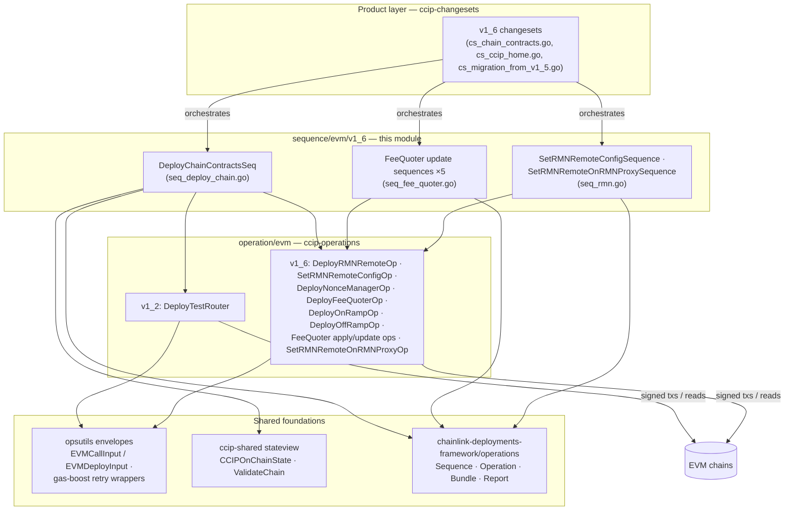
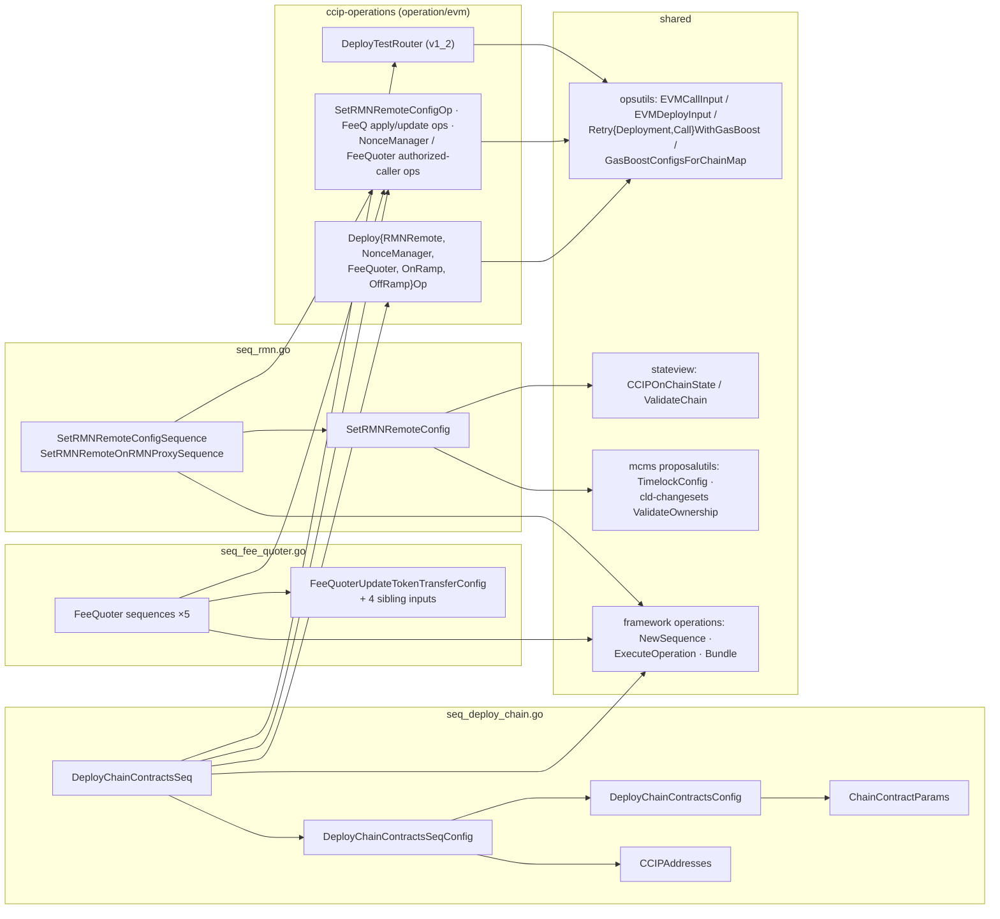
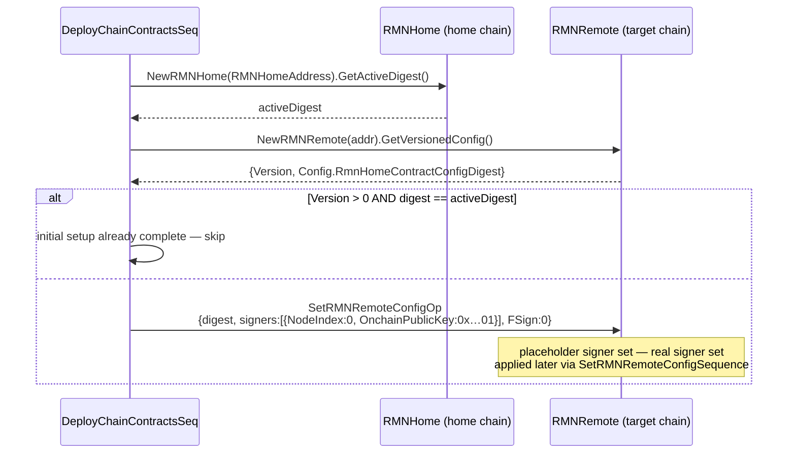
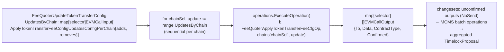
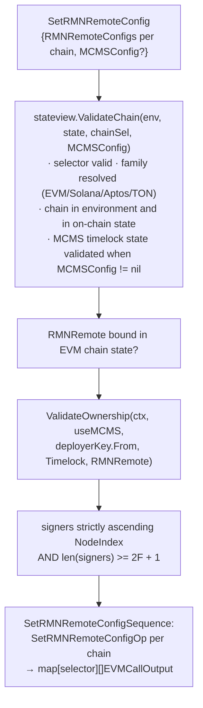

# CCIP v1.6 Sequences (`ccip-sequences_v1_6`)

> **Location:** `chainlink/deployment/ccip/sequence/evm/v1_6/` — Go package `v1_6`, part of the `github.com/smartcontractkit/chainlink/deployment` Go module (see [`chainlink/deployment/go.mod`](../../repo/chainlink/deployment/go.mod), which pins `chainlink-deployments-framework`, the `chainlink-ccip` gobindings and the MCMS libraries used here).
>
> **Parent:** [ccip-sequences](../ccip-sequences.md) — for the layering rules shared by all sequence families (changesets → sequences → operations).

## 1. Introduction

`ccip-sequences_v1_6` is the **v1.6 deployment & configuration sequence family** of the [CCIP Deployment Suite](../../CCIP_Deployment_Suite.md). While the sibling [ccip-sequences_migration](ccip-sequences_migration.md) package *reads and translates* legacy v1.5.0 configuration, this package *writes*: it deploys the complete CCIP v1.6 per-chain contract set and applies all FeeQuoter and RMN configuration across fleets of EVM chains.

The package is organized into three files, each owning one concern:

| File | Concern | Core component |
|---|---|---|
| [`seq_deploy_chain.go`](../../repo/chainlink/deployment/ccip/sequence/evm/v1_6/seq_deploy_chain.go) | Idempotent deployment of the per-chain v1.6 contract set + wiring | `ChainContractParams` (with `DeployChainContractsSeqConfig`, `CCIPAddresses`, `DeployChainContractsSeq`) |
| [`seq_fee_quoter.go`](../../repo/chainlink/deployment/ccip/sequence/evm/v1_6/seq_fee_quoter.go) | FeeQuoter configuration updates across many chains | `FeeQuoterUpdateTokenTransferConfig` (plus four sibling update sequences) |
| [`seq_rmn.go`](../../repo/chainlink/deployment/ccip/sequence/evm/v1_6/seq_rmn.go) | RMN `RMNRemote` / `RMNProxy` configuration with ownership validation | `SetRMNRemoteConfig` (plus `SetRMNRemoteConfigSequence`, `SetRMNRemoteOnRMNProxySequence`) |

All three files follow the same conventions described on the parent page ([ccip-sequences](../ccip-sequences.md)): typed inputs keyed by **chain selector**, validation-first config structs, execution through the `chainlink-deployments-framework/operations` `Bundle`, and composition of atomic operations from [ccip-operations](../ccip-operations.md).

## 2. Where this module fits in the system



- **Above:** changesets in [ccip-changesets](../ccip-changesets.md) (e.g. the EVM v1.6 changesets in [ccip-changesets_evm_1_6](../ccip-changesets/ccip-changesets_evm_1_6.md)) decide *when and what* to run and aggregate unconfirmed outputs into MCMS timelock proposals. The migration changeset `cs_migration_from_v1_5.go` also consumes this package's outputs after running the [migration sequences](ccip-sequences_migration.md).
- **Below:** every on-chain action is an operation from [ccip-operations](../ccip-operations.md) (see [ccip-operations_evm_v1_6](../ccip-operations/ccip-operations_evm_v1_6.md) for the operation definitions; [ccip-operations_evm_v1_2](../ccip-operations/ccip-operations_evm_v1_2.md) for the test router).
- **Contracts:** the deployed contracts (OnRamp, OffRamp, FeeQuoter, NonceManager, RMNRemote, RMNProxy, TestRouter) are the CCIP protocol contracts whose runtime semantics are documented in [CCIP Cross-Chain Protocol](../../CCIP_Cross-Chain_Protocol.md) and [ccip](../../CCIP_Cross-Chain_Protocol/ccip.md).

## 3. Core components

### 3.1 Chain contract deployment — `seq_deploy_chain.go`

#### `ChainContractParams`

Per-chain constructor parameters for the contracts this sequence deploys. One instance per target chain inside `DeployChainContractsConfig.ContractParamsPerChain`.

| Field | Type | Purpose |
|---|---|---|
| `FeeQuoterOpts` | `*opsutils.ContractOpts` | Optional bytecode/version override for the FeeQuoter deployment (`ContractOpts{Version *semver.Version, EVMBytecode []byte}`); operations fall back to their pinned defaults when `nil`. |
| `FeeQuoterParams` | `ccipopsv1_6.FeeQuoterParams` | FeeQuoter initialization: `MaxFeeJuelsPerMsg`, token-price staleness threshold, LINK/WETH premium multipliers, initial token price feeds, token-transfer fee configs and destination-chain config args. |
| `OffRampParams` | `ccipopsv1_6.OffRampParams` | OffRamp initialization: `GasForCallExactCheck`, `PermissionLessExecutionThresholdSeconds`, `MessageInterceptor`. |

`Validate(selector uint64)` delegates to `FeeQuoterParams.Validate()` and `OffRampParams.Validate(false)` and wraps any failure with the chain selector context.

#### `CCIPAddresses`

The address book for one chain, split into two groups:

- **Prerequisites (validated non-zero)** — must already exist before this sequence runs: `RMNProxyAddress`, `WrappedNativeAddress`, `TimelockAddress` (MCMS), `LinkAddress`, `TokenAdminRegistryAddress`. `Validate(selector)` fails with an actionable message ("deploy the prerequisites first" / "deploy the mcms contracts first") if any is the zero address.
- **Optional / newly deployed** — `LegacyRMNAddress` and `FeeAggregatorAddress` are optional inputs (legacy RMN only feeds RMNRemote bootstrap; a zero `FeeAggregatorAddress` is deliberately defaulted to the deployer key — see the flow below). The remaining six — `OnRampAddress`, `TestRouterAddress`, `OffRampAddress`, `NonceManagerAddress`, `FeeQuoterAddress`, `RMNRemoteAddress` — act as **idempotency markers**: a non-zero address means "already deployed, reuse it"; a zero address means "deploy it in this run".

#### `DeployChainContractsConfig` / `DeployChainContractsSeqConfig`

```text
DeployChainContractsConfig {
  HomeChainSelector       uint64                                // chain hosting RMNHome
  ContractParamsPerChain  map[uint64]ChainContractParams        // per-chain constructor params
  GasBoostConfigPerChain  map[uint64]cldfproposalutils.GasBoostConfig
}

DeployChainContractsSeqConfig {
  DeployChainContractsConfig                                    // embedded
  RMNHomeAddress          common.Address                        // must already be deployed
  AddressesPerChain       map[uint64]CCIPAddresses              // prerequisite + idempotency addresses
  GasBoostConfigPerChain  map[uint64]cldfproposalutils.GasBoostConfig
}
```

`DeployChainContractsConfig.Validate()` checks that the home-chain selector and every per-chain selector pass `deployment.IsValidChainSelector` and that every `ChainContractParams` validates. `DeployChainContractsSeqConfig.Validate()` additionally requires a non-zero `RMNHomeAddress` ("deploy the home chain first") and enforces a strict **1:1 mapping** between `ContractParamsPerChain` and `AddressesPerChain` — a chain present in only one map aborts the run.

> **Subtlety:** `DeployChainContractsSeqConfig` re-declares `GasBoostConfigPerChain` while also embedding `DeployChainContractsConfig` (which has the same field). In Go the outer field shadows the promoted one, so the *outer* `GasBoostConfigPerChain` is the effective map used by `DeployChainContractsSeq`.

#### `DeployChainContractsSeq`

A single `operations.NewSequence` (`semver 1.0.0`, `"Deploys all 1.6 chain contracts for the specified evm chain(s)"`) with the handler signature `func(operations.Bundle, map[uint64]cldf_evm.Chain, DeployChainContractsSeqConfig) (map[uint64]map[string]string, error)`. The output maps each chain selector to `address → TypeAndVersion` for every contract deployed in the run. It is executed by changesets via `operations.ExecuteSequence`, and its report flows into the changeset's `ChangesetOutput.Reports`.

### 3.2 FeeQuoter configuration — `seq_fee_quoter.go`

Five sibling sequences, all sharing the same shape: iterate `UpdatesByChain map[uint64]opsutils.EVMCallInput[…TypeName…]` **sequentially**, execute one FeeQuoter operation per chain, and return `map[uint64][]opsutils.EVMCallOutput`. Each chain selector must exist in the chain dependencies or the sequence fails fast.

| Sequence (var) | Input struct | `EVMCallInput` payload | Operation invoked |
|---|---|---|---|
| `FeeQuoterApplyDestChainConfigUpdatesSequence` | `FeeQuoterApplyDestChainConfigUpdatesSequenceInput` | `[]fee_quoter.FeeQuoterDestChainConfigArgs` | `FeeQuoterApplyDestChainConfigUpdatesOp` |
| `FeeQuoterUpdatePricesSequence` | `FeeQuoterUpdatePricesSequenceInput` | `fee_quoter.InternalPriceUpdates` (token + gas prices) | `FeeQuoterUpdatePricesOp` |
| `FeeQUpdateTransferTokenFeeCfgSeq` | `FeeQuoterUpdateTokenTransferConfig` | `ccipops.ApplyTokenTransferFeeConfigUpdatesConfigPerChain` | `FeeQuoterApplyTokenTransferFeeCfgOp` |
| `FeeQuoterApplyFeeTokensUpdatesSeq` | `FeeQuoterUpdateFeeTokensConfig` | `ccipops.ApplyFeeTokensUpdatesInput` (add/remove supported fee tokens) | `FeeQuoterApplyFeeTokensUpdatesOp` |
| `FeeQApplyPremiumMultiplierWeiPerEthUpdatesSeq` | `FeeQuoterUpdatePremiumMultiplierWeiPerEthConfig` | `[]fee_quoter.FeeQuoterPremiumMultiplierWeiPerEthArgs` | `FeeQApplyPremiumMultiplierWeiPerEthUpdateOp` |

**`FeeQuoterUpdateTokenTransferConfig`** (the module's core component for this file) wraps per-chain sets of **adds** and **removes**:

```go
type FeeQuoterUpdateTokenTransferConfig struct {
    UpdatesByChain map[uint64]opsutils.EVMCallInput[ccipops.ApplyTokenTransferFeeConfigUpdatesConfigPerChain]
}

type ApplyTokenTransferFeeConfigUpdatesConfigPerChain struct {   // ccipops (operation/evm/v1_6)
    TokenTransferFeeConfigs       []fee_quoter.FeeQuoterTokenTransferFeeConfigArgs    // apply
    TokenTransferFeeConfigsRemove []fee_quoter.FeeQuoterTokenTransferFeeConfigRemoveArgs // remove
}
```

> **Name-collision warning:** a struct with the *same name* exists in the `migration` package with a completely different shape (it wraps `OnRampToFeeQuoterDestChainConfigInput` for the read-side translation). The two are disambiguated by Go package qualification; see [ccip-sequences_migration](ccip-sequences_migration.md). The migration changesets feed the *output* of the migration translation sequences directly into this type's sequence to apply the translated v1.5 configuration onto v1.6 FeeQuoter contracts.

### 3.3 RMN configuration — `seq_rmn.go`

#### `SetRMNRemoteConfig` (input config + validator)

```go
type SetRMNRemoteConfig struct {
    RMNRemoteConfigs map[uint64]ccipops.RMNRemoteConfig // per-chain signer sets, F, digest
    MCMSConfig       *cldfproposalutils.TimelockConfig  // nil ⇒ direct-send mode
}
```

`Validate(env cldf.Environment, state stateview.CCIPOnChainState)` runs, **per chain**, four checks in order:

1. **Chain validity** — `stateview.ValidateChain(env, state, chainSelector, MCMSConfig)` verifies the selector, resolves its chain family (EVM/Solana/Aptos/TON), confirms the chain exists in both the environment and the on-chain state, and — when `MCMSConfig != nil` — validates the MCMS-with-timelock state (proposer/canceller/bypasser MCMs, timelock, call proxy). See [ccip-shared](../ccip-shared.md).
2. **RMNRemote presence** — `state.MustGetEVMChainState(chainSelector).RMNRemote` must be bound (nil otherwise ⇒ "RMNRemote not found").
3. **Ownership** — `mcmschangesets.ValidateOwnership(ctx, useMCMS, deployerKey.From, Timelock.Address(), RMNRemote)` ensures the contract's owner matches the expected authority: the deployer EOA in direct-send mode, or the timelock in MCMS mode. This makes MCMS-gated runs fail *before* any proposal is built rather than mid-configuration.
4. **Signer invariants** — `config.Signers` must be in **strictly ascending `NodeIndex` order**, and the count must satisfy the BFT bound `len(signers) >= 2F + 1` for the configured `F`.

#### `SetRMNRemoteConfigSequence` / `SetRMNRemoteOnRMNProxySequence`

- `SetRMNRemoteConfigSequence` iterates `map[uint64]opsutils.EVMCallInput[rmn_remote.RMNRemoteConfig]` and executes `SetRMNRemoteConfigOp` per chain (no per-chain concurrency).
- `SetRMNRemoteOnRMNProxySequence` takes `SetRMNRemoteOnRMNProxySequenceInput{UpdatesByChain map[uint64]opsutils.EVMCallInput[common.Address]}` — the per-chain payload being the **RMNRemote address** — and executes `SetRMNRemoteOnRMNProxyOp` to point each chain's `RMNProxy` at it. It is typically run after the remote config is set during the v1.5 → v1.6 upgrade (the sequence name string contains a known typo: `"SetRMNRemoteOnRMNProxySequece"`).

## 4. Architecture and component relationships



Dependency notes:

- The deployment sequence is the only consumer of the **v1.2** router operation (`ccipopsv1_2.DeployTestRouter`) and mixes it freely with v1.6 operations; the FeeQuoter binding is pinned to the `v1_6_3` gobindings while `rmn_home`, `rmn_remote` and `nonce_manager` use `v1_6_0` (see the import block of [`seq_deploy_chain.go`](../../repo/chainlink/deployment/ccip/sequence/evm/v1_6/seq_deploy_chain.go)).
- All deploy operations are wrapped with `opsutils.RetryDeploymentWithGasBoost` and all call operations with `opsutils.RetryCallWithGasBoost`, parameterized by the per-chain `GasBoostConfig` resolved through `opsutils.GasBoostConfigsForChainMap`. A `nil` config degrades to a no-retry pass-through — escalation of gas limit/price happens per failed attempt inside the framework's retry hook.
- `SetRMNRemoteConfig` is the only sequence input that takes the full `cldf.Environment` + `stateview.CCIPOnChainState`, because ownership and presence checks require reading current on-chain state rather than trusting caller-supplied addresses.

## 5. Process flows

### 5.1 `DeployChainContractsSeq` — idempotent per-chain deployment

```mermaid
flowchart TB
    IN["DeployChainContractsSeqConfig<br/>{HomeChainSelector, RMNHomeAddress,<br/>ContractParamsPerChain, AddressesPerChain,<br/>GasBoostConfigPerChain}"]
    VAL["Validate():<br/>selectors valid · FeeQuoter + OffRamp params valid ·<br/>RMNHomeAddress set · Addresses ↔ Params 1:1 ·<br/>prerequisites per chain non-zero"]
    GB["GasBoostConfigsForChainMap(ContractParams, GasBoostConfig)"]
    DEPS["resolve home chain + every target chain<br/>from the dependency map — fail fast if missing"]

    IN --> VAL --> GB --> DEPS
    DEPS --> PAR["errgroup — one goroutine per chain<br/>(mutex-guarded output map)"]

    subgraph PC["per chain — strictly ordered steps, each idempotent"]
        S1{"RMNRemoteAddress<br/>already set?"}
        S1 -->|"no"| D1["DeployRMNRemoteOp<br/>(warn if LegacyRMN absent — setRMN skipped)"]
        S1 -->|"yes"| U1["reuse"]
        D1 --> S2
        U1 --> S2

        S2{"RMNRemote config set?<br/>version &gt; 0 AND digest ==<br/>RMNHome.GetActiveDigest()"}
        S2 -->|"no"| D2["SetRMNRemoteConfigOp —<br/>initial config: active digest,<br/>placeholder signer {0, 0x…01}, FSign 0"]
        S2 -->|"yes"| U2["skip (log: config already set)"]
        D2 --> S3
        U2 --> S3

        S3{"TestRouterAddress<br/>already set?"}
        S3 -->|"no"| D3["DeployTestRouter (v1_2)<br/>(RMNProxy + WrappedNative)"]
        S3 -->|"yes"| U3["skip"]
        D3 --> S4
        U3 --> S4

        S4{"NonceManagerAddress<br/>already set?"}
        S4 -->|"no"| D4["DeployNonceManagerOp<br/>(mark newNonceManager)"]
        S4 -->|"yes"| U4["reuse"]
        D4 --> S5
        U4 --> S5

        S5{"FeeQuoterAddress<br/>already set?"}
        S5 -->|"no"| D5["DeployFeeQuoterOp<br/>(price updaters: Timelock + deployer key;<br/>mark newFeeQuoter)"]
        S5 -->|"yes"| U5["reuse"]
        D5 --> S6
        U5 --> S6

        S6{"OnRampAddress<br/>already set?"}
        S6 -->|"no"| D6["DeployOnRampOp — TokenAdminRegistry,<br/>NonceManager, RMNProxy as RMN, FeeQuoter,<br/>FeeAggregator (defaults to deployer key if zero,<br/>avoiding fund loss on WithdrawFeeToken)"]
        S6 -->|"yes"| U6["skip"]
        D6 --> S7
        U6 --> S7

        S7{"OffRampAddress<br/>already set?"}
        S7 -->|"no"| D7["DeployOffRampOp — OffRampParams,<br/>RMNProxy, NonceManager,<br/>TokenAdminRegistry, FeeQuoter"]
        S7 -->|"yes"| U7["skip"]
        D7 --> S8
        U7 --> S8

        S8{"wiring — only for<br/>freshly deployed contracts"}
        S8 -->|"newFeeQuoter"| W1["FeeQApplyAuthorizedCallerOp:<br/>OffRamp → FeeQuoter"]
        S8 -->|"newNonceManager"| W2["NonceManagerUpdateAuthorizedCallerOp:<br/>OffRamp + OnRamp → NonceManager"]
    end

    PAR --> OUT["map[chainSelector]map[address]TypeAndVersion<br/>+ ExecutionReports (per op)"]
```



Failure semantics: any goroutine error aborts the whole `errgroup` and the sequence returns an error wrapping the failed chain — but because **every step is idempotent** (address-presence short-circuits, RMNRemote config re-checked on-chain, authorized-caller wiring only when the contract was freshly deployed), re-running the sequence with the same config resumes exactly where it stopped.

### 5.2 RMNRemote bootstrap handshake (inside `DeployChainContractsSeq`)

The RMNRemote config check is the one step that consults **two** chains — the home chain (where `RMNHome` lives) and the target chain:



### 5.3 FeeQuoter update fan-out (`seq_fee_quoter.go`)

All five sequences share this shape (shown for `FeeQUpdateTransferTokenFeeCfgSeq` / `FeeQuoterUpdateTokenTransferConfig`):



The `NoSend` flag carried on each `EVMCallInput` is what makes these sequences MCMS-compatible: with `NoSend: true` the operation builds calldata using simulated transact opts, marks `Confirmed = false`, and the changeset layer converts those outputs into MCMS batch operations (see the `AddEVMCallSequenceToCSOutput` helper in [`opsutils/evm.go`](../../repo/chainlink/deployment/ccip/internal/opsutils/evm.go) and [ccip-changesets](../ccip-changesets.md)). With `NoSend: false`, each call is sent by the deployer key and confirmed on-chain before the sequence proceeds.

### 5.4 `SetRMNRemoteConfig` validation and execution



Any check failing aborts the whole validation with the offending chain selector in the error — no partial configuration is ever applied when inputs are inconsistent.

## 6. Cross-cutting behaviors

| Behavior | How it is implemented in this module |
|---|---|
| **Validation-first** | Every config struct exposes `Validate()` (optionally taking the chain selector, environment or state view); sequences return before any transaction when validation fails. |
| **Idempotency** | `DeployChainContractsSeq` re-derives work from `CCIPAddresses` (zero address = deploy) and from live RMNHome/RMNRemote state; config-update sequences are naturally re-runnable (same calldata, `NoSend` for MCMS flows). |
| **Per-chain parallelism** | Only the deployment sequence fans out concurrently (`errgroup` + mutex-guarded output map). FeeQuoter/RMN sequences iterate chains sequentially. |
| **Gas-boost retries** | Per-chain `cldfproposalutils.GasBoostConfig` drives `RetryDeploymentWithGasBoost` / `RetryCallWithGasBoost`, which raise gas limit/price per attempt; `GasBoostConfigsForChainMap` maps the config onto the target chains (missing entries ⇒ no retry). |
| **MCMS compatibility** | `EVMCallInput.NoSend` + changeset-side `AddEVMCallSequenceToCSOutput` aggregate unconfirmed calldata into timelock proposals; `SetRMNRemoteConfig.MCMSConfig` additionally forces ownership validation against the timelock. |
| **Version pinning** | Gobinding packages are pinned per contract version (`fee_quoter` v1_6_3; `rmn_home`/`rmn_remote`/`nonce_manager` v1_6_0; test router v1_2), matching the operation set in [ccip-operations](../ccip-operations.md). |
| **Structured reporting** | Outputs are plain, JSON-serializable maps keyed by chain selector; every operation appends an execution report that propagates up through `Bundle` reports to the invoking changeset. |

## 7. Related documentation

- [ccip-sequences](../ccip-sequences.md) — parent module: sequence-layer conventions, the full sequence catalog and the migration data flow.
- [ccip-sequences_migration](ccip-sequences_migration.md) — the v1.5 → v1.6 translation sequences whose outputs feed this module's FeeQuoter apply sequences (and the same-named `FeeQuoterUpdateTokenTransferConfig` type).
- [ccip-operations](../ccip-operations.md) and [ccip-operations_evm_v1_6](../ccip-operations/ccip-operations_evm_v1_6.md) — the atomic operations invoked here.
- [ccip-changesets](../ccip-changesets.md) and [ccip-changesets_evm_1_6](../ccip-changesets/ccip-changesets_evm_1_6.md) — the product-level orchestrators and MCMS proposal aggregation.
- [ccip-shared](../ccip-shared.md) — `stateview.CCIPOnChainState`, `stateview.ValidateChain`, contract bindings and deployer groups used for validation.
- [CCIP Deployment Suite](../../CCIP_Deployment_Suite.md) — the suite this module belongs to.
- [Deployment Framework Core](../../Deployment_Framework_Core___Product_Deployments.md) — the `chainlink-deployments-framework` primitives (`Sequence`, `Operation`, `Bundle`, `Environment`) this module is built on.
- [CCIP Cross-Chain Protocol](../../CCIP_Cross-Chain_Protocol.md) — runtime semantics of the deployed OnRamp/OffRamp/FeeQuoter/RMN contracts.
