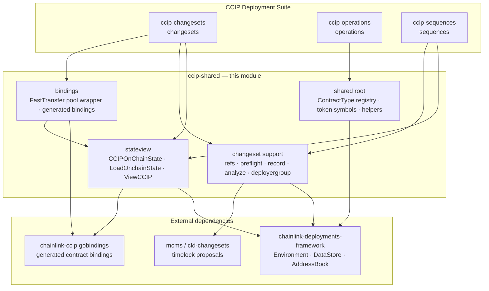
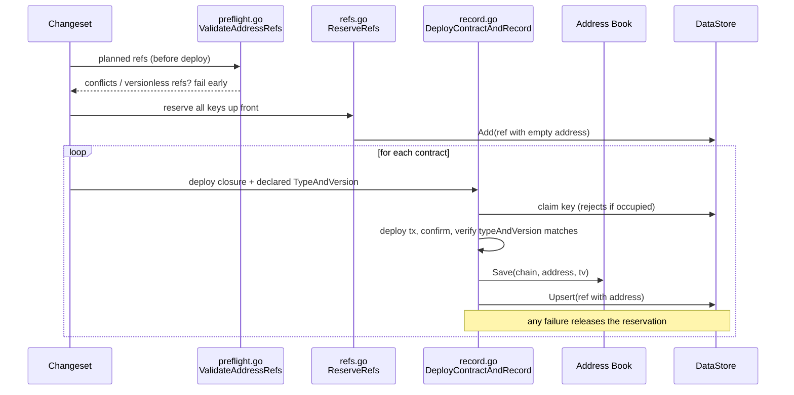
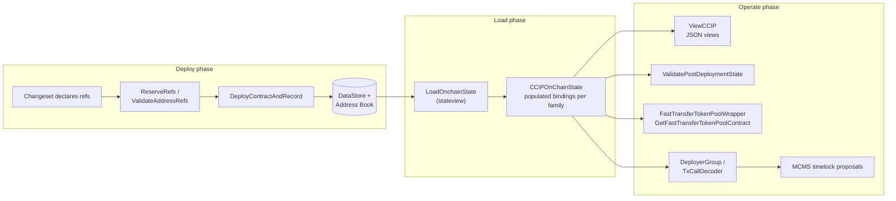

# ccip-shared

> **Location in source tree:** `chainlink/deployment/ccip/shared` (part of the `chainlink/deployment` Go module)
>
> **Parent module:** [CCIP_Deployment_Suite](../CCIP_Deployment_Suite.md)

## 1. Purpose and Scope

`ccip-shared` is the **shared foundation library of the CCIP Deployment Suite**. Every other CCIP deployment package — [ccip-changesets](ccip-changesets.md), [ccip-operations](ccip-operations.md) and [ccip-sequences](ccip-sequences.md) — builds on the primitives defined here. The module deliberately contains **no product deployment logic of its own**; instead it provides the vocabulary, the bindings and the bookkeeping machinery that changesets and sequences use to deploy, record, load, validate and describe CCIP on-chain infrastructure.

Concretely, the module supplies:

1. **Canonical contract type registry** — a single source of truth for every `deployment.ContractType` string used by CCIP deployments (legacy v1.5 types, v1.6 types, token pools, tokens, Solana/Aptos/TON program types, attestation, treasury and OpenZeppelin proxy types), plus OCR parameter validation.
2. **On-chain state loading and views** (`stateview`) — resolves deployed contracts from the datastore/address book into populated Go bindings across EVM, Solana, Aptos, Sui and TON, and renders human-readable JSON views.
3. **Go contract bindings** (`bindings`) — `abigen`-generated bindings for contracts that are not (yet) published through the `chainlink-ccip` gobindings module (Fast Transfer token pools, Signer Registry, Token Governor, USD stablecoin), plus a **unified `FastTransferPool` wrapper** that normalizes three pool variants behind one interface.
4. **Changeset/deployment support primitives** — atomic deploy-and-record helpers for the datastore and address book, reference reservation and preflight validation, MCMS bundle ref resolution, token symbol/price-feed metadata, hybrid-pool supply math, MCMS proposal decoding (Markdown description), deployer-group orchestration, and small utilities (address normalization, contract-code waits, CCIP send config).

### Design principles visible in the code

* **One key, one contract.** Datastore keys are `(chain, type, version, qualifier)`. Helpers such as `ReserveRefs`, `ValidateAddressRefs` and `DeployContractAndRecord` claim keys *before* transactions are sent, so a failed deployment can never leave an orphaned contract with no datastore record (`record.go`, `refs.go`, `preflight.go`).
* **Failure before deployment.** Preconditions (duplicate keys, missing qualifiers, versionless refs) are validated in `VerifyPreconditions`, where they cost nothing, rather than in `Apply`, where they would cost orphaned contracts (`preflight.go`).
* **Family-aware identity.** Address comparison respects chain-family casing rules: EVM addresses are case-folded (EIP-55 vs lowercase), Solana/Sui addresses are compared byte-exact (`addresses.go`).
* **Labels over deletion.** Historical contracts are marked with the `superseded` label rather than removed, and ref loaders (`MCMSBundleRefs`, `isActiveRef`) simply skip superseded rows (`datastore_refs.go`, `stateview/datastore_state.go`).

## 2. Architecture Overview

The dependency direction is strictly one-way: changesets, operations and sequences depend on `ccip-shared`; `ccip-shared` depends only on the deployment framework and upstream contract repositories.

## 3. Sub-module Map

The module is organized into three functional sub-modules. Click through for detailed component-level documentation.

| Sub-module | Documentation | Contents |
|---|---|---|
| **State loading & views** | [ccip-shared_stateview](ccip-shared/ccip-shared_stateview.md) | `stateview/` — `CCIPOnChainState`, `LoadOnchainState`, `ViewCCIP`, per-family chain states (EVM, Solana), datastore-backed ref resolution, post-deployment validation |
| **Contract bindings & pool wrapper** | [ccip-shared_bindings](ccip-shared/ccip-shared_bindings.md) | `bindings/` — `FastTransferPool` interface, adapter/iterator wrappers, generated bindings for Fast Transfer pools, Signer Registry (EVM + Solana), Token Governor, USD stablecoin |
| **Changeset support primitives** | [ccip-shared_changeset-support](ccip-shared/ccip-shared_changeset-support.md) | Root package + `deployergroup/`, `deploylink/`, `client/` — ContractType registry, ref reservation/recording, preflight validation, token metadata, hybrid supply math, MCMS proposal analysis |

## 4. High-level Functionality

### 4.1 Contract type registry and shared types (`types.go`, `token_pools.go`, `token_info.go`)

> 📄 Component details: [ccip-shared_changeset-support](ccip-shared/ccip-shared_changeset-support.md)

`types.go` declares every `deployment.ContractType` constant used across CCIP deployments — from legacy `CommitStore`/`EVM2EVMOnRamp` through v1.6 `OnRamp`/`OffRamp`/`CCIPHome`/`RMNHome` to token pools (`BurnMintFastTransferTokenPool`, `HybridWithExternalMinterFastTransferTokenPool`, …), Solana program types (`SVMSignerRegistry`, `TokenPoolLookupTable`) and Aptos/TON types. It also defines `OCRParameters` with a strict `Validate()` used to sanity-check OCR2 configuration before it is written on-chain.

`token_pools.go` complements this with the accepted **token pool type/version sets** (`TokenPoolTypes`, `TokenPoolVersions`) and the generic `NewTokenPoolWithMetadata[P tokenPool]` helper, which binds a pool at an address, reads its `typeAndVersion()` and token `symbol()`, and returns the pool together with a `TokenPoolMetadata{Version, Symbol}` — the metadata key used by all pool lookups. Invalid on-chain versions such as `1.6.x-dev` are normalized rather than rejected.

`token_info.go` defines `TokenSymbol` constants (LINK, WETH, USDC, CCIP-BnM, …), the price-feed **description → symbol** mapping used to configure FeeQuoter token entries, and the pluggable `TokenRegistry` (default registry + `NewMergedRegistry` for CLD-provided tokens) plus `TokenConfig` for building token-info maps.

### 4.2 Deployment bookkeeping (`refs.go`, `preflight.go`, `record.go`, `datastore_refs.go`)

> 📄 Component details: [ccip-shared_changeset-support](ccip-shared/ccip-shared_changeset-support.md)

These four files implement the module's core invariant: *a deployed contract always ends up recorded exactly once, under exactly one datastore key*.

* `refs.go` — `ReserveRefs` validates and pre-claims the full key set for a changeset (empty qualifier is only legal for singletons; duplicates are rejected).
* `preflight.go` — `ValidateAddressRefs` / `ValidateAddressRefsStrict` are the `VerifyPreconditions` entry points; they detect two planned refs sharing a key and reject (or merely log) redeployment over an existing address.
* `record.go` — `DeployContractAndRecord` performs deploy → confirm → verify declared type → save to address book → upsert datastore ref, releasing the claimed key on every failure path; `RecordAddress` is its counterpart for derived/imported addresses (Solana PDAs, Sui objects).
* `datastore_refs.go` — read-side: `MCMSBundleRefs` selects the active MCMS bundle for a chain (with legacy empty-qualifier fallback for the default bundle), `CheckRefUniqueness` rejects ambiguous identities, and `SupersededLabel` marks historical rows.

### 4.3 On-chain state loading (`stateview/`)

Detailed in [ccip-shared_stateview](ccip-shared/ccip-shared_stateview.md). `LoadOnchainState` turns environment datastore refs into a `CCIPOnChainState` holding populated bindings for every chain family; `ViewCCIP` renders the same state as JSON for docs/UI; `ValidatePostDeploymentState` cross-checks RMN, FeeQuoter, ramps and ownership after a deployment.

### 4.4 Contract bindings (`bindings/`)

Detailed in [ccip-shared_bindings](ccip-shared/ccip-shared_bindings.md). Generated `abigen` bindings for contracts consumed by the deployment suite, and the `FastTransferTokenPoolWrapper` that adapts the three Fast Transfer pool variants (BurnMint, BurnMintWithExternalMinter, HybridWithExternalMinter) behind one interface with normalized config/quote types and a unified event iterator.

### 4.5 MCMS proposal analysis and deployer orchestration (`analyze.go`, `deployergroup/`)

> 📄 Component details: [ccip-shared_changeset-support](ccip-shared/ccip-shared_changeset-support.md)

`analyze.go` implements `TxCallDecoder`, a pluggable ABI decoder that renders decoded calls (address, method, inputs/outputs) as Markdown tables, annotating addresses with the contract they resolve to (`AddressesByChain` context) and chain selectors with chain names. `DescribeTimelockProposal` formats whole batches — this output is what goes into MCMS proposal documents reviewed by operators.

`deployergroup/` builds on it: a `DeployerGroup` wraps the environment, loaded state and an optional `TimelockConfig`, collects `DescribedTransaction`s (EVM or Solana) into a `DeploymentContext` (with fork support), and either sends them directly or converts them to `mcmstypes.Transaction`s for timelock proposals.

### 4.6 Token pools & hybrid supply math (`hybrid_supply.go`)

> 📄 Component details: [ccip-shared_changeset-support](ccip-shared/ccip-shared_changeset-support.md)

For Hybrid pools whose minting is delegated to an external minter, group updates must state the remote chain's supply **in local base units**. `NormalizeRemoteSupply` converts between decimal domains exactly (rejecting truncating scale-downs and uint256 overflow), `ValidateRemoteChainSupply` rejects unconverted remote amounts (which would under-back the pool by up to 10¹²), and `VerifyRemoteDecimals` cross-checks declared decimals against the remote chain through family-specific readers (ERC-20 `decimals`, SPL mint account, Aptos `fungible_asset::decimals` view).

### 4.7 Small utilities (`addresses.go`, `helpers.go`, `wait_contract_code.go`, `client/`, `deploylink/`)

> 📄 Component details: [ccip-shared_changeset-support](ccip-shared/ccip-shared_changeset-support.md)

* `addresses.go` — `NormalizeAddress`/`AddressesEqual` implement family-aware address comparison.
* `helpers.go` — CCIP capability ID derivation, EIP-1967 proxy storage slots (`AdminSlot`, `TUPImplementationSlot`), `ResolveFeeQuoterAddressAndVersion` (highest-semver, ambiguity-checked), ref collection from datastore + address book, and quoted qualifier composition (`QualifierFromParts`/`ParseQualifierParts`).
* `wait_contract_code.go` — `WaitForContractCode` retries `eth_getCode` (Fibonacci backoff, 30s cap) because Docker-CI Geth can serve a mined receipt before code is visible on all RPC paths.
* `client/` — `CCIPSendReqConfig` and functional options for sending CCIP messages in tests, extracted from testhelpers to break an import cycle.
* `deploylink/` — `DeployLinkTokenChangeset` wraps the upstream LINK token changeset and additionally mirrors datastore refs into the legacy address book.

## 5. Data Flow: Deploy → Record → Load → Operate

This is the canonical lifecycle of CCIP deployment tooling: contracts are deployed and recorded atomically (Phase 1), everything that needs contract handles loads them from the same datastore (Phase 2), and operations — views, validation, pool interactions, further MCMS proposals — operate on the loaded state (Phase 3).

## 6. Relationship to Other Modules

* **Consumers:** [ccip-changesets](ccip-changesets.md) (changesets built on refs/record/stateview/bindings), [ccip-operations](ccip-operations.md) (operations using shared types and bindings), [ccip-sequences](ccip-sequences.md) (sequences composing changesets with `ReserveRefs`/preflight guarantees).
* **Upstream framework:** `chainlink-deployments-framework` supplies `Environment`, `DataStore`, `AddressBook` and the changeset interfaces (`ChangeSetV2`) that all sub-modules target.
* **Contract sources:** most CCIP contract bindings come from `chainlink-ccip`/`ccip-contract-examples` gobindings; the bindings in this module are the contracts **not** available there (Fast Transfer pools, Signer Registry, Token Governor, USD stablecoin).
* **Chain selectors:** `chain-selectors` provides the family/selector resolution used by `addresses.go`, `analyze.go` and `hybrid_supply.go`.
