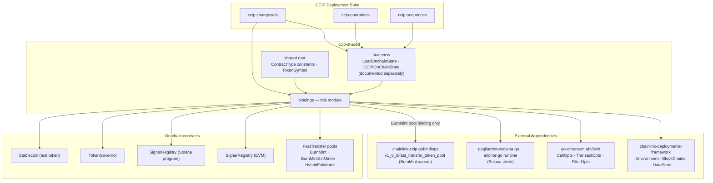
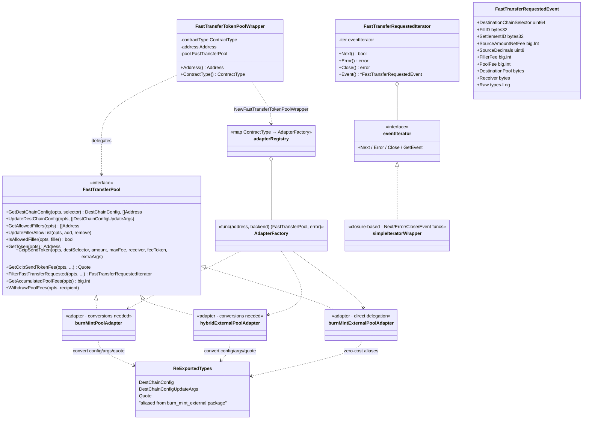
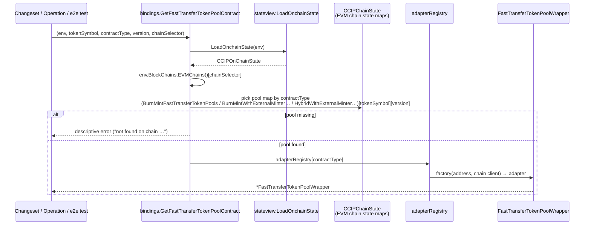
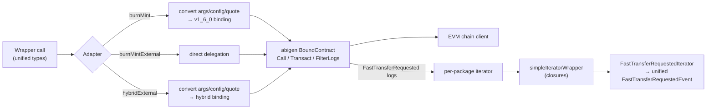
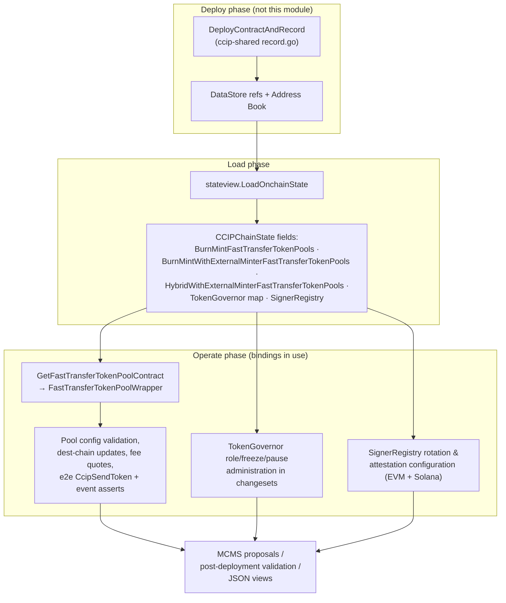

# CCIP Shared Bindings (`bindings`)

## Introduction

The `ccip-shared_bindings` module (directory `chainlink/deployment/ccip/shared/bindings`, part of the [`chainlink/deployment`](../../Deployment_Framework_Core___Product_Deployments.md) Go module) is the **contract-binding layer of the CCIP Deployment Suite**. It lives inside the [ccip-shared](../ccip-shared.md) library and supplies typed Go clients for the on-chain contracts that CCIP deployment tooling must interact with but that are **not published through the upstream `chainlink-ccip` gobindings module**.

The module has two kinds of content:

1. **Generated contract bindings** (`// Code generated – DO NOT EDIT`) — `abigen`-produced Go bindings for EVM contracts (Fast Transfer token pools with external minters, the attestation `SignerRegistry`, the `TokenGovernor`, a `Stablecoin` test token) and an `anchor-go`-produced Solana Anchor client for the Solana `SignerRegistry` program (instructions, accounts, events, Borsh types, PDA derivation).
2. **One hand-written normalization layer** — the `FastTransferTokenPoolWrapper`, which adapts three structurally similar but type-distinct Fast Transfer pool bindings behind a single `FastTransferPool` interface with normalized config/quote types and a unified event iterator.

All other suite packages — [ccip-changesets](../ccip-changesets.md), [ccip-operations](../ccip-operations.md) and [ccip-sequences](../ccip-sequences.md) — consume these bindings *through* [ccip-shared_stateview](ccip-shared_stateview.md), which resolves deployed addresses into populated binding objects. The bindings module itself never deploys anything and performs no bookkeeping; it is a pure *read/interact* layer over the [chainlink-deployments-framework](../../Deployment_Framework_Core___Product_Deployments.md) environment.

> **Location in source tree:** `chainlink/deployment/ccip/shared/bindings`
>
> **Parent module:** [ccip-shared](../ccip-shared.md) · **Grandparent:** [CCIP_Deployment_Suite](../../CCIP_Deployment_Suite.md)

## Module at a glance

| Path | Generator | Contents |
|---|---|---|
| `bindings/fast_transfer_token_pool_wrapper.go` | *Hand-written* | `FastTransferPool` interface, `FastTransferTokenPoolWrapper`, three pool adapters, `adapterRegistry` factory map, conversion helpers, unified `FastTransferRequestedIterator`, `GetFastTransferTokenPoolContract` discovery helper |
| `bindings/burn_mint_with_external_minter_fast_transfer_token_pool/` | `abigen` | Binding for `BurnMintWithExternalMinterFastTransferTokenPool` (mint/burn delegated to an external minter contract) |
| `bindings/hybrid_with_external_minter_fast_transfer_token_pool/` | `abigen` | Binding for `HybridWithExternalMinterFastTransferTokenPool` (liquidity-group hybrid pool with external minter) |
| `bindings/signer_registry/` | `abigen` | Binding for the EVM `SignerRegistry` (attestation-service signer set with two-step key rotation) |
| `bindings/signer_registry_solana/` | `anchor-go` | Solana Anchor client: `instructions.go`, `accounts.go`, `events.go`, `types.go` (Borsh), `discriminators.go`, `fetchers.go`, `program-id.go`, `errors.go`, `constants.go` |
| `bindings/token_governor/` | `abigen` | Binding for `TokenGovernor` (role-governed mint/burn/freeze/pause with a timelocked default admin) |
| `bindings/usd_stablecoin/` | `abigen` | Binding for the `Stablecoin` test token (ERC-20 + permit + pause + per-account freeze) |

Every `*_metadata.go` file in the generated packages holds the raw contract `ABI` and creation `Bin` (split from the main file); every binding exposes the standard `abigen` triple — `Caller`, `Transactor`, `Filterer` — plus `Session`/`Raw` wrappers, a `TypeAndVersion` view helper and a `ParseLog`/`Topic()` surface compatible with the `chainlink-ccip` `generated.AbigenLog` interface.

## Architecture

### Where the module sits

The bindings are the lowest layer of the [ccip-shared](../ccip-shared.md) stack: [ccip-shared_stateview](ccip-shared_stateview.md) instantiates them, the contract-type constants that key them come from the shared root package (documented in [ccip-shared_changeset-support](ccip-shared_changeset-support.md)), and changesets/operations consume populated bindings loaded from the deployment framework's `DataStore`.

Two details of this layout matter for maintainers:

* **Only the `BurnMintFastTransferTokenPool` binding is imported from upstream** (`chainlink-ccip/chains/evm/gobindings/generated/v1_6_0/fast_transfer_token_pool`). The two external-minter variants, the signer registries, the governor and the stablecoin are local to this module — that is the module's reason to exist.
* **The dependency on `stateview` is one-directional at runtime** (`bindings → stateview` inside `GetFastTransferTokenPoolContract`) while `stateview`'s chain-state structs *hold* binding objects from this module. Both sides key off the same `shared.*` contract-type constants, so the contract-type registry in [ccip-shared_changeset-support](ccip-shared_changeset-support.md) is the single source of truth tying them together.

### The Fast Transfer pool wrapper (the only hand-written code)

Solidity-wise, all three Fast Transfer pool variants implement the same `FastTransferTokenPoolAbstract` behaviour. But `abigen` emits one Go package per contract, so the identical ABI structs (`DestChainConfig`, `DestChainConfigUpdateArgs`, `Quote`) appear as *three distinct Go types*. Consumers — changeset validations, hybrid-supply math, e2e tests that call `CcipSendToken` — must not care which variant is deployed. The wrapper solves this with a classic **adapter + factory-registry** design:

* `FastTransferPool` — the family-agnostic interface (destination-chain config, filler allow-listing, `CcipSendToken` / fee quotes, event filtering, fee accumulation).
* Three adapters (`burnMintPoolAdapter`, `burnMintExternalPoolAdapter`, `hybridExternalPoolAdapter`) — each delegates to its raw binding, converting argument/result types only where the generated Go types differ (the burn-mint-external adapter needs no conversion because the wrapper's re-exported type aliases *are* that package's types).
* `adapterRegistry` — a `map[deployment.ContractType]AdapterFactory` keyed by the shared contract-type constants (`shared.BurnMintFastTransferTokenPool`, `shared.BurnMintWithExternalMinterFastTransferTokenPool`, `shared.HybridWithExternalMinterFastTransferTokenPool`). `NewFastTransferTokenPoolWrapper` selects the factory, binds the contract and returns a `*FastTransferTokenPoolWrapper`.

The same normalization is applied to event iterators: each generated pool has its own `FastTransferRequestedIterator` type, so the wrapper hides all three behind a small `eventIterator` interface implemented by closure-based `simpleIteratorWrapper`s, and exposes a single `FastTransferRequestedIterator` producing a single `FastTransferRequestedEvent` struct.

The conversion helpers are pure field-copy functions in both directions (`convertDestChainConfigFromBurnMint`, `convertUpdateArgsToBurnMint`, `convertQuoteFromHybrid`, …), so adding a fourth pool variant is a mechanical extension: new generated package → new adapter (with its own converters and iterator closure) → one new registry entry (see *Maintenance notes* below).

### Contract surface per binding

| Binding | Distinctive surface |
|---|---|
| **BurnMint Fast Transfer pool** (upstream binding) | Standard abstract-pool behaviour; burn-and-mint semantics; used when the token's minting is handled on-chain by the pool itself. |
| **BurnMintWithExternalMinter Fast Transfer pool** | Constructor takes an extra `minter` address; exposes `getMinter`. Mint/burn is delegated to an external minter contract (the `TokenGovernor`-governed token in practice). Adds the fast-transfer operations: `ccipSendToken` (payable, returns a `settlementId`), `getCcipSendTokenFee`, `computeFillId`, `fastFill`, `getFillInfo`, `getAccumulatedPoolFees`, `withdrawPoolFees`, `updateDestChainConfig`, `updateFillerAllowList`. |
| **HybridWithExternalMinter Fast Transfer pool** | Everything above **plus liquidity-group accounting**: `updateGroups` (`HybridTokenPoolAbstractGroupUpdate{RemoteChainSelector, Group, RemoteChainSupply}`), `getGroup`, `getLockedTokens`, `getRebalancer`/`setRebalancer`, `provideLiquidity`/`withdrawLiquidity`, and the `LiquidityAdded`/`LiquidityRemoved`/`LiquidityMigrated`/`GroupUpdated` events. The remote-supply units carried by group updates are validated by `NormalizeRemoteSupply`/`ValidateRemoteChainSupply` in the parent module's `hybrid_supply.go` (see [ccip-shared_changeset-support](ccip-shared_changeset-support.md)). |
| **SignerRegistry (EVM)** | Attestation-service signer set: `addSigners`/`removeSigners` (with `SignerNotRemovedDueToNoMatch` soft event), `getMaxSigners` cap, and **two-step key rotation** — `setNewSignerAddresses` stages a replacement EVM address per signer (`NewSignerAddressSet`), then `promoteNewSignerAddresses` commits it (`SignerAddressPromoted`). Two-step ownership via `acceptOwnership`. `typeAndVersion` = `SignerRegistry 1.0.0`. |
| **SignerRegistry (Solana)** | Anchor program client mirroring the EVM semantics for the SVM CCIP stack: `add_signer` etc. operate on 20-byte EVM addresses (`[20]uint8`) with an optional staged new address for rotation; `Config` PDA holds `owner`, optional `proposedOwner` and both bumps; `Signers` PDA holds the signer list; events (`Initialized`, `NewOwnerProposed`, `OwnerChanged`, `SignerAdded`, `SignerModified`, `SignerRemoved`) are Borsh-encoded with Anchor discriminators. Registered in the contract-type registry as `SVMSignerRegistry`. |
| **TokenGovernor** | Governance wrapper around a token: OpenZeppelin `AccessControl` roles (`MINTER_ROLE`, `BURNER_ROLE`, `BRIDGE_MINTER_OR_BURNER_ROLE`, `FREEZER_ROLE`/`UNFREEZER_ROLE`, `PAUSER_ROLE`/`UNPAUSER_ROLE`, `CHECKER_ADMIN_ROLE`, `RECOVERY_ROLE`) with enumerable role members; OZ `DefaultAdminRules` timelocked admin transfer/delay (`beginDefaultAdminTransfer`, `acceptDefaultAdminTransfer`, `changeDefaultAdminDelay`, `pendingDefaultAdmin{,Delay}` with schedules); `mint`/`burn`/`burnFrom` (bridge + native variants, with `BridgeMint`/`BridgeBurn`/`NativeMint`/`NativeBurn` events); `pause`/`unpause`; per-account `freeze`/`unfreeze` and `drainFrozenAccount`/`batchDrainFrozenAccounts`; `recoverERC20`/`recoverGovernedTokenERC20`; `setChecker`/`getChecker`; and `executeTokenFunction` for delegated token calls. |
| **Stablecoin** | Test/sample ERC-20 with EIP-2612 `permit`, pause, per-account freeze and `drain`, used by deployment test flows. |

## Key flows

### Flow 1 — Discovering and binding a deployed pool

`GetFastTransferTokenPoolContract` is the canonical entry point for consumers. It shows how the bindings layer composes with [ccip-shared_stateview](ccip-shared_stateview.md) (state loading) and the deployment framework (chain clients):

Error handling is explicit at every hop: missing chain selector in the environment, missing chain state, missing pool for `(tokenSymbol, version)`, and unsupported contract types each produce a distinct, actionable message. The wrapper is then used uniformly regardless of variant — e.g. `GetDestChainConfig` for preflight validation before an `UpdateDestChainConfig` transaction is queued into a DeployerGroup/MCMS proposal (see [ccip-shared_changeset-support](ccip-shared_changeset-support.md)).

### Flow 2 — Operating on a Fast Transfer pool

The read paths (`GetDestChainConfig`, `GetAllowedFillers`, `GetCcipSendTokenFee`, `GetAccumulatedPoolFees`, rate-limiter state on the raw bindings) and write paths (`UpdateDestChainConfig`, `UpdateFillerAllowList`, `CcipSendToken`, `WithdrawPoolFees`, `fastFill`) both funnel through this single adapter choke point, which keeps the public API type-stable when new pool variants or versions are added.

## Data flow in the deployment suite

Note the `TokenGovernor` and EVM `SignerRegistry` bindings appear **directly as fields on the EVM chain state** (`CCIPChainState.TokenGovernor map[TokenSymbol]*token_governor.TokenGovernor`, `CCIPChainState.SignerRegistry *signer_registry.SignerRegistry`), so consumers typically reach them via [ccip-shared_stateview](ccip-shared_stateview.md) rather than through the wrapper pattern; the wrapper pattern is specific to the three Fast Transfer pool variants.

## Integration with other modules

* **[ccip-shared_stateview](ccip-shared_stateview.md)** — instantiates these bindings while resolving `DataStore` address refs; the per-type pool maps consumed by `GetFastTransferTokenPoolContract` live in its EVM chain state.
* **[ccip-shared_changeset-support](ccip-shared_changeset-support.md)** — owns the `deployment.ContractType` registry (`shared.BurnMintFastTransferTokenPool`, `shared.BurnMintWithExternalMinterFastTransferTokenPool`, `shared.HybridWithExternalMinterFastTransferTokenPool`, `shared.TokenGovernor`, `shared.EVMSignerRegistry`, `shared.SVMSignerRegistry`, …) that keys the wrapper's adapter registry and the stateview dispatch, plus the deploy-and-record helpers that put pool addresses into the datastore in the first place, and `hybrid_supply.go` which validates the remote-supply values passed to `updateGroups` on the hybrid pool.
* **[ccip-changesets](../ccip-changesets.md) / [ccip-operations](../ccip-operations.md) / [ccip-sequences](../ccip-sequences.md)** — consume populated bindings (usually via stateview) to configure pools, administer tokens and rotate signer sets inside changesets and MCMS timelock proposals.
* **Upstream contract sources** — the burn-mint Fast Transfer pool binding is imported from `chainlink-ccip/chains/evm/gobindings/generated/v1_6_0/fast_transfer_token_pool`; everything else in this module is generated from Solidity sources or a Solana Anchor IDL that are versioned with the deployment suite.

## Maintenance notes

* **Generated files are never edited by hand.** Each generated package carries a `*_metadata.go` holding ABI/bin; regenerate from the Solidity/IDL sources. The `signer_registry_solana` package is Anchor-generated (`anchor-go`) and additionally carries account fetchers, discriminators, program ID and Borsh codecs.
* **Adding a new Fast Transfer pool variant** touches exactly six places: (1) generated binding package, (2) adapter struct implementing `FastTransferPool`, (3) config/args/quote conversion functions if the generated types differ, (4) one `adapterRegistry` entry keyed by a new `shared.ContractType` constant, (5) an iterator-wrapper closure if the pool emits `FastTransferRequested`, and (6) a chain-state map plus a `case` in `GetFastTransferTokenPoolContract`.
* **Type-alias strategy:** the wrapper re-exports `DestChainConfig`, `DestChainConfigUpdateArgs` and `Quote` as aliases of the `burn_mint_external` package's types, so that package effectively defines the canonical wire shape; adapters for other variants pay the conversion cost.
* **`contractType` is carried on the wrapper** (`ContractType()`) because downstream consumers (views, validators) need to distinguish variants without type assertions on the raw bindings.
