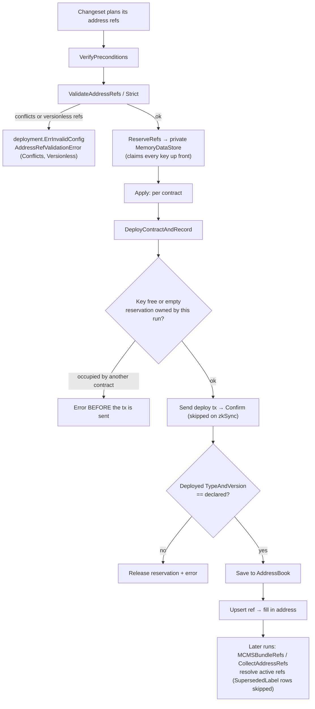
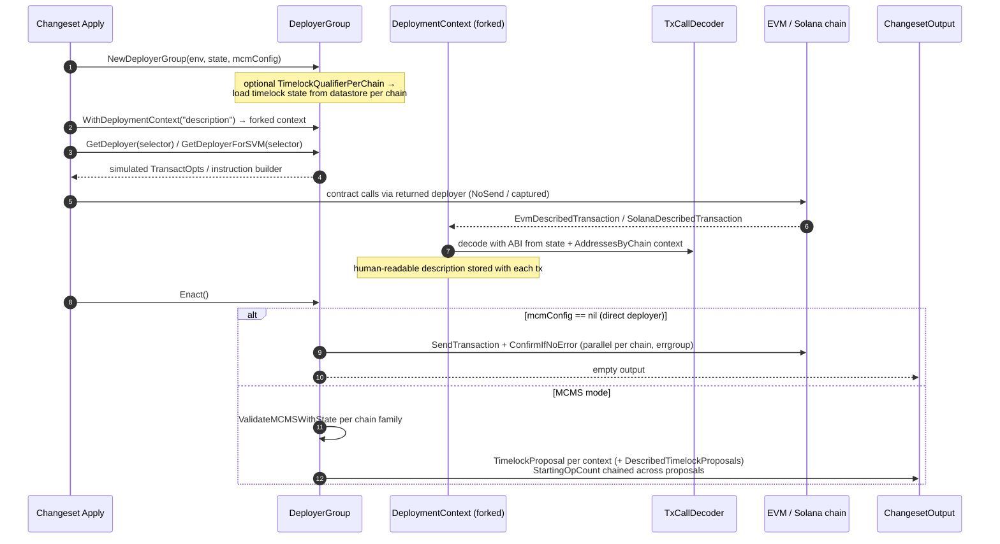
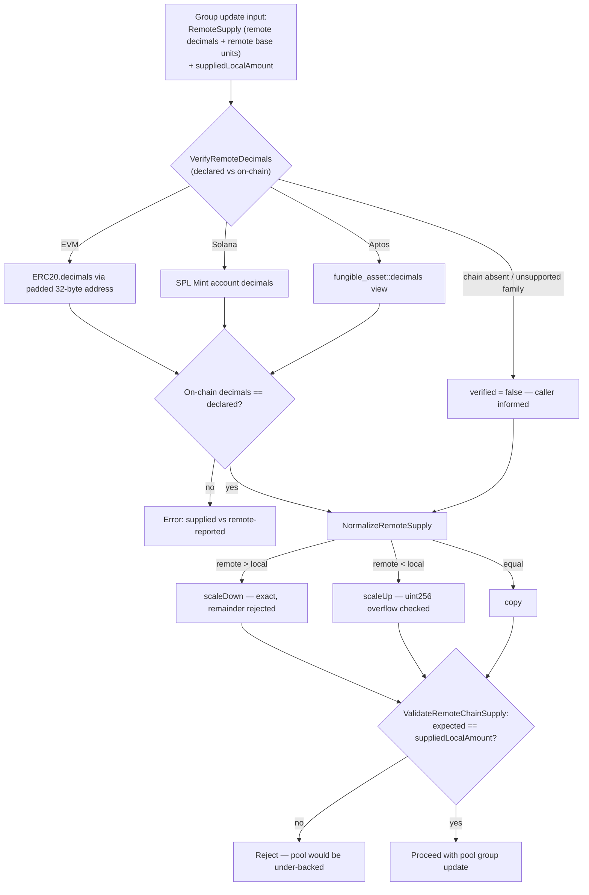

# CCIP Shared — Changeset Support (`chainlink/deployment/ccip/shared`)

## Overview

**ccip-shared_changeset-support** is the shared foundation layer that CCIP deployment changesets, operations, and sequences are built on. It lives in the `chainlink/deployment/ccip/shared` package (plus the `deployergroup`, `deploylink`, and `client` sub-packages) of the `github.com/smartcontractkit/chainlink/deployment` Go module and answers four recurring needs of every CCIP deployment script:

1. **A canonical contract taxonomy** — every CCIP contract type (EVM, Solana, Aptos, TON) named once, plus the OCR3 tuning parameters used to configure oracle jobs.
2. **A safe datastore reference lifecycle** — reserve → validate → deploy & record → load, guaranteeing that a deployed contract always ends up with a consistent datastore record and address-book entry, and that nothing is deployed under a key it cannot own.
3. **A dual-mode execution abstraction** — write a changeset once and have it either execute directly with the deployer key or emit MCMS timelock proposals, with every transaction decoded into a human-readable description.
4. **Cross-chain token domain logic** — token symbols/registries, token-pool metadata loading, and exact decimal-domain conversion of remote token supplies for hybrid/fast-transfer pools.

The package is intentionally *product-neutral plumbing*: it does not decide *what* to deploy (that is the job of the [CCIP changesets](../ccip-changesets.md), [operations](../ccip-operations.md), and [sequences](../ccip-sequences.md)) — it provides the primitives those layers call.

---

## Position in the System

This module is one of the children of [CCIP shared (`ccip-shared`)](../ccip-shared.md) inside the [CCIP Deployment Suite](../../CCIP_Deployment_Suite.md). Its closest relatives are:

| Sibling module | Relationship |
|---|---|
| [Chain state views (`ccip-shared_stateview`)](ccip-shared_stateview.md) | `DeployerGroup` consumes `stateview.CCIPOnChainState` (per-chain contract bindings, MCMS/timelock state, ABI registry) and Solana timelock loading helpers. |
| [Contract bindings (`ccip-shared_bindings`)](ccip-shared_bindings.md) | Typed Go bindings for fast-transfer/hybrid token pools and signer registries that `NewTokenPoolWithMetadata` and the deployer group wrap. |
| [Deployment framework core](../../Deployment_Framework_Core___Product_Deployments/deployment-common.md) | The `chainlink-deployments-framework` (`cldf`) primitives this module extends: `deployment.Environment`, `datastore.MemoryDataStore` / `AddressRef`, `deployment.AddressBook`, `TypeAndVersion`, `ChangeSetV2`. |
| [CCIP changesets / operations / sequences](../ccip-changesets.md) | Primary consumers of every helper in this module. |

Upstream protocol-facing types referenced here (e.g. `ccipocr3.TokenInfo`, `UnknownEncodedAddress`) are defined in the shared foundation libraries; see [Shared Foundation Libraries — Domain Types](../../Shared_Foundation_Libraries___Domain_Types.md).

---

## Architecture

```mermaid
flowchart TB
    subgraph SUP["ccip/shared — changeset support"]
        direction TB

        subgraph TAX["Contract taxonomy"]
            TYPES["types.go<br/>ContractType constants (EVM / SVM / Aptos / TON)<br/>OCRParameters + Validate"]
        end

        subgraph TOK["Token domain"]
            TINFO["token_info.go<br/>TokenRegistry · SetRegistry · NewMergedRegistry<br/>TokenConfig · TokenDetails"]
            TPOOL["token_pools.go<br/>NewTokenPoolWithMetadata[P]<br/>version + type sets"]
            HSUP["hybrid_supply.go<br/>RemoteSupply · NormalizeRemoteSupply<br/>ValidateRemoteChainSupply · VerifyRemoteDecimals"]
        end

        subgraph REF["Datastore reference lifecycle"]
            RESERVE["refs.go<br/>ReserveRefs"]
            PRE["preflight.go<br/>ValidateAddressRefs (Strict)<br/>AddressRefValidationError"]
            REC["record.go<br/>DeployContractAndRecord[C] · RecordAddress<br/>claimAddressRef · isNilStore"]
            BUNDLE["datastore_refs.go<br/>MCMSBundleRefs · CheckRefUniqueness<br/>SupersededLabel"]
        end

        subgraph EXEC["Execution abstraction"]
            DG["deployergroup/deployer_group.go<br/>DeployerGroup · DeploymentContext<br/>DescribedTransaction (EVM / SVM)"]
            DLINK["deploylink/deploy_link_token.go<br/>DeployLinkTokenChangeset"]
            WAIT["wait_contract_code.go<br/>WaitForContractCode"]
        end

        subgraph TOOL["Proposal tooling & utilities"]
            ANA["analyze.go<br/>TxCallDecoder · Argument tree<br/>DecodedCall.Describe · DescribeTimelockProposal"]
            ADDR["addresses.go · helpers.go<br/>NormalizeAddress · AddressesEqual<br/>ResolveFeeQuoterAddressAndVersion<br/>QualifierFromParts · EIP-1967 slots"]
        end

        CLI["client/types.go<br/>CCIPSendReqConfig · AnyMsgSentEvent<br/>functional options"]
    end

    subgraph FRAMEWORK["chainlink-deployments-framework (cldf)"]
        ENV["deployment.Environment<br/>BlockChains · DataStore · ExistingAddresses"]
        DS["datastore.MemoryDataStore<br/>AddressRef (chain, type, version, qualifier)"]
        AB["deployment.AddressBook"]
        MCMSLIB["mcms TimelockProposal"]
    end

    subgraph CONSUMERS["CCIP deployment consumers"]
        CS["changesets v1_5 / v1_5_1 / v1_6 / crossfamily / solana"]
        OPS["operations"]
        SEQ["sequences"]
    end

    CS --> SUP
    OPS --> SUP
    SEQ --> SUP

    DG --> ANA
    DG --> TINFO
    REC --> ADDR
    PRE --> ADDR
    SUP --> ENV
    SUP --> DS
    SUP --> AB
    DG --> MCMSLIB
```

**Build context.** The package is part of the `github.com/smartcontractkit/chainlink/deployment` module (`chainlink/deployment/go.mod`, go 1.27.1). Its behavior depends on the pinned framework versions declared there, notably `chainlink-deployments-framework v0.123.3` (datastore + changeset primitives), `mcms v0.55.2` (proposals), `chain-selectors v1.0.112` (chain family resolution), `go-ethereum`, `solana-go`, `aptos-go-sdk`, `chainlink-evm/gethwrappers` (ERC-20/ERC-165 bindings), `chainlink-common` (logger, `ccipocr3` types), `cld-changesets` (upstream LINK token changeset, Solana PDA helpers, MCMS proposal utils), `Masterminds/semver/v3`, and `sethvargo/go-retry`.

---

## Subsystems

### 1. Contract type taxonomy — `types.go`

Defines the single source of truth for `deployment.ContractType` strings across all chain families, grouped as:

- **Legacy (v1.x on-chain names):** `CommitStore`, `PriceRegistry`, `RMN`, and the v1.5 datastore aliases `EVM2EVMOnRamp` / `EVM2EVMOffRamp` (which share bindings with the modern `OnRamp`/`OffRamp` at v1.5.0 and match the on-chain `typeAndVersion`).
- **Current EVM core:** `Router`, `OnRamp`, `OffRamp`, `FeeQuoter`, `NonceManager`, `TokenAdminRegistry`, `TokenPoolFactory`, `RegistryModuleOwnerCustom`, `CCIPHome`, `RMNHome`, `RMNRemote`, `ARMProxy`, `CapabilitiesRegistry`, `DonIDClaimer`, `PriceFeed`, `TokenGovernor`, `Multicall3`, `WETH9`, and OpenZeppelin `ProxyAdmin` / `TransparentUpgradeableProxy`.
- **Tokens and pools:** tokens (`BurnMintToken`, `BurnMintERC20Token`, `BurnMintERC20TransparentToken`, `ERC20Token`, `ERC677Token`, `USDCToken`, …) and pools (`BurnMintTokenPool`, `LockReleaseTokenPool`, `USDCTokenPool`, `HybridLockReleaseUSDCTokenPool`, `BurnMintWithExternalMinter*`, `HybridWithExternalMinter*`, `USDCTokenPoolProxy`, …).
- **Test contracts:** `TestRouter`, `CCIPReceiver`, `LogMessageDataReceiver`, `USDCMockTransmitter`, etc.
- **Non-EVM:** Solana programs (`Receiver`, `SPL2022Tokens`, `CCIPCommon`, `RemoteSource/RemoteDest`, `TokenPoolLookupTable`, `CCTPTokenPool`, `SVMSignerRegistry`, …), Aptos modules (`AptosManyChainMultisig`, `AptosCCIP`, `AptosManagedTokenPool`, …), TON (`TonCCIP`, `TonReceiver`), the attestation `SignerRegistry` (EVM), the Firedrill entrypoint, and `FeeAggregator`.
- **`CLLMetadata = "CLL"`** — the marker used for datastore qualifiers (see `DefaultMCMSQualifier` in `datastore_refs.go`).

Also defined here is **`OCRParameters`**, the JSON-serializable set of OCR3 timing knobs (`DeltaProgress`, `DeltaResend`, `DeltaInitial`, `DeltaRound`, `DeltaGrace`, `DeltaCertifiedCommitRequest`, `DeltaStage`, `Rmax`, and the four `MaxDuration*` fields). Its `Validate()` method enforces that every duration is positive — with the single exception of `DeltaStage`, which may be `0` to disable staging — and that `Rmax > 0`. Changesets that write oracle configs embed this struct and call `Validate` in `VerifyPreconditions`.

### 2. Token domain — `token_info.go`, `token_pools.go`

**`token_info.go`** models "which tokens does a price-feed description describe" and "what token info goes on-chain":

- `TokenRegistry` — pluggable lookup from a price-feed description (e.g. `"ETH / USD"`) to `[]TokenSymbol`. A package-level default registry is backed by `DescriptionToTokenSymbols`; `SetRegistry` swaps the implementation and `NewMergedRegistry` builds one that merges Chainlink defaults with CLD/environment-provided mappings (de-duplicating symbols per description).
- Well-known `TokenSymbol` constants (`LINK`, `WETH`, `USDC`, `WBTC`, chain-specific wrapped natives such as `WAVAX`, `WPOL`, `WBNB`, `WS`, …), the test tokens `CCIP-BnM` / `CCIP-LnM`, decimals (`LinkDecimals = 18`, `UsdcDecimals = 6`, `LBTCDecimals = 8`), mock prices, and `TestDeviationPPB`.
- `TokenConfig` — a `map[TokenSymbol]ccipocr3common.TokenInfo` builder. `UpsertTokenInfo` adds entries and `GetTokenInfo` resolves the LINK/WETH symbol entries into a `map[UnknownEncodedAddress]TokenInfo` keyed by the *token's* address, which is what price-registry and FeeQuoter configuration consumes. `NewTestTokenConfig` wires mock aggregators for tests.
- `TokenDetails` — the minimal read interface (address, symbol, decimals) satisfied by any wrapped ERC-20 binding.

**`token_pools.go`** knows which pool types exist and reads their metadata:

- Version markers: `CurrentTokenPoolVersion` (1.5.1), `FastTransferTokenPoolVersion` (1.6.3-dev), `BurnMintWithExternalMinterFastTransferTokenPoolVersion` and `HybridWithExternalMinterFastTransferTokenPoolVersion` (1.6.0), plus the `TokenTypes`, `TokenPoolTypes`, and `TokenPoolVersions` membership sets (1.5.0 → 2.0.0).
- `tokenPool` — the behavioral interface (`GetToken`, `TypeAndVersion`) implemented by every pool binding (see [ccip-shared_bindings](ccip-shared_bindings.md)).
- `TokenPoolMetadata{Version, Symbol}` and **`NewTokenPoolWithMetadata[P tokenPool]`** — a generic loader that, given a binding constructor and a pool address: binds the pool, reads its token address, reads and parses `typeAndVersion` into a semver (with a fallback that normalizes pre-release dev tags such as `1.6.x-dev` into `1.6.3-dev`-style valid semver), binds the underlying ERC-20 and reads its symbol. Callers use this to classify an existing pool before configuring lanes, rate limits, or migrations.

### 3. Cross-family supply normalization — `hybrid_supply.go`

External-minter token pools (fast-transfer / hybrid pools) hold backing collateral and must know, in **local** base units, how much supply exists on each remote chain. This file makes the unit conversion exact and auditable:

- `RemoteSupply{Decimals, Amount}` — a remote chain's total supply in the remote chain's own smallest unit, exactly as read from `totalSupply()` (EVM), `getTokenSupply` (Solana), or the fungible-asset supply (Aptos).
- **`NormalizeRemoteSupply(amount, remoteDecimals, localDecimals)`** — converts between decimal domains, mirroring `TokenPool._calculateLocalAmount`:
  - *Scale down* (remote more precise than local) must be **exact** — any remainder is rejected, because truncating would under-back the pool.
  - *Scale up* multiplies and rejects results exceeding 256 bits.
  - Both paths cap the exponent at `maxDecimalExponent = 77` (the largest power of ten that fits a `uint256`).
- **`ValidateRemoteChainSupply`** — cross-checks the local amount a changeset wants to supply against the normalized remote supply, and rejects the classic mistake of passing the raw remote value through (with a 6-decimal remote and an 18-decimal local token that would under-back the pool by 10¹²). The error message spells out the required local amount.
- **`VerifyRemoteDecimals`** — cross-checks a declared remote decimal precision against the chain itself, per family:
  - EVM: `common.BytesToAddress` (pool stores addresses left-padded to 32 bytes) + `ERC20.Decimals`.
  - Solana: SPL `Mint` account decoded via `GetAccountDataBorshInto`.
  - Aptos: `0x1::fungible_asset::decimals` view call on the metadata object (parsing the JSON number the client returns).
  - Returns `verified = false` (rather than silently passing) when the chain is absent from the environment or the family is unsupported, so the caller knows the declared value was the only source of truth.

### 4. Datastore reference lifecycle — `refs.go`, `preflight.go`, `record.go`, `datastore_refs.go`

A datastore key is `(chain selector, type, version, qualifier)`. The helpers in this group make that key safe across the whole changeset lifecycle:

- **`refs.go` → `ReserveRefs`** claims every ref a changeset is about to write into a fresh `datastore.MemoryDataStore` *before anything is deployed*. Because the key does not depend on the deployed address, the whole key set is known up front; subsequent writes are upserts into keys the changeset already owns and cannot conflict. It rejects versionless refs (no key without a version) and unqualified members of a multi-instance group — an empty qualifier reads as "any" during lookups, so every instance of a repeated `(chain, type, version)` needs a name. Failing here is `ErrRefReservation`.
- **`preflight.go` → `ValidateAddressRefs` / `ValidateAddressRefsStrict`** are meant to be called from a changeset's `VerifyPreconditions` with the refs it *plans* to produce. `AddressRefValidationError` carries structured detail (`Conflicts` — pairs of refs sharing one key; `Versionless` — refs with no version) and is wrapped in `deployment.ErrInvalidConfig` so callers can extract it with `AsAddressRefValidationError`. The non-strict variant treats replacing an address already held under the same key as a **logged redeploy**; the strict variant rejects it with `deployment.ErrInvalidEnvironment` (for changesets that only ever deploy fresh contracts). `sameContract` deliberately only recognizes sameness when an actual address is known — two undeployed refs competing for one key must fail.
- **`record.go` → `DeployContractAndRecord[C any]`** is `deployment.DeployContract` plus an atomic record write. Its ordering is the point:
  1. The key is **claimed before the transaction is sent** (`claimAddressRef`), so a key conflict aborts before a contract exists on chain.
  2. On any later failure the claim is **released** (only if this call created it — an empty reservation found in place belongs to `ReserveRefs` and is left for the owner).
  3. The deployed `TypeAndVersion` is verified against the declared one *before* the address book is written, because the datastore key was reserved for the declared type.
  4. The address book is saved, then the ref is upserted with the real address (guaranteed conflict-free because the key is already held).
  
  A typed-nil datastore is rejected explicitly (`isNilStore` handles the non-nil-interface/nil-pointer trap) — silently degrading to address-book-only would lose the record this function exists to write.
- **`record.go` → `RecordAddress`** is the counterpart for addresses that were *not* produced by an EVM deployment: derived Solana PDAs, Sui objects, or imported contracts. It enforces the same occupancy rule (an empty-address reservation or an equal address — compared with family case rules — is fine; a different contract is `ErrAddressRefExists`), is idempotent on re-runs (`saveAddressBookRecord` treats a same-type/version duplicate as a no-op and rejects a genuine type/version disagreement), and a nil address book is an explicit opt-out of the legacy registry.
- **`datastore_refs.go`** handles *reading* refs back:
  - **`MCMSBundleRefs`** selects the active MCMS bundle rows for one chain and qualifier, filtering out `SupersededLabel`-marked rows and versionless refs. For the `DefaultMCMSQualifier` (the `CLL` qualifier) only, an empty-qualified bundle is accepted as a legacy fallback — singletons and MCMS deployed by `DeployMCMSWithTimelockV2` in test environments were written that way; a non-empty selection always wins and dedicated bundles (RMN, ultra-fast-curse, operator) never fall back. The result is sorted deterministically and passed through `CheckRefUniqueness`, which rejects two active refs claiming one `(type, version, qualifier)` identity with different addresses.
  - **`SupersededLabel = "superseded"`** marks rows an operator declared historical; `ResolveFeeQuoterAddressAndVersion` honors it too.

### 5. Execution abstraction — `deployergroup/deployer_group.go`

`DeployerGroup` lets a changeset author write contract calls **without knowing whether they will be executed by the deployer EOA or queued into MCMS timelock proposals**. It depends on [chain state views](ccip-shared_stateview.md) (`CCIPOnChainState` for per-chain contract bindings, `MustGetEVMChainState(...).ABIByAddress` for decoding, and `ValidateSolanaTimelockConfig`) and on the [MCMS bindings](ccip-shared_bindings.md) loaded from the datastore.

Key mechanics:

- **Construction:** `NewDeployerGroup(e, state, mcmConfig)` returns the `WithContext` builder (the deprecated alias `DeployerGroupWithContext` still compiles). If `mcmConfig.TimelockQualifierPerChain` is set, a datastore is **required** (it panics otherwise) and the timelock state for each qualified chain is refreshed from the datastore via `UpdateMCMSStateWithAddressFromDatastoreForChain`.
- **`DeploymentContext`** accumulates described transactions per chain and supports `Fork(description)`, producing a linked list; `getContextChainInOrder` flattens it oldest-first so transactions appear in proposal order.
- **`GetDeployer(selector)`** returns `bind.TransactOpts` that, in MCMS mode, use the timelock address as `From`; signing is always simulated (`NoSend = true`) with a custom signer that:
  - derives each nonce from the number of transactions already recorded for that chain (so a batch of calls is consistent),
  - decodes the call with `TxCallDecoder` using the ABI registered for the target address in the chain state, producing a Markdown description,
  - appends an `EvmDescribedTransaction` to the context and bumps `sim.Nonce`.
- **`GetDeployerForSVM(selector)`** resolves the authority (deployer pubkey, or the timelock signer PDA derived from `LoadMCMSWithTimelockFromDataStore` with the per-chain qualifier) and returns a closure that turns a `DeployerForSVM` invocation into a recorded `SolanaDescribedTransaction`.
- **`DescribedTransaction`** has two implementations. `EvmDescribedTransaction.ToMCMS` maps straight to an MCMS transaction; `SolanaDescribedTransaction.ToMCMS` clears signer flags on accounts (the timelock PDA signer is re-added by the MCMS layer) and wraps the instruction via `mcmsSolana.NewTransaction`.
- **`Enact()`** branches:
  - *Deployer mode* sends EVM transactions and confirms them (`ConfirmIfNoErrorWithABI` when the state carries the ABI, else `ConfirmIfNoError`), or confirms Solana instruction batches, running chains concurrently through an `errgroup`.
  - *MCMS mode* validates the MCMS state per chain (`ValidateMCMSWithState`: EVM via `state.EVMMCMSStateByChain()` + `mcmConfig.Validate`; Solana via `stateview.ValidateSolanaTimelockConfig`; TON is a TODO no-op), builds timelock and MCM address maps (`BuildTimelockAddressPerChain`, `BuildMcmAddressesPerChainByAction`, honoring per-chain qualifiers), assembles batches into a `TimelockProposal` per context (`BuildProposalFromBatchesV2`), renders `DescribedTimelockProposals`, and chains `StartingOpCount` across multiple proposals so subsequent proposals continue where the previous one left off.

### 6. Proposal decoding — `analyze.go`

`TxCallDecoder` turns raw calldata into the human-readable descriptions embedded in proposals:

- **Analyzer pipeline:** `NewTxCallDecoder(extraAnalyzers)` prepends caller-supplied `Analyzer` functions before the built-ins, giving products an extension point for domain-specific argument rendering. The built-ins are `BytesAndAddressAnalyzer` (`address`/`bytes`/`bytesN` → hex, addresses checksummed) and `ChainSelectorAnalyzer` (a `uint64` whose *name* matches `[cC]hain([sS]el)?.*` → rendered as `<selector> (<chain name>)` via `GetChainNameBySelector`).
- **`Argument` tree:** `SimpleArgument`, `BytesArgument`, `AddressArgument` (whose `Annotation` resolves the address against `AddressesByChain` from the `ArgumentContext`, e.g. *"address of Router 1.6.0 from ethereum-mainnet"*), `ChainSelectorArgument`, recursive `ArrayArgument` (auto-indents when nested) and `StructArgument` (pretty-prints with ≥ 2 fields).
- **`DecodedCall.Describe`** emits Markdown: annotated **Address**/**Method** header, then an Inputs/Outputs table with inline values, pipe escaping, and `
` blocks for multi-line (nested) values.
- **`DescribeTimelockProposal`** renders whole proposals: one `### Batch n` section per operation batch with chain selector + resolved chain name and a `#### Operation i` block per described transaction. This is what fills `DescribedTimelockProposals` in the MCMS mode of `DeployerGroup`.

### 7. Address handling and shared helpers — `addresses.go`, `helpers.go`

- **`NormalizeAddress` / `AddressesEqual`** — case rules are family-specific: EVM hex addresses are folded to lower case (EIP-55 checksums may differ between sources), while Solana/Sui addresses are case-sensitive and are left untouched; an unknown selector is also left alone (erasing a distinction that *does* exist would silently merge two contracts). All intra-module address comparisons go through these.
- **`ResolveFeeQuoterAddressAndVersion`** — resolves the FeeQuoter with the highest semver on a chain from a ref list, skipping versionless and `superseded` rows, rejecting two different addresses at the same version (ambiguous) and non-hex addresses.
- **`CollectAddressRefs` / `CollectDataStoreRefs`** — flatten refs from the environment datastore and (for the former) the existing address book, unkeyed and un-de-duplicated, for chain-singleton resolution without keyed datastore lookups. Read failures are errors, never partial results.
- **`QualifierFromParts` / `ParseQualifierParts`** — build multi-instance qualifiers by quoting each part (`"a"/"b"` style) so free-form caller text (e.g. metadata) cannot collide across part boundaries; the parser also accepts the historical unquoted form during migration. `TokenPoolLookupTableQualifier` composes this for Solana token-pool lookup tables keyed by (mint, pool type, metadata).
- **Capability & proxy constants** — `CCIPCapabilityID` (keccak of ABI-encoded `"ccip"`, `"v1.0.0"`), `GetCCIPDonsFromCapRegistry` (DONs whose capability list contains it), and the EIP-1967 `AdminSlot` / `TUPImplementationSlot` constants used when working with transparent upgradeable proxies and token pool proxies.

### 8. Deployment utilities — `wait_contract_code.go`, `deploylink`, `client`

- **`WaitForContractCode`** retries (Fibonacci backoff, 500 ms → capped 2 s, 30 s max) until bytecode is visible at an address, because geth in Docker CI can return a mined deployment receipt before `eth_getCode` serves the code on all RPC paths.
- **`deploylink.DeployLinkTokenChangeset`** is a `cldf.ChangeSetV2` wrapper around the upstream `cld-changesets` LINK token changeset: it delegates `VerifyPreconditions` and `Apply`, then back-fills a memory `AddressBook` from the returned datastore refs for backward compatibility with consumers that still read the address book.
- **`client/types.go`** carries the minimal message-sending types extracted from testhelpers to avoid an import cycle: `AnyMsgSentEvent` (sequence number + raw chain-specific event) and `CCIPSendReqConfig` with functional options (`WithSourceChain`, `WithDestChain`, `WithSender`, `WithMessage`, `WithTestRouter`, `WithMaxRetries`).

---

## Key data flow: hybrid token supply

---

## Error model and invariants

| Error / sentinel | Source | Meaning |
|---|---|---|
| `ErrRefReservation` | `refs.go` | The refs a changeset intends to write cannot all be held in a datastore at once (versionless ref, unqualified multi-instance member, duplicate key). |
| `AddressRefValidationError` (+ `AsAddressRefValidationError`) | `preflight.go` | Structured precondition failure: `Conflicts` (shared keys) and `Versionless` refs; wrapped in `deployment.ErrInvalidConfig`. |
| `deployment.ErrInvalidEnvironment` | `preflight.go` (strict mode) | A planned ref would replace a different address held under the same key. |
| `datastore.ErrAddressRefExists` | `record.go` | A key already holds a different contract; distinct qualifiers are required. Raised before a transaction is sent or a registry is written. |
| Ambiguity errors | `helpers.go`, `datastore_refs.go` | Two same-version FeeQuoters at different addresses; two active MCMS refs with one `(type, version, qualifier)` but different addresses. |
| Exactness errors | `hybrid_supply.go` | Non-exact scale-down (would truncate supply), > uint256 scale-up, decimals mismatch, > 10⁷⁷ exponent. |

Invariants the module guarantees to its consumers:

1. **Claim-before-deploy** — a datastore key is owned before a contract exists, so occupancy conflicts can never strand a deployed contract.
2. **Single writer per key** — occupancy by a *different* contract is always an error; reservations and idempotent re-records are the only sanctioned reuses.
3. **Atomic deploy+record** — the address book and datastore ref for a contract are written in the same step, with a released reservation on failure.
4. **Declared-vs-deployed type safety** — a contract is recorded under the `TypeAndVersion` it was declared with, verified against what actually deployed.
5. **Case-correct identity** — address equality and normalization respect the chain family's case semantics.
6. **Exact supply conversion** — pool backing is computed in local base units with truncation impossible.

---

## Related documentation

- Parent: [CCIP shared (`ccip-shared`)](../ccip-shared.md)
- Siblings: [Chain state views](ccip-shared_stateview.md) · [Contract bindings](ccip-shared_bindings.md)
- Consumers: [CCIP changesets](../ccip-changesets.md) · [CCIP operations](../ccip-operations.md) · [CCIP sequences](../ccip-sequences.md)
- Framework: [Deployment Framework Core — Product Deployments](../../Deployment_Framework_Core___Product_Deployments.md) · [Deployment common](../../Deployment_Framework_Core___Product_Deployments/deployment-common.md)
- Suite root: [CCIP Deployment Suite](../../CCIP_Deployment_Suite.md)
