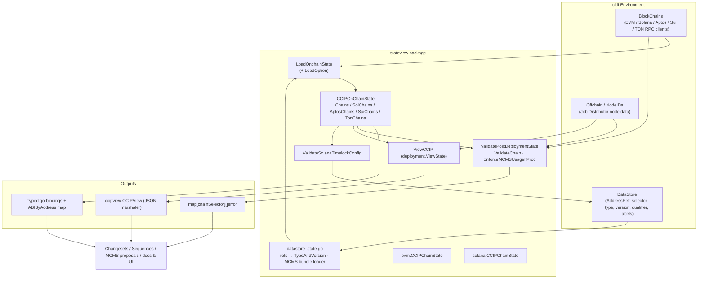
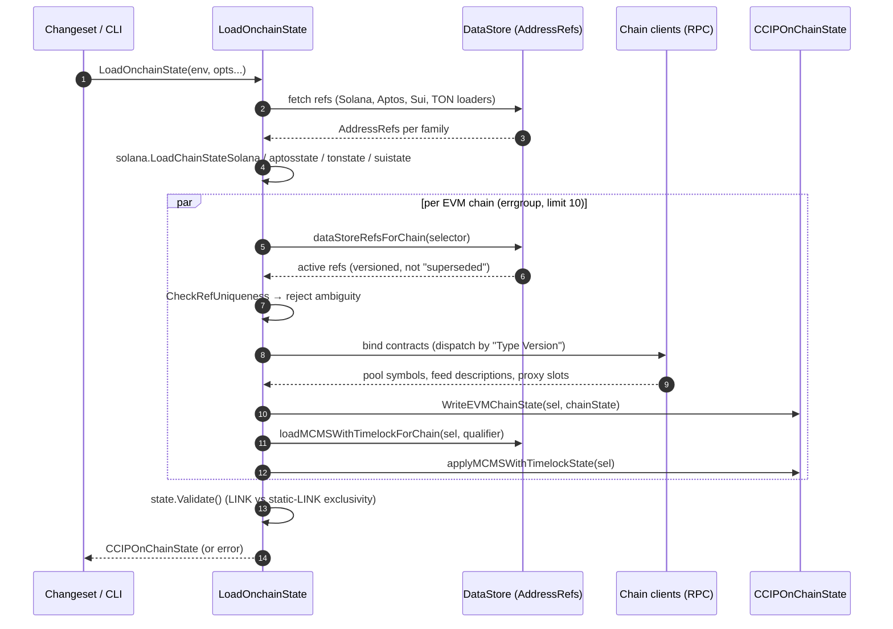
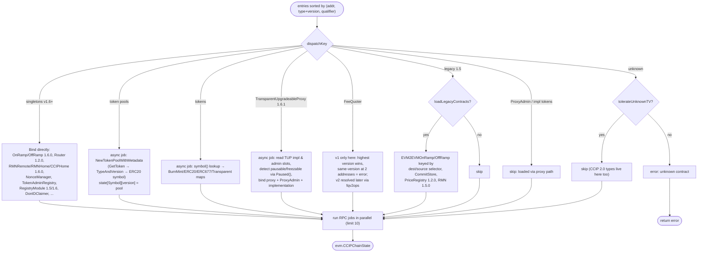
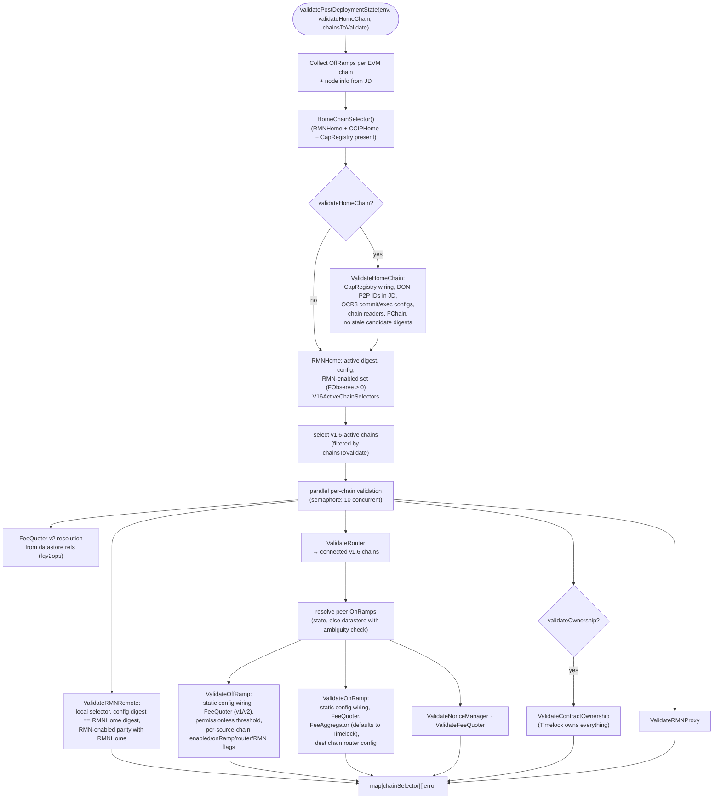
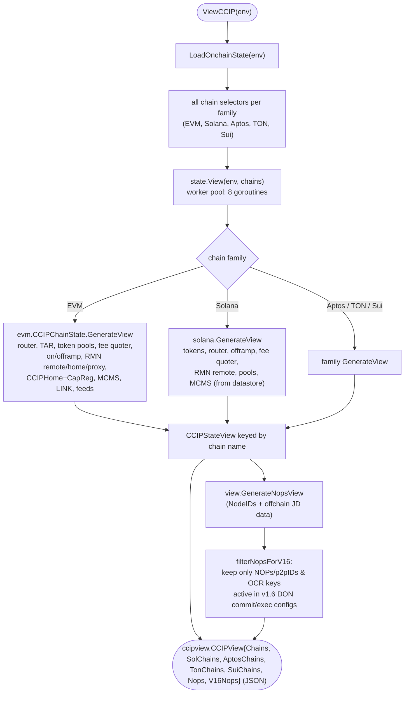

# CCIP Shared Stateview (`stateview`)

## Introduction

The `ccip-shared_stateview` module (package `chainlink/deployment/ccip/shared/stateview`, part of the [`github.com/smartcontractkit/chainlink/deployment`](../../Deployment_Framework_Core___Product_Deployments.md) Go module) is the **single source of truth for reading deployed CCIP on-chain state** inside the [CCIP Deployment Suite](../../CCIP_Deployment_Suite.md). It answers three questions for any set of chains in a `cldf.Environment`:

1. **What is deployed?** — `LoadOnchainState` resolves contract addresses from the deployment framework's `DataStore` address references and binds them into typed, version-aware Go bindings per chain family (EVM, Solana, Aptos, Sui, TON), producing a `CCIPOnChainState`.
2. **Is the deployment correctly configured?** — `ValidatePostDeploymentState` (and friends) cross-check on-chain static/dynamic configuration across Router, OnRamp, OffRamp, FeeQuoter, NonceManager, RMNHome/RMNRemote, CCIPHome and the MCMS/timelock governance stack, aggregating per-chain errors.
3. **What does it look like?** — `ViewCCIP` (a `deployment.ViewState` implementation) and `CCIPOnChainState.View` render JSON-serializable views of every contract for documentation, UI and MCMS proposal workflows.

The module is deliberately **family-agnostic at its API surface** (one struct, five maps keyed by chain selector) while delegating family-specific binding, PDA/program and view logic to per-family sub-packages (`evm/`, `solana/`) and to sibling product loaders (Aptos, Sui, TON). It never mutates chains: it is a read/validate/render layer consumed by [changesets](../ccip-changesets.md), [sequences](../ccip-sequences.md) and [operations](../ccip-operations.md).

## Module at a glance

| File | Core symbols | Responsibility |
|---|---|---|
| `stateview/state.go` | `CCIPOnChainState`, `LoadOnchainState`, `LoadChainState`, `ValidateChain`, `ValidatePostDeploymentState` | Multi-family state container, datastore-backed loading, EVM contract-type dispatch, post-deployment validation orchestration |
| `stateview/datastore_state.go` | `DataStoreTypeVersionsForChain`, `loadMCMSWithTimelockForChain`, `AddressRefsToTypeVersions` | AddressRef → binding-input plumbing, MCMS bundle resolution, ambiguity checks, deterministic ordering |
| `stateview/view.go` | `ViewCCIP` | Top-level `deployment.ViewState` entry point; v1.6 NOP filtering for billing/JIRA |
| `stateview/solana_timelock.go` | `ValidateSolanaTimelockConfig` | Datastore-backed Solana MCMS/timelock proposal validation |
| `stateview/evm/state.go` | `evm.CCIPChainState` | EVM bindings, per-contract config validators, EVM `GenerateView` |
| `stateview/solana/state.go` | `solana.CCIPChainState` | Solana program/PDA state, validators, Solana `GenerateView`, ownership checks |

## Architecture

The module sits between the **deployment framework environment** (chain clients + datastore + offchain/JD data) and its consumers (changesets, MCMS proposal builders, docs/UI tooling). Shared primitives come from the parent [ccip-shared](../ccip-shared.md) module — contract-type constants, `MCMSBundleRefs`/`CheckRefUniqueness`, and `NewTokenPoolWithMetadata` (detailed in [ccip-shared_changeset-support](ccip-shared_changeset-support.md)) — and binding types from [ccip-shared_bindings](ccip-shared_bindings.md).



Internally, `CCIPOnChainState` composes per-family chain-state structures. The EVM and Solana variants are owned by this module; Aptos, Sui and TON states are produced by their respective product packages and merely stored here.

```mermaid
classDiagram
    class CCIPOnChainState {
        +map[uint64]evm.CCIPChainState Chains
        +map[uint64]solana.CCIPChainState SolChains
        +map[uint64]aptosstate.CCIPChainState AptosChains
        +map[uint64]suistate.CCIPChainState SuiChains
        +map[uint64]tonstate.CCIPChainState TonChains
        -evmMu sync.RWMutex
        +EVMChains() []uint64
        +EVMChainState(sel) (evm.CCIPChainState, bool)
        +WriteEVMChainState(sel, st)
        +ValidatePostDeploymentState(...) map[uint64][]error
        +View(e, chains) CCIPStateView
        +SupportedChains() map[uint64]struct{}
    }
    class evm_CCIPChainState {
        <<evm/state.go>>
        +MCMSWithTimelockState (embedded)
        +LinkTokenState (embedded)
        +ABIByAddress map[string]string
        +OnRamp / OffRamp / Router / FeeQuoter
        +RMNRemote / RMNHome / CCIPHome
        +TokenAdminRegistry / NonceManager
        +token &amp; pool maps (symbol → version → binding)
        +GenerateView(lggr, chain) ChainView
        +ValidateOnRamp / ValidateOffRamp / ...
    }
    class solana_CCIPChainState {
        <<solana/state.go>>
        +Router / OffRamp / FeeQuoter / RMNRemote PublicKey
        +BurnMintTokenPools / LockReleaseTokenPools
        +TokenPoolLookupTable / cached PDAs
        +GenerateView(e, selector) SolChainView
        +ValidateOwnershipSolana(...)
    }
    class CCIPStateView {
        +map[string]ChainView Chains
        +map[string]SolChainView SolChains
        +... (keyed by chain name)
    }
    CCIPOnChainState o-- evm_CCIPChainState
    CCIPOnChainState o-- solana_CCIPChainState
    CCIPOnChainState --> CCIPStateView : View()
```

## Data flow: loading on-chain state

`LoadOnchainState` is the canonical loader. It is fully datastore-backed: addresses are never guessed, they come from `Environment.DataStore` `AddressRef` rows (chain selector, contract type, semver version, qualifier, labels) that earlier changesets/operations recorded (see [DeployContractAndRecord in ccip-shared_changeset-support](ccip-shared_changeset-support.md)).



Key loading semantics:

- **Filtering**: only *active* refs load — `isActiveRef` requires a non-nil version and absence of the `SupersededLabel` label, so operators can retire rows without deleting them.
- **Ambiguity is fatal**: `CheckRefUniqueness` (from [ccip-shared](../ccip-shared.md)) rejects two active refs claiming the same `(type, version, qualifier)` identity at different addresses. Solana additionally collapses alias types (`TestReceiver` → `Receiver`) and keeps the *highest version* per `(type, qualifier)`.
- **Concurrency**: EVM chain loading uses `errgroup` with limit 10; inside each chain, RPC-bound work (token pool symbol resolution, USD feed description lookup, proxy implementation slot reads) runs in a second bounded `errgroup`. Dispatch is sorted by `(address, type+version, qualifier)` so behavior is deterministic regardless of map iteration order.
- **Tolerance mode**: datastore loads always append `WithTolerateUnknownContractTypes()` because the datastore is a superset that also serves CCIP 2.0 loaders holding types this legacy loader does not model.

### Load options

| Option | Effect |
|---|---|
| `WithLoadLegacyContracts(bool)` | Bind v1.5 lane contracts (`EVM2EVMOnRamp`, `EVM2EVMOffRamp`, `CommitStore`, `PriceRegistry`, `RMN`) — off by default to keep loads cheap; used during migrations |
| `WithMCMSQualifier(qualifier)` | Select a non-default MCMS bundle (e.g. RMN, operator bundles); default is `DefaultMCMSQualifier` (the `CLL` qualifier, with an empty-qualifier legacy fallback) |
| `WithTolerateUnknownContractTypes()` | Skip unrecognized contract types instead of erroring |

### EVM contract-type dispatch

`loadChainStateWithEntries` is the heart of EVM loading: a deterministic switch on `dispatchKey` (`"<ContractType> <semver>"`) that binds generated go-binding constructors and populates `ABIByAddress` (used later for multicall decoding, see `TxCallDecoder` in [ccip-shared_changeset-support](ccip-shared_changeset-support.md)).



Notable behaviors:

- **Token pools** are keyed `TokenSymbol → semver.Version → binding` via `ccipshared.NewTokenPoolWithMetadata`, which resolves the pool's token, parses its on-chain `typeAndVersion` (with a `1.6.x-dev → 1.6.3-dev` normalization fallback) and fetches the token symbol over RPC. Pool families covered: BurnMint (1.5.0 proxy, 1.5.1, 1.6.1), FastTransfer (1.6.0, 1.6.3-dev, external-minter and hybrid variants), LockRelease (1.5.1, 1.6.1), BurnWithFromMint, BurnFromMint, USDC pools (1.5.1, 1.6.2) and CCTP message-transmitter proxies.
- **TokenGovernor** resolves the governed token and its symbol; **PriceFeed** entries parse the AggregatorV3 `description()` into token symbols and register one feed per symbol.
- **MCMS with timelock** bindings (proposer/canceller/bypasser MCM, `RBACTimelock`, `CallProxy`) load through `loadMCMSWithTimelockForChain` and are applied with `applyMCMSWithTimelockState`, which keeps `ABIByAddress` in sync.
- **Home chain detection**: `HomeChainSelector()` returns the (unique) EVM chain holding `RMNHome` + `CCIPHome` + `CapabilitiesRegistry`. `EnforceMCMSUsageIfProd` uses ownership of these two contracts (owned by the Timelock ⇒ production ⇒ MCMS config required) and rejects environments with multiple candidate home chains.

## Data flow: post-deployment validation

`ValidatePostDeploymentState` orchestrates full-stack consistency checks after a deployment or upgrade. `ValidatePostDeploymentStateWithoutMCMSOwnership` runs the same flow minus contract-ownership checks (useful when governance migration is still in progress).



Cross-family consistency rules enforced here include: the OffRamp's per-source RMN verification flag must be *disabled* when RMN is not enabled in RMNHome/RMNRemote for that source; the OnRamp/OffRamp dynamic `FeeQuoter` must equal the bound v1 FeeQuoter or the datastore-resolved v2 FeeQuoter; and OCR3 configs require ≥3 unique signers/transmitters with `transmitters ≥ 3*FChain + 1`.

Two public helpers complete the validation surface:

- `ValidateChain(env, state, chainSel, mcmsCfg)` — validates chain presence (env + state) per family and, when an MCMS config is supplied, EVM `TimelockConfig.Validate`, Solana `ValidateSolanaTimelockConfig`, or Aptos `ValidateAptos`.
- `ValidateOwnershipOfChain` — concurrent ownership check of an explicit contract set against either the deployer key (test) or the Timelock (production).

## Data flow: view generation (docs / UI / MCMS)

`ViewCCIP` implements the framework's `deployment.ViewState` contract used by deployment docs and UI tooling ([Deployment Framework Core](../../Deployment_Framework_Core___Product_Deployments.md)). It renders contracts *and* node-operator (NOP) data, including a v1.6-specific NOP subset used for NOP billing and JIRA.



Per-chain EVM view generation is itself parallel (8 workers over a job channel), with each contract view writing into a mutex-guarded `ChainView` builder; token pool view failures log a warning and skip rather than abort the whole view.

## Component interaction: datastore plumbing (`datastore_state.go`)

This file is the adapter between the framework's generic `AddressRef` rows and the loader's input shapes. It also owns MCMS bundle resolution:

- `isActiveRef` — versioned and not `SupersededLabel`-marked.
- `AddressRefsToTypeVersions` — reshape refs to `address → []TypeAndVersion` (labels preserved, versionless refs skipped); `flattenTypeVersions` / `TypeVersionsToSlices` convert in the opposite direction for legacy helpers.
- `dataStoreRefsForChain` / `DataStoreTypeVersionsForChain` — per-chain filtered fetch with `CheckRefUniqueness` ambiguity rejection.
- `loadMCMSWithTimelockForChain(e, selector, qualifier)` — qualifier-isolated MCMS bundle resolution via `ccipshared.MCMSBundleRefs` (the default `CLL` qualifier also accepts an empty-qualifier bundle as a legacy fallback; dedicated bundles like RMN never fall back), then `MaybeLoadMCMSWithTimelockChainStateFromRefs`. An empty bundle yields an empty state, not an error.
- `sortAddressRefs` — deterministic ordering (chain, type, version, qualifier, address) for callers that pick one ref from many.
- `UpdateMCMSStateWithAddressFromDatastoreForChain` — public entry to re-resolve and apply an MCMS bundle into an existing `CCIPOnChainState` (e.g. after a governance deployment).

For the semantics of qualifiers and ref reservation rules (`ReserveRefs` rejecting unqualified members of multi-instance groups), see [ccip-shared_changeset-support](ccip-shared_changeset-support.md).

## Solana specifics

### Solana chain state (`solana/state.go`)

`solana.CCIPChainState` holds program public keys (Router, FeeQuoter, OffRamp, RMNRemote, token pools keyed by metadata id, LINK/WSOL/USDC/SPL tokens), plus **pre-derived PDAs** (router/fee-quoter/offramp config PDAs, RMN remote config & curses PDAs) and the `TokenPoolLookupTable` (token → pool type → metadata → ALT address), which avoids redundant on-chain PDA derivation during changesets.

- Loading (`LoadChainStateSolana`) consumes datastore refs; `selectSolanaRefs` dedupes per `(type, qualifier)` keeping the highest version and erroring on same-version ambiguity, then dispatch is type-based with receiver/offramp version-deduping and qualifier-part parsing for lookup tables.
- Validation helpers cover router/offramp/fee-quoter config-PDA existence and initialization, pool deployment (config PDA present for the active pool), token-program membership (`TokenToTokenProgram`) and fee aggregator configuration.
- Ownership: `ValidateOwnershipSolana` and `IsSolanaProgramOwnedByTimelock` compare each program's config owner (or pool config owner) with the timelock signer PDA derived from the datastore-resolved MCMS bundle; supported programs include Router, OffRamp, FeeQuoter, RMNRemote, BurnMint/LockRelease/CCTP pools and the SVM signer registry.
- `GenerateView` renders tokens, FeeQuoter, Router, OffRamp, RMNRemote and pool views (via `deployment/ccip/view/solana`), plus an MCMS-with-timelock view resolved from the datastore.

### Solana timelock validation (`solana_timelock.go`)

`ValidateSolanaTimelockConfig` is the CCIP-owned, datastore-backed replacement for the framework's `TimelockConfig.ValidateSolana` (the framework itself is not patched). It:

1. Defaults `MCMSAction` to `schedule` and restricts actions to schedule/cancel/bypass.
2. Resolves the qualifier from `tc.TimelockQualifierPerChain[chainSel]` or falls back to `DefaultMCMSQualifier` (empty qualifier also accepted for the default).
3. Requires the `RBACTimelock` ref for the chain and that the address parses as `programID.PDASeed`.
4. Additionally requires the action's MCMS account: Proposer (schedule), Canceller (cancel), Bypasser (bypass).

## Cross-family address helpers

`CCIPOnChainState` exposes family-normalized helpers used by lane/message tooling and other [CCIP modules](../../CCIP_Cross-Chain_Protocol/ccip.md):

- `GetOnRampAddressBytes` / `GetOffRampAddressBytes` — raw address bytes per family (EVM address bytes, Solana pubkeys — with the Router serving as the Solana "onramp", Aptos `CCIPAddress`, Sui normalized string→bytes, TON raw-address codec).
- `ValidateRamp(sel, rampType)` — existence check for OnRamp/OffRamp per family.
- `OffRampPermissionLessExecutionThresholdSeconds` — dynamic config read per family (EVM call, Solana config PDA, Aptos module call; Sui currently returns a hardcoded 2-hour placeholder).
- `SupportedChains()` — union of all family selectors; `EVMMCMSStateByChain` / `SolanaMCMSStateByChain` / `AptosMCMSStateByChain` / `TONMCMSStateByChain` — MCMS state snapshots for proposal building.

## Extending the module (adding a contract type)

1. Define the `deployment.ContractType` constant in `chainlink/deployment/ccip/shared/types.go` (see [ccip-shared](../ccip-shared.md)).
2. Add a `case` to the `dispatchKey` switch in `loadChainStateWithEntries` (`stateview/state.go`), binding the generated wrapper (bindings live in [ccip-shared_bindings](ccip-shared_bindings.md)) and recording its ABI in `ABIByAddress`. RPC-bound work (symbol lookups, etc.) should be queued into the parallel `work` slice, guarded by the shared mutex.
3. If the type belongs to a product family, prefer a dedicated loader package (like `aptosstate`/`tonstate`/`suistate`) and store results in the corresponding `CCIPOnChainState` map.
4. Extend `evm.CCIPChainState.Validate*` if the contract participates in static/dynamic wiring, and `GenerateView` if it should appear in docs/UI.
5. Remember: unknown types error at load time unless `WithTolerateUnknownContractTypes()` is passed — new types deployed by CCIP 2.0 pipelines should either be modelled here or tolerated by loaders that need coexistence.

## Concurrency and determinism guarantees

- `CCIPOnChainState.Chains` is guarded by an internal `sync.RWMutex`; use `EVMChainState` / `MustGetEVMChainState` / `WriteEVMChainState` instead of touching the map directly.
- All parallelism is bounded: 10-way chain loading and per-chain RPC work (EVM), 10-way semaphore in validation, 8-worker pools in view generation.
- Dispatch ordering, ref sorting (`sortAddressRefs`, bundle sorting in `MCMSBundleRefs`, Solana ref selection) are all deterministic, so error messages and selection outcomes never depend on map iteration order.
- Ambiguity anywhere (duplicate `(type, version, qualifier)` at different addresses, multiple home chains, multiple FeeQuoter v1 instances of the same version) fails loudly rather than picking arbitrarily.

## Relationships to other modules

- [ccip-shared](../ccip-shared.md) — parent module: contract-type constants, `DefaultMCMSQualifier`/`SupersededLabel`, `MCMSBundleRefs`, `CheckRefUniqueness`, `NewTokenPoolWithMetadata`, `ResolveFeeQuoterAddressAndVersion`, `CollectDataStoreRefs`.
- [ccip-shared_changeset-support](ccip-shared_changeset-support.md) — ref reservation (`ReserveRefs`), address recording (`DeployContractAndRecord`, `RecordAddress`), preflight validation and helper utilities that *write* the refs stateview reads.
- [ccip-shared_bindings](ccip-shared_bindings.md) — hand-written binding wrappers (fast-transfer pool adapters, signer registries, token governor) bound by the EVM dispatcher.
- [ccip-changesets](../ccip-changesets.md), [ccip-operations](../ccip-operations.md), [ccip-sequences](../ccip-sequences.md) — primary consumers: every changeset loads state via `LoadOnchainState` and validates via `ValidateChain` / `ValidatePostDeploymentState`.
- [CCIP protocol module](../../CCIP_Cross-Chain_Protocol/ccip.md) — runtime counterpart: defines the on-chain contract semantics (OCR transmitters, codecs) whose deployments stateview inspects.
- [Deployment Framework Core](../../Deployment_Framework_Core___Product_Deployments.md) — `cldf.Environment`, `DataStore`, `AddressRef`, `TypeAndVersion`, `ViewState` contract this module implements.
- [Shared Foundation Libraries](../../Shared_Foundation_Libraries___Domain_Types.md) — chain-agnostic type foundations (relayer/provider interfaces, chain selectors) underlying the bindings bound here.

## Build and tooling notes

The package lives in the `github.com/smartcontractkit/chainlink/deployment` Go module (see `chainlink/deployment/go.mod`), which pins the chainlink core framework via a `replace` directive and depends on the CCIP contract bindings (`chainlink-ccip` gobindings, `ccip-contract-examples`, `chainlink-evm` gethwrappers) that the dispatcher binds. Linting follows the repository-wide `chainlink/.golangci.yml` configuration, and module-level tests (`state_test.go`, `datastore_state_test.go`, `view_test.go`, `update_mcms_state_test.go`, plus `evm/` and `solana/` suites) exercise the loader, validation and view flows against simulated chains.
