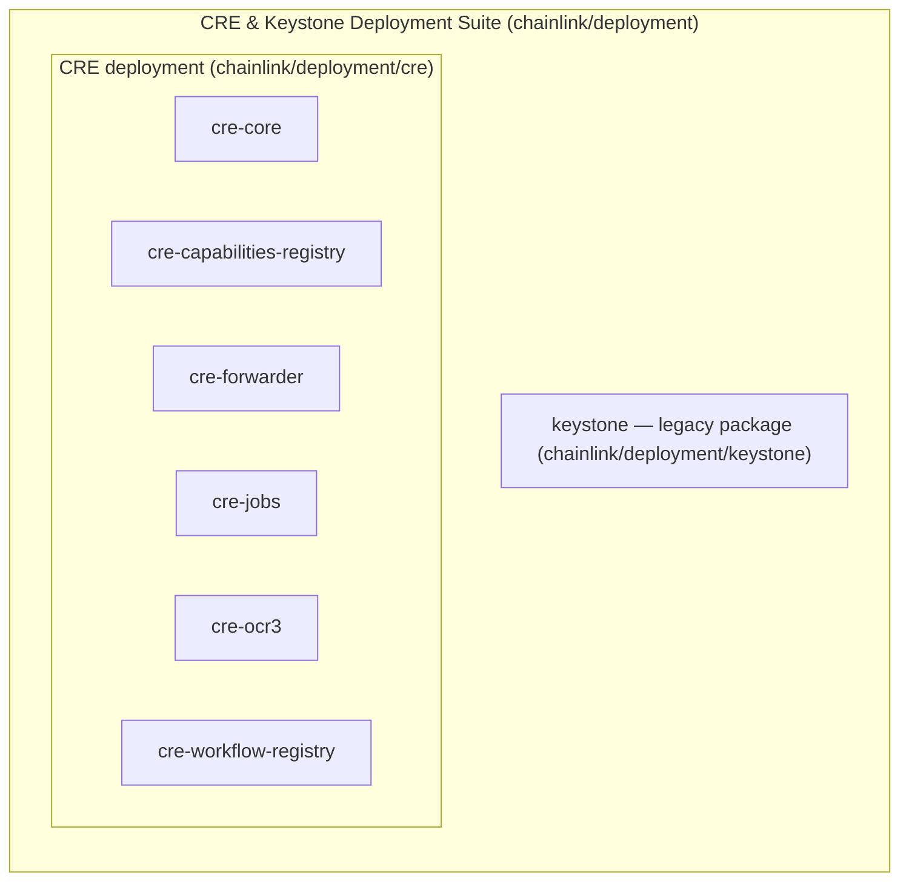
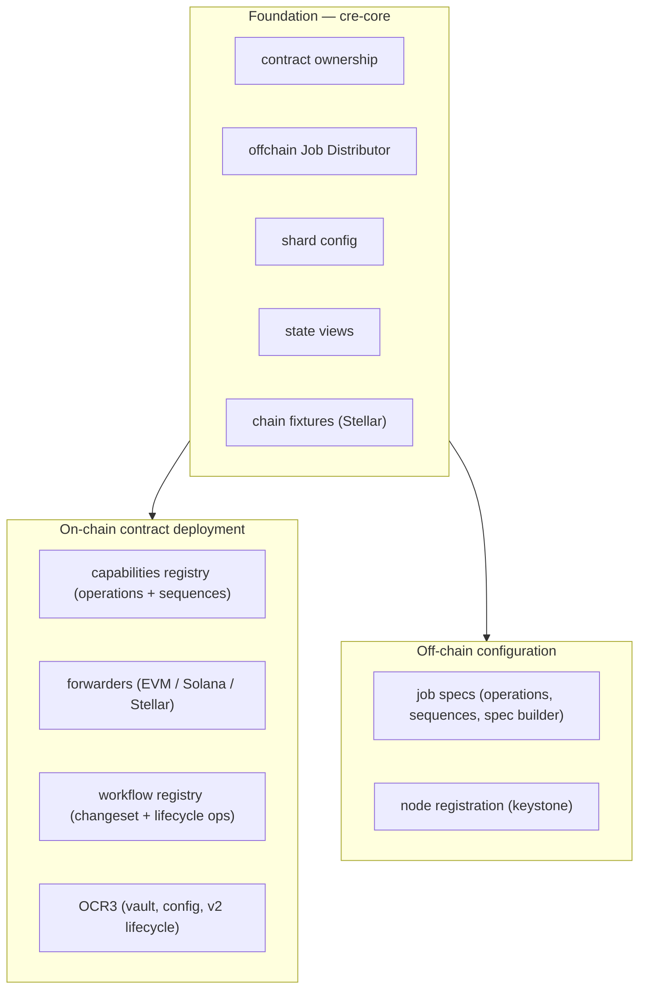
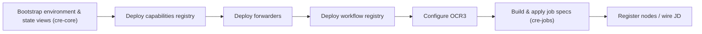

# CRE & Keystone Deployment Suite

## Purpose

The `CRE___Keystone_Deployment_Suite` module (rooted at `chainlink/deployment`) contains the deployment tooling for the **Chainlink Runtime Environment (CRE)** — the successor to the **Keystone** stack. It packages the on-chain contract deployments and off-chain configuration needed to stand up a complete CRE deployment on target chains, built on the shared Deployment Framework primitives (`Changeset` / `Operation` / `Sequence`) from the [Deployment Framework Core](../Deployment_Framework_Core___Product_Deployments) module.

Concretely, the suite provides:

- **On-chain contract infrastructure** — the capabilities registry, the workflow registry, per-chain forwarder contracts (EVM, Solana, Stellar), and OCR3-backed oracle contracts (including the "vault" contract and its configuration/lifecycle management).
- **Off-chain configuration** — job specification generation and application, node registration, Job Distributor (JD) wiring, shard configuration, and contract ownership management.
- **State introspection** — state views that aggregate deployed contract addresses and configuration, used for validation and by downstream changesets.
- **Legacy Keystone support** — the standalone `keystone` package retains the original Keystone deployment flow (node registration, registry deployment, forwarders, workflow registry config, state views).

## Architecture

### Module composition

### Conceptual layering

`cre-core` acts as the shared foundation for the individual CRE deployment packages; the `keystone` package is a self-contained legacy flow covering the same lifecycle for the original product.

### Typical deployment flow (illustrative)

## Core components

| Component | Path | Responsibility | Documentation |
|---|---|---|---|
| `cre-core` | `chainlink/deployment/cre` | Shared CRE deployment foundation: contract ownership management, offchain Job Distributor configuration, shard configuration, Stellar test fixtures, and state views. | [cre-core](CRE___Keystone_Deployment_Suite/cre-core.md) |
| `cre-capabilities-registry` | `chainlink/deployment/cre/capabilities_registry` | Operations and sequences for deploying and configuring the on-chain capabilities registry. | [cre-capabilities-registry](CRE___Keystone_Deployment_Suite/cre-capabilities-registry.md) |
| `cre-forwarder` | `chainlink/deployment/cre/forwarder` | Forwarder contract deployment and configuration across EVM, Solana, and Stellar chains. | [cre-forwarder](CRE___Keystone_Deployment_Suite/cre-forwarder.md) |
| `cre-jobs` | `chainlink/deployment/cre/jobs` | Job specification operations, sequences, and the job spec builder for configuring nodes. | [cre-jobs](CRE___Keystone_Deployment_Suite/cre-jobs.md) |
| `cre-ocr3` | `chainlink/deployment/cre/ocr3` | OCR3 oracle contract deployment: vault contract, configuration, and v2 lifecycle management. | [cre-ocr3](CRE___Keystone_Deployment_Suite/cre-ocr3.md) |
| `cre-workflow-registry` | `chainlink/deployment/cre/workflow_registry` | Workflow registry deployment via changesets, lifecycle operations, and operations. | [cre-workflow-registry](CRE___Keystone_Deployment_Suite/cre-workflow-registry.md) |
| `keystone` | `chainlink/deployment/keystone` | Legacy Keystone deployment flow: node registration, capabilities registry deployment, forwarders, workflow registry configuration, and state views. | [keystone](CRE___Keystone_Deployment_Suite/keystone.md) |

## Relationship to other modules

- **[Deployment Framework Core](../Deployment_Framework_Core___Product_Deployments)** — supplies the shared deployment primitives (`chainlink/deployment/common`), product deployments, and token/data-feeds helpers this suite builds upon.
- **[Dev, Test & Simulation Environments](../Dev__Test___Simulation_Environments)** — the `chainlink/deployment/environment` harness and the system/integration test suites consume this suite to provision CRE stacks in ephemeral test environments.
- **[Workflow & Capability Runtime (CRE Engine)](../Workflow___Capability_Runtime__CRE_Engine_)** — the runtime this suite provisions infrastructure for: deployed registries, forwarders, and job specs drive the workflow/capability engine and its chain capabilities.