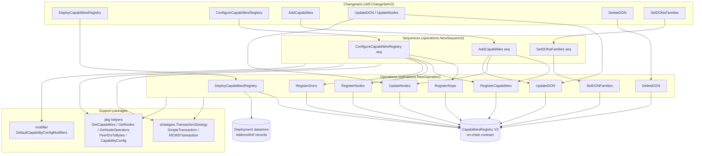
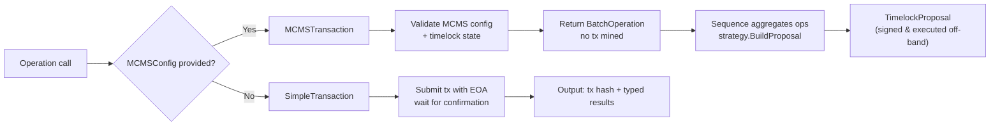
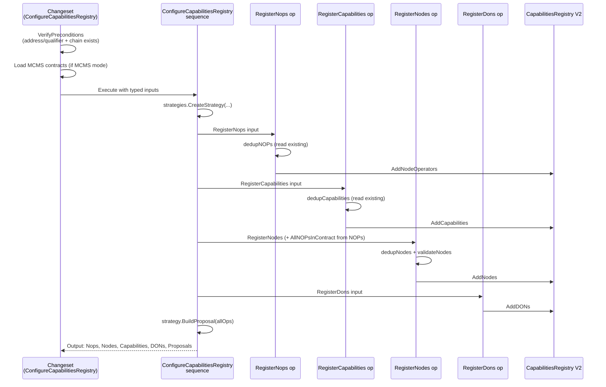
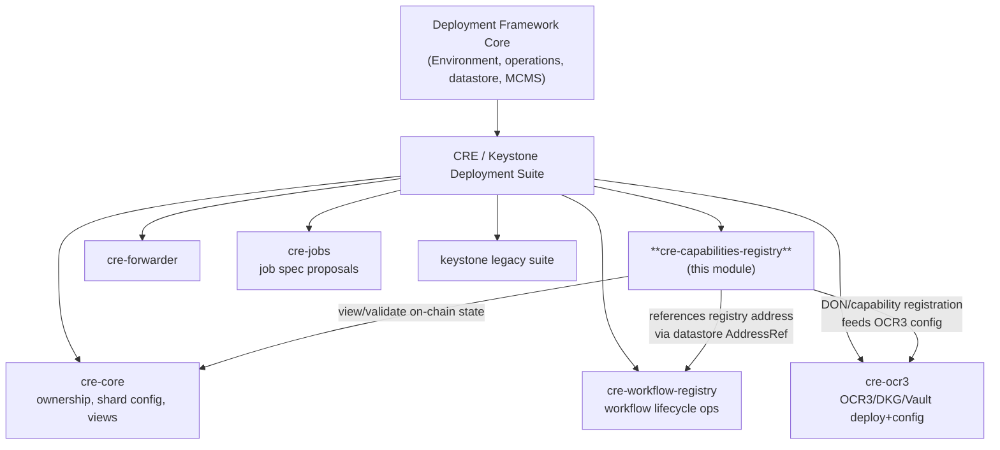

# Capabilities Registry Deployment (CRE v2)

## Overview

The `cre-capabilities-registry` module provides the deployment framework artifacts — **changesets, operations, and sequences** — for deploying and managing the **Capabilities Registry V2 smart contract** (`capabilities_registry_wrapper_v2`), the on-chain source of truth that records which nodes, node operators (NOPs), DONs (Decentralized Operator Networks), and capabilities exist in a Chainlink Runtime Environment (CRE) deployment.

The module lives under `chainlink/deployment/cre/capabilities_registry/v2/changeset/` and is built on the [Deployment Framework Core](../Deployment_Framework_Core___Product_Deployments/deployment-common.md) primitives:

- **`cldf.Environment`** — the deployment environment (chains, logger, datastore, operations bundle).
- **`operations.NewOperation`** — atomic, single-side-effect units of work with input validation, versioning, and reporting.
- **`operations.NewSequence`** — orchestrated multi-step flows that compose operations.
- **`datastore.AddressRefKey`** — address book references so operations resolve contracts without hard-coded addresses.

### Purpose

| Concern | What this module provides |
|---|---|
| **Contract deployment** | Deploy the V2 Capabilities Registry and register it in the deployment datastore |
| **Registry bootstrap** | Register node operators, nodes, capabilities, and DONs in one coordinated sequence |
| **Lifecycle management** | Add capabilities to DONs, update nodes/DONs, set DON family membership, delete DONs |
| **Governance safety** | Every mutating operation can run in *direct* mode (EOA transaction, confirmed immediately) or *MCMS* mode (transaction wrapped into a timelock proposal for multi-party signing) |

> The on-chain counterpart is the `CapabilitiesRegistry` contract generated by the `chainlink-evm` gethwrappers (`capabilities_registry_wrapper_v2`). This module only orchestrates calls to it.

## Architecture

### Layered view

The module follows the standard deployment-framework layering: **Changesets** (top-level entry points in `changeset/`) validate preconditions, translate config into typed inputs, and execute either **Operations** or **Sequences**, which in turn act on the on-chain contract through a **TransactionStrategy**.

### Component relationships

- **Changeset → Sequence/Operation**: changesets own input translation (JSON/YAML config → typed wrapper structs) and MCMS contract lookup (`strategies.GetMCMSContracts`); they never call the chain directly.
- **Sequence → Operations**: sequences create a single `TransactionStrategy` and share it across all child operations so a whole flow collapses into one MCMS proposal.
- **Operations → Strategy → Chain**: each operation wraps its contract call in `strategy.Apply(...)`, which either submits and confirms a direct transaction or records an `mcmstypes.BatchOperation` for later proposal assembly.
- **Operations → `pkg` helpers**: read paths use paginated contract reads (`pkg.GetCapabilities`, `pkg.GetNodes`, `pkg.GetNodeOperators`) and id/byte conversions (`pkg.PeerIDsToBytes`) to implement **idempotent deduplication** — the registry contract reverts on duplicates, which would poison a whole MCMS batch.

### Execution modes: direct vs. MCMS

Every mutating operation and sequence accepts an optional `*contracts.MCMSConfig` (an alias for `cldfproposalutils.TimelockConfig`, defined in `chainlink/deployment/cre/contracts/contracts.go`). `strategies.CreateStrategy` selects the execution mode:

Key behavioral details:

- **Direct mode**: `SimpleTransaction` submits via the chain deployer key and waits for receipt; outputs carry the transaction hash.
- **MCMS mode**: `MCMSTransaction` never mines; it returns a `*mcmstypes.BatchOperation`. Sequences accumulate these and call `strategy.BuildProposal(allOps)` to produce a single `mcmslib.TimelockProposal` for governance approval.
- **Idempotency**: `RegisterCapabilities.dedupCapabilities`, `RegisterNodes.dedupNodes`, `RegisterNops.dedupNOPs`, and the merge logic in `UpdateNodes.makeNodeParams` and `UpdateDON.computeConfigs` all read current on-chain state first and skip already-applied changes, so re-running a sequence is safe and MCMS batches never revert on duplicates.
- **NOP ID bookkeeping**: node operator IDs are 1-based positions in the contract. `RegisterNops` returns `AllContractExpectedNOPs` — a name→ID map that includes *planned* NOPs — which `RegisterNodes` consumes via `RegisterNodesInput.AllNOPsInContract` when nodes reference NOPs that are only being registered in the same MCMS batch.

## Sub-modules

The module is split into two sub-modules:

| Sub-module | Contents | Documentation |
|---|---|---|
| **Contract Operations** | Atomic operations against the V2 Capabilities Registry: `DeployCapabilitiesRegistry`, `RegisterNops`, `RegisterNodes`, `RegisterCapabilities`, `RegisterDons`, `UpdateNodes`, `UpdateDON`, `SetDONFamilies`, `DeleteDON` | [cre-capabilities-registry_operations](cre-capabilities-registry/cre-capabilities-registry_operations.md) |
| **Orchestration Sequences** | Multi-step flows composing the operations: `ConfigureCapabilitiesRegistry` (full bootstrap), `AddCapabilities` (capabilities + per-DON node/DON updates), `SetDONsFamilies` (batch family membership changes) | [cre-capabilities-registry_sequences](cre-capabilities-registry/cre-capabilities-registry_cre-capabilities-registry_sequences.md) |

### Typical bootstrap flow

The full lifecycle of standing up a registry, as orchestrated by the changesets and the `ConfigureCapabilitiesRegistry` sequence:

### Capability addition flow (post-bootstrap)

`AddCapabilities` handles the more involved in-place evolution of an existing registry: it registers any new capabilities once at the registry level, then for each DON it fetches the DON's nodes, applies capability-config **modifiers** (e.g. the Aptos DON modifier that injects the p2p→transmitter map), appends the new capabilities to every node via `UpdateNodes`, and updates the DON's capability configurations via `UpdateDON` (merging with on-chain state). Details in the [sequences documentation](cre-capabilities-registry/cre-capabilities-registry_cre-capabilities-registry_sequences.md).

## Module placement in the system

- The [cre-workflow-registry](cre-workflow-registry.md) module points the Workflow Registry contract at the Capabilities Registry (`SetCapabilitiesRegistry`).
- The [cre-ocr3](cre-ocr3.md) module relies on the DONs and capability configurations registered here when configuring OCR3/DKG and Vault plugins.
- System tests validate the sync behavior of this registry separately (see [Dev, Test & Simulation Environments](../Dev,_Test___Simulation_Environments/system-tests.md)).

## Design conventions

1. **Inputs are plain data** — every `*Input` struct is JSON/YAML serializable with no private fields and implements `Validate()` where applicable, matching the changeset framework's config-driven model.
2. **Deps are constructor-injected** — each operation has a `*Deps` struct (`Env`, `Strategy`, and optionally a pre-bound `CapabilitiesRegistry` binding) supplied by the caller, keeping operations testable and reusable from changesets, sequences, and tools.
3. **Outputs are typed and reportable** — outputs echo the effective on-chain params plus the optional `*mcmstypes.BatchOperation`, so callers can both consume results and assemble proposals.
4. **Fail-safe reads before writes** — all mutating operations read current registry state to dedupe, validate, and resolve references (NOP IDs, DON IDs by name, node keys by P2P ID), converting contract reverts into descriptive Go errors with `cldf.DecodeErr`.
5. **Versioned identifiers** — every operation/sequence is registered with a name and semantic version (e.g. `"register-nodes-op" v1.0.0`) for traceability in operation reports.
