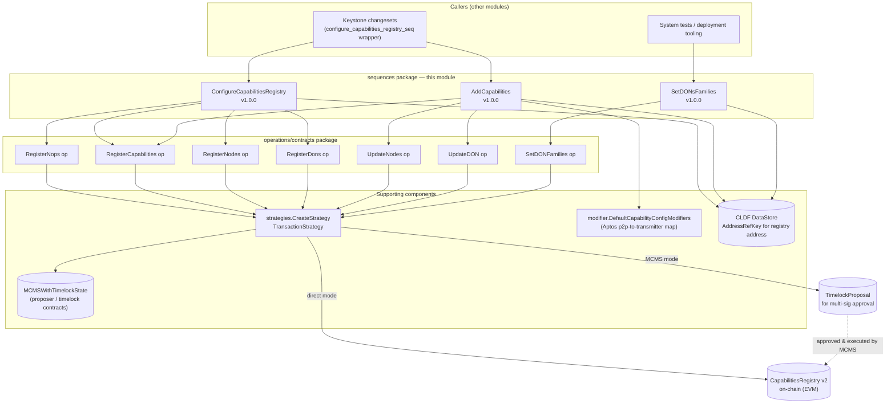
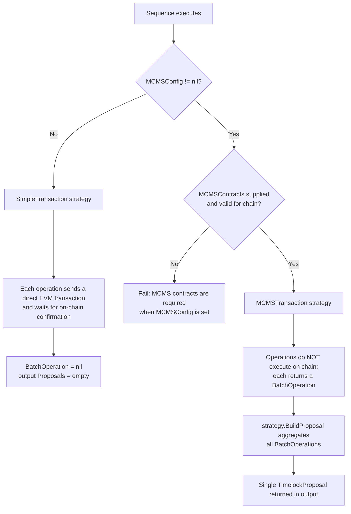
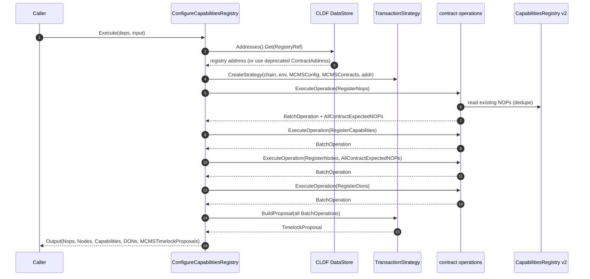
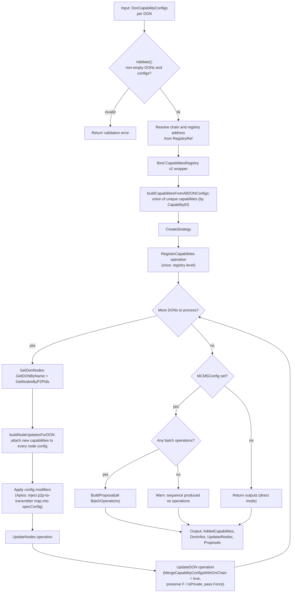
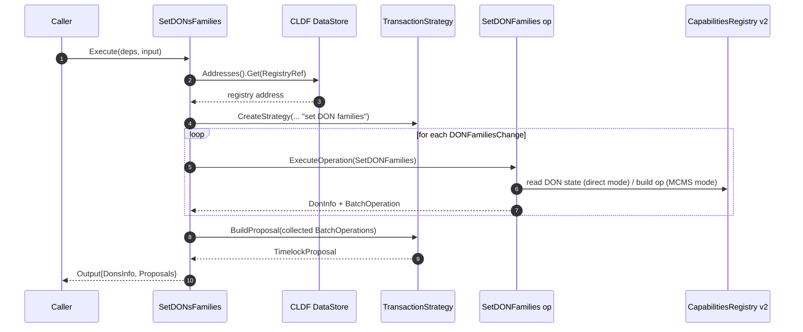
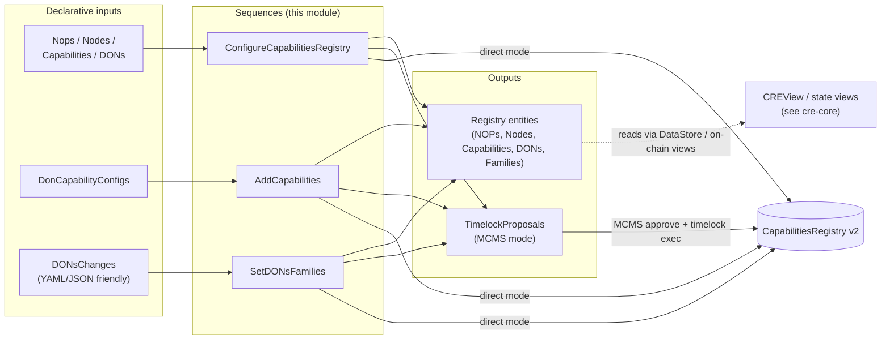

# Capabilities Registry — Configuration Sequences (CRE Deployment)

## Introduction

This module implements the **orchestration sequences** for the Capabilities Registry **v2** on-chain contract used by the Chainlink Runtime Environment (CRE). While the sibling [registry operations module](cre-capabilities-registry_operations.md) defines the individual, low-level contract operations (register NOPs, register capabilities, register nodes, register/update DONs, set DON families), the sequences in this module **compose those operations into multi-step, atomic deployment workflows**:

| Sequence | Go identifier | Version | Purpose |
| --- | --- | --- | --- |
| `configure-capabilities-registry` | `ConfigureCapabilitiesRegistry` | `1.0.0` | Full bootstrap of a registry: node operators, capabilities, nodes, and DONs in one pass |
| `add-capabilities-seq` | `AddCapabilities` | `1.0.0` | Incrementally add capabilities to existing DONs, updating node configs and DON capability sets |
| `set-dons-families-seq` | `SetDONsFamilies` | `1.0.0` | Add or remove DON family memberships for one or more DONs |

Source location: `chainlink/deployment/cre/capabilities_registry/v2/changeset/sequences/` (package `sequences`, Go module `github.com/smartcontractkit/chainlink/deployment`).

All three sequences are built on the **Chainlink Deployments Framework (CLDF)** operations model (`operations.NewSequence` / `operations.ExecuteOperation`) and share a uniform execution model: every mutation is routed through a **transaction strategy** that either executes directly on an EVM chain or defers execution by aggregating all mutations into a single **MCMS TimelockProposal** for multi-sig governance. The framework concepts (changesets → sequences → operations, the CLDF `DataStore`, and `MCMSWithTimelockState`) are documented in [Deployment Framework Core & Product Deployments](../../Deployment_Framework_Core___Product_Deployments.md).

> **Contract under management.** The target is the `CapabilitiesRegistry` v2 contract (Go binding `capabilities_registry_wrapper_v2` from `chainlink-evm`), which holds the on-chain source of truth for node operators, nodes (P2P identities), capabilities, DONs, and DON family membership. The on-chain registry is consumed by the CRE workflow engine's capability registry subsystem (see [Workflow & Capability Runtime (CRE Engine)](../../Workflow___Capability_Runtime_(CRE_Engine).md)).

---

## Architecture

### Component map

The sequences sit between product-level changesets (callers) and the per-contract operations. Each sequence owns input validation, address/chain resolution, strategy construction, operation orchestration, and MCMS proposal aggregation.

### Execution strategy model

Every sequence constructs exactly one strategy via `strategies.CreateStrategy` and passes it into each operation. The strategy decides **when** state actually changes on chain:

| Aspect | `SimpleTransaction` (direct) | `MCMSTransaction` (governed) |
| --- | --- | --- |
| Activation | `MCMSConfig == nil` | `MCMSConfig != nil` and `MCMSContracts` provided/valid |
| On-chain effect | Immediate, per-operation, confirmed before the next step | Deferred — nothing executes until the proposal passes MCMS voting and the timelock executes it |
| Operation return value | `BatchOperation` is `nil` | `BatchOperation` per operation, aggregated by the sequence |
| Sequence output | Registry read-back data only (NOPs, nodes, DONs…) | Registry data **plus** `[]mcmslib.TimelockProposal` |

`MCMSConfig` is an alias for the CLDF `TimelockConfig` (`chainlink/deployment/cre/contracts/contracts.go`), and the required `MCMSContracts` value is an `evmstate.MCMSWithTimelockState` — the proposer/timelock pair that owns the registry, normally located through the CLDF DataStore (see `strategies.GetMCMSContracts`).

---

## Sequence reference

### 1. `ConfigureCapabilitiesRegistry` — registry bootstrap

**Identifier:** `configure-capabilities-registry` · **Version:** `1.0.0`
**Description:** "Configures the capabilities registry by registering node operators, nodes, dons and capabilities"

This is the one-shot bootstrap path for a freshly deployed registry. It runs four operations in a fixed order and folds every produced batch operation into a single proposal:

1. **RegisterNops** — registers node operators (deduplicated against on-chain state); returns the full expected NOP name→ID map.
2. **RegisterCapabilities** — registers the capability list.
3. **RegisterNodes** — registers nodes; receives the NOP map from step 1 (`AllContractExpectedNOPs`) so node-to-operator assignments are consistent.
4. **RegisterDons** — registers the DON definitions.

#### Input / Output

| `ConfigureCapabilitiesRegistryInput` | Type | Notes |
| --- | --- | --- |
| `RegistryChainSel` | `uint64` | EVM chain selector hosting the registry |
| `RegistryRef` | `datastore.AddressRefKey` | Preferred registry address reference (resolved from the CLDF DataStore) |
| `ContractAddress` | `string` | **Deprecated** legacy address input; mutually exclusive with `RegistryRef` (removed under PRODCRE-1030) |
| `MCMSConfig` | `*crecontracts.MCMSConfig` | `nil` ⇒ direct execution; non-nil ⇒ MCMS proposal mode |
| `Description` | `string` | Human-readable proposal/transaction description |
| `Nops` | `[]CapabilitiesRegistryNodeOperatorParams` | Node operators to register |
| `Nodes` | `[]contracts.NodesInput` | Nodes to register |
| `Capabilities` | `[]contracts.RegisterableCapability` | Capabilities to register |
| `DONs` | `[]CapabilitiesRegistryNewDONParams` | DONs to register |

`Validate()` enforces that **exactly one** of `RegistryRef` / `ContractAddress` is set.

| `ConfigureCapabilitiesRegistryOutput` | Type |
| --- | --- |
| `Nops` | `[]CapabilitiesRegistryNodeOperatorParams` (post-dedup) |
| `Nodes` | `[]CapabilitiesRegistryNodeParams` |
| `Capabilities` | `[]RegisterableCapability` |
| `DONs` | `[]CapabilitiesRegistryNewDONParams` |
| `MCMSTimelockProposals` | `[]mcmslib.TimelockProposal` (exactly one when MCMS mode produced operations) |

#### Process flow

> **Note on direct mode:** the diagram shows MCMS mode. In direct mode the operations themselves send and confirm transactions against `Reg` and the final `BuildProposal` step is skipped (no batch operations are produced).

---

### 2. `AddCapabilities` — incremental capability rollout

**Identifier:** `add-capabilities-seq` · **Version:** `1.0.0`
**Description:** "Add Capabilities to the capabilities registry"

This sequence extends an **existing** registry: it registers any not-yet-known capabilities once at the registry level, then for each DON in the input re-wires that DON's nodes and updates the DON's capability configuration set. This is the sequence operators run when a new capability version (e.g. a new chain capability) must be attached to one or more production DONs.

#### Input / Output

| `AddCapabilitiesInput` | Type | Notes |
| --- | --- | --- |
| `DonCapabilityConfigs` | `map[string][]contracts.CapabilityConfig` | DON name → capability configs to attach. Keys must be non-empty; every DON entry needs ≥ 1 config |
| `Force` | `bool` | Bypasses validation that forwarder contracts are ready for the new configuration version. **Dangerous** — can break the whole platform if forwarders are unready (forwarded to the `UpdateDON` operation) |
| `RegistryRef` | `datastore.AddressRefKey` | Registry address reference (chain selector is derived from the ref) |
| `MCMSConfig` | `*crecontracts.MCMSConfig` | Execution mode selector |

`Validate()` requires at least one DON entry, non-empty DON names, and at least one capability config per DON.

| `AddCapabilitiesOutput` | Type |
| --- | --- |
| `AddedCapabilities` | `[]RegisterableCapability` (deduplicated union across all DONs) |
| `DonInfos` | `[]CapabilitiesRegistryUpdateDONParams` (one per processed DON) |
| `UpdatedNodes` | `[]CapabilitiesRegistryNodeParams` (all node config updates) |
| `Proposals` | `[]mcmslib.TimelockProposal` |

#### Process flow

Key behaviors and helpers (all in `add_capabilities.go`):

- **Registry-level deduplication** — `buildCapabilitiesFromAllDONConfigs` collects the union of `RegisterableCapability` values keyed by `CapabilityID`, so a capability shared by multiple DONs is registered exactly once.
- **Per-DON node fan-out** — `buildNodeUpdatesForDON` attaches every new capability to the node config of **each** node in the DON (keyed by P2P peer ID), producing the input for the `UpdateNodes` operation.
- **On-chain DON lookup** — the exported helper `GetDonNodes(donName, capReg)` resolves a DON by name (`GetDONByName`) and its nodes (`GetNodesByP2PIds`), with CLDF ABI error decoding. It preserves the DON's `F` (fault tolerance) and publicity settings for the subsequent `UpdateDON` call (`IsPrivate = !don.IsPublic`).
- **Capability config modifiers** — before node/DON updates, `modifier.DefaultCapabilityConfigModifiers()` is applied per DON. The default set contains the Aptos modifier: for capability IDs of the form `aptos:ChainSelector:<selector>@<version>`, it requires `Env.Offchain` (Job Distributor client), builds a `p2pToTransmitterMap` for the DON's peers on that chain, and merges it into the capability's `specConfig` in place. New chain-specific modifiers plug into the same hook.
- **Merge semantics** — `UpdateDON` is invoked with `MergeCapabilityConfigsWithOnChain: true`, so on-chain capability configs are merged with (not replaced by) the new ones.

---

### 3. `SetDONsFamilies` — DON family membership management

**Identifier:** `set-dons-families-seq` · **Version:** `1.0.0`
**Description:** "Set DONs Families in Capabilities Registry"

A focused administrative sequence that adjusts **DON family membership** (families group DONs that must not share capabilities — see the family-uniqueness rule below).

#### Input / Output

| `SetDONsFamiliesInput` | Type | Notes |
| --- | --- | --- |
| `DONsChanges` | `[]DONFamiliesChange` | At least one change required (`Validate()`) |
| `RegistryRef` | `datastore.AddressRefKey` | Registry address reference |
| `MCMSConfig` | `*crecontracts.MCMSConfig` | Execution mode selector |

`DONFamiliesChange` carries JSON/YAML tags (`donName`, `addToFamilies`, `removeFromFamilies`), making it directly loadable from declarative config files:

| Field | Type |
| --- | --- |
| `DonName` | `string` |
| `AddToFamilies` | `[]string` |
| `RemoveFromFamilies` | `[]string` |

| `SetDONsFamiliesOutput` | Type |
| --- | --- |
| `DonsInfo` | `[]CapabilitiesRegistryDONInfo` |
| `Proposals` | `[]mcmslib.TimelockProposal` |

#### Process flow

Changes are applied per-DON via the `SetDONFamilies` operation; all resulting batch operations are aggregated into a single proposal (when any were produced).

---

## Shared behaviors

All three sequences follow the same contract, which makes them predictable to operate and extend:

1. **Deps shape** — identical `Deps` struct everywhere: the CLDF `Environment` plus `MCMSContracts` (`*evmstate.MCMSWithTimelockState`), the latter being *required if and only if* `MCMSConfig` is non-nil (enforced inside `CreateStrategy`).
2. **Address resolution** — the registry address always comes from the CLDF DataStore via a `datastore.AddressRefKey`, except for the deprecated `ContractAddress` escape hatch in `ConfigureCapabilitiesRegistry`.
3. **Chain resolution** — the target chain is looked up from `Env.BlockChains.EVMChains()` by the registry chain selector; a missing chain fails fast (`cldf.ErrChainNotFound` or an explicit error).
4. **Idempotency at the operation layer** — operations (e.g. `RegisterNops`) deduplicate inputs against current on-chain state before building transactions, so re-running a sequence skips already-applied registrations.
5. **Proposal aggregation** — batch operations from all executed sub-operations are collected in order and folded into **one** `TimelockProposal` per sequence run, so a bootstrap or rollout is approved/executed as a single governance action.
6. **Input validation** — each input struct exposes a `Validate()` method invoked at the top of the sequence body.

**Package helper worth knowing:** `ValidateNoDuplicateCapabilitiesAcrossDONs` (in `validate_capabilities.go`, same package) enforces that a capability is assigned to at most one DON **per DON family** — DONs in disjoint families may share a capability. Callers composing `AddCapabilities` input typically use it as a pre-flight check against existing on-chain DON info.

---

## Data flow summary

- In **direct mode** the artifacts are purely the returned registry entity data; state changes are already final on chain.
- In **MCMS mode** the primary artifact is the `TimelockProposal`, which must be signed by proposers, voted, and executed by the timelock before the registry changes. Post-execution state can be inspected through the on-chain views of the [cre-core module](../cre-core.md) (e.g. `CREView`, `OCR3ConfigViewLegacy`).

---

## Dependencies and related modules

| Dependency | Relation | Documentation |
| --- | --- | --- |
| Capabilities Registry operations (`RegisterNops`, `RegisterCapabilities`, `RegisterNodes`, `RegisterDons`, `UpdateNodes`, `UpdateDON`, `SetDONFamilies`) | Invoked via `operations.ExecuteOperation`; see the operations reference for per-operation semantics, dedup logic and ABIs | [cre-capabilities-registry operations](cre-capabilities-registry_operations.md) |
| Capabilities Registry parent module | Owning module grouping operations, sequences and registry changesets | [cre-capabilities-registry](../cre-capabilities-registry.md) |
| Deployment framework core | CLDF `Environment`, `operations` framework, `DataStore`/`AddressRefKey`, `MCMSWithTimelockState`, changeset patterns | [Deployment Framework Core & Product Deployments](../../Deployment_Framework_Core___Product_Deployments.md) |
| Keystone deployment changesets | Legacy Keystone changesets wrap these sequences (e.g. the `configure_capabilities_registry_seq` wrapper) | [Keystone deployment module](../keystone.md) |
| CRE core | Registry state views (`CREView`), MCMS ownership tooling, offchain JD registration | [cre-core](../cre-core.md) |
| OCR3 deployment | OCR3/DON configuration typically follows registry bootstrap in a full CRE deployment | [cre-ocr3](../cre-ocr3.md) |
| Workflow registry | Downstream consumer: workflows registered on DONs configured through this registry | [cre-workflow-registry](../cre-workflow-registry.md) |
| CRE Engine | The runtime that consumes the on-chain registry's capability/DON data | [Workflow & Capability Runtime (CRE Engine)](../../Workflow___Capability_Runtime_(CRE_Engine).md) |
| System tests | End-to-end tests wait for registry pickup and drive full CRE topologies that include these sequences | [System tests](../../Dev,_Test___Simulation_Environments/system-tests.md) |
| Suite overview | Position of this module in the overall deployment suite | [CRE & Keystone Deployment Suite](../../CRE___Keystone_Deployment_Suite.md) |

Build-time dependencies (CLDF, `mcms`, `chainlink-evm` bindings, `semver`, EVM/Aptos SDKs) are pinned in the deployment Go module manifest: `chainlink/deployment/go.mod`.

---

## Operational considerations

- **Choose the execution mode deliberately.** Production registry mutations should almost always run in MCMS mode; direct mode is intended for local/dev environments. Forgetting to pass `MCMSContracts` while setting `MCMSConfig` fails fast rather than silently degrading to direct execution.
- **`AddCapabilities.Force` is a footgun.** Setting `Force: true` skips forwarder-readiness validation for the new configuration version. The source documentation is explicit: this is "very dangerous" and could break the whole platform if forwarders are not ready. Prefer resolving forwarder readiness first (see the [cre-forwarder module](../cre-forwarder.md) for forwarder deployment/configuration sequences).
- **Proposal granularity.** Each sequence produces at most one proposal per run; partial failures before proposal building leave no on-chain trace in MCMS mode (operations are dry until executed), whereas direct mode may leave partial state — another reason to prefer MCMS for multi-step runs like `ConfigureCapabilitiesRegistry`.
- **Version pinning.** Sequences are versioned (`semver`) artifacts of the CLDF operations registry (`configure-capabilities-registry@1.0.0`, `add-capabilities-seq@1.0.0`, `set-dons-families-seq@1.0.0`); callers should reference them by name and version to remain stable across framework upgrades.
- **`ContractAddress` deprecation.** New callers must use `RegistryRef`; the string-address path exists only for backward compatibility and is scheduled for removal (PRODCRE-1030).
