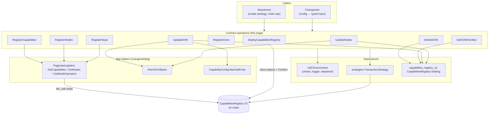
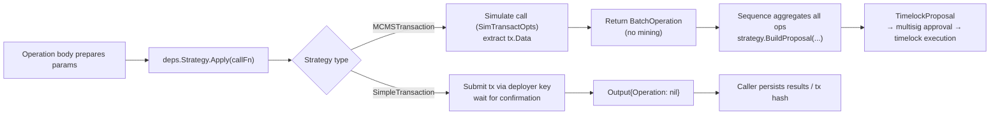
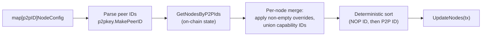
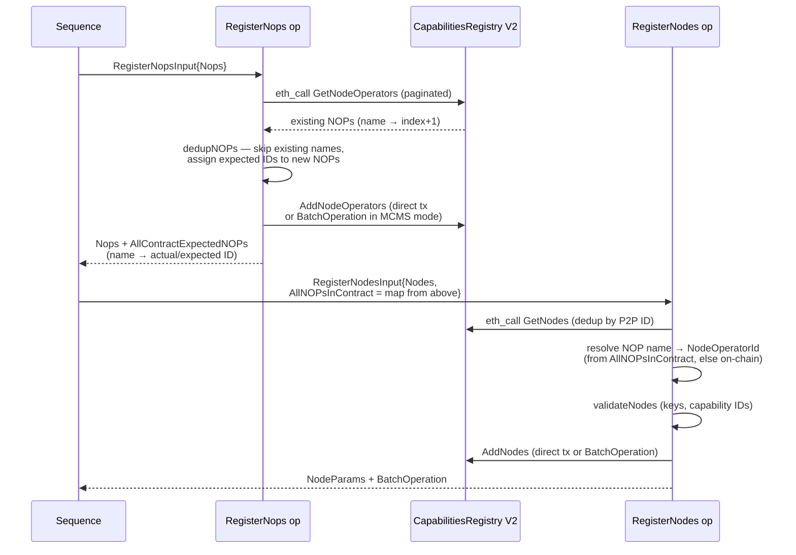
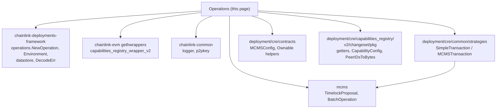

# Capabilities Registry — Contract Operations

## Overview

This page documents the **atomic contract operations** of the [Capabilities Registry deployment module](../cre-capabilities-registry.md). They live in the package `chainlink/deployment/cre/capabilities_registry/v2/changeset/operations/contracts/` and are the lowest-level, single-side-effect building blocks used to deploy and manage the **Capabilities Registry V2** smart contract (`capabilities_registry_wrapper_v2` from `chainlink-evm/gethwrappers`).

Each operation is registered via `operations.NewOperation[I, O, D]` from the [Deployment Framework Core](../../Deployment_Framework_Core___Product_Deployments/deployment-common.md), which gives every operation:

- a **stable identifier and semantic version** (all are `v1.0.0`) for traceability in operation reports,
- **typed inputs and outputs** (plain, JSON/YAML-serializable structs),
- a **`Deps` struct** with the injected environment, contract bindings, and transaction strategy,
- a **single side effect** — one contract call, wrapped by a `TransactionStrategy` so the same code path runs in direct (EOA) or MCMS timelock mode.

Operations are never invoked directly by end users: **changesets** translate config into typed inputs, and **sequences** orchestrate several operations into one transaction batch or one MCMS proposal. See the parent page for the [module architecture](../cre-capabilities-registry.md) and the [orchestration sequences](cre-capabilities-registry_sequences.md) that compose these operations.

### Operations catalog

| Operation | Registered ID | Contract call | Registry concern |
|---|---|---|---|
| `DeployCapabilitiesRegistry` | `deploy-capabilities-registry-v2-op` | `DeployCapabilitiesRegistry(...)` | Deploys the registry contract itself |
| `RegisterNops` | `register-nops-op` | `AddNodeOperators` | Node operators (NOPs) |
| `RegisterCapabilities` | `register-capabilities-op` | `AddCapabilities` | Capability catalog |
| `RegisterNodes` | `register-nodes-op` | `AddNodes` | Nodes (bound to NOPs + capabilities) |
| `RegisterDons` | `register-dons-op` | `AddDONs` | DONs (Decentralized Operator Networks) |
| `UpdateNodes` | `update-nodes-op` | `UpdateNodes` | Node parameters & capability assignment |
| `UpdateDON` | `update-don-op` | `UpdateDONByName` | DON parameters, composition & capability configs |
| `SetDONFamilies` | `set-don-families-op` | `SetDONFamilies` | DON family membership |
| `DeleteDON` | `delete-don-op` | `RemoveDONsByName` | DON removal |

All operations are **EVM-only** — they resolve the target chain through `deps.Env.BlockChains.EVMChains()[input.ChainSelector]` and fail fast if the selector is unknown.

## Architecture

### Component anatomy

Every operation follows the same anatomy: a caller (changeset or sequence) supplies **Deps** (environment, strategy, optionally a pre-bound contract handle) plus a plain **Input**; the operation reads on-chain state via the `pkg` helpers, prepares and validates parameters, delegates execution to the **TransactionStrategy**, and returns a typed **Output** that echoes the effective parameters plus the optional MCMS `BatchOperation`.



### Input / Output / Deps conventions

1. **Inputs are data** — every `*Input` struct carries the registry `Address`, `ChainSelector`, the payload (NOPs / capabilities / nodes / DONs / updates) and an optional `*contracts.MCMSConfig`. `MCMSConfig` (an alias for `cldfproposalutils.TimelockConfig`, defined in `chainlink/deployment/cre/contracts/contracts.go`) is the *mode switch*: `nil` ⇒ direct execution, non-nil ⇒ MCMS proposal mode.
2. **Deps are injected** — `Env` plus a `strategies.TransactionStrategy` for mutating operations; the read-free update operations (`UpdateNodes`, `UpdateDON`, `SetDONFamilies`, `DeleteDON`) instead receive a pre-bound `*capabilities_registry_v2.CapabilitiesRegistry`, which the calling sequence resolves from the deployment datastore.
3. **Outputs are reportable** — outputs echo the effective on-chain parameters and always carry `Operation *mcmstypes.BatchOperation`. In direct mode this is `nil` (the tx is already mined); in MCMS mode it is the record the sequence aggregates into a `TimelockProposal` via `strategy.BuildProposal`.
4. **Contract errors are decoded** — every reverted contract call is passed through `cldf.DecodeErr(capabilities_registry_v2.CapabilitiesRegistryABI, err)` so failures surface as readable custom-error messages instead of raw ABI reverts.

## Transaction execution: direct vs. MCMS

All mutating operations share one execution path through the `strategies.TransactionStrategy` interface (defined in `chainlink/deployment/cre/common/strategies/strategies.go`):

```go
type TransactionStrategy interface {
    Apply(callFn func(opts *bind.TransactOpts) (*types.Transaction, error)) (
        *mcmstypes.BatchOperation, *types.Transaction, error)
    BuildProposal(operations []mcmstypes.BatchOperation) (*mcmslib.TimelockProposal, error)
}
```

| | `SimpleTransaction` (`simple_transaction.go`) | `MCMSTransaction` (`mcms_transaction.go`) |
|---|---|---|
| Execution | Submits with `chain.DeployerKey` and waits for `chain.Confirm(tx)` | Simulates with `cldf.SimTransactOpts()` to obtain calldata, then wraps it in `BatchOperationForChain` — **no transaction is mined** |
| `Apply` result | `Operation = nil`, real `*types.Transaction` | Non-nil `BatchOperation`, simulated tx (used only for data) |
| `BuildProposal` | Not applicable (returns nil) | Assembles an `mcmslib.TimelockProposal` from the accumulated batch operations, using the MCMS/timelock state and the chain inspector |
| Typical use | Devnets, non-governed deployments | Production registries owned by an MCMS timelock |



> The choice of strategy is made once by the calling sequence (via `strategies.CreateStrategy` and MCMS contract lookup) and shared by every child operation, so an entire bootstrap collapses into a single proposal. See [cre-capabilities-registry_sequences](cre-capabilities-registry_sequences.md).

## Operation reference

### DeployCapabilitiesRegistry

Deploys a fresh **Capabilities Registry V2** contract with empty constructor parameters (`CapabilitiesRegistryConstructorParams{}`), waits for the deployment receipt, and reads the contract's `TypeAndVersion` on-chain.

- **Deps:** `Env` only (no strategy — deployment is inherently a direct, deployer-keyed transaction).
- **Input:** `ChainSelector`, `Qualifier` (datastore qualifier under which the contract will be referenced).
- **Output:** `Address`, `ChainSelector`, `Qualifier`, plus parsed `Type`, `Version`, and `Labels` from the on-chain `TypeAndVersion` — the metadata callers persist as an `AddressRef` in the deployment datastore.

This is the only operation that does not require an existing contract; every other operation binds to an address passed in its input (or a binding supplied by the sequence).

### RegisterNops

Registers node operators via `AddNodeOperators`. Node operator IDs in the contract are **1-based positions** in registration order (ID = index + 1, mirroring the `AddNodeOperators` implementation in `chainlink-evm`).

Behavior:

- **Empty input is a no-op** — the contract accepts an empty NOP array, but the operation short-circuits and returns an empty output without touching the chain.
- **Deduplication (`dedupNOPs`)** — fetches existing NOPs via the paginated `pkg.GetNodeOperators` getter and skips any input NOP whose **name** already exists in the contract. This makes re-runs idempotent and prevents a duplicate-name revert from poisoning a whole MCMS batch.
- **ID bookkeeping** — the output field `AllContractExpectedNOPs map[string]int` maps **every** NOP name — both those already on-chain and the ones being submitted now — to its (actual or expected) 1-based ID. `RegisterNodes` consumes this map when nodes reference NOPs that are only being registered in the same batch (where the NOPs are not yet readable on-chain).
- **Output:** deduped `Nops`, `AllContractExpectedNOPs`, and the `BatchOperation`.

### RegisterNodes

Registers nodes via `AddNodes`. Each `NodesInput` carries `NOP` (name reference), `Signer`, `P2pID`, `EncryptionPublicKey`, `CsaKey` (all `[32]byte`), and `CapabilityIDs`.

Behavior:

1. **Input validation** — `Address` must be set and `ChainSelector` non-zero; an empty node list is a no-op (the contract allows empty arrays).
2. **Node deduplication (`dedupNodes`)** — fetches existing nodes via `pkg.GetNodes` and skips inputs whose `P2pID` is already registered.
3. **NOP resolution** — for each node, the `NOP` name is resolved to a 1-based `NodeOperatorId`. The lookup prefers `input.AllNOPsInContract` (the expected-ID map produced by `RegisterNops`, essential in MCMS mode) and otherwise reads NOPs from the contract; an unresolvable NOP name aborts the operation with ``node operator `X` not found in contract``.
4. **Parameter validation (`validateNodes`)** — rejects zero `NodeOperatorId`, empty `Signer` / `EncryptionPublicKey` / `P2pId` / `CsaKey`, and an empty `CapabilityIds` list.
5. Executes `AddNodes` through the strategy.

**Output:** the effective `[]CapabilitiesRegistryNodeParams` and the `BatchOperation`.

### RegisterCapabilities

Registers capabilities via `AddCapabilities`. A `RegisterableCapability` consists of `CapabilityID`, `ConfigurationContract` (address), and `Metadata` (a `pkg.CapabilityConfig`, i.e. an untyped `map[string]any`).

Behavior:

- Empty input (or "nothing new after dedup") is a logged no-op.
- **Deduplication (`dedupCapabilities`)** — fetches the existing capability catalog via `pkg.GetCapabilities` and drops inputs whose `CapabilityID` already exists; it also deduplicates the input list itself. The contract reverts on double registration, and in MCMS mode a revert would invalidate the entire batch — hence the read-before-write.
- **Metadata serialization** — each capability's `Metadata` is marshalled to JSON bytes before submission (`CapabilitiesRegistryCapability.Metadata`).
- **Output:** the submitted capabilities (echoed from input) and the `BatchOperation`.

### RegisterDons

Registers DONs via `AddDONs` using the gethwrapper's `CapabilitiesRegistryNewDONParams` directly. Unlike the register operations above it performs **no deduplication or validation** — that responsibility sits with the calling sequence/changeset, which computes DON parameters (nodes, capabilities, `F`, public/private) from config. **Output:** the echoed `DONs` and the `BatchOperation`.

### UpdateNodes

Updates existing nodes via `UpdateNodes`, keyed by P2P peer ID. Input is a map `map[string]NodeConfig` where the key is the peer-ID string (parsed with `p2pkey.MakePeerID`) and `NodeConfig` carries optional overrides:

| `NodeConfig` field | Update semantics |
|---|---|
| `EncryptionPublicKey string` | Replaces on-chain value if non-empty (hex-decoded to `[32]byte`) |
| `NodeOperatorID uint32` | Replaces on-chain value if non-zero |
| `Signer [32]byte` | Replaces on-chain value if non-zero |
| `CSAKey string` | Replaces on-chain value if non-empty (hex-decoded) |
| `Capabilities []…Capability` | **Merged** with the node's existing capability IDs (union, deduplicated by `CapabilityId`) — idempotent |

`makeNodeParams` fetches the current nodes via `GetNodesByP2PIds`, merges each field override onto the on-chain values, and sorts the resulting params by `NodeOperatorId`, then `P2pId` — a deterministic order that keeps repeated MCMS proposals byte-identical.



**Output:** `UpdatedNodes` (the fully merged params, not just the deltas) and the `BatchOperation`.

### UpdateDON

Updates a DON **by name** via `UpdateDONByName` (names are the user-friendly handle; IDs are resolved internally).

Input semantics:

- `DonName` (required, validated) identifies the DON; `NewDonName` optionally renames it.
- `P2PIDs` — the peer IDs composing the DON; documented as *"only provided if the DON composition is changing"*. They are converted with `pkg.PeerIDsToBytes` into the update params.
- `CapabilityConfigs` — per-capability configuration entries. Each entry's `Config map[string]any` is marshalled to proto bytes through `pkg.CapabilityConfig.MarshalProto` (JSON → `protojson` validation against the `pb.CapabilityConfig` schema → `proto.Marshal`), so malformed config fields are rejected before any transaction.
- `MergeCapabilityConfigsWithOnChain` — when true, on-chain capability configurations not present in the input are preserved; when false the submitted set replaces them. Duplicate capability IDs *within the input* are rejected.
- Defaults filled from on-chain state: `F` falls back to the DON's existing value when `0`; `IsPublic` stays at the on-chain value unless `IsPrivate` is `true` (a backwards-compatibility quirk: the zero-value bool cannot express "unset"); `Config` is carried over unchanged.
- `Force` — per the input docs, *"force the update even if we cannot validate that all forwarder contracts are ready"*; the flag is carried on the input for upstream callers to interpret. As the code comment warns, using it when forwarders are not ready **can break the whole platform**.

**Output:** the effective `CapabilitiesRegistryUpdateDONParams` (`DonInfo`) and the `BatchOperation`.

### SetDONFamilies

Moves a DON in or out of DON families via `SetDONFamilies(donId, addTo, removeFrom)`.

- **Validation:** `DonName` required; at least one of `AddToFamilies` / `RemoveFromFamilies` must be non-empty.
- The DON is resolved by name → ID (callers never handle IDs), and the **latest** DON info is fetched via `GetDON(id)`.
- The output `DonInfo` is computed **optimistically**: families to remove are dropped and families to add appended in memory, so the caller sees the expected post-transaction state alongside the `BatchOperation`.

### DeleteDON

Removes one or more DONs **by name** in a single `RemoveDONsByName` call — described in the code as *"simple, safe-by-default removal"*.

- **Validation:** at least one name; empty strings rejected.
- **Pre-flight existence check:** every name is verified with `GetDONByName` first, converting a would-be revert into a descriptive error before any transaction is created (important for MCMS batches).
- **Output:** `DeletedNames` (echo of input) plus the `BatchOperation`; in direct mode the tx hash is logged.

## Data flow: NOP and node registration across operations

The most subtle interaction in this module is the **NOP ID bookkeeping** between `RegisterNops` and `RegisterNodes`. Node parameters reference their operator by a 1-based numeric ID, but IDs do not exist on-chain for NOPs that are only being registered in the same transaction batch. The two operations solve this by threading an expected-ID map through the sequence:



In **direct mode** the map is merely an optimization; in **MCMS mode** it is required for any node that references a NOP registered in the same proposal, because the on-chain read cannot see the not-yet-executed batch.

## Idempotency, validation, and safety model

| Operation | Read-before-write guard | Dedup key | Empty-input behavior |
|---|---|---|---|
| `RegisterNops` | `pkg.GetNodeOperators` | NOP name | No-op |
| `RegisterCapabilities` | `pkg.GetCapabilities` | Capability ID | No-op (logged) |
| `RegisterNodes` | `pkg.GetNodes` | Node P2P ID | No-op |
| `RegisterDons` | — (deferred to sequence) | — | Delegates to contract |
| `UpdateNodes` | `GetNodesByP2PIds` + merge | — (merge is idempotent) | n/a |
| `UpdateDON` | `GetDONByName` + config merge | Capability config ID (duplicates rejected) | n/a |
| `SetDONFamilies` | `GetDONByName` / `GetDON` | — | Rejected by validation |
| `DeleteDON` | `GetDONByName` per name | — | Rejected by validation |

Additional safety properties:

- **Deterministic ordering** — `UpdateNodes` sorts node params by (`NodeOperatorId`, `P2pId`) and `UpdateDON` sorts capability configurations by `CapabilityId`, so re-deriving a proposal yields identical calldata.
- **Errors decoded** — all contract reverts go through `cldf.DecodeErr(...CapabilitiesRegistryABI, err)`, surfacing registry custom errors (e.g. duplicate-registration reverts) as actionable messages.
- **Bounded reads** — the `pkg` getters page on-chain reads with fixed limits (`MaxCapabilities=128`, `MaxNOPs=128`, `MaxNodes=256`, `MaxDONs=32`; full pagination is a known TODO in `chainlink/deployment/cre/capabilities_registry/v2/changeset/pkg/contract_wrapper.go`). Very large registries should be minded against these caps.

## Dependencies



Version pins for these dependencies (e.g. `chainlink-deployments-framework v0.123.3`, `chainlink-evm`, `mcms`) are managed in `chainlink/deployment/go.mod`, which also carries a local `replace` for the `chainlink` module and a codec-compatibility pin for `ugorji/go/codec` required by MCMS.

## Usage

Operations are executed through the deployment-framework operation runner, typically from a sequence. Illustrative direct execution:

```go
// Strategy chosen once by the caller (see sequences page for CreateStrategy usage).
strat := &strategies.SimpleTransaction{Chain: chain}

out, err := operations.ExecuteOperation(b, RegisterNops,
    RegisterNopsDeps{Env: env, Strategy: strat},
    RegisterNopsInput{
        Address:       registryAddr,
        ChainSelector: chain.Selector,
        Nops:          nops,
        // MCMSConfig: nil → direct mode; non-nil → proposal mode
    })
// out.AllContractExpectedNOPs feeds RegisterNodesInput.AllNOPsInContract
```

For the full orchestration — `ConfigureCapabilitiesRegistry` (deploy + NOPs + capabilities + nodes + DONs in one batch/proposal), `AddCapabilities`, and `SetDONsFamilies` — see [cre-capabilities-registry_sequences](cre-capabilities-registry_sequences.md). Downstream consumers of the registry state maintained by these operations include the [cre-workflow-registry](../cre-workflow-registry.md) (points the Workflow Registry at this contract), [cre-ocr3](../cre-ocr3.md) (DON/capability configs feed OCR3, DKG and Vault setup), and the legacy [keystone](../keystone.md) suite; shared state views live in [cre-core](../cre-core.md).
