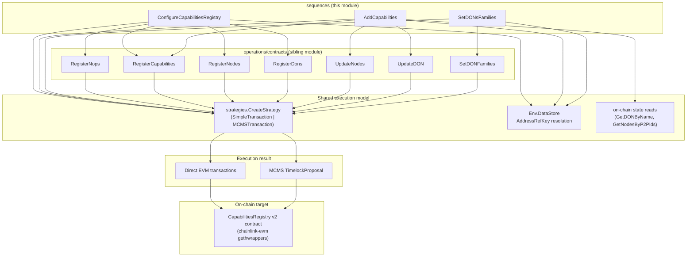
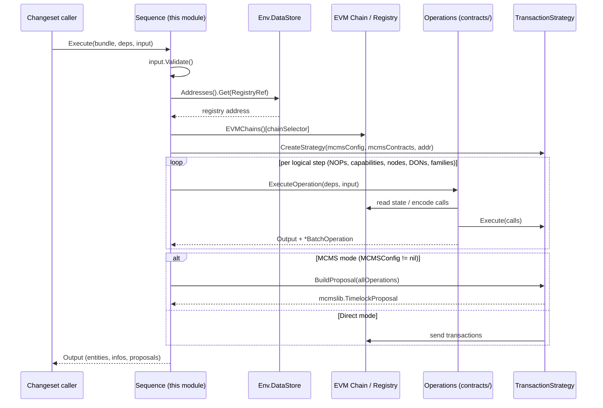
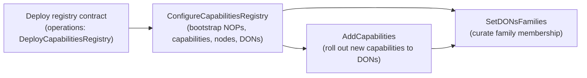

# cre-capabilities-registry — Sequences

## Overview

This module implements the **sequence layer** of the Capabilities Registry v2 changesets, located at
`chainlink/deployment/cre/capabilities_registry/v2/changeset/sequences/`. It is a sub-module of the
[cre-capabilities-registry](../cre-capabilities-registry.md) package within the
[CRE / Keystone Deployment Suite](../../CRE___Keystone_Deployment_Suite.md).

A **sequence** is the highest-level composable unit of the deployment framework used here
(`chainlink-deployments-framework/operations`): a versioned, named orchestration of one or more
**operations** that together complete a coherent on-chain task. While a single operation maps roughly to
one registry call (e.g. "register nodes"), a sequence composes several operations, reads on-chain state in
between, aggregates all resulting batch operations, and finally produces either:

- a set of **directly-executed transactions** (non-MCMS mode), or
- a single consolidated **MCMS `TimelockProposal`** for multi-sig governance execution (MCMS mode).

The sequences in this module drive the full lifecycle of configuring the on-chain
`CapabilitiesRegistry` contract:

| Sequence | File | Purpose |
|---|---|---|
| `ConfigureCapabilitiesRegistry` | `configure_capabilities_registry.go` | One-shot bootstrap: register node operators, capabilities, nodes, and DONs |
| `AddCapabilities` | `add_capabilities.go` | Incremental change: add new capabilities to existing DONs and update affected nodes |
| `SetDONsFamilies` | `set_dons_families.go` | Admin change: add/remove DONs to/from DON families |

All three follow the same architectural contract (deps/input/output, strategy-based execution, address
resolution via the datastore), so understanding one makes the others immediately readable.

## Architecture



### Key dependencies

The sequences run inside the `chainlink/deployment` Go module (see `chainlink/deployment/go.mod`) and rely
on:

- **`chainlink-deployments-framework`** — `cldf.Environment` (chains, datastore, logger) and the
  `operations` DSL (`NewSequence`, `ExecuteOperation`, `Bundle`).
- **`chainlink-evm` generated wrappers** — the typed `capabilities_registry_v2.CapabilitiesRegistry`
  binding used both for on-chain reads (`GetDONByName`, `GetNodesByP2PIds`) and as the target of generated
  batch operations.
- **`mcms`** — `TimelockProposal` and `types.BatchOperation`, the wire format for governance proposals.
- **`chainlink/deployment/cre/common/strategies`** — `CreateStrategy` decides the execution mode:

  ```go
  // If MCMSConfig is provided, an MCMSTransaction strategy is returned; it requires
  // MCMSContracts (the deployed MCMS with timelock state) and validates the config.
  // Otherwise a SimpleTransaction strategy executes calls directly from the EOA.
  ```

- **`evmstate.MCMSWithTimelockState`** (`cld-changesets/legacy/pkg/family/evm`) — the deployed MCMS
  timelock contracts; required only when `MCMSConfig != nil`.

### Shared execution contract

Every sequence in this module applies the same five steps:

1. **Validate input** — a `Validate()` method enforces invariants (e.g. exactly one of registry-ref /
   contract address, non-empty DON configs, non-empty change list).
2. **Resolve the registry address** — either from `input.RegistryRef` via
   `deps.Env.DataStore.Addresses().Get(...)` (preferred) or, in the configure sequence only, from the
   deprecated `input.ContractAddress` string.
3. **Resolve the EVM chain** — `deps.Env.BlockChains.EVMChains()[chainSelector]`.
4. **Create the transaction strategy** — `strategies.CreateStrategy(chain, env, mcmsConfig, mcmsContracts,
   registryAddress, description)`; all per-DON/per-entity operations share one strategy so their batch
   operations can be merged into a single proposal.
5. **Aggregate & emit** — collect every operation's `*types.BatchOperation`; if any exist, call
   `strategy.BuildProposal(allOperations)` to produce one `mcmslib.TimelockProposal` (MCMS mode). In direct
   mode the operations execute inline and the proposal list stays empty.



## Sub-modules

Each sequence is documented in detail in its own page (filenames as generated under
`cre-capabilities-registry_sequences/`):

- **[cre-capabilities-registry_sequences_configure_registry.md](cre-capabilities-registry_sequences/cre-capabilities-registry_sequences_configure_registry.md)**
  — `ConfigureCapabilitiesRegistry` and its `Deps` / `Input` / `Output` types: full bootstrap of node
  operators, capabilities, nodes and DONs in a single ordered run, producing one consolidated MCMS
  proposal. Supports both the modern `RegistryRef`-based and the deprecated `ContractAddress`-based
  addressing.
- **[cre-capabilities-registry_sequences_add_capabilities.md](cre-capabilities-registry_sequences/cre-capabilities-registry_sequences_add_capabilities.md)**
  — `AddCapabilities` and its `Deps` / `Input` / `Output` types: incremental capability rollout.
  Deduplicates capabilities registry-wide, reads each DON's nodes on-chain, applies capability-config
  modifiers (e.g. Aptos p2p→transmitter mapping), and issues `UpdateNodes` + `UpdateDON` per DON. Includes
  the hazardous `Force` bypass flag.
- **[cre-capabilities-registry_sequences_set_dons_families.md](cre-capabilities-registry_sequences/cre-capabilities-registry_sequences_set_dons_families.md)**
  — `SetDONsFamilies` with its `Deps` / `Input` / `DONFamiliesChange` / `Output` types: batch add/remove of
  DONs to/from DON families via repeated `SetDONFamilies` operations, with a single aggregated proposal.

## Sequence interaction & data flow

The three sequences are independent orchestrations over the same target contract, but they compose a
lifecycle:



- `ConfigureCapabilitiesRegistry` is the **initial** configuration path; its output
  (`ConfigureCapabilitiesRegistryOutput`) returns the registered entities (NOPs, capabilities, nodes, DONs)
  plus the proposal so callers can persist them.
- `AddCapabilities` is the **steady-state mutation** path; it never registers new nodes or operators, only
  capabilities and the resulting node/DON config updates. It depends on DONs already existing on-chain
  (fetched via `GetDonNodes`, which reads `GetDONByName` and `GetNodesByP2PIds` from the registry).
- `SetDONsFamilies` is a **governance curation** path operating purely on DON family membership; it requires
  no entity inputs beyond the change list.

All three aggregate their operations into exactly one `TimelockProposal` per run when in MCMS mode —
callers sign/execute the proposal once rather than per-step.

## Related modules

- [cre-capabilities-registry](../cre-capabilities-registry.md) — parent module; includes the
  [operations layer](cre-capabilities-registry_operations.md) (`RegisterNops`, `RegisterCapabilities`,
  `RegisterNodes`, `RegisterDons`, `UpdateNodes`, `UpdateDON`, `SetDONFamilies`, …) that these sequences
  compose.
- [keystone node registration](../keystone/keystone_node_registration.md) — the legacy Keystone
  `ConfigureCapabilitiesRegistrySeq` variant under `chainlink/deployment/keystone/changeset/operations/contracts`,
  superseded in intent by this module's v2 sequences.
- [Deployment Framework Core & Product Deployments](../../Deployment_Framework_Core___Product_Deployments.md) —
  the framework primitives (changesets, operations, datastore, MCMS helpers) these sequences build on.
