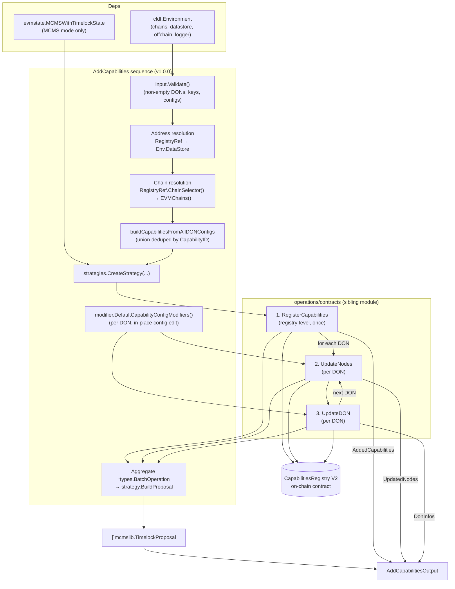
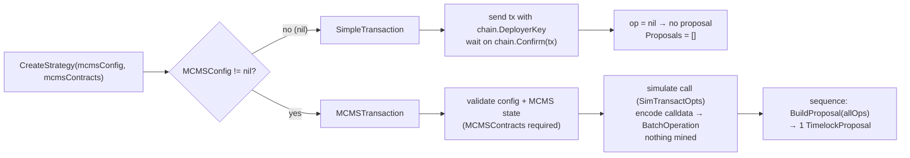
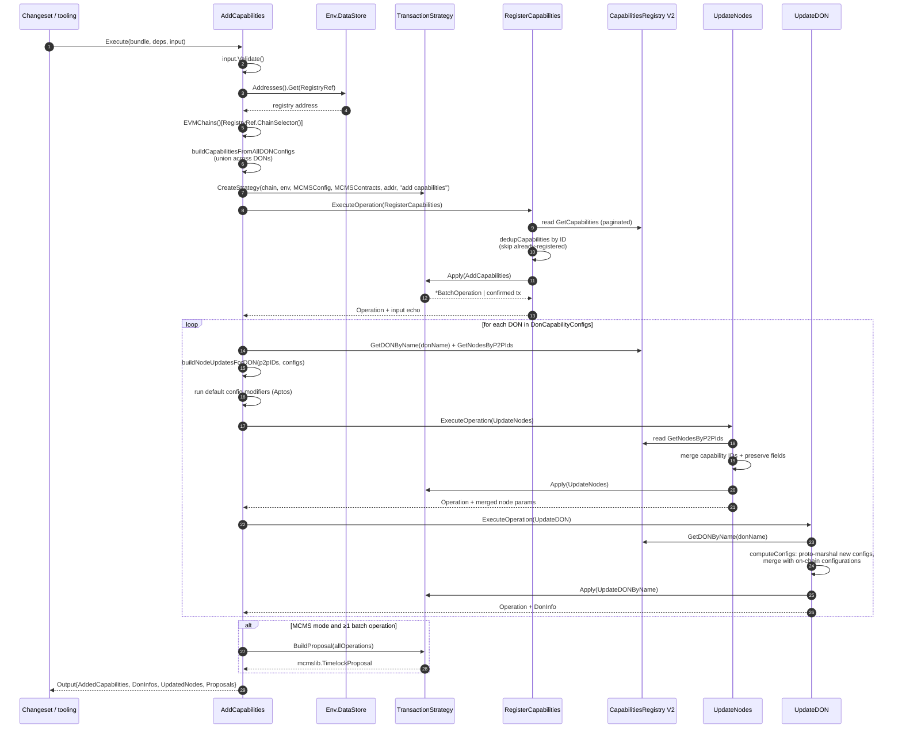
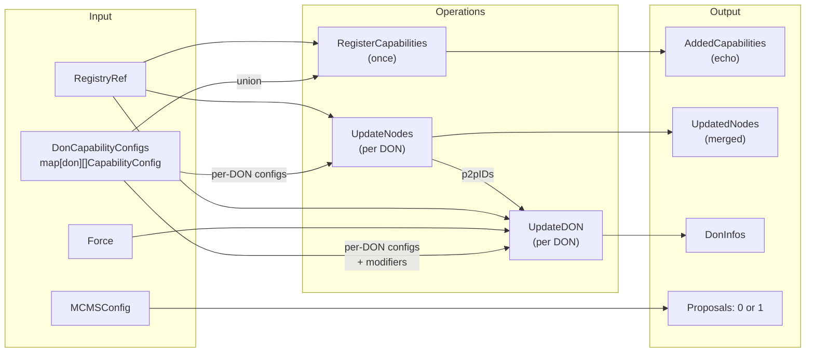

# Add Capabilities Sequence

## Overview

`AddCapabilities` is the **incremental maintenance sequence** for the Capabilities Registry V2 contract. Defined in
`chainlink/deployment/cre/capabilities_registry/v2/changeset/sequences/add_capabilities.go`, it attaches new capabilities to one or
more **already-registered DONs** on an already-deployed registry. Where the bootstrap sequence
[`ConfigureCapabilitiesRegistry`](cre-capabilities-registry_sequences_configure_registry.md) creates entities from scratch
(NOPs, capabilities, nodes, DONs), `AddCapabilities` is the day-2 counterpart: it registers any *not-yet-known* capabilities at the
registry level, then appends them to every node and DON named in the input — without touching the DON's membership, `F` value, or
publicity.

The sequence is built with the deployment framework's `operations.NewSequence` DSL (name `"add-capabilities-seq"`, version `1.0.0`)
and, like every sequence in this module, collapses all child-operation side effects into either directly-executed transactions or a
**single MCMS `TimelockProposal`** for multi-sig governance execution. See the [sequences overview](../cre-capabilities-registry_sequences.md)
for the shared execution contract and the [operations layer](../cre-capabilities-registry_operations.md) for the atomic units it composes.

Typical use cases:

- Onboarding a new capability type (e.g. an Aptos chain capability or a new write-target) to an existing workflow DON.
- Enabling the same capability across several DONs in one run (`DonCapabilityConfigs` is a per-DON map).
- Rotating capability configuration while preserving the DON's on-chain state (config merging is on by default).

This page documents the sequence's public surface (`AddCapabilitiesDeps`, `AddCapabilitiesInput`, `AddCapabilitiesOutput`), its
orchestration logic, and its guarantees (idempotency, config merging, proposal assembly).

## Core components

| Component | Kind | Purpose |
|---|---|---|
| `AddCapabilities` | `operations.Sequence` | The orchestration itself: input validation, addressing/chain resolution, strategy creation, registry-level capability registration, per-DON node + DON updates, MCMS proposal assembly |
| `AddCapabilitiesDeps` | Deps struct | Constructor-injected dependencies: the deployment environment and the deployed MCMS contract state |
| `AddCapabilitiesInput` | Input struct | Plain-data, `Validate()`-checked configuration: the per-DON capability configs, execution mode, registry addressing, and the `Force` override |
| `AddCapabilitiesOutput` | Output struct | Echo of what was effectively submitted (capabilities, DON update params, merged node params) plus the assembled MCMS proposal |

### `AddCapabilitiesDeps`

| Field | Type | Semantics |
|---|---|---|
| `Env` | `*cldf.Environment` | The deployment environment: EVM chains, datastore (address book), logger, and — for Aptos capabilities — the offchain/Job Distributor client. Required. |
| `MCMSContracts` | `*evmstate.MCMSWithTimelockState` | The deployed MCMS-with-timelock contract bundle (proposer MCM, timelock, …). **Required when `input.MCMSConfig != nil`** — `strategies.CreateStrategy` rejects the run otherwise. Ignored in direct mode. |

Callers obtain `MCMSContracts` via the shared helper `strategies.GetMCMSContracts(env, chainSelector, mcmsConfig)` or the
changeset-level lookup; see the [Deployment Framework Core](../../../Deployment_Framework_Core___Product_Deployments.md) module for the
datastore/address-book mechanics behind that lookup.

### `AddCapabilitiesInput`

| Field | Type | Semantics |
|---|---|---|
| `DonCapabilityConfigs` | `map[string][]contracts.CapabilityConfig` | Maps DON name → the list of capability configs (`contracts.CapabilityConfig` = `Capability`{`CapabilityID`, `ConfigurationContract`, `Metadata`} + untyped `Config` map) to attach to that DON. The union of all lists, deduplicated by `CapabilityID`, is what gets registered at the registry level. |
| `Force` | `bool` | Forwards to `UpdateDON`. When `true`, the DON update proceeds **even if forwarder readiness cannot be validated**. Documented in code as very dangerous — it can break the whole platform if forwarders are not ready. Leave `false` unless explicitly coordinated with forwarder owners. |
| `RegistryRef` | `datastore.AddressRefKey` | Datastore key for the Capabilities Registry (address + chain selector). Resolved via `Env.DataStore.Addresses().Get(...)`; its `ChainSelector()` also selects the target chain. |
| `MCMSConfig` | `*crecontracts.MCMSConfig` | Execution mode switch (alias for `cldfproposalutils.TimelockConfig`). `nil` → direct EOA transactions; non-nil → MCMS proposal mode. |

`Validate()` enforces three rules **before any chain interaction**:

- `DonCapabilityConfigs` must contain at least one DON entry.
- No DON key may be an empty string.
- Every DON entry must contain at least one capability config.

### `AddCapabilitiesOutput`

| Field | Type | Semantics |
|---|---|---|
| `AddedCapabilities` | `[]contracts.RegisterableCapability` | The requested capability set echoed back by `RegisterCapabilities` (the **input echo**, not the post-dedup on-chain delta). |
| `DonInfos` | `[]capabilities_registry_v2.CapabilitiesRegistryUpdateDONParams` | One entry per processed DON: the exact `UpdateDONByName` params that were submitted (merged capability configurations, preserved `F`/`IsPublic`, DON membership). |
| `UpdatedNodes` | `[]capabilities_registry_v2.CapabilitiesRegistryNodeParams` | The validated, merged node params actually submitted by `UpdateNodes` across all DONs (existing fields preserved, capability IDs appended). |
| `Proposals` | `[]mcmslib.TimelockProposal` | 0 or 1 consolidated proposal. Populated only in MCMS mode and only if at least one batch operation was produced. |

## Architecture

### Composition

The sequence owns a single `strategies.TransactionStrategy` created once via `strategies.CreateStrategy` and shares it with all three
child operations (`RegisterCapabilities`, `UpdateNodes`, `UpdateDON`), which is what allows the entire flow to fold into one MCMS
proposal. All operations target the same `CapabilitiesRegistry` V2 binding
(`chainlink-evm/gethwrappers/workflow/generated/capabilities_registry_wrapper_v2`).



Key relationships:

- **Sequence → operations**: each step runs through `operations.ExecuteOperation`, inheriting the framework's validation, versioning,
  and report generation. A failure in any step aborts the sequence.
- **Operation → operation**: within a DON iteration, the node updates are derived from the DON's on-chain node list
  (`GetDonNodes`) and the same `p2pIDs` slice is reused by both `UpdateNodes` and `UpdateDON`, guaranteeing node-set consistency.
- **Operations → strategy → chain**: every mutating call is wrapped in `strategy.Apply(callFn)`, which either executes and confirms
  on-chain (direct mode) or encodes the calldata into an `mcmstypes.BatchOperation` without mining (MCMS mode).
- **Sequence → modifier framework**: per-DON capability configs are passed through `modifier.DefaultCapabilityConfigModifiers()`
  before `UpdateDON` sees them (see [Capability config modifiers](#capability-config-modifiers)).

### Execution modes

`strategies.CreateStrategy` picks the mode from `input.MCMSConfig`:



MCMS-mode specifics (`strategies.MCMSTransaction`, `chainlink/deployment/cre/common/strategies/mcms_transaction.go`):

- Calls are **simulated**, not broadcast: `cldf.SimTransactOpts()` encodes the calldata, and `cldfproposalutils.BatchOperationForChain`
  wraps it as a batch operation for the registry address.
- `BuildProposal` requires the timelock and proposer MCM from `MCMSWithTimelockState`, resolves the correct MCM via
  `MCMSConfig.MCMBasedOnAction(...)`, attaches a per-chain MCMS inspector, and delegates to
  `proposeutils.BuildProposalFromBatchesV2` with the shared description `contracts.AddCapabilitiesDescription` (`"add capabilities"`).
- The MCMS config itself is validated against the chain and state inside `CreateStrategy` before any operation runs, so a
  misconfigured proposal fails fast.

Direct-mode specifics (`strategies.SimpleTransaction`): each of the three operations submits its own transaction from the deployer
key and waits for confirmation; `BuildProposal` is a no-op returning `nil`, so the output carries empty `Proposals`.

## Execution flow



## Data flow: input → operations → output

| Input field | Consumed by | Feeds output field |
|---|---|---|
| `DonCapabilityConfigs` (union) | `RegisterCapabilities` (dedup vs. on-chain by ID) | `Output.AddedCapabilities` (input echo) |
| `DonCapabilityConfigs[don]` | `UpdateNodes` (via `buildNodeUpdatesForDON`) | `Output.UpdatedNodes` (merged per DON) |
| `DonCapabilityConfigs[don]` | `UpdateDON` (proto-marshal + merge with on-chain configs) | `Output.DonInfos` (one per DON) |
| `MCMSConfig` | `strategies.CreateStrategy` | `Output.Proposals` (0 or 1) |
| `Force` | `UpdateDON` input | May permit an update despite unvalidated forwarder readiness |
| `RegistryRef` | Address + chain resolution | Target of all three operations |



## Per-DON update mechanics

### Registry-level capability registration (once)

`buildCapabilitiesFromAllDONConfigs` computes the **set union** of capabilities across all DONs' configs, deduplicated by
`CapabilityID`, and maps each to a `contracts.RegisterableCapability` (`CapabilityID`, `ConfigurationContract`, JSON `Metadata`).
`RegisterCapabilities` then reads all existing capabilities via a paginated helper and **skips any capability already registered** —
this matters both for idempotent re-runs and for MCMS batches, where a single revert (duplicate `AddCapabilities`) would poison the
whole proposal.

### Node updates: append-only and idempotent

For each DON, the sequence reads the DON's members (`GetDONByName` → `GetNodesByP2PIds`) and builds one
`contracts.NodeConfig` per member P2P ID carrying **only** the new capability list (`buildNodeUpdatesForDON`; metadata is
JSON-marshalled per capability). `UpdateNodes` then merges rather than replaces:

- Existing capability IDs from on-chain state are preserved, and the new IDs are appended with dedup — re-running the sequence does
  not duplicate IDs.
- Fields the input leaves at their zero value (encryption public key, signer, node operator ID, CSA key) are carried over from the
  on-chain node, so the update only touches capabilities.
- The resulting `CapabilitiesRegistryNodeParams` are deterministically sorted (node operator ID, then P2P ID) before submission.

### DON updates: merge-with-on-chain by default

`UpdateDON` is invoked with `MergeCapabilityConfigsWithOnChain: true`. Its `computeConfigs` step:

1. Proto-marshals each input `CapabilityConfig.Config` (`pkg.CapabilityConfig.MarshalProto`) — a `nil` config is an error.
2. Rejects duplicate capability IDs within the input.
3. Because merging is enabled, **retains any existing on-chain capability configurations** that are not in the input, so attaching a
   new capability never drops the DON's existing ones.
4. Sorts the final configuration list by capability ID.

Unset DON attributes are carried over from on-chain state: `F` (fault tolerance) and publicity (`IsPrivate` is applied as
`!don.IsPublic`, and only when explicitly set). The DON's membership is re-asserted as the P2P IDs read from the registry, making the
operation a pure capability attachment.

### Capability config modifiers

Before `UpdateDON` runs for a DON, the sequence applies `modifier.DefaultCapabilityConfigModifiers()` to the DON's configs in place.
The default set currently contains a single `aptosDonModifier`, which:

- Detects Aptos chain capabilities by capability-ID prefix (`aptos:ChainSelector:<selector>[@version]`).
- Requires `deps.Env.Offchain` (the Job Distributor client) and fetches node OCR metadata for the DON's P2P IDs.
- Builds a `p2p → transmitter` map, converting each node's ed25519 transmit public key into an Aptos account address
  (`sha3-256(pubkey ‖ 0x00)`) as expected by the relayer and capability code.
- Injects that map as `specConfig.p2pToTransmitterMap` into the capability config, failing if a non-empty `specConfig` was supplied
  by the caller.

The modifier framework is the designated extension point for other chain- or capability-specific config enrichment; new modifiers
plug into `DefaultCapabilityConfigModifiers` without sequence changes.

## Ordering, idempotency, and edge cases

**Why register capabilities before updating DONs/nodes.** `UpdateDON` writes capability *configurations* referencing capability IDs;
the registry contract requires those IDs to exist. Registering the union first keeps the whole flow correct even when everything lands
in the same MCMS batch and is not yet readable on-chain.

**Idempotency (safe re-runs):**

| Operation | Dedup key | Source of truth |
|---|---|---|
| `RegisterCapabilities` | Capability ID | On-chain read via paginated `GetCapabilities` + within-input dedup |
| `UpdateNodes` | Capability ID per node | Merge of on-chain node capabilities + input (deduped) |
| `UpdateDON` | Capability ID per configuration | Merge of on-chain configurations + input (`MergeCapabilityConfigsWithOnChain: true`) |

Re-running the sequence with the same input is a no-op at the registry level (all capabilities deduplicated away) and produces
byte-identical node/DON params at the DON level.

**Map iteration order.** `DonCapabilityConfigs` is a Go map, so the per-DON loop order is nondeterministic. Each DON's update set is
self-contained (registry-level registration happens before the loop), so ordering only affects batch-operation sequence inside the
MCMS proposal, not correctness.

**Empty results.** If MCMS mode is enabled but every operation deduplicated away (nothing new to add), the sequence logs a warning
(`"Add capability sequence has not produced any operations to execute"`), skips proposal building, and returns an empty `Proposals`
slice. This makes the sequence safe to call unconditionally from changesets.

**Error handling.**

- Input violations are caught by `Validate()` before any chain interaction.
- Unknown chain selectors and datastore lookup failures abort with wrapped errors before the strategy is created.
- `CreateStrategy` fails fast when `MCMSConfig` is set without `MCMSContracts`, or when the MCMS config is invalid for the chain.
- Contract call failures are surfaced through `cldf.DecodeErr(CapabilitiesRegistryABI, err)`, converting raw Solidity reverts into
  readable Go errors.
- Any operation failure aborts the sequence; in direct mode earlier transactions are already confirmed (no cross-step rollback —
  re-running is the recovery path, enabled by idempotency); in MCMS mode nothing is mined, so a failure loses nothing.

## Usage example

A typical changeset invocation (MCMS mode):

```go
out, err := operations.ExecuteSequence(
    b,
    sequences.AddCapabilities,
    sequences.AddCapabilitiesDeps{
        Env:           env,
        MCMSContracts: mcmsState, // from strategies.GetMCMSContracts(env, chainSel, mcmsConfig)
    },
    sequences.AddCapabilitiesInput{
        RegistryRef: datastore.NewAddressRefKey(chainSel, deployment.CapabilitiesRegistry, "capabilities-registry"),
        DonCapabilityConfigs: map[string][]contracts.CapabilityConfig{
            "workflow-don-1": {
                {
                    Capability: contracts.Capability{
                        CapabilityID:          "aptos:ChainSelector:12345@1.0.0",
                        ConfigurationContract: cfgContractAddr,
                        Metadata:              map[string]any{"Readable": true},
                    },
                    Config: nil, // specConfig injected by the Aptos modifier
                },
            },
            "workflow-don-2": {
                {
                    Capability: contracts.Capability{
                        CapabilityID:          "cron@1.0.0",
                        ConfigurationContract: common.Address{},
                        Metadata:              map[string]any{"Readable": true},
                    },
                    Config: map[string]any{"schedule": "*/15 * * * *"},
                },
            },
        },
        MCMSConfig: mcmsConfig, // nil → direct, confirmed transactions
        Force:      false,      // never force unless forwarder readiness is confirmed
    },
)
// out.Proposals → submit through MCMS tooling (or empty in direct mode)
// out.UpdatedNodes / out.DonInfos → audit trail of the exact on-chain params
```

Callers typically wrap this sequence in a changeset that also updates the Workflow Registry association
(`SetCapabilitiesRegistry`) when a new DON/capability combination starts producing workflows; see
[cre-workflow-registry](../../cre-workflow-registry.md) and the [keystone changesets](../../keystone.md).

## Related documentation

- [Capabilities Registry module](../../cre-capabilities-registry.md) — contract model, registry view, and module layout.
- [Operations layer](../cre-capabilities-registry_operations.md) — `RegisterCapabilities`, `UpdateNodes`, `UpdateDON`, and the other
  atomic units referenced here.
- [Sequences overview](../cre-capabilities-registry_sequences.md) — the shared Deps/Input/Output and strategy contract.
- [Configure Capabilities Registry](cre-capabilities-registry_sequences_configure_registry.md) — the bootstrap counterpart
  (NOPs, capabilities, nodes, DONs from scratch).
- [Set DONs Families](cre-capabilities-registry_sequences_set_dons_families.md) — the sibling sequence for DON family management.
- [CRE state views](../../cre-core/cre-core_state-views.md) — inspecting the resulting on-chain registry state
  (`view.OCR3ConfigViewLegacy`, `CREView`).
- [Deployment Framework Core](../../../Deployment_Framework_Core___Product_Deployments.md) — datastore/address-book and
  `CapabilityRegistryViewV2` mechanics underpinning `RegistryRef` resolution.
