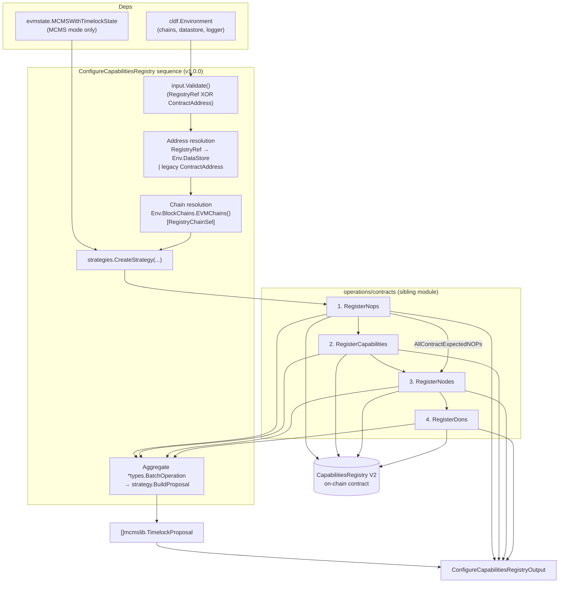
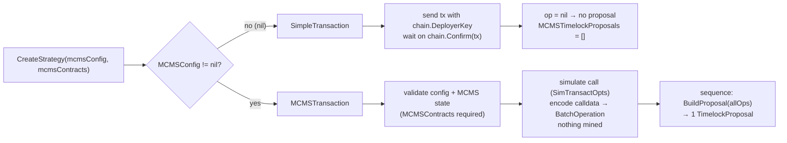
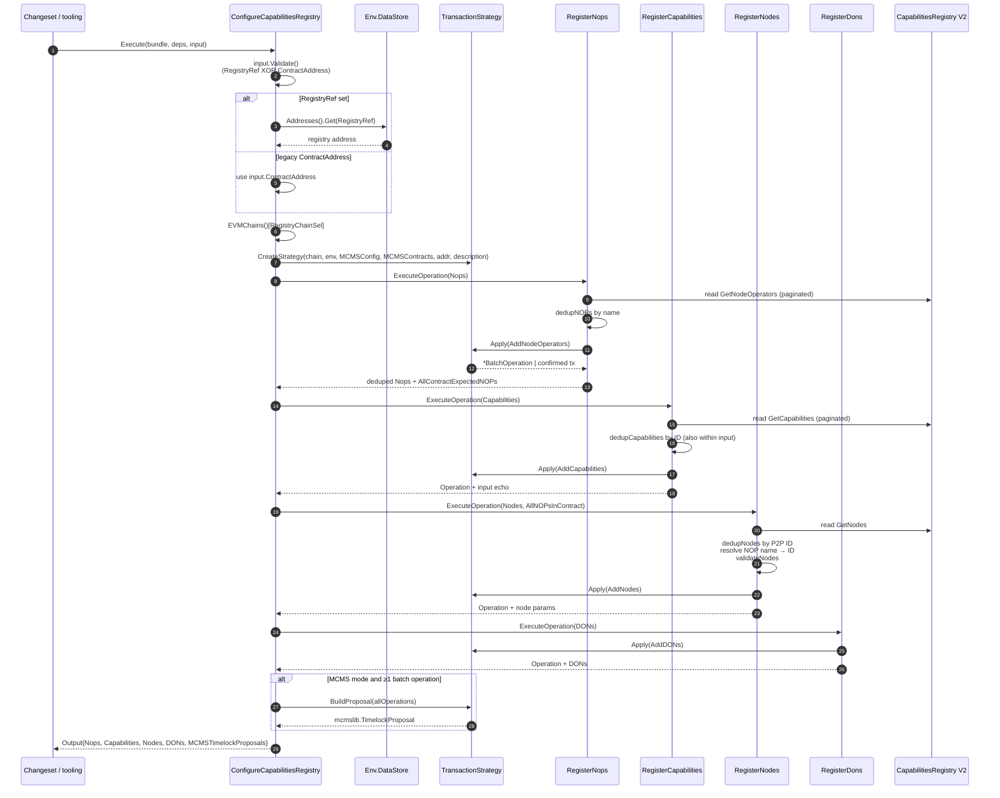
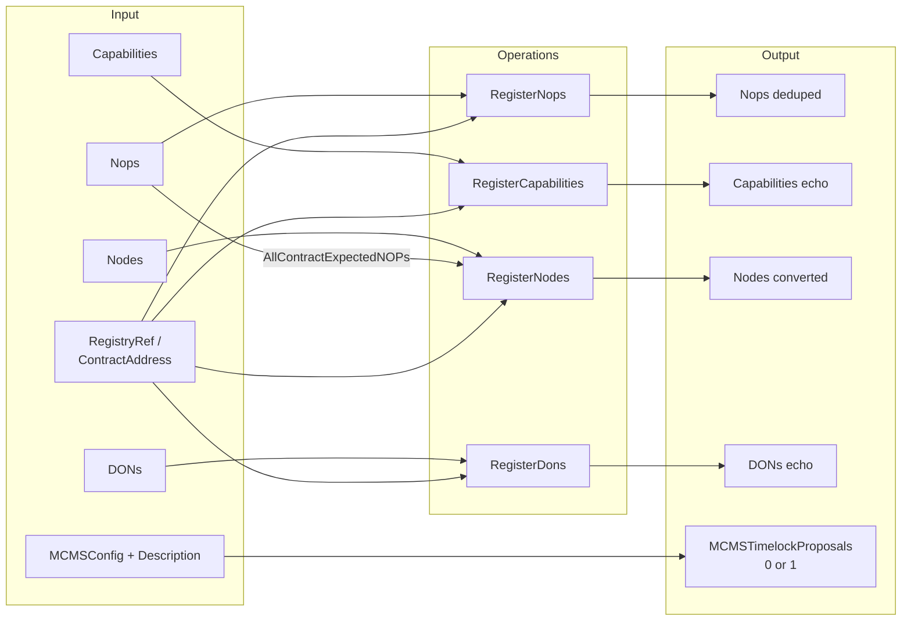
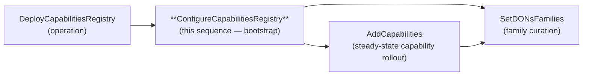

# Configure Capabilities Registry Sequence

## Overview

`ConfigureCapabilitiesRegistry` is the **one-shot bootstrap sequence** for the Capabilities Registry V2 contract. Defined in
`chainlink/deployment/cre/capabilities_registry/v2/changeset/sequences/configure_capabilities_registry.go`, it registers the four
kinds of entities a fresh CRE deployment needs in a single ordered run:

1. **Node operators (NOPs)** — via `RegisterNops`
2. **Capabilities** — via `RegisterCapabilities`
3. **Nodes** — via `RegisterNodes` (bound to their NOPs and capabilities)
4. **DONs** — via `RegisterDons` (Decentralized Operator Networks referencing nodes and capabilities)

The sequence is built with the deployment framework's `operations.NewSequence` DSL (name `"configure-capabilities-registry"`, version `1.0.0`) and, like every sequence in this module, collapses all child-operation side effects into either a set of directly-executed transactions or a **single MCMS `TimelockProposal`** for multi-sig governance execution. See the [sequences overview](../cre-capabilities-registry_sequences.md) for the shared execution contract and the [operations layer](../cre-capabilities-registry_operations.md) for the atomic units it composes.

This page documents the sequence's public surface (`ConfigureCapabilitiesRegistryDeps`, `ConfigureCapabilitiesRegistryInput`, `ConfigureCapabilitiesRegistryOutput`), its orchestration logic, and its guarantees (ordering, idempotency, proposal assembly).

## Core components

| Component | Kind | Purpose |
|---|---|---|
| `ConfigureCapabilitiesRegistry` | `operations.Sequence` | The orchestration itself: resolves addressing, creates the transaction strategy, runs the four registration operations, aggregates batch operations, builds the proposal |
| `ConfigureCapabilitiesRegistryDeps` | Deps struct | Constructor-injected dependencies: the deployment environment and the deployed MCMS contract state |
| `ConfigureCapabilitiesRegistryInput` | Input struct | Plain-data, `Validate()`-checked configuration: addressing, execution mode, and the entities to register |
| `ConfigureCapabilitiesRegistryOutput` | Output struct | Echo of what was effectively submitted, plus the assembled MCMS proposals |

### `ConfigureCapabilitiesRegistryDeps`

| Field | Type | Semantics |
|---|---|---|
| `Env` | `*cldf.Environment` | The deployment environment: EVM chains, datastore (address book), logger. Required. |
| `MCMSContracts` | `*evmstate.MCMSWithTimelockState` | The deployed MCMS-with-timelock contract bundle (proposer MCM, timelock, …). **Required when `input.MCMSConfig != nil`** — `strategies.CreateStrategy` rejects the run otherwise. Ignored in direct mode. |

Callers obtain `MCMSContracts` via the shared helper `strategies.GetMCMSContracts(env, chainSelector, mcmsConfig)` or the changeset-level lookup; see the [Deployment Framework Core](../../../Deployment_Framework_Core___Product_Deployments.md) module for the datastore/address-book mechanics behind that lookup.

### `ConfigureCapabilitiesRegistryInput`

| Field | Type | Semantics |
|---|---|---|
| `RegistryChainSel` | `uint64` | Chain selector of the chain hosting the registry. Used to fetch the `cldf_evm.Chain` from `Env.BlockChains.EVMChains()`. |
| `RegistryRef` | `datastore.AddressRefKey` | **Preferred addressing.** Datastore key resolved via `Env.DataStore.Addresses().Get(...)` to obtain the registry address. |
| `ContractAddress` | `string` | **Deprecated** legacy addressing (`TODO(PRODCRE-1030)`). Mutually exclusive with `RegistryRef`. |
| `MCMSConfig` | `*crecontracts.MCMSConfig` | Execution mode switch (alias for `cldfproposalutils.TimelockConfig`). `nil` → direct EOA transactions; non-nil → MCMS proposal mode. |
| `Description` | `string` | Human-readable proposal description. *Note:* in the current version the sequence passes the package-level constant `contracts.ConfigureCapabilitiesRegistryDescription` (`"configure capabilities registry"`, from `operations/contracts/types.go`) to the strategy; this field is reserved but not yet consumed. |
| `Nops` | `[]capabilities_registry_v2.CapabilitiesRegistryNodeOperatorParams` | Node operators to register. May be empty. |
| `Nodes` | `[]contracts.NodesInput` | Nodes to register (NOP name, signer, P2P ID, encryption public key, CSA key, capability IDs). May be empty. |
| `Capabilities` | `[]contracts.RegisterableCapability` | Capabilities to register (ID, configuration contract, JSON metadata). May be empty. |
| `DONs` | `[]capabilities_registry_v2.CapabilitiesRegistryNewDONParams` | DONs to register (node P2P IDs + capability IDs + config). May be empty. |

`Validate()` enforces the addressing invariant:

- exactly one of `RegistryRef` / `ContractAddress` must be set — providing **neither** or **both** is an error.

### `ConfigureCapabilitiesRegistryOutput`

| Field | Type | Semantics |
|---|---|---|
| `Nops` | `[]capabilities_registry_v2.CapabilitiesRegistryNodeOperatorParams` | The **deduplicated** NOP set actually submitted by `RegisterNops` |
| `Nodes` | `[]capabilities_registry_v2.CapabilitiesRegistryNodeParams` | The validated, NOP-ID-resolved node params actually submitted by `RegisterNodes` |
| `Capabilities` | `[]contracts.RegisterableCapability` | The requested capability set echoed back by `RegisterCapabilities` (input, not the post-dedup list) |
| `DONs` | `[]capabilities_registry_v2.CapabilitiesRegistryNewDONParams` | The requested DON set echoed back by `RegisterDons` |
| `MCMSTimelockProposals` | `[]mcmslib.TimelockProposal` | 0 or 1 consolidated proposal. Populated only in MCMS mode and only if at least one batch operation was produced. |

## Architecture

### Composition

The sequence owns a single `strategies.TransactionStrategy` created once via `strategies.CreateStrategy` and shares it with all four child operations, which is what allows the entire flow to fold into one proposal. All four operations target the same `CapabilitiesRegistry` V2 binding (`chainlink-evm/gethwrappers/workflow/generated/capabilities_registry_wrapper_v2`).



Key relationships:

- **Sequence → operations**: each step runs through `operations.ExecuteOperation`, inheriting the framework's validation, versioning, and report generation. A failure in any step aborts the sequence.
- **Operation → operation**: the only cross-operation data dependency is `RegisterNopsOutput.AllContractExpectedNOPs` → `RegisterNodesInput.AllNOPsInContract` (see [NOP ID bookkeeping](#nop-id-bookkeeping)).
- **Operations → strategy → chain**: every mutating call is wrapped in `strategy.Apply(callFn)`, which either executes and confirms on-chain (direct mode) or encodes the calldata into an `mcmstypes.BatchOperation` without mining (MCMS mode).

### Execution modes

`strategies.CreateStrategy` picks the mode from `input.MCMSConfig`:



MCMS-mode specifics (`strategies.MCMSTransaction`, `chainlink/deployment/cre/common/strategies/mcms_transaction.go`):

- Calls are **simulated**, not broadcast: `cldf.SimTransactOpts()` encodes the calldata, and `cldfproposalutils.BatchOperationForChain` wraps it as a batch operation for the registry address.
- `BuildProposal` requires the timelock and proposer MCM from `MCMSWithTimelockState`, resolves the correct MCM via `MCMSConfig.MCMBasedOnAction(...)` (sign-and-execute vs. proposal-only actions), attaches a per-chain MCMS inspector, and delegates to `proposeutils.BuildProposalFromBatchesV2`.
- The MCMS config itself is validated against the chain and state inside `CreateStrategy` before any operation runs, so a misconfigured proposal fails fast.

Direct-mode specifics (`strategies.SimpleTransaction`, `chainlink/deployment/cre/common/strategies/simple_transaction.go`): each of the four operations submits its own transaction from the deployer key and waits for confirmation; `BuildProposal` is a no-op returning `nil`, so the output carries empty proposals.

## Execution flow



## Data flow: input → operations → output

| Input field | Consumed by | Feeds output field |
|---|---|---|
| `Nops` | `RegisterNops` (dedup by name) | `Output.Nops` (deduped) |
| `Capabilities` | `RegisterCapabilities` (dedup by ID) | `Output.Capabilities` (input echo) |
| `Nodes` | `RegisterNodes` (dedup by P2P ID, NOP-ID resolution, field validation) | `Output.Nodes` (converted `CapabilitiesRegistryNodeParams`) |
| `DONs` | `RegisterDons` (pass-through) | `Output.DONs` (input echo) |
| `MCMSConfig`, `Description` | `strategies.CreateStrategy` | `Output.MCMSTimelockProposals` |
| `RegistryRef` / `ContractAddress`, `RegistryChainSel` | Address/chain resolution | Target of all four operations |



## Ordering, idempotency, and edge cases

**Why the fixed order NOPs → capabilities → nodes → DONs:**

- Nodes reference node operators by name; the operation must translate names to the contract's 1-based sequential NOP IDs. Running NOPs first (and forwarding `AllContractExpectedNOPs`) makes that translation correct even when the NOPs land in the same MCMS batch and are not yet readable on-chain.
- DONs reference node P2P IDs and capability IDs, so nodes and capabilities must be registered before DONs or `AddDONs` would revert.

**Idempotency (safe re-runs):**

| Operation | Dedup key | Source of truth |
|---|---|---|
| `RegisterNops` | NOP name | On-chain read via `pkg.GetNodeOperators` |
| `RegisterCapabilities` | Capability ID | On-chain read via `pkg.GetCapabilities` + within-input dedup |
| `RegisterNodes` | P2P ID | On-chain read via `pkg.GetNodes` |
| `RegisterDons` | — none — | Passes params straight through; duplicates revert |

The reads-before-writes pattern exists because the registry contract reverts on duplicates — and a single revert would poison an entire MCMS batch. Re-running the sequence on an already-configured registry is a no-op for existing entities.

**NOP ID bookkeeping.** NOP IDs are 1-based positions assigned by `AddNodeOperators`. `RegisterNops` returns `AllContractExpectedNOPs`, a name→ID map covering both on-chain NOPs and *planned* NOPs (existing count + 1, +2, …). `RegisterNodes` consumes this map so node params can reference NOPs registered earlier in the same run.

**Empty inputs.** Every operation short-circuits on an empty slice (the contract accepts empty arrays) and emits no batch operation. If all four inputs are empty — or everything is deduplicated away — `allOperations` is empty, no proposal is built, and the output carries empty `MCMSTimelockProposals`. This makes the sequence safe to call unconditionally from changesets.

**Error handling.**

- Input addressing violations are caught by `Validate()` before any chain interaction.
- Unknown chain selectors and datastore lookup failures abort with descriptive wrapped errors before the strategy is created.
- Contract call failures are surfaced through `cldf.DecodeErr(CapabilitiesRegistryABI, err)`, converting raw Solidity reverts into readable Go errors.
- Any operation failure aborts the sequence; in direct mode earlier transactions are already confirmed (no cross-step rollback — re-running is the recovery path, enabled by idempotency); in MCMS mode nothing is mined, so a failure loses nothing.

## Usage example

A typical changeset invocation (direct mode omitted for brevity):

```go
out, err := operations.ExecuteSequence(
    b,
    sequences.ConfigureCapabilitiesRegistry,
    sequences.ConfigureCapabilitiesRegistryDeps{
        Env:           env,
        MCMSContracts: mcmsState, // from strategies.GetMCMSContracts(...) or changeset lookup
    },
    sequences.ConfigureCapabilitiesRegistryInput{
        RegistryChainSel: chainSel,
        RegistryRef:      datastore.NewAddressRefKey(chainSel, contracts.CapabilitiesRegistryType, ...),
        MCMSConfig:       &mcmsCfg, // nil → direct transactions
        Nops:             nopParams,
        Nodes:            nodeInputs,
        Capabilities:     capabilities,
        DONs:             donParams,
    },
)
// out.MCMSTimelockProposals → sign & execute via MCMS governance
```

The generated proposal is a standard `mcmslib.TimelockProposal`: proposers sign it and it is executed through the timelock outside this module. Ops/CI tooling and the [system tests](../../../Dev,_Test___Simulation_Environments/system-tests.md) then wait for nodes to pick up the registry state (e.g. `system-tests/lib/cre/contracts/registry_pickup_wait.go`).

## Lifecycle position and related documentation

Within the registry lifecycle (see the full picture in the [sequences overview](../cre-capabilities-registry_sequences.md) and the [module page](../../cre-capabilities-registry.md)):



- **[Sequences overview](../cre-capabilities-registry_sequences.md)** — the shared five-step execution contract all sequences follow.
- **[Add Capabilities sequence](cre-capabilities-registry_sequences_add_capabilities.md)** — the incremental follow-up: registers new capabilities and pushes them into existing DONs via `UpdateNodes`/`UpdateDON`.
- **[Set DONs Families sequence](cre-capabilities-registry_sequences_set_dons_families.md)** — batch DON family membership changes.
- **[Operations layer](../cre-capabilities-registry_operations.md)** — the atomic `Register*`/`Update*`/`DeleteDON` operations composed here.
- **[Keystone node registration](../../keystone/keystone_node_registration.md)** — the legacy v1 Keystone `ConfigureCapabilitiesRegistrySeq` variant, superseded in intent by this v2 sequence.
- **[Deployment Framework Core](../../../Deployment_Framework_Core___Product_Deployments.md)** — `cldf.Environment`, the operations DSL, the datastore, and MCMS proposal helpers.
- **[CRE & Keystone Deployment Suite](../../../CRE___Keystone_Deployment_Suite.md)** — the suite this module belongs to; downstream consumers include [cre-ocr3](../../cre-ocr3.md) (consumes registered DONs/capabilities) and [cre-workflow-registry](../../cre-workflow-registry.md) (points at this registry).

**Build context.** The sequence lives in the `chainlink/deployment` Go module (`chainlink/deployment/go.mod`), which pins `chainlink-deployments-framework v0.123.3`, the `chainlink-evm` gethwrappers (source of the `capabilities_registry_wrapper_v2` binding), and the MCMS proposal tooling it depends on. Contract-side behavior referenced above (duplicate reverts, sequential NOP IDs) is defined by `CapabilitiesRegistry.sol` in the `chainlink-evm` repository.
