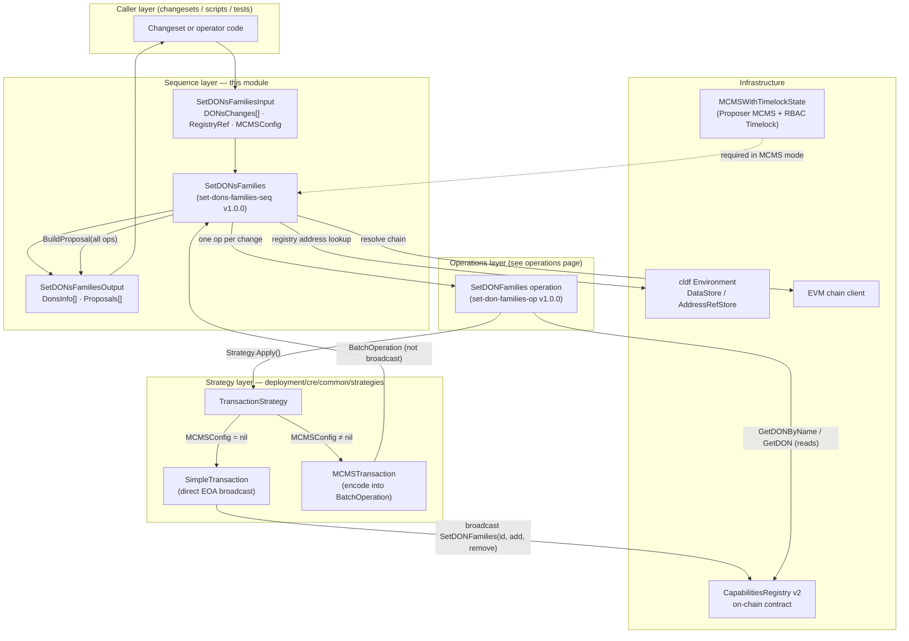
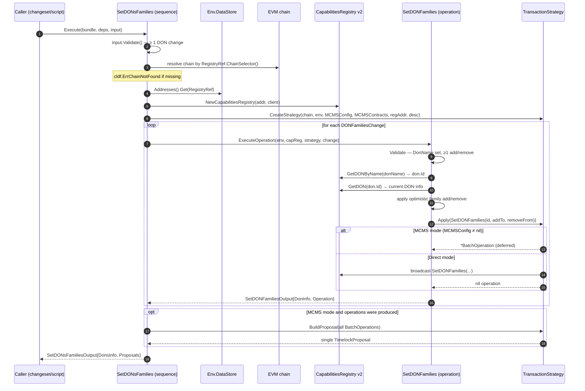
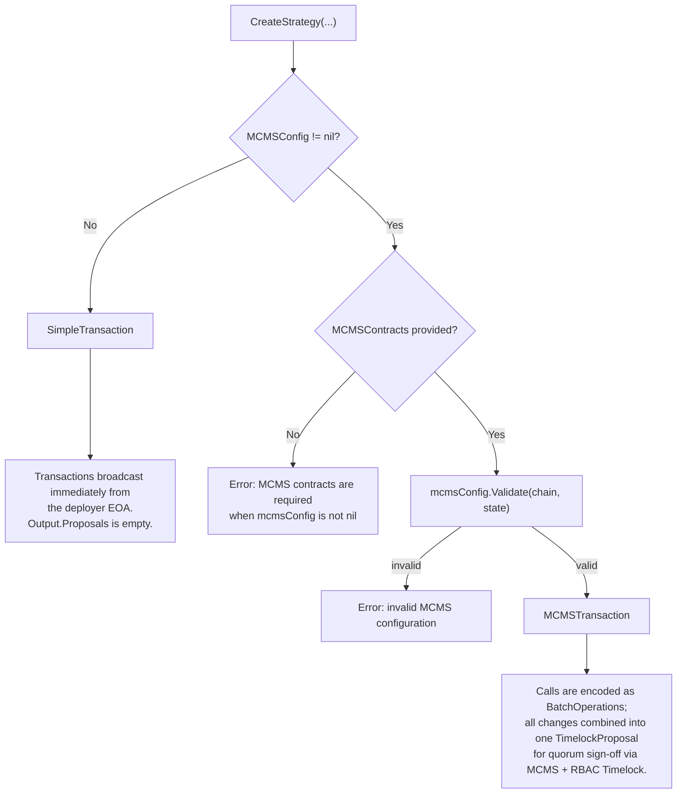
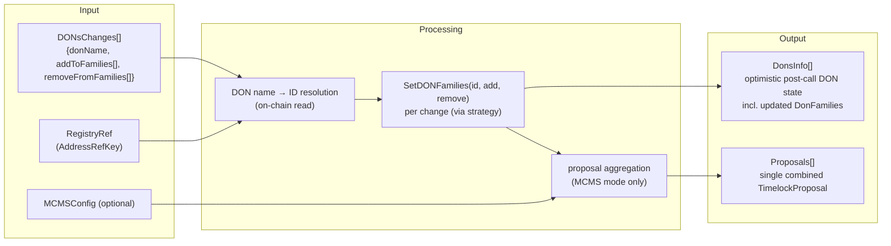

# cre-capabilities-registry_sequences_set_dons_families

## Overview

This module implements the **`SetDONsFamilies` sequence**, the deployment primitive that manages **DON family membership** on the on-chain `CapabilitiesRegistry` (v2) contract. A *DON family* is a named grouping of Decentralized Operator Networks (DONs) stored on-chain (the `DonFamilies` field of `CapabilitiesRegistryDONInfo`); families allow sets of DONs to be addressed as a unit by other on-chain and off-chain components.

The sequence is part of the [Capabilities Registry v2 deployment module](../../cre-capabilities-registry.md), one of three sequences alongside [Configure Capabilities Registry](cre-capabilities-registry_sequences_configure_registry.md) and [Add Capabilities](cre-capabilities-registry_sequences_add_capabilities.md). It follows the Chainlink deployment framework's **Sequence → Operation → Strategy** pattern:

| Layer | Component | Responsibility |
|---|---|---|
| Sequence | `SetDONsFamilies` | Orchestrates batched family changes, aggregates results and proposals |
| Operation | `SetDONFamilies` (documented in the [operations page](../cre-capabilities-registry_operations.md)) | Resolves a single DON by name and applies one add/remove family change |
| Strategy | `strategies.TransactionStrategy` | Decides whether calls are broadcast directly or deferred into an MCMS proposal |

**Source file:** `chainlink/deployment/cre/capabilities_registry/v2/changeset/sequences/set_dons_families.go`
**Go module:** `github.com/smartcontractkit/chainlink/deployment` (see `chainlink/deployment/go.mod`), which depends on `chainlink-deployments-framework`, `mcms`, and `go-ethereum`.

---

## Core Components

| Component | Kind | Description |
|---|---|---|
| `SetDONsFamilies` | `operations.Sequence` | Registered as `"set-dons-families-seq"` v`1.0.0` ("Set DONs Families in Capabilities Registry"). Executes one `SetDONFamilies` operation per requested change and aggregates the results. |
| `SetDONsFamiliesDeps` | Deps struct | `Env *cldf.Environment` (blockchains, datastore, logger) and `MCMSContracts *evmstate.MCMSWithTimelockState` — the MCMS-with-timelock state, **required whenever `MCMSConfig` is non-nil**. |
| `SetDONsFamiliesInput` | Input struct | `DONsChanges []DONFamiliesChange`, `RegistryRef datastore.AddressRefKey` (datastore key carrying chain selector + registry address), and optional `MCMSConfig *crecontracts.MCMSConfig` (an alias for `cldfproposalutils.TimelockConfig`, defined in `chainlink/deployment/cre/contracts/contracts.go`). |
| `DONFamiliesChange` | Input element | A single DON membership change: `DonName`, `AddToFamilies []string`, `RemoveFromFamilies []string`. Carries `json`/`yaml` tags, so inputs can be deserialized from declarative deployment manifests. |
| `SetDONsFamiliesOutput` | Output struct | `DonsInfo []capabilities_registry_v2.CapabilitiesRegistryDONInfo` (one per change, post-change state) and `Proposals []mcmslib.TimelockProposal` (empty in direct-execution mode). |

### Input semantics

- **`DonName` is the user-facing identifier.** Callers never handle numeric DON IDs; the underlying operation resolves the ID on-chain via `GetDONByName`.
- **Sequence-level validation** only requires at least one DON change. **Operation-level validation** (inside `SetDONFamilies`) additionally requires a non-empty `DonName` and at least one family to add or remove — an entry with neither is rejected.
- **`RegistryRef`** is an `datastore.AddressRefKey` into the framework's address-reference store; the sequence derives the EVM chain selector from it and looks up the deployed `CapabilitiesRegistry` v2 address.

### Output semantics

- **`DonsInfo`** entries are *optimistic* post-call snapshots: the operation reads the DON's current on-chain state, locally applies the requested removals (silently skipping families the DON is not a member of) and additions, and returns that view. The on-chain contract remains the source of truth once transactions are finalized.
- **`Proposals`** contains at most **one** `TimelockProposal`: when running in MCMS mode, all `BatchOperation`s from every DON change are combined into a single proposal targeting the registry.

---

## Architecture



The sequence owns **batching and proposal aggregation**; the operation owns **name→ID resolution, optimistic state computation, and a single contract call**; the strategy owns **how the call reaches the chain**. This mirrors the pattern used by the sibling [Add Capabilities](cre-capabilities-registry_sequences_add_capabilities.md) and [Configure Registry](cre-capabilities-registry_sequences_configure_registry.md) sequences, which share the same `CreateStrategy` entry point from [cre-core](../../cre-core.md).

---

## Process Flow



---

## Execution Modes

Execution behavior is selected entirely by whether `MCMSConfig` is provided:



| Mode | Trigger | Effect | Output |
|---|---|---|---|
| **Direct** | `MCMSConfig == nil` | `SimpleTransaction` broadcasts `SetDONFamilies(...)` immediately using the environment's deployer key. | `DonsInfo` populated, `Proposals` empty |
| **MCMS** | `MCMSConfig != nil` (and `MCMSContracts` supplied) | Calls are *not* broadcast; each is captured as a `types.BatchOperation`. The sequence aggregates them into one `mcmslib.TimelockProposal` naming the registry as the call target. | `DonsInfo` populated, `Proposals` contains one proposal |

In MCMS mode, the caller is responsible for submitting the returned proposal through the MCMS governance flow (signing, quorum, timelock execution). The `MCMSWithTimelockState` passed via `SetDONsFamiliesDeps` is the loaded on-chain state of the proposer MCMS and RBAC timelock contracts that own the registry; the framework's deployment-common layer provides equivalent state loading for other chains (see [Deployment Framework Core](../../../Deployment_Framework_Core___Product_Deployments.md)).

---

## Data Flow



---

## Error Handling

| Stage | Condition | Error |
|---|---|---|
| Sequence input | `DONsChanges` empty | `must specify at least one DON change` |
| Chain resolution | Chain selector not present in `Env.BlockChains.EVMChains()` | `cldf.ErrChainNotFound` |
| Datastore | Registry address ref not found for `RegistryRef` | wrapped datastore error (`failed to get registry address`) |
| Contract binding | `NewCapabilitiesRegistry` fails | `failed to create CapabilitiesRegistry` |
| Strategy | `MCMSConfig != nil` but `MCMSContracts == nil` | `MCMS contracts are required when mcmsConfig is not nil` |
| Strategy | Timelock config fails validation | `invalid MCMS configuration` |
| Operation | Missing `DonName`, or no add/remove families | operation `Validate()` error, surfaced per-DON |
| Operation | `GetDONByName` / `GetDON` / `SetDONFamilies` revert | ABI-decoded error wrapped with `cldf.DecodeErr` and context (DON name) |
| Proposal | `strategy.BuildProposal` fails | `failed to build MCMS proposal` |

Note the fail-fast granularity: any failure in a single DON change aborts the whole sequence, so partially applied batches are possible in direct mode (earlier changes may already be mined). In MCMS mode the sequence is effectively atomic from the operator's perspective — nothing is applied until the combined proposal is approved and executed.

---

## Usage Example

```go
out, err := sequences.SetDONsFamilies.Execute(
    bundle,
    sequences.SetDONsFamiliesDeps{
        Env: env,
        MCMSContracts: mcmsState, // required only when MCMSConfig is set
    },
    sequences.SetDONsFamiliesInput{
        RegistryRef: registryRefKey, // datastore key of the CapabilitiesRegistry v2
        DONsChanges: []sequences.DONFamiliesChange{
            {
                DonName:            "workflow-don-1",
                AddToFamilies:      []string{"payments"},
                RemoveFromFamilies: []string{"legacy"},
            },
            {
                DonName:       "workflow-don-2",
                AddToFamilies: []string{"payments"},
            },
        },
        MCMSConfig: nil, // set a *crecontracts.MCMSConfig to defer to MCMS governance
    },
)
// out.DonsInfo  — one CapabilitiesRegistryDONInfo per change
// out.Proposals — one TimelockProposal when running in MCMS mode
```

---

## Role in the System

The `CapabilitiesRegistry` v2 contract is the on-chain source of truth for the [CRE Engine](../../../CRE___Keystone_Deployment_Suite.md): it records registered nodes, capabilities, DONs, and the family memberships that group DONs. Typical deployment order within the registry module is:

1. [Configure Capabilities Registry](cre-capabilities-registry_sequences_configure_registry.md) — deploy the registry and register DONs, nodes, and capabilities.
2. [Add Capabilities](cre-capabilities-registry_sequences_add_capabilities.md) — attach capabilities to DONs and update node/DON configurations.
3. **Set DONs Families (this module)** — assign DONs to named families for group-level addressing.

Family assignments are commonly established before configuring downstream registries that reference DONs — for example the [Workflow Registry](../../cre-workflow-registry.md) (DON limits/overrides) and [OCR3](../../cre-ocr3.md) deployments. To inspect the resulting on-chain state, use the shared capability-registry views (`CapabilityRegistryViewV2`) documented in [deployment-common registry views](../../../Deployment_Framework_Core___Product_Deployments/deployment-common/deployment-common_registry-views.md).

The sequence participates in the framework's versioned operation registry (`"set-dons-families-seq"` at `1.0.0`), enabling deterministic change tracking and reproducible deployments across environments — from local simulation to governed production chains.

---

## Related Documentation

- [cre-capabilities-registry](../../cre-capabilities-registry.md) — parent module (contract operations and sequences)
- [cre-capabilities-registry_sequences](../cre-capabilities-registry_sequences.md) — sibling sequences overview
- [cre-capabilities-registry_sequences_configure_registry](cre-capabilities-registry_sequences_configure_registry.md) — registry deployment and initial configuration
- [cre-capabilities-registry_sequences_add_capabilities](cre-capabilities-registry_sequences_add_capabilities.md) — capability attachment (same strategy pattern)
- [cre-capabilities-registry_operations](../cre-capabilities-registry_operations.md) — the `SetDONFamilies` operation and its siblings
- [cre-core](../../cre-core.md) — shared transaction strategy layer and contract helpers
- [CRE & Keystone Deployment Suite](../../../CRE___Keystone_Deployment_Suite.md) — suite overview
- [Deployment Framework Core](../../../Deployment_Framework_Core___Product_Deployments.md) — framework primitives, MCMS state, and state views
