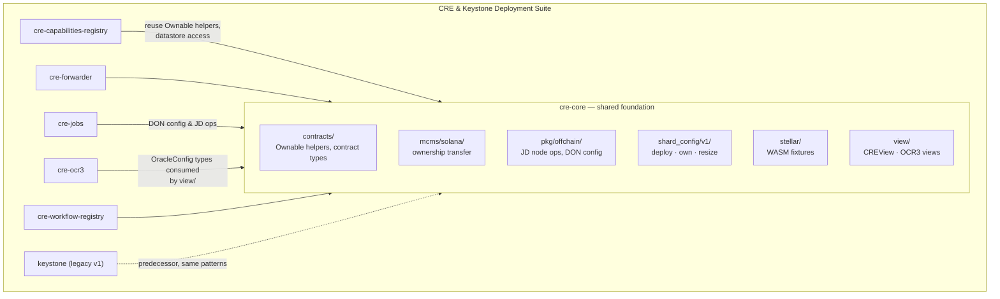
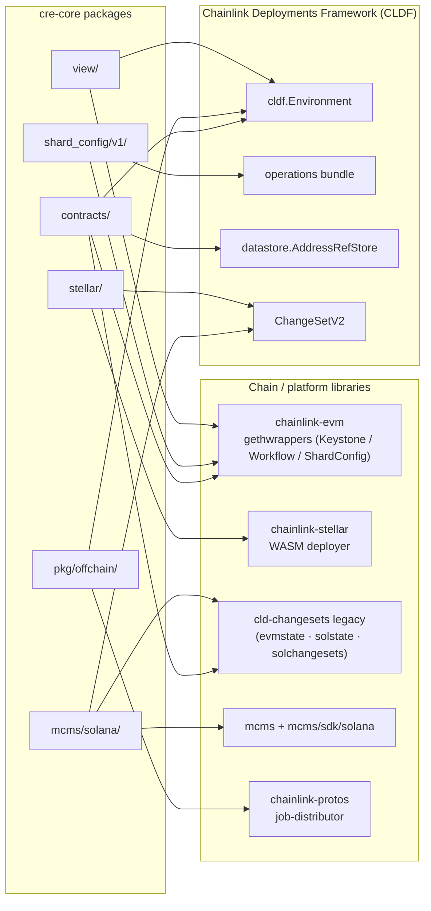
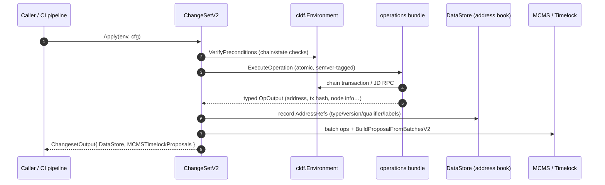
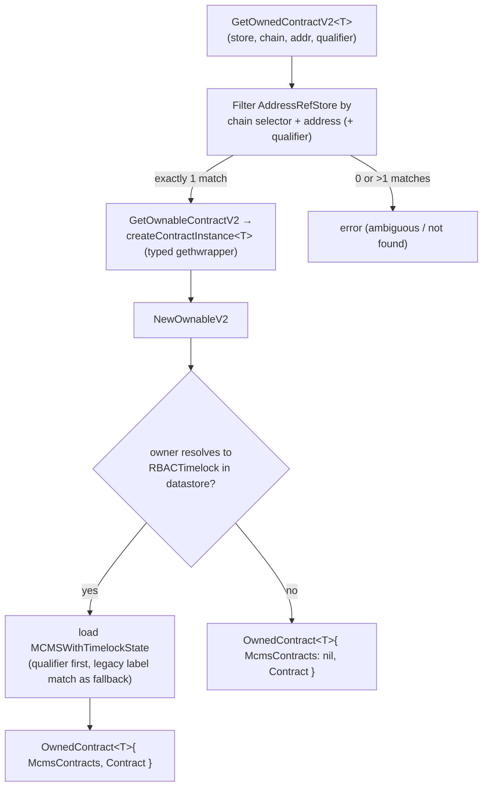
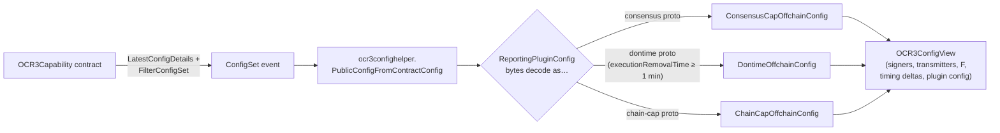

# CRE Deployment Suite — Core (`cre-core`)

## 1. Purpose & Scope

`cre-core` is the **foundational sub-module of the CRE (Chainlink Runtime Environment) & Keystone Deployment Suite**. It lives under `chainlink/deployment/cre` inside the Go module `github.com/smartcontractkit/chainlink/deployment` (module pins in [`chainlink/deployment/go.mod`](../../repo/chainlink/deployment/go.mod)).

While the sibling packages of the suite own the *product-facing* changesets — the [Capabilities Registry](cre-capabilities-registry.md), [Forwarders](cre-forwarder.md), [Job proposals](cre-jobs.md), [OCR3 deployment](cre-ocr3.md), and the [Workflow Registry](cre-workflow-registry.md) — `cre-core` provides the **shared building blocks every one of those packages reuses**:

| Area | Package | What it provides |
|---|---|---|
| Contract bindings & ownership | `contracts/` | Canonical `cldf.ContractType` constants for CRE contracts plus generic, type-safe `Ownable[T]` helpers that resolve contracts from the deployment datastore and detect MCMS/timelock governance |
| Solana MCMS governance | `mcms/solana/` | The `TransferSolanaMCMSOwnership` changeset — hands the Solana MCMS stack (proposer/canceller/bypasser MCMS, timelock, access controllers) to the timelock signer PDA |
| Offchain / Job Distributor integration | `pkg/offchain/` | Atomic operations to register/upsert nodes with the Job Distributor (JD), DON & node configuration types, and DON-targeted node filters |
| ShardConfig lifecycle | `shard_config/v1/` | Atomic operations to deploy the `ShardConfig` contract, transfer its ownership, and update the desired shard count |
| Stellar test fixtures | `stellar/` | Changesets that deploy CRE WASM fixtures (read fixture, receiver / rejecting receiver) on Stellar and query them |
| Deployment state views | `view/` | Read-only, JSON/YAML-serializable views of a live deployment: `CREView`, `CREChainView`, and decoded OCR3 configurations |

Everything in this module is built on the primitives of the [Deployment Framework (CLDF)](../Deployment_Framework_Core___Product_Deployments.md): the `Environment`, `ChangeSetV2`, versioned `operations`, the `datastore.AddressRefStore` address book, and MCMS/timelock proposal machinery.

## 2. Where `cre-core` fits in the system

`cre-core` itself sits on top of the deployment framework and chain-specific libraries:

## 3. Framework concepts used throughout `cre-core`

| Concept | Type / API | Role in this module |
|---|---|---|
| **Environment** | `cldf.Environment` | Deploy-time context: block chains (`EVMChains()`, `SolanaChains()`, `StellarChains()`), the `DataStore` address book, a logger, and the `Offchain` Job Distributor client |
| **Changeset** | `cldf.ChangeSetV2[C]` | Versioned unit of change: `VerifyPreconditions(env, cfg)` then `Apply(env, cfg) → ChangesetOutput` (new datastore entries + MCMS proposals). Used by `TransferSolanaMCMSOwnership`, `DeployReadFixture`, `DeployReceiver`, `ReportCount` |
| **Operation** | `operations.NewOperation(id, semver, desc, fn)` | Atomic, semver-versioned side effect executed via `operations.ExecuteOperation` on an operations bundle. All ShardConfig ops and JD node ops follow this pattern; outputs are typed `*OpOutput` structs |
| **Address book** | `datastore.AddressRefStore` | Persistent registry of deployed contracts keyed by chain selector, address, type, version, qualifier, and labels — the lookup backbone of the `contracts/` helpers |
| **MCMS + Timelock** | `mcms.TimelockProposal`, `cldfproposalutils.TimelockConfig` | Decentralized governance: privileged actions (ownership transfer, config changes) are *proposed* through timelock proposals rather than sent directly from an EOA |
| **Job Distributor (JD)** | `env.Offchain` (gRPC) | Offchain node-management service used to register nodes, attach `don-<name>` labels, and query nodes by filters |

## 4. Sub-module documentation

`cre-core` is split into five documented sub-modules, each with its own page under `cre-core/`:

| Sub-module | Page (file) | Components documented |
|---|---|---|
| Contract ownership & bindings | [cre-core_contract-ownership](cre-core/cre-core_contract-ownership.md) | `contracts/contracts.go` — `Ownable` interface, `NewOwnableV2`, `GetOwnedContractV2`, `GetOwnableContractV2`, `GetOwnerTypeAndVersionV2`, canonical `ContractType` constants (`CapabilitiesRegistry`, `WorkflowRegistry`, `KeystoneForwarder`, `OCR3Capability`, `ShardConfig`, `RBACTimelock`, `ProposerManyChainMultiSig`, …) · `mcms/solana/transfer_ownership.go` — `TransferSolanaMCMSOwnership` changeset |
| Offchain / Job Distributor integration | [cre-core_offchain-jd](cre-core/cre-core_offchain-jd.md) | `pkg/offchain/changeset/operations/register_nodes_with_jd.go` — `JDRegisterNodeOp`, `JDUpsertNodeOp`, `JDRegisterNodeOpOutput`, DON-label management · `pkg/offchain/types.go` — `DONConfig`, `NodeCfg`, `TargetDONFilter` |
| ShardConfig lifecycle | [cre-core_shard-config](cre-core/cre-core_shard-config.md) | `shard_config/v1/changeset/operations/contracts/` — `DeployShardConfigOp`, `TransferOwnershipOp`, `UpdateShardCountOp` with their typed Inputs/Outputs/Deps |
| Stellar test fixtures | [cre-core_stellar-fixtures](cre-core/cre-core_stellar-fixtures.md) | `stellar/read_fixture.go` — `DeployReadFixture` · `stellar/receiver.go` — `DeployReceiver`, `ReportCount`, plus chain-level helpers (`DeployReceiverForChain`, `DeployRejectingReceiverForChain`, `ReportCountForChain`, `ReceiverLastValueU64ForChain`) |
| Deployment state views | [cre-core_state-views](cre-core/cre-core_state-views.md) | `view/view.go` — `CREView`, `CREChainView` · `view/ocr3.go` — `OCR3ConfigView`, `OCR3ConfigViewLegacy`, plugin-type-aware OCR3 config generation |

## 5. How a deployment flows through `cre-core`

The canonical flow for any privileged change in the suite is:

Two concrete instantiations of this flow in `cre-core`:

1. **Ownership hand-over (Solana)** — `TransferSolanaMCMSOwnership` loads the MCMS-with-timelock state per chain, builds `transfer-ownership` operations for each MCMS contract (proposer/canceller/bypasser MCMS, timelock, four access controllers), and assembles them into a single timelock proposal.
2. **State introspection (read-only)** — the `view/` package walks the address book and on-chain contracts to build a `CREView`. It never mutates state; OCR3 views additionally decode the binary `ReportingPluginConfig` into one of three plugin schemas (consensus, dontime, chain-cap).

### Ownership resolution (EVM, generic over contract type)

The `contracts/` package centralizes how any CRE contract instance is obtained and how its governance status is determined — this is the helper every sibling deployment package uses before touching a contract:

Key details worth knowing when extending this module:

- `createContractInstance[T]` supports exactly the CRE contract families: `KeystoneForwarder`, `CapabilitiesRegistry` (v1 & v2), `OCR3Capability`, `WorkflowRegistry` (v1 & v2), and `ShardConfig`. Adding a new contract type requires extending both the type switch and the `ContractType` constants.
- The MCMS state loader tolerates **legacy ad-hoc qualifiers**: when a qualifier-based load fails, it retries via an exact label match against the address book (tracked by `CRE-1360` until migration completes).
- Owner lookup is case-insensitive for EVM addresses because some entries are stored with different casing.

## 6. OCR3 state views at a glance

`view/ocr3.go` turns an on-chain `OCR3Capability` contract into a human-readable configuration view:

Automatic plugin-type detection is heuristic (probing distinctive proto fields); when the plugin type is known — e.g. from the contract qualifier in `address_refs.json` — prefer `GenerateOCR3ConfigViewForPlugin`, which decodes deterministically. The legacy variant `OCR3ConfigViewLegacy` preserves the pre-protobuf JSON shape (with a string-encoded `RequestTimeout`) for backwards compatibility of stored reports.

## 7. Relationship to other modules

- **Within the suite** (see [CRE & Keystone Deployment Suite](../CRE___Keystone_Deployment_Suite.md)): the Capabilities Registry, Forwarder, Jobs, OCR3, and Workflow Registry pages document the product changesets; `cre-core` documents the shared layer they depend on. The legacy [Keystone](keystone.md) module predates `cre-core` and follows the same changeset/operation patterns.
- **Deployment Framework Core**: [Deployment_Framework_Core___Product_Deployments](../Deployment_Framework_Core___Product_Deployments.md) documents the CLDF primitives (`Environment`, `ChangeSetV2`, operations, datastore) and the [common changesets/view helpers](../Deployment_Framework_Core___Product_Deployments/deployment-common.md) (e.g. `MCMSWithTimelockState` loading, `CapabilityRegistryViewV2` used by `CREChainView`).
- **Dev / Test / Simulation Environments**: the Stellar fixtures and JD registration operations are consumed by test harnesses described in [Dev,_Test___Simulation_Environments](../Dev,_Test___Simulation_Environments/deployment-environment.md) (e.g. `jdtestutils`, devenv).
- **Shared Foundation Libraries**: proto/codec/type conventions used by the views and operations come from [Shared_Foundation_Libraries___Domain_Types](../Shared_Foundation_Libraries___Domain_Types.md).
