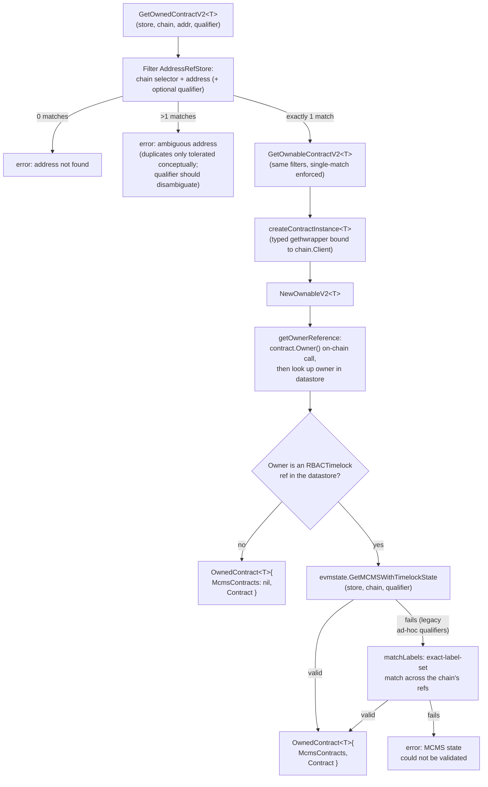
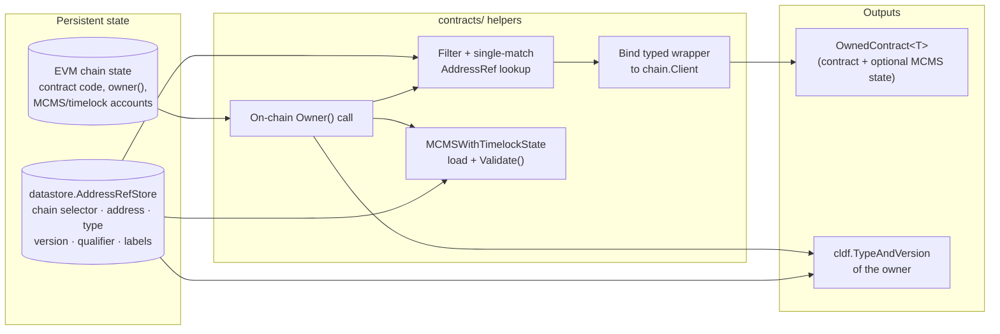
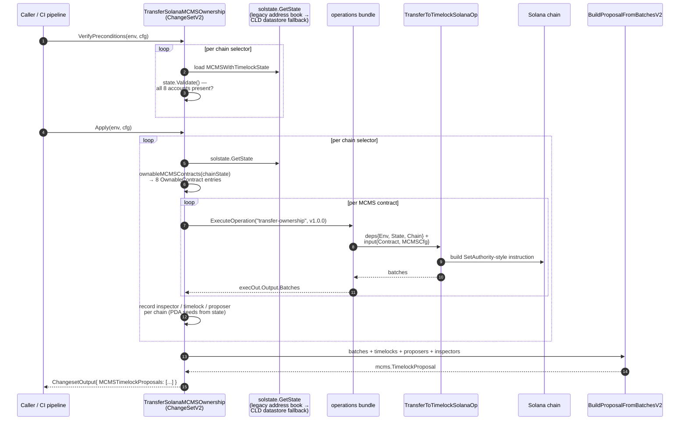
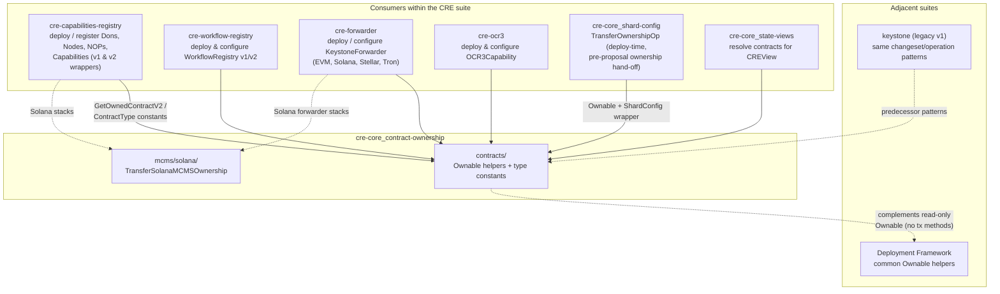
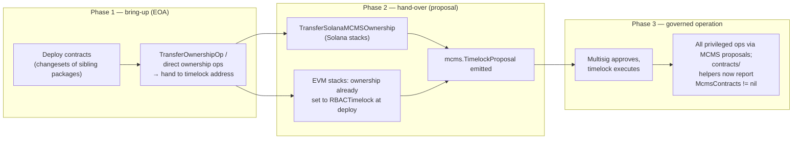

# Contract Ownership & MCMS Governance (`cre-core_contract-ownership`)

## 1. Purpose & Scope

`cre-core_contract-ownership` is the sub-module of [cre-core](../cre-core.md) that answers one question for every CRE deployment: **"Who owns this contract, and how do privileged changes get executed?"**

It provides two complementary pillars, both living in the Go module [`github.com/smartcontractkit/chainlink/deployment`](https://github.com/smartcontractkit/chainlink/deployment) (see `chainlink/deployment/go.mod`):

| Pillar | Package | What it provides |
|---|---|---|
| **EVM contract ownership & bindings** | `chainlink/deployment/cre/contracts/` | The generic `Ownable` interface, canonical `cldf.ContractType` constants for all CRE contracts, and type-safe helpers (`NewOwnableV2`, `GetOwnedContractV2`, `GetOwnableContractV2`, `GetOwnerTypeAndVersionV2`) that resolve contract instances from the deployment datastore and detect MCMS/timelock governance |
| **Solana MCMS ownership hand-over** | `chainlink/deployment/cre/mcms/solana/` | The `TransferSolanaMCMSOwnership` changeset, which produces a timelock proposal transferring the whole Solana MCMS stack (proposer/canceller/bypasser MCMS, timelock, four access controllers) to the timelock signer PDA |

Both pillars exist to support **decentralized governance**: once a CRE deployment is live, privileged admin actions must not be executed directly from an EOA. Instead they are batched into [MCMS](https://github.com/smartcontractkit/mcms) timelock proposals that a multisig approves and the timelock executes. This module supplies the primitives that let every other changeset in the suite (a) *discover* whether a target contract is already under timelock control, and (b) *produce* the proposals that hand control over.

## 2. Architecture Overview

```mermaid
flowchart TB
    subgraph module["cre-core_contract-ownership"]
        direction TB
        subgraph contracts["contracts/ — EVM ownership &amp; bindings"]
            OT["cldf.ContractType constants<br/>(CapabilitiesRegistry, WorkflowRegistry,<br/>KeystoneForwarder, OCR3Capability, ShardConfig, …)"]
            OW["Ownable interface"]
            OC["OwnedContract&lt;T&gt;"]
            H1["NewOwnableV2&lt;T&gt;"]
            H2["GetOwnableContractV2&lt;T&gt;<br/>GetOwnedContractV2&lt;T&gt;"]
            H3["GetOwnerTypeAndVersionV2&lt;T&gt;"]
            CI["createContractInstance&lt;T&gt;<br/>(typed gethwrapper factory)"]
        end
        subgraph mcms["mcms/solana/ — Solana hand-over"]
            TS["TransferSolanaMCMSOwnership<br/>(ChangeSetV2, v1.0.0)"]
            OMC["ownableMCMSContracts<br/>(8 MCMS accounts/programs)"]
            ATT["applyTransferMCMSToTimelock<br/>(batch → proposal)"]
        end
    end

    subgraph cldf["Chainlink Deployments Framework (CLDF)"]
        DS["datastore.AddressRefStore"]
        ENV["cldf.Environment"]
        OPS["operations.ExecuteOperation"]
        CS["cldf.ChangeSetV2"]
    end

    subgraph libs["External libraries"]
        EVW["chainlink-evm gethwrappers<br/>(Keystone/Workflow/ShardConfig bindings)"]
        EVST["cld-changesets legacy<br/>evmstate.MCMSWithTimelockState"]
        SOST["cld-changesets legacy<br/>solstate.GetState"]
        SOOP["solchangesets.<br/>TransferToTimelockSolanaOp"]
        MSDK["mcms + mcms/sdk/solana<br/>(TimelockProposal, Inspector, PDA helpers)"]
        PU["cldfproposalutils<br/>TimelockConfig · BuildProposalFromBatchesV2"]
    end

    H1 --> OW
    H1 --> DS
    H1 --> EVST
    H2 --> DS
    H2 --> CI
    H2 --> H1
    CI --> EVW
    H3 --> OW
    H3 --> DS

    TS --> CS
    TS --> SOST
    TS --> OMC
    TS --> ATT
    ATT --> OPS
    ATT --> SOOP
    ATT --> PU
    ATT --> MSDK
    OMC --> MSDK
```



### 2.1 Contract type catalog

The `contracts/` package pins the canonical `cldf.ContractType` identifiers used across the whole CRE suite (these strings are what ends up in the datastore's `TypeAndVersion` records and in the address book):

| ContractType | CRE role | Linked from |
|---|---|---|
| `CapabilitiesRegistry` | On-chain registry of capabilities, nodes, DONs and NOPs | [cre-capabilities-registry](../cre-capabilities-registry.md) |
| `WorkflowRegistry` | On-chain registry of workflow owner/allowlist/permissions | [cre-workflow-registry](../cre-workflow-registry.md) |
| `KeystoneForwarder` | Forwards workflow reports to consumer contracts | [cre-forwarder](../cre-forwarder.md) |
| `OCR3Capability` | OCR3 reporting capability contract (also used by DKG/vault setups) | [cre-ocr3](../cre-ocr3.md) |
| `ShardConfig` | Desired shard-count configuration contract | [cre-core_shard-config](cre-core_shard-config.md) |
| `BalanceReader` | Read-only helper for node balances | — |
| `FeedConsumer` | Example/test feed consumer | — |
| `RBACTimelock` | Timelock contract that executes approved MCMS proposals | shared governance stack |
| `ProposerManyChainMultiSig` | Proposer MCMS contract | shared governance stack |
| `MockKeystoneForwarder` | Test double for the forwarder | dev/test environments |

`MCMSConfig` is an alias for `cldfproposalutils.TimelockConfig`, the shared configuration for proposal building (signers, timelock address, etc.).

## 3. EVM Ownership Resolution (`contracts/`)

### 3.1 Core abstractions

**`Ownable` interface** — the minimal contract surface needed to reason about ownership:

```go
type Ownable interface {
    Address() common.Address
    Owner(opts *bind.CallOpts) (common.Address, error)
}
```

Every generated gethwrapper for the CRE contract families satisfies this interface, which is what makes the helpers generic: `NewOwnableV2[T Ownable]`, `GetOwnedContractV2[T Ownable]`, etc. work uniformly over `*forwarder.KeystoneForwarder`, `*capabilities_registry_v2.CapabilitiesRegistry`, `*shard_config.ShardConfig`, and friends.

**`OwnedContract[T]`** — the result of ownership resolution: the bound contract instance plus (optionally) the full MCMS-with-timelock state it is governed by:

```go
type OwnedContract[T Ownable] struct {
    McmsContracts *evmstate.MCMSWithTimelockState // nil when the contract is EOA-owned
    Contract      T
}
```

### 3.2 Resolution pipeline

All ownership lookups funnel through the datastore (`datastore.AddressRefStore` — see [Deployment Framework Core](../../Deployment_Framework_Core___Product_Deployments.md)). The pipeline for obtaining a fully-resolved, governance-aware contract handle:



Key behaviours to be aware of:

- **Closed generic type set.** `GetOwnableContractV2` and `createContractInstance` accept exactly these types: `*forwarder.KeystoneForwarder`, `*capabilities_registry.CapabilitiesRegistry` (v1), `*capabilities_registry_v2.CapabilitiesRegistry`, `*ocr3_capability.OCR3Capability`, `*workflow_registry.WorkflowRegistry` (v1), `*workflow_registry_v2.WorkflowRegistry`, and `*shard_config.ShardConfig`. Any other type is rejected with an "unsupported contract type" error. Adding a new contract requires extending **both** the type switch in `GetOwnableContractV2` and the factory in `createContractInstance`, plus a new `ContractType` constant.
- **Single-match invariant.** A datastore lookup must resolve to exactly one `AddressRef` (chain selector + address, optionally narrowed by qualifier); otherwise the helpers fail fast rather than guessing. With a non-empty qualifier the address+qualifier pair must be unique; without one, the helper also rejects duplicates since the same address stored under multiple qualifiers is ambiguous.
- **Governance detection is on-chain first.** `getOwnerReference` calls `contract.Owner(nil)` against the chain, then matches the returned address against the datastore — **case-insensitively** — because some stored addresses have different hex casing. If the owner is not found, ownership resolution silently assumes non-MCMS (EOA) ownership and returns `nil` instead of an error; a missing timelock ref yields `GetOwnerTypeAndVersionV2 == nil`.
- **Legacy qualifier tolerance (tracked by CRE-1360).** Older deployments stored MCMS contracts with ad-hoc qualifiers. When a qualifier-based load of `MCMSWithTimelockState` fails validation, the helper retries via an exact label-set match (`matchLabels`) over all of the chain's address refs, then validates the reconstructed state. This migration shim is scheduled for removal once all deployments use consistent qualifiers.
- **`GetOwnerTypeAndVersionV2`** is the lightweight variant used when you only need to know *what kind of contract* owns a target (e.g. to branch between EOA-owned and timelock-owned flows). It returns the owner's `*cldf.TypeAndVersion` or `nil` when the owner is not in the datastore (interpreted as non-MCMS).

### 3.3 Data flow: from datastore to governance-aware handle



## 4. Solana MCMS Ownership Hand-over (`mcms/solana/`)

### 4.1 What it does

`TransferSolanaMCMSOwnership` is a `cldf.ChangeSetV2[TransferSolanaMCMSOwnershipConfig]` (version `1.0.0`) that, for each configured Solana chain, transfers ownership of the **entire MCMS governance stack** to the timelock signer PDA. Because Solana programs use PDA-based ownership rather than an `owner()` storage slot, this changeset enumerates the MCMS accounts explicitly instead of using the `Ownable` interface:

1. **Proposer MCMS** config PDA
2. **Canceller MCMS** config PDA
3. **Bypasser MCMS** config PDA
4. **Timelock** config PDA
5. **Proposer / Executor / Canceller / Bypasser access controllers** (4 accounts)

### 4.2 Changeset contract

```go
type TransferSolanaMCMSOwnershipConfig struct {
    Chains  []uint64                        // Solana chain selectors
    MCMSCfg cldfproposalutils.TimelockConfig // proposal/timelock parameters
}

type TransferSolanaMCMSOwnership struct{} // implements cldf.ChangeSetV2[...Config]
```

The changeset follows the standard two-phase CLDF lifecycle (`VerifyPreconditions` → `Apply`, see [cre-core framework concepts](../cre-core.md#3-framework-concepts-used-throughout-cre-core)):

### 4.3 Execution flow



### 4.4 Behavioural details

- **Preconditions are strict.** `VerifyPreconditions` rejects the run unless every configured selector resolves to a complete, validated MCMS-with-timelock state (`state.Validate()`), and each selector is present in `env.BlockChains.SolanaChains()`.
- **Address resolution is legacy-first.** `solstate.GetState` reads the legacy address book first and falls back to the CLD datastore — mirroring the EVM side's tolerance for pre-migration deployments (see [cre-core](../cre-core.md#2-where-cre-core-fits-in-the-system)).
- **Per-chain proposal scoping.** The timelock and proposer addresses recorded for the proposal are derived from the chain's own state (`mcmssolanasdk.ContractAddress(program, PDASeed(seed))`), so a single proposal can span multiple chains while each batch targets the right PDAs.
- **Output is proposals, not transactions.** Like the rest of the suite, the changeset never executes privileged actions itself; it emits `[]mcms.TimelockProposal` in `ChangesetOutput`. Approving/executing is a separate governance step performed with MCMS tooling (see the two-phase flow in [Deployment Framework Core](../../Deployment_Framework_Core___Product_Deployments.md)).

## 5. Consumers & Component Interaction

Nearly every product-facing package in the CRE suite depends on this module. The interaction pattern is always the same: *resolve → branch on governance status → act (directly if EOA-owned during bring-up, or via proposal once under timelock)*.



Two flavours of "ownership" coexist by design:

- **Read-only governance detection** (this module, `contracts.Ownable`): only `Address()` and `Owner()` — enough to inspect and branch, never enough to mutate. This is what sibling deployment packages use.
- **Transaction-capable ownership** (`chainlink/deployment/common/changeset/internal/{evm,shared}.Ownable` documented in [deployment-common](../../Deployment_Framework_Core___Product_Deployments/deployment-common.md)): adds `TransferOwnership`/`AcceptOwnership` transact methods. The `cre`-side interface deliberately narrows this so the ownership layer stays non-mutating; actual ownership changes are modelled as versioned operations, e.g. [cre-core_shard-config](cre-core_shard-config.md)'s `TransferOwnershipOp` (deploy-time, direct tx) versus this module's `TransferSolanaMCMSOwnership` (post-deploy, via timelock proposal).

## 6. End-to-End Governance Lifecycle

Putting both pillars together, the lifecycle of contract governance in a CRE deployment:



The `OwnedContract.McmsContracts` field is the runtime signal of this transition: `nil` means the deployment is still EOA-governed (bring-up), non-nil means the full MCMS stack is resolvable and governance proposals are mandatory.

## 7. Operational & Extension Notes

- **Adding a new ownable CRE contract**: (1) add a `cldf.ContractType` constant in `contracts/contracts.go`, (2) extend the type switch in `GetOwnableContractV2`, (3) extend the factory in `createContractInstance`. All three are in the same file by design — the set of governable contracts is intentionally closed and reviewable.
- **Do not bypass the datastore**: ownership detection compares the on-chain `Owner()` against datastore records; a contract deployed without recording its owner in the address book/datastore will be misclassified as EOA-owned.
- **Qualifier discipline**: new deployments must use consistent qualifiers across the MCMS stack (timelock + MCMS + access controllers share one qualifier). The label-matching fallback exists only for pre-migration deployments and is tracked by CRE-1360 for removal.
- **Version pinning**: the Solana changeset pins `transferMCMSOwnershipVersion = 1.0.0` with `semver`; bump it (not just the description) when transfer semantics change so operation audit trails stay meaningful.
- **MCMS library coupling**: proposal construction uses `mcms` + `mcms/sdk/solana`; the `ugorji/go/codec` pin in `chainlink/deployment/go.mod` exists specifically because of transitive `mcms` dependencies — be careful when bumping codec versions.

## 8. Related Documentation

| Topic | Page |
|---|---|
| Parent module: shared CRE deployment foundation | [cre-core](../cre-core.md) |
| CRE & Keystone suite overview | [CRE___Keystone_Deployment_Suite](../../CRE___Keystone_Deployment_Suite.md) |
| Capabilities Registry changesets (primary `Ownable` consumer) | [cre-capabilities-registry](../cre-capabilities-registry.md) |
| Forwarder deployment (EVM/Solana/Stellar/Tron) | [cre-forwarder](../cre-forwarder.md) |
| Workflow Registry changesets | [cre-workflow-registry](../cre-workflow-registry.md) |
| OCR3 deployment & configuration | [cre-ocr3](../cre-ocr3.md) |
| ShardConfig lifecycle (deploy-time ownership ops) | [cre-core_shard-config](cre-core_shard-config.md) |
| Deployment state views (read-only counterpart) | [cre-core_state-views](cre-core_state-views.md) |
| CLDF primitives (`Environment`, `ChangeSetV2`, operations, datastore) | [Deployment_Framework_Core___Product_Deployments](../../Deployment_Framework_Core___Product_Deployments.md) |
| Framework-level `Ownable` (transaction-capable) & MCMS state helpers | [deployment-common](../../Deployment_Framework_Core___Product_Deployments/deployment-common.md) |
| CCIP suite's shared MCMS/deployer-group machinery | [ccip-shared](../../CCIP_Deployment_Suite/ccip-shared.md) |
| Test harnesses exercising these changesets | [deployment-environment](../../Dev,_Test___Simulation_Environments/deployment-environment.md), [system-tests](../../Dev,_Test___Simulation_Environments/system-tests.md) |
| Legacy Keystone suite (predecessor patterns) | [keystone](../keystone.md) |
