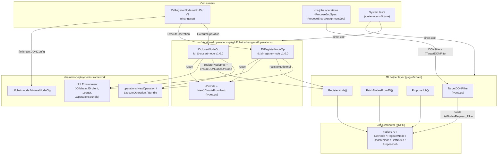
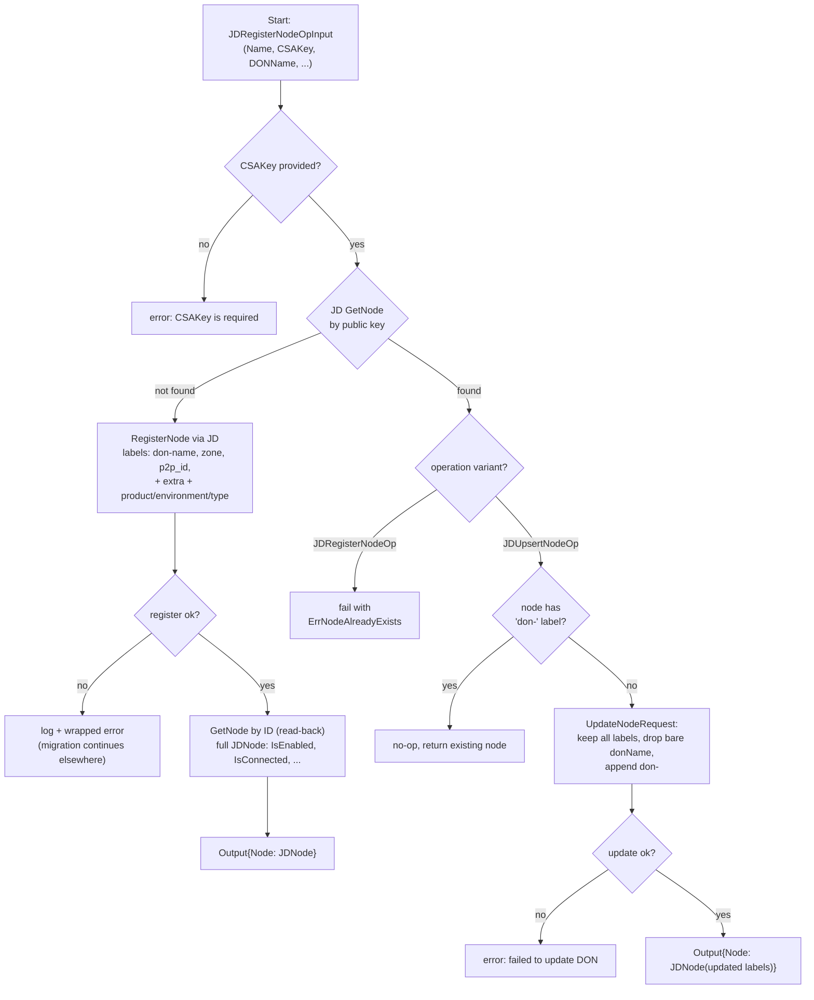
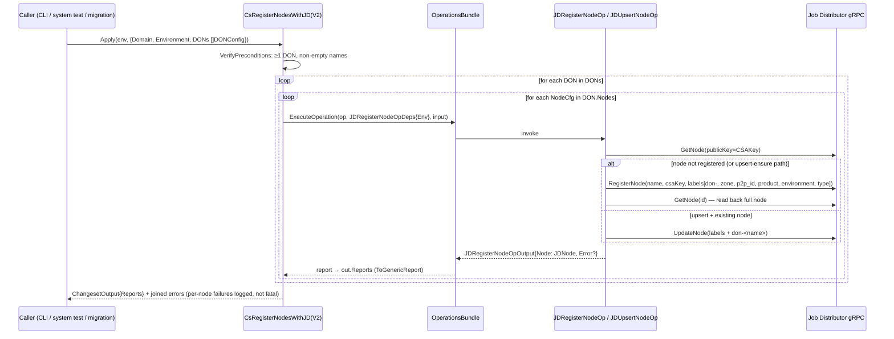
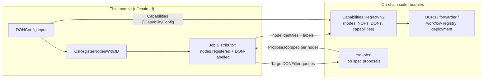

# cre-core / Offchain Job Distributor Integration (`offchain-jd`)

## Introduction

The **offchain-jd** module (`chainlink/deployment/cre/pkg/offchain`) is the off-chain integration layer between the **CRE/Keystone Deployment Suite** and the **Job Distributor (JD)** — Chainlink's off-chain coordination service that maintains a registry of oracle nodes, their identities, labels, and job proposals.

While most deployment suites concern themselves with *on-chain* artifacts (contracts, proxies, MCMS proposals), a CRE deployment is not operational until the participating nodes are known to the off-chain infrastructure: each node must be **registered with the Job Distributor** (keyed by its CSA public key), **labelled with its DON membership**, and receive **proposed job specifications**. This module provides exactly that bridge, expressed in the same [changeset → operation → sequence](../../Deployment_Framework_Core___Product_Deployments/deployment-common.md) idiom used by the on-chain deployment framework.

### What this module does

| Concern | Provided by |
|---|---|
| Register / upsert a node with JD (idempotently) | [`JDRegisterNodeOp`](#jdregisternodeop--jdupsertnodeop), [`JDUpsertNodeOp`](#jdregisternodeop--jdupsertnodeop) |
| Declarative DON topology for bulk registration | [`DONConfig`, `NodeCfg`](#data-model-donconfig--nodecfg) |
| Building JD node-list queries per DON | [`TargetDONFilter`](#data-model-targetdonfilter) |
| Job proposal distribution to filtered nodes | `ProposeJob` ([see cre-jobs](../cre-jobs.md)) |
| Changeset wrapper for migration pipelines | `CsRegisterNodesWithJD`, `CsRegisterNodesWithJDV2` |
| Serializable node reports | `JDNode`, `NewJDNodeFromProto` |

### Module position

This page documents a child module of [cre-core](../cre-core.md) within the [CRE & Keystone Deployment Suite](../../CRE___Keystone_Deployment_Suite.md). Its sibling modules cover the on-chain counterparts of the same deployment flow:

- [cre-core contract ownership](cre-core_contract-ownership.md) — who owns deployed contracts (EOA / MCMS)
- [cre-core shard config](cre-core_shard-config.md) — shard configuration contracts
- [cre-core state views](cre-core_state-views.md) — read-side views of deployed state
- [Capabilities Registry v2](../cre-capabilities-registry.md) — the on-chain registry where nodes and DONs are mirrored
- [cre-jobs](../cre-jobs.md) — job spec construction and proposal, which consumes this module's filters

---

## Architecture

### Component relationships

The module is layered: a low-level **JD client helper layer** (`nodes.go`, `propose_job.go`) talks directly to the JD gRPC API; **versioned operations** wrap those calls with idempotency and reporting semantics; a **changeset** iterates a declarative `DONConfig` topology and fans out to the operations; and **consumers** (other changesets, CLI flows, system tests) drive the whole thing.



### External dependencies

Declared in [`chainlink/deployment/go.mod`](../../Deployment_Framework_Core___Product_Deployments/deployment-common.md):

- `github.com/smartcontractkit/chainlink-deployments-framework` — `cldf.Environment`, the `operations` framework (`NewOperation`, `Bundle`, `ExecuteOperation`), the `offchain.Client` JD client interface, and `offchain.node.MinimalNodeCfg` embedded by `NodeCfg`.
- `github.com/smartcontractkit/chainlink-protos/job-distributor/v1` — generated gRPC types (`nodev1.Node`, `ListNodesRequest_Filter`, `ptypes.Label`, `ptypes.Selector`).
- `github.com/Masterminds/semver/v3` — semantic versioning of operations.
- Internal: `chainlink/deployment/cre/capabilities_registry/v2/changeset/operations/contracts` — supplies the `CapabilityConfig` type referenced by `DONConfig` (see [capabilities registry](../cre-capabilities-registry.md)).

---

## Core Components

### Node registration operations (`changeset/operations/register_nodes_with_jd.go`)

Two sibling operations share the same deps and I/O shape but differ in **idempotency semantics**:

| | `JDRegisterNodeOp` (`jd-register-node`) | `JDUpsertNodeOp` (`jd-upsert-node`) |
|---|---|---|
| Node missing | Registers it | Registers it |
| Node exists (CSA key known to JD) | **Fails** with `ErrNodeAlreadyExists` | **Succeeds**; ensures the `don-<name>` label is present |
| Intended use | Known-fresh migrations | Re-runnable migrations / reconciliation |

```go
type JDRegisterNodeOpDeps struct {
    Env cldf.Environment   // provides .Offchain (JD client), .Logger, context
}

type JDRegisterNodeOpInput struct {
    IsBootstrap bool              // selects "bootstrap" vs "plugin" node-type label
    Domain      string            // e.g. "cre" product/domain key
    Environment string            // deployment environment name
    Name        string            // human-readable node name
    CSAKey      string            // node CSA public key (JD identity key)
    P2PID       string            // optional p2p peer id → "p2p_id" label
    DONName     string            // DON membership → "don-<name>" label
    Zone        string            // optional zone label
    Labels      map[string]string // arbitrary extra labels
}

type JDRegisterNodeOpOutput struct {
    Error string // empty if no error
    Node  JDNode // populated even on error, when a proto node was available
}
```

Key implementation details:

- **Identity check** (`registerNodeImpl`): the JD is first queried with `GetNode{PublicKey: &input.CSAKey}`. A hit short-circuits registration and returns `ErrNodeAlreadyExists` — the CSA key is the node's unique identity in JD.
- **Label synthesis**: `don-<DONName>` (empty value), optional `zone`, optional `p2p_id`, then all caller-supplied labels via `maps.Copy`. The underlying `offchain.RegisterNode` helper adds `product = <domain>`, `environment = <environment>` and `type ∈ {bootstrap, plugin}` on top (see [`pkg/offchain/nodes.go`](../../../repo/chainlink/deployment/cre/pkg/offchain/nodes.go)).
- **Read-back**: after registration the node is fetched again by ID so the returned `JDNode` carries JD-populated fields (`IsEnabled`, `IsConnected`, P2P key bundles, timestamps) rather than just the request echo.
- **Failure isolation in the upsert path**: `JDUpsertNodeOp` matches the error string against `ErrNodeAlreadyExists`; if the node pre-existed it falls through to `ensureDONLabelOnNode`, which rewrites the node's label set through `UpdateNodeRequest`, preserving all existing labels, dropping stale bare-`<donName>` labels and appending `don-<name>`. If the label is already present the operation is a no-op.
- **Deliberate non-fatal logging**: a registration failure for one node is logged and wrapped but does not abort the remaining nodes; the changeset aggregates errors with `errors.Join`.

### Serializable node report (`changeset/operations/types.go`)

`JDNode` is a JSON/YAML-friendly projection of `nodev1.Node` (ID, name, CSA public key, enabled/connected flags, labels, P2P key bundles, workflow key, NOP friendly name, version). `NewJDNodeFromProto` performs nil-safe conversion; outputs from both operations embed it so that **operation reports** captured by the operations framework's bundle contain the resulting node identity — useful for downstream steps that must reference node IDs (e.g. on-chain registration in the [capabilities registry](../cre-capabilities-registry.md)).

---

## Data model

### `DONConfig` / `NodeCfg` (`pkg/offchain/types.go`)

`DONConfig` is the declarative unit of off-chain topology. It is serialized in changeset inputs as JSON or YAML and drives the changesets described below:

```go
type NodeCfg struct {
    node.MinimalNodeCfg `yaml:",inline"` // name + CSA key (from chainlink-deployments-framework)
    P2PID               string `json:"p2p_id" yaml:"p2p_id"`
    Zone                string `json:"zone" yaml:"zone"`
}

type DONConfig struct {
    ID             int                          `json:"don_id" ...`
    Name           string                       `json:"don_name" ...`
    F              uint8                        `json:"f" ...`   // Byzantine fault tolerance
    Nodes          []NodeCfg                    `json:"nodes" ...`
    BootstrapNodes []string                     `json:"bootstrap_nodes,omitempty" ...`
    Capabilities   []contracts.CapabilityConfig `json:"capabilities,omitempty" ...`
}
```

Notes:

- `Nodes` are plugin/worker nodes; `BootstrapNodes` are listed as raw strings (bootstrap nodes carry no per-node config beyond identity in this shape).
- `Capabilities` reuses the `CapabilityConfig` proto-marshalable map type from the capabilities-registry changeset package — a single input document can therefore express both *which nodes form a DON* (this module) and *what that DON can do on-chain* ([capabilities registry v2](../cre-capabilities-registry.md)).
- `F` mirrors the on-chain DON registration parameter and is validated/consumed by on-chain registration flows, not by JD itself.

### `TargetDONFilter` (`pkg/offchain/types.go`)

`TargetDONFilter` is a small DSL for constructing `nodev1.ListNodesRequest_Filter` queries against JD. Each filter is a `Key`/`Value` pair; two keys are special-cased:

| Key (`FilterKey*`) | Translates to |
|---|---|
| `don_name` (`FilterKeyDONName`) | Selector `{Key: "don-<value>", Op: EXIST}` — matches the DON-membership label written by registration |
| `csa_public_key` (`FilterKeyCSAPublicKey`) | Appended to `filter.PublicKeys` |
| any other key | Selector `{Key, Op: EQ, Value}` — generic label equality |

Methods:

- `AddToFilter(f)` — mutates and returns the given filter.
- `AddToFilterIfNotPresent(f)` — same, but skips when an equivalent selector/key already exists (idempotent composition).
- `ToListFilter()` — builds a fresh filter from scratch.

This is the mechanism by which [cre-jobs](../cre-jobs.md) operations (e.g. `ProposeJobSpec`, `ProposeShardAssignmentJob`) target "the plugin nodes of DON X" or "the node with CSA key Y" when proposing job specs:

```go
// chainlink/deployment/cre/jobs/operations/propose_job_spec.go
filter := &node.ListNodesRequest_Filter{ /* type: plugin|bootstrap */ }
for _, f := range input.DONFilters {
    filter = f.AddToFilter(filter)
}
```

### Label taxonomy

Node labels are the *only* grouping mechanism JD offers, so the module defines a strict vocabulary (see `nodes.go` constants and `registerNodeImpl`):

| Label | Meaning | Written by |
|---|---|---|
| `product = cre` (const `ProductLabel`) | Product partition | `RegisterNode` |
| `environment` | Environment partition | `RegisterNode` |
| `type = bootstrap \| plugin` | Node role | `RegisterNode` |
| `don-<name>` (empty value) | DON membership (also used by `TargetDONFilter` and `ProposeJob`) | `registerNodeImpl` / `ensureDONLabelOnNode` |
| `zone` | Placement hint | `registerNodeImpl` |
| `p2p_id` | Peer identity hint | `registerNodeImpl` |
| `workflow_owner`, `workflow_name`, `gateway_name`, `capability_name` | Per-job / per-capability selectors | job-proposal flows ([cre-jobs](../cre-jobs.md)) |

---

## Process flows

### Node upsert flow (`JDUpsertNodeOp`)



### Changeset fan-out flow (`CsRegisterNodesWithJD` / `V2`)



### End-to-end off-chain provisioning

Where this module sits in a full CRE deployment, and how its outputs feed the rest of the suite:



- The on-chain mirroring of the same node set happens in the [capabilities registry changesets](../cre-capabilities-registry.md) (`RegisterNodes`, `RegisterDons`, `RegisterNops`), which operate on contract state rather than JD.
- Job distribution (TOML specs for OCR3 bootstrap/standard-capability/shard-assignment jobs) is owned by [cre-jobs](../cre-jobs.md); it re-uses this module's `ProposeJob`/`TargetDONFilter` primitives.

---

## Error handling and idempotency guarantees

| Scenario | Behavior |
|---|---|
| Missing `CSAKey` in operation input | Immediate error before any JD call |
| Node already registered, `JDRegisterNodeOp` | Returns `ErrNodeAlreadyExists`; output still carries the located node |
| Node already registered, `JDUpsertNodeOp` | No re-registration; label reconciliation only |
| DON label already present, upsert path | No-op with informational log |
| One node fails to register inside a changeset | Logged at error level, aggregated via `errors.Join`; remaining nodes still processed; per-node operation reports still emitted |
| JD client uninitialized (`FetchNodesFromJD`) | Explicit error naming the required env vars (`JD_GRPC` / `OFFCHAIN_JD_ENDPOINTS_GRPC`) |
| Blank JD response on register | Treated as failure ("blank response received") |

Re-running `CsRegisterNodesWithJD` (the upsert variant) is safe: it converges JD state to "every node exists and carries the `don-<name>` label" without duplicating registrations.

---

## Usage

Typical changeset input (YAML/JSON shape of `CsRegisterNodesWithJDInput`):

```yaml
domain: cre
environment: staging
dons:
  - don_id: 1
    don_name: workflow-don
    f: 1
    nodes:
      - name: node-a
        csa_key: <csa-public-key>
        p2p_id: <peer-id>
        zone: us-east-1
    bootstrap_nodes:
      - <csa-public-key-bootstrap>
    capabilities: []   # CapabilityConfig entries for the on-chain registry
```

Executing the upsert changeset registers every `nodes` entry with JD (labelled `don-workflow-don`, `zone`, `p2p_id`, `product`, `environment`, `type: plugin`) and emits one operation report per node containing the resulting `JDNode`. Bootstrap nodes are typically handled by the dedicated bootstrap-job flows in [cre-jobs](../cre-jobs.md).

For consumers that must look nodes up again later (job proposals, forwarder configuration, test assertions), prefer `offchain.FetchNodesFromJD(ctx, jd, filter)` with a `TargetDONFilter{Key: FilterKeyDONName, Value: "<don name>"}` rather than re-deriving selectors manually.

Consumers in this repository include the [system-tests CRE library](../../Dev,_Test___Simulation_Environments/system-tests.md), which imports both `chainlink/deployment/cre/pkg/offchain` and its `changeset/operations` package directly to wire DONs together in test environments.

---

## Related documentation

- [cre-core](../cre-core.md) — parent module: shared contract ownership, shard config, state views
- [cre-capabilities-registry](../cre-capabilities-registry.md) — on-chain registry operations that mirror nodes/DONs/capabilities
- [cre-jobs](../cre-jobs.md) — job spec construction and proposal, consuming `TargetDONFilter`
- [Deployment Framework Core](../../Deployment_Framework_Core___Product_Deployments/deployment-common.md) — the underlying changeset/operation/sequence framework and `chainlink/deployment/go.mod` dependency set
- [Dev, Test & Simulation Environments / system-tests](../../Dev,_Test___Simulation_Environments/system-tests.md) — consumers of this module's operations in test topologies
