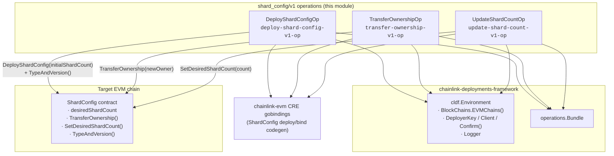
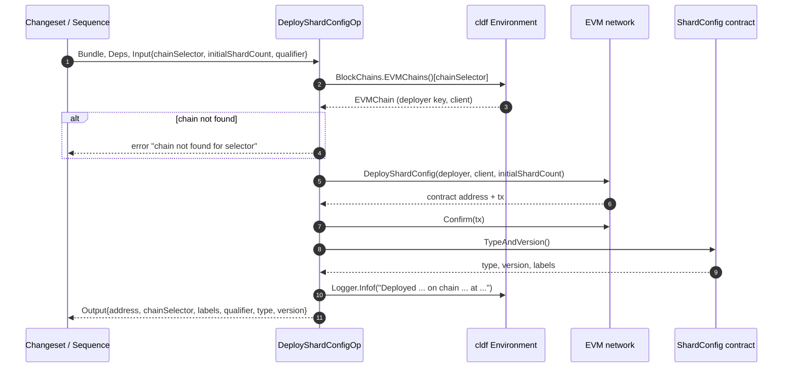
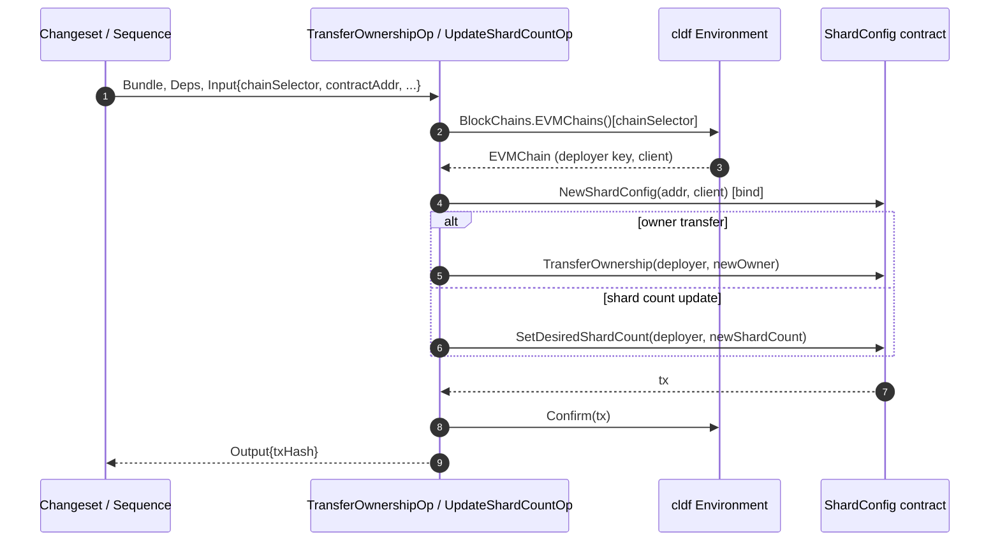
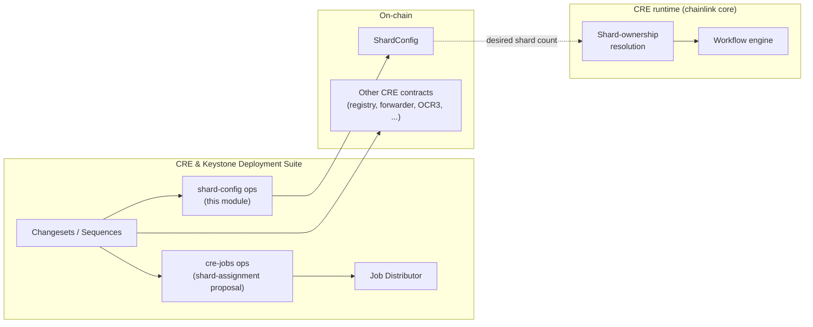

# CRE Core — Shard Config Deployment Operations (v1)

The **shard-config** module provides the on-chain deployment and administration primitives for the **ShardConfig** contract, a component of the Chainlink Runtime Environment (CRE). It exposes three atomic [chainlink-deployments-framework](https://github.com/smartcontractkit/chainlink-deployments-framework) operations that (1) deploy the `ShardConfig` contract with an initial shard count, (2) transfer its ownership, and (3) update the desired shard count. These operations are the building blocks that changesets and sequences in the [CRE & Keystone Deployment Suite](../../CRE___Keystone_Deployment_Suite.md) compose to configure workflow sharding for a DON.

- **Package:** `chainlink/deployment/cre/shard_config/v1/changeset/operations/contracts`
- **Go module:** `github.com/smartcontractkit/chainlink/deployment` (see `chainlink/deployment/go.mod`)
- **Parent module:** [cre-core](../cre-core.md)
- **Chain scope:** EVM only (v1)
- **Contract:** `ShardConfig` (generated bindings from `chainlink-evm/contracts/cre/gobindings`)

---

## Why ShardConfig exists

CRE workflow execution can be *sharded* across the nodes of a DON so that each node only executes a subset of workflow steps. The desired number of shards is governed on-chain by the `ShardConfig` contract, so the shard topology of a DON is a first-class, auditable on-chain artifact rather than an off-chain assumption. This module owns the lifecycle of that artifact during deployment:

1. **Deploy** the contract with an initial shard count.
2. **Transfer ownership** from the ephemeral deployer to the governance address (e.g., an MCMS/timelock contract).
3. **Update the desired shard count** as the DON scales up or down.

The off-chain counterpart — proposing shard-assignment jobs to the Job Distributor — lives in the [cre-jobs](../cre-jobs.md) module, and the runtime consumption of shard ownership is described in [workflows sharding](../../Workflow___Capability_Runtime_\(CRE_Engine\)/workflows/workflows_sharding.md).

---

## Core components

All three operations are created with `operations.NewOperation(...)`, giving each a **stable operation ID** and a **semantic version** (`1.0.0`). Operation IDs and versions are recorded in framework operation reports, making deployments reproducible and auditable. Every operation follows the same dependency and I/O conventions:

- **Deps:** `DeployShardConfigOpDeps` / `TransferOwnershipOpDeps` / `UpdateShardCountOpDeps` each carry a single field, `Env *cldf.Environment`, which provides EVM chain handles (`Env.BlockChains.EVMChains()`), the deployer key, a JSON-RPC client, transaction confirmation, and structured logging.
- **Inputs/Outputs:** plain structs with JSON tags, so operations can be serialized into changeset reports, replayed, and validated.

| Operation | ID | On-chain effect | Input | Output |
|---|---|---|---|---|
| `DeployShardConfigOp` | `deploy-shard-config-v1-op` | Deploys `ShardConfig` with `initialShardCount`; reads `TypeAndVersion()` | Chain selector, initial shard count, optional qualifier | Contract address, chain selector, labels, qualifier, type, version |
| `TransferOwnershipOp` | `transfer-ownership-v1-op` | Calls `TransferOwnership(newOwner)` | Chain selector, contract address, new owner address | Transaction hash |
| `UpdateShardCountOp` | `update-shard-count-v1-op` | Calls `SetDesiredShardCount(newShardCount)` | Chain selector, contract address, new shard count | Transaction hash |

### `DeployShardConfigOp` — deploy and register

Deploys a fresh `ShardConfig` contract on the EVM chain identified by `ChainSelector`, then introspects the deployed contract to return a complete registration record.

| Field | Type | Description |
|---|---|---|
| `DeployShardConfigOpInput.ChainSelector` | `uint64` | CCD chain selector of the target EVM chain |
| `DeployShardConfigOpInput.InitialShardCount` | `uint64` | Initial desired shard count written at deployment |
| `DeployShardConfigOpInput.Qualifier` | `string` | Optional deployment qualifier (defaults to `""`) |
| `DeployShardConfigOpOutput.Address` | `string` | Checksum address of the deployed contract |
| `DeployShardConfigOpOutput.ChainSelector` | `uint64` | Echoed chain selector |
| `DeployShardConfigOpOutput.Labels` | `[]string` | Contract labels derived from on-chain `TypeAndVersion()` |
| `DeployShardConfigOpOutput.Qualifier` | `string` | Echoed qualifier |
| `DeployShardConfigOpOutput.Type` / `.Version` | `string` | Contract type and version parsed from on-chain `TypeAndVersion()` via `cldf.TypeAndVersionFromString` |

Execution steps: resolve the chain → `shard_config.DeployShardConfig(...)` → `chain.Confirm(tx)` → bind via `shard_config.NewShardConfig` → `TypeAndVersion()` → log and return. Because type/version are read **from the deployed bytecode** rather than assumed in Go code, the output record reflects exactly what landed on chain.

### `TransferOwnershipOp` — ownership handover

Binds to an existing `ShardConfig` at `ContractAddr` and invokes `TransferOwnership(newOwner)` from the environment's deployer key. Returns only the transaction hash; it is the caller's (changeset's) responsibility to verify the new owner afterward. The typical handover target is an MCMS/timelock contract — see [contract ownership](cre-core_contract-ownership.md) for the suite-wide ownership patterns.

### `UpdateShardCountOp` — scale the shard topology

Binds to an existing `ShardConfig` and invokes `SetDesiredShardCount(big.NewInt(int64(newShardCount)))`. After the change is confirmed, the new desired shard count becomes the on-chain source of truth from which shard assignment is derived.

---

## Architecture

Each operation is intentionally *atomic*: it performs exactly one side effect and relies on the surrounding changeset/sequence (in the [deployment framework](../../Deployment_Framework_Core___Product_Deployments/deployment-common.md)) for ordering, batching, and report persistence.

---

## Process flows

### Deploying ShardConfig

### Administering an existing contract

`TransferOwnershipOp` and `UpdateShardCountOp` share the same shape: bind → invoke → confirm → log → return `TxHash`.

---

## Dependencies

**External (from `chainlink/deployment/go.mod`):**

| Dependency | Role |
|---|---|
| `github.com/smartcontractkit/chainlink-deployments-framework` (v0.123.3) | `operations.NewOperation`, `operations.Bundle`, `cldf.Environment`, `cldf.TypeAndVersionFromString` |
| `github.com/smartcontractkit/chainlink-evm/contracts/cre/gobindings` | Generated `DeployShardConfig`, `NewShardConfig` bindings for the `ShardConfig` contract |
| `github.com/ethereum/go-ethereum` | `abi/bind` call options, `common.Address`, transaction types |
| `github.com/Masterminds/semver/v3` | Operation versioning (`semver.MustParse("1.0.0")`) |

**Internal (within the CRE & Keystone Deployment Suite):**

- [cre-core](../cre-core.md) — the parent module grouping shared CRE deployment primitives.
- [cre-core contract-ownership](cre-core_contract-ownership.md) — `Ownable` helpers and MCMS ownership transfer used when handing ShardConfig to governance.
- [cre-jobs](../cre-jobs.md) — `ProposeShardAssignmentJob` proposes the shard-assignment jobs that nodes run; its desired shard count originates from this contract.
- [cre-core state-views](cre-core_state-views.md) — `CREView` / OCR3 views for inspecting deployed state.
- [Workflows sharding](../../Workflow___Capability_Runtime_\(CRE_Engine\)/workflows/workflows_sharding.md) — the runtime side: workflow shard-ownership resolution (e.g., the `AllShardsResolver` interface in `chainlink/core/services/workflows/shardownership`) consumes the shard topology that this contract configures.

---

## How it fits into a CRE deployment

A typical deployment sequence is:

1. Deploy other CRE core contracts (capabilities registry, OCR3, workflow registry — see sibling modules).
2. Invoke `DeployShardConfigOp` to place `ShardConfig` on the target chain with the initial shard count.
3. Propose shard-assignment jobs via [cre-jobs](../cre-jobs.md) so nodes pick up their shard assignments.
4. Hand `ShardConfig` ownership to the governance contract via `TransferOwnershipOp` (see [contract-ownership](cre-core_contract-ownership.md)).
5. Later, reshard the DON by invoking `UpdateShardCountOp`; the runtime picks up the new desired count through shard-ownership resolution ([workflows sharding](../../Workflow___Capability_Runtime_\(CRE_Engine\)/workflows/workflows_sharding.md)).

---

## Conventions and error handling

- **Versioned packages:** the `v1` package directory plus per-operation semver IDs (`deploy-shard-config-v1-op`, …) allow future contract versions to be added side-by-side without breaking recorded reports.
- **JSON-serializable I/O:** all input/output structs carry JSON tags for report persistence and replay by the operations framework.
- **Fail-fast chain resolution:** every operation first resolves the chain from `Env.BlockChains.EVMChains()` and returns a wrapped `chain not found for selector %d` error before any on-chain interaction.
- **Confirmation before returning:** every state-changing call is followed by `chain.Confirm(tx)`; errors from deployment, binding, `TypeAndVersion()`, invocation, and confirmation are wrapped with `%w` for context.
- **EVM-only (v1):** unlike [cre-forwarder](../cre-forwarder.md), which ships Solana/Stellar variants, the shard-config module only supports EVM chains in v1; multi-chain support would arrive in a `v2` package.
- **On-chain self-description:** the contract's `TypeAndVersion()` is the source of truth for the `Type`, `Version`, and `Labels` fields in `DeployShardConfigOpOutput`, keeping deployment records consistent with the deployed artifact.

---

## Related documentation

- [CRE & Keystone Deployment Suite](../../CRE___Keystone_Deployment_Suite.md) — suite overview and deployment framework conventions.
- [cre-core](../cre-core.md) — parent module: contract ownership, offchain/JD integration, state views, Stellar fixtures.
- [Deployment Framework Core & Product Deployments](../../Deployment_Framework_Core___Product_Deployments/deployment-common.md) — the changeset/operation/sequence model these operations build on.
- [Workflow & Capability Runtime (CRE Engine)](../../Workflow___Capability_Runtime_\(CRE_Engine\).md) — the runtime that consumes the shard configuration.
