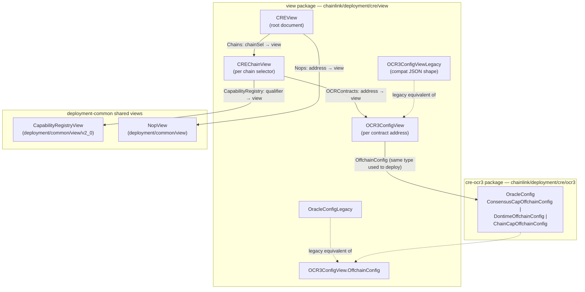
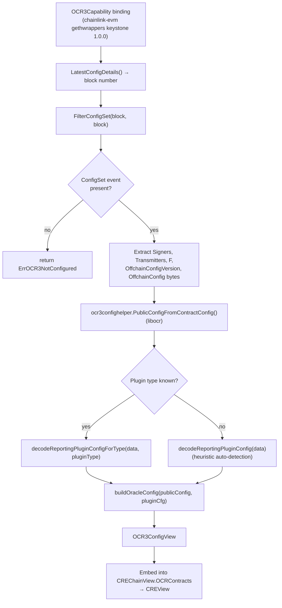
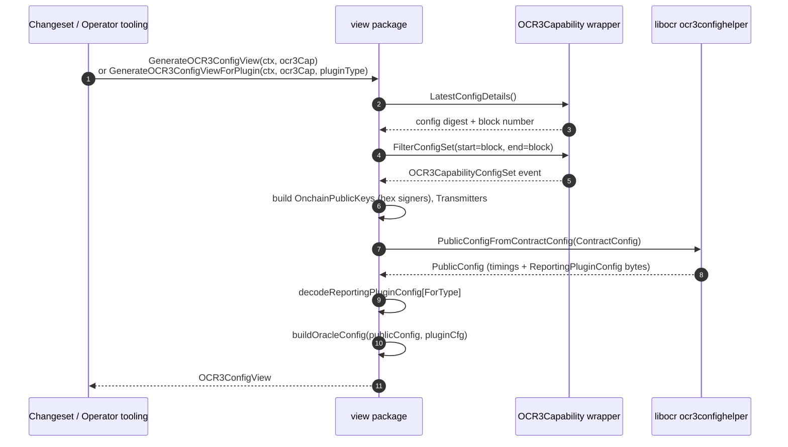
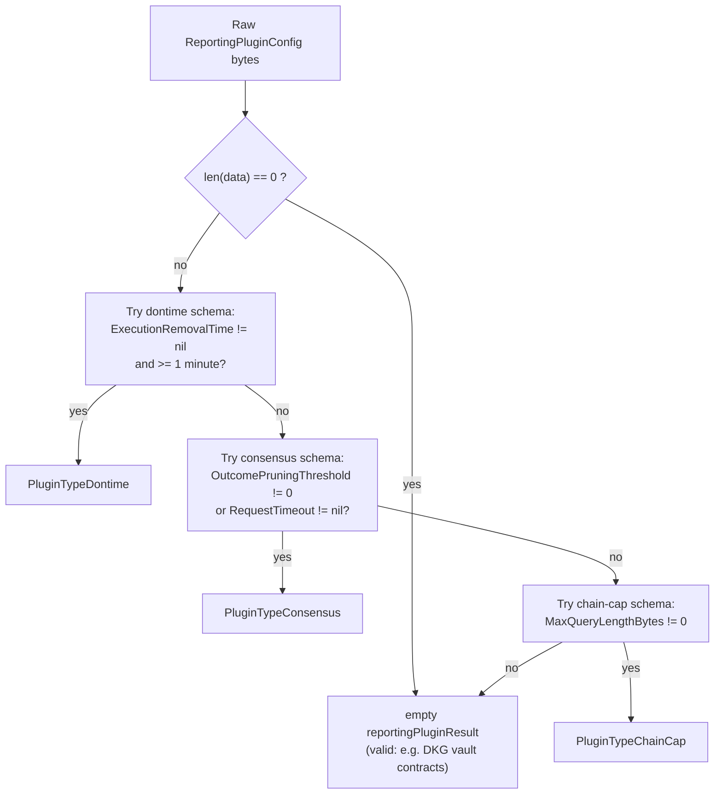
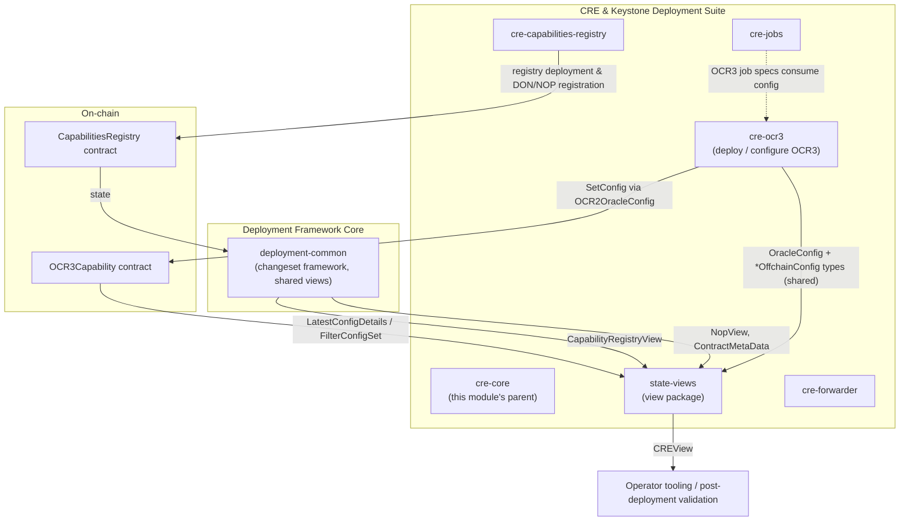

# cre-core / State Views

## 1. Introduction

The **state-views** module (`chainlink/deployment/cre/view`) is the read-only state projection layer of the [CRE & Keystone Deployment Suite](../../CRE___Keystone_Deployment_Suite.md). It turns live on-chain state — most importantly the configuration committed to deployed **OCR3 Capability** contracts — plus off-chain node-operator data into serializable, human- and machine-readable Go view objects (`CREView`, `CREChainView`, `OCR3ConfigView`).

It is one of the cross-cutting helpers inside the [cre-core](../cre-core.md) module, alongside [contract-ownership](cre-core_contract-ownership.md), [offchain-jd](cre-core_offchain-jd.md), [shard-config](cre-core_shard-config.md), and [stellar-fixtures](cre-core_stellar-fixtures.md). The package is intentionally small (two files) and has **no mutating operations**: it reads contracts and emits views, and is therefore safe to call from changesets, sequences, validation tooling, and operator scripts at any point after deployment.

> **Module boundary:** the package belongs to the `github.com/smartcontractkit/chainlink/deployment` Go module (see `chainlink/deployment/go.mod`), the same module that hosts the [Deployment Framework Core](../../Deployment_Framework_Core___Product_Deployments.md).

### Responsibilities

- Aggregate a whole CRE deployment into a single `CREView` document (per-chain registry + OCR3 state, plus node-operator inventory).
- Read and decode the **latest committed OCR3 configuration** from an `OCR3Capability` contract into a typed `OCR3ConfigView`.
- Decode the OCR3 `ReportingPluginConfig` offchain-config bytes for the three supported plugin families (**consensus**, **dontime**, **chain-cap**) — either by explicit type or by a documented auto-detection heuristic.
- Preserve a **legacy JSON representation** (`OCR3ConfigViewLegacy` / `OracleConfigLegacy`) for backward compatibility with pre-existing view outputs.

---

## 2. Architecture and Component Relationships

### 2.1 View composition

`CREView` is the root document. Each level composes types from this module with shared view types provided by the deployment-common library.



### 2.2 Component reference

| Component | File | Kind | Purpose |
|---|---|---|---|
| `CREView` | `view/view.go` | struct | Root view: `Chains map[string]CREChainView` (keyed by chain selector) and `Nops map[string]view.NopView` (keyed by NOP address). Custom `MarshalJSON` emits indented JSON via the alias trick. |
| `NewCREChainView` | `view/view.go` | constructor | Returns an initialized `CREChainView` with empty `CapabilityRegistry` and `OCRContracts` maps. |
| `CREChainView` | `view/view.go` | struct | Per-chain projection: `CapabilityRegistry map[string]common_v2_0.CapabilityRegistryView` (keyed by contract qualifier) and `OCRContracts map[string]OCR3ConfigView` (keyed by contract address). |
| `OCR3ConfigView` | `view/ocr3.go` | struct | Decoded OCR3 config: hex `Signers`, `Transmitters` (`ocr2types.Account`), `F`, `OnchainConfig`, `OffchainConfigVersion`, and typed `OffchainConfig` (`ocr3.OracleConfig`). Carries both `json:` and `yaml:` tags. |
| `OCR3ConfigViewLegacy` | `view/ocr3.go` | struct | Pre-yaml-tag JSON shape of the same data, with `OffchainConfig` typed as `OracleConfigLegacy`. |
| `OracleConfigLegacy` | `view/ocr3.go` | struct | Legacy flattened oracle config; `UnmarshalJSON` accepts `RequestTimeout` as a duration **string** and tolerates it being absent. |
| `GenerateOCR3ConfigView` | `view/ocr3.go` | function | Reads the contract's latest config and produces an `OCR3ConfigView`, auto-detecting the reporting-plugin type. |
| `GenerateOCR3ConfigViewForPlugin` | `view/ocr3.go` | function | Same as above, but decodes the plugin config using an **explicit** `PluginType` (preferred when the type is known, e.g. from the contract qualifier in `address_refs.json`). |
| `PluginType` (`consensus` / `dontime` / `chain-cap`) | `view/ocr3.go` | enum | Identifies the reporting-plugin proto schema embedded in `ReportingPluginConfig` bytes. |
| `reportingPluginResult` | `view/ocr3.go` | struct | One-of holder for the decoded plugin sub-config; exactly one field non-nil after a successful decode. |
| `decodeReportingPluginConfig` | `view/ocr3.go` | function | Heuristic auto-detection of plugin type from raw proto bytes (see §3.3). |
| `decodeReportingPluginConfigForType` | `view/ocr3.go` | function | Explicit `proto.Unmarshal` per plugin type into the matching `ocr3.*OffchainConfig` struct. |
| `buildOracleConfig` | `view/ocr3.go` | function | Assembles an `ocr3.OracleConfig` from libocr `PublicConfig` timing fields plus the decoded plugin sub-config. |
| `millisecondsToUint32` | `view/ocr3.go` | helper | Saturating duration→millisecond conversion (`uint32`). |
| `ErrOCR3NotConfigured` | `view/ocr3.go` | error | Returned when no `ConfigSet` event exists for the contract (i.e. `SetConfig` was never executed). |

---

## 3. OCR3 Configuration View Generation (Data Flow)

### 3.1 Pipeline overview

`GenerateOCR3ConfigView` and `GenerateOCR3ConfigViewForPlugin` share the same read-back pipeline; they differ only in *how* the reporting-plugin sub-config is decoded.



Key behaviours of the pipeline:

- **Latest-config scoping.** `LatestConfigDetails` returns the block of the most recent configuration; `FilterConfigSet` is run only over that single block, so the view always reflects the *currently active* OCR3 config.
- **Empty onchain config.** CRE deployments always set a `nil` onchain config, and the view mirrors this (`OnchainConfig: nil`); the contract config is reconstructed with `ocr3confighelper.PublicConfigFromContractConfig`.
- **Signer readability.** Raw `ocr2types.OnchainPublicKey` bytes are additionally hex-encoded into `Signers []string` for human-readable output, while `Transmitters` are preserved as `ocr2types.Account`.
- **Plugin decode result.** `reportingPluginResult` may have *all* fields `nil` when the plugin config is empty or unrecognised (e.g. DKG vault contracts) — this is not an error; the rest of the OCR3 timing config is still emitted.
- **Timing fields.** `buildOracleConfig` maps libocr `PublicConfig` deltas (`DeltaProgress`, `DeltaResend`, `DeltaInitial`, `DeltaRound`, `DeltaGrace`, `DeltaCertifiedCommitRequest`, `DeltaStage`), `RMax` → `MaxRoundsPerEpoch`, schedule `S` → `TransmissionSchedule`, and the `MaxDuration*` fields, converting durations to saturated millisecond counters via `millisecondsToUint32`.

### 3.2 Interaction sequence



### 3.3 Reporting-plugin type detection

The OCR3 contract stores the reporting-plugin sub-config as opaque proto bytes. Three schemas share the byte space, so the view supports two decode strategies:

| Strategy | Function | When to use |
|---|---|---|
| **Explicit** | `GenerateOCR3ConfigViewForPlugin` with `PluginType` | Preferred. Use whenever the plugin type is known statically, e.g. from the contract qualifier recorded in `address_refs.json`. No guessing, deterministic. |
| **Heuristic** | `GenerateOCR3ConfigView` → `decodeReportingPluginConfig` | Fallback when only raw bytes are available. Probes distinctive fields of each proto schema, in a fixed order. |

Heuristic detection order (applied to the raw bytes):



The discriminators rely on field-number collisions with semantically distinct value ranges — e.g. `executionRemovalTime` (dontime, field 8) and `requestTimeout` (consensus, field 8) occupy the same field number, but dontime's value is a long duration (≥ 1 minute) whereas consensus request timeouts are always shorter in known CRE deployments. Because heuristics are value-range based, **explicit typing should be preferred for new tooling**.

Decoded sub-configs map onto the shared `cre-ocr3` offchain-config types:

| `PluginType` | Wire schema | Target view type |
|---|---|---|
| `consensus` | `capocr3types.ReportingPluginConfig` (`chainlink-common/pkg/capabilities/consensus/ocr3/types`) | `ocr3.ConsensusCapOffchainConfig` |
| `dontime` | `dontimepb.Config` (`chainlink-common/pkg/workflows/dontime/pb`) | `ocr3.DontimeOffchainConfig` |
| `chain-cap` | `evmcapocr3types.ReportingPluginConfig` (`chainlink-common/pkg/capabilities/v2/chain-capabilities/consensus/ocr3/types`) | `ocr3.ChainCapOffchainConfig` |

---

## 4. Serialization

- **Modern view.** `OCR3ConfigView` carries both `json:` and `yaml:` tags, so it can be rendered to operator JSON *or* YAML reports directly.
- **Root indentation.** `CREView.MarshalJSON` uses a type alias to avoid infinite recursion and emits `json.MarshalIndent` output with a single-space indent.
- **Legacy shape.** `OCR3ConfigViewLegacy` and `OracleConfigLegacy` reproduce the older flat JSON schema (no yaml tags). `OracleConfigLegacy.UnmarshalJSON` embeds the legacy struct via an alias and post-processes `RequestTimeout`, accepting a Go duration **string** (e.g. `"30s"`) and defaulting to `0` when absent — this keeps old JSON artifacts loadable into the current tooling.
- **Shared config types.** Because `OCR3ConfigView.OffchainConfig` is the *same* `ocr3.OracleConfig` type consumed by the deployment side (`TopLevelConfigSource`, `GenerateOCR3Config`), a fetched view can be re-serialized and fed back as a config source — enabling config round-tripping, drift comparison, and redeployment flows.

---

## 5. Fit Within the Deployment Suite



### Dependencies on other modules

| Dependency | Direction | What is used | Documented in |
|---|---|---|---|
| `chainlink/deployment/cre/ocr3` (cre-ocr3) | consumes types | `OracleConfig`, `ConsensusCapOffchainConfig`, `DontimeOffchainConfig`, `ChainCapOffchainConfig` — the deploy-side config source (`TopLevelConfigSource`) and the view-side target type are the same | [cre-ocr3](../cre-ocr3.md) |
| `chainlink/deployment/common/view/v2_0` + `common/view` (deployment-common) | consumes types | `CapabilityRegistryView` (capabilities, nodes, NOPs, DONs, denormalized DON summary) and `NopView` (node inventory incl. OCR keys, CSA key, job specs) | [deployment-common](../../Deployment_Framework_Core___Product_Deployments/deployment-common.md) |
| `chainlink-evm` generated bindings | consumes bindings | `OCR3Capability` wrapper (`LatestConfig`, `FilterConfigSet`) | — |
| `libocr` (`offchainreporting2plus/ocr3confighelper`, `types`) | consumes library | Public-config decoding and OCR account/public-key types | — |
| `chainlink-common` proto schemas | consumes schemas | Consensus/dontime/chain-cap `ReportingPluginConfig` protos used for offchain-config decoding | [capabilities_core](../../Workflow___Capability_Runtime_(CRE_Engine)/capabilities/capabilities_core.md) |

### Analogous patterns

The **read-back view** pattern used here is the CRE counterpart of the CCIP Deployment Suite's state views (`LoadOnchainState` / `ViewCCIP` in `chainlink/deployment/ccip/shared/stateview`), documented in [ccip-shared stateview](../../CCIP_Deployment_Suite/ccip-shared/ccip-shared_stateview.md). Both follow the Deployment Framework's changeset/operation model (see the [Deployment Framework Core](../../Deployment_Framework_Core___Product_Deployments.md)) and differ only in the product contracts they project.

### Typical consumers

- **Post-deployment validation** — after [cre-ocr3](../cre-ocr3.md) deploy/configure changesets and [cre-capabilities-registry](../cre-capabilities-registry.md) registration sequences run, operators materialize a `CREView` to confirm signers/transmitters/F and offchain timings landed as intended.
- **Forwarder & job provisioning** — OCR3 views feed the job-spec builders in [cre-jobs](../cre-jobs.md) (bootstrap/OCR3 job proposals) which require the same oracle identity and timing data.
- **Change management** — because `OffchainConfig` reuses the deploy-side `ocr3.OracleConfig` type, fetched views can be diffed against desired config before proposing MCMS transactions (see [cre-core contract-ownership](cre-core_contract-ownership.md) for ownership-transfer flows that pair with such proposals).

---

## 6. Usage Example

```go
import (
    "context"

    cldf "github.com/smartcontractkit/chainlink-deployments-framework/deployment"
    ocr3cap "github.com/smartcontractkit/chainlink-evm/gethwrappers/keystone/generated/ocr3_capability_1_0_0"
    "github.com/smartcontractkit/chainlink/deployment/cre/view"
)

func buildView(ctx context.Context, env *cldf.Environment, ocr3Cap ocr3cap.OCR3Capability) error {
    // Preferred: plugin type known from the deployment qualifier/refs.
    cfgView, err := view.GenerateOCR3ConfigViewForPlugin(ctx, ocr3Cap, view.PluginTypeConsensus)
    if err != nil {
        if errors.Is(err, view.ErrOCR3NotConfigured) {
            // SetConfig has not been executed yet for this contract.
            return nil
        }
        return err
    }

    chainView := view.NewCREChainView()
    chainView.OCRContracts[ocr3Cap.Address().String()] = cfgView
    // chainView.CapabilityRegistry[qualifier] = capabilityRegistryView  // from deployment-common

    // CREView{Chains: ..., Nops: ...} is then marshalled with indented JSON.
    doc := view.CREView{ Chains: map[string]view.CREChainView{chainSel: chainView} }
    out, err := json.Marshal(doc) // indented via custom MarshalJSON
    _ = out
    _ = err
    return nil
}
```

---

## 7. Design Notes & Invariants

1. **Read-only layer.** The view package never mutates chain or datastore state; all functions take a context and a contract binding and return plain structs.
2. **One-of plugin config.** `reportingPluginResult` enforces "exactly one plugin schema" at decode time; all-nil is legal only for empty/unrecognised inputs (e.g. DKG vault contracts), preserving forward compatibility with new plugin kinds.
3. **Heuristic order is load-bearing.** Dontime-before-consensus ordering exploits the ≥1-minute vs. short-timeout distinction on the shared field 8; keep this ordering stable when adding schemas, and prefer explicit `PluginType` in new code paths.
4. **Saturating time conversion.** `millisecondsToUint32` clamps at `math.MaxUint32` rather than wrapping, so extreme timing values cannot silently corrupt views.
5. **Symmetry with deployment config.** Views intentionally reuse `cre-ocr3.OracleConfig` (the `TopLevelConfigSource` payload) so that "what was configured" and "what is on-chain" are directly comparable.

---

## 8. Related Documentation

- Parent module: [cre-core](../cre-core.md)
- Sibling modules: [contract-ownership](cre-core_contract-ownership.md) · [offchain-jd](cre-core_offchain-jd.md) · [shard-config](cre-core_shard-config.md) · [stellar-fixtures](cre-core_stellar-fixtures.md)
- Config counterpart: [cre-ocr3](../cre-ocr3.md) — defines the `OracleConfig`/offchain-config types surfaced by these views
- Registry counterpart: [cre-capabilities-registry](../cre-capabilities-registry.md)
- Shared view library: [deployment-common](../../Deployment_Framework_Core___Product_Deployments/deployment-common.md)
- Analogous CCIP pattern: [ccip-shared stateview](../../CCIP_Deployment_Suite/ccip-shared/ccip-shared_stateview.md)
- Suite overview: [CRE & Keystone Deployment Suite](../../CRE___Keystone_Deployment_Suite.md)
