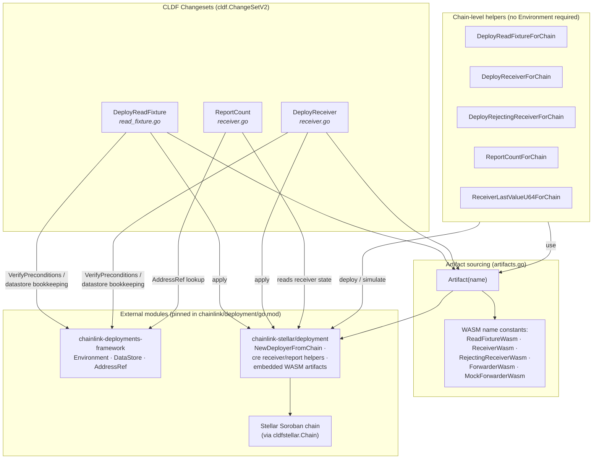
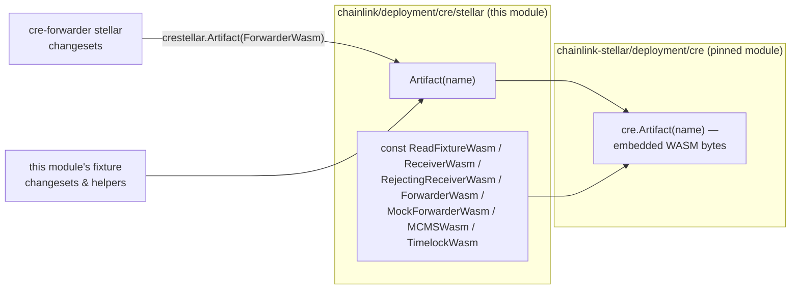
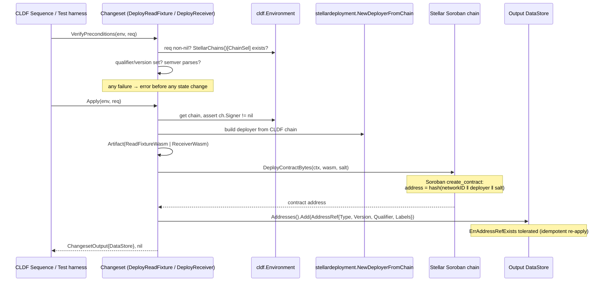
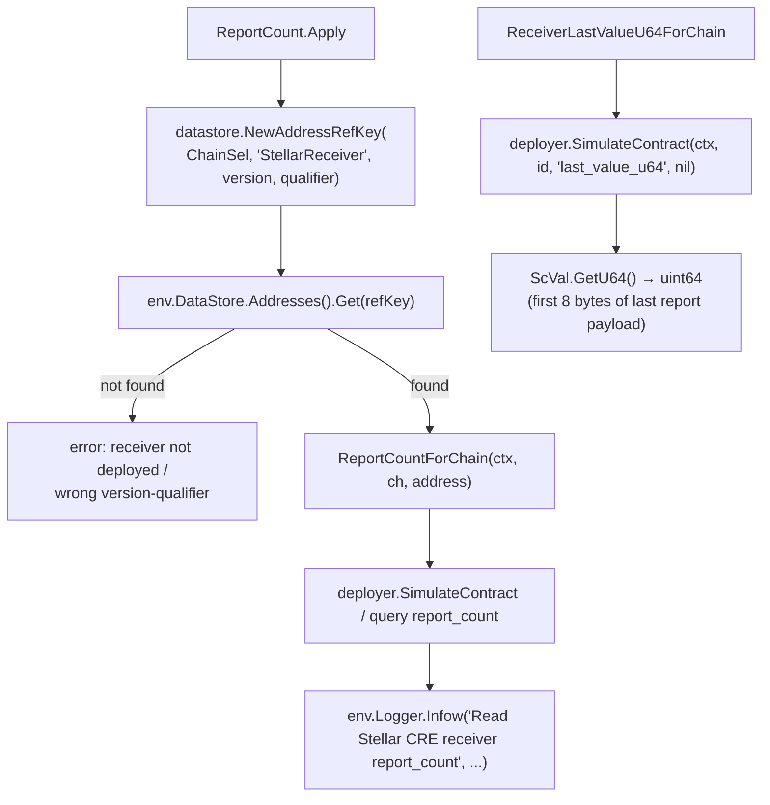
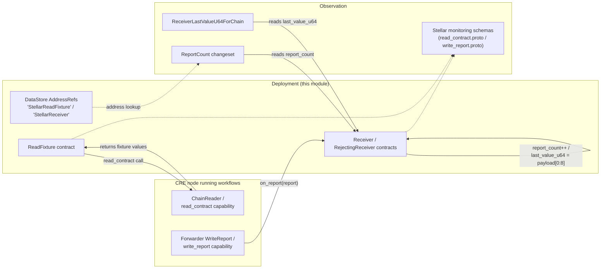

# cre-core / Stellar Test Fixtures (`chainlink/deployment/cre/stellar`)

## Overview

The **Stellar test fixtures** module provides [CLDF](../../Deployment_Framework_Core___Product_Deployments/deployment-common.md) (`ChangeSetV2`) changesets and chain-level helpers for deploying and interacting with **Stellar Soroban test fixture contracts** used to validate the CRE (Chainlink Runtime Environment) integration on Stellar:

| Fixture | Purpose | Validates |
|---|---|---|
| **ReadFixture** contract | A `read_contract` target that returns deterministic values | CRE read path (ChainReader / `read_contract` capability) |
| **Receiver** contract | Implements `on_report`, accepts and stores forwarder transmissions | CRE write path (forwarder `WriteReport` → `TransmissionState::Succeeded`) |
| **Rejecting Receiver** contract | Always returns `Err` from `on_report` | Forwarder failure handling (`TransmissionState::Failed`) |

The module lives in `chainlink/deployment/cre/stellar/` (Go module `github.com/smartcontractkit/chainlink/deployment`, see `chainlink/deployment/go.mod`) and is a child of [cre-core](../cre-core.md), alongside [contract-ownership](cre-core_contract-ownership.md), [offchain-jd](cre-core_offchain-jd.md), [shard-config](cre-core_shard-config.md), and [state-views](cre-core_state-views.md).

It is deliberately minimal and **test-oriented**: unlike the [cre-forwarder](../cre-forwarder.md) or [cre-capabilities-registry](../cre-capabilities-registry.md) modules, it deploys no production CRE contracts. Its changesets follow the exact same CLDF contract as the production ones (precondition verification, semver-qualified addressing, datastore `AddressRef` bookkeeping), so fixtures can be composed into the same deployment sequences as real infrastructure.

---

## Architecture

### Component relationships



### How the pieces fit

- **Changesets** (`DeployReadFixture`, `DeployReceiver`, `ReportCount`) are the primary surface. They are composable with any CLDF environment and sequence in the CRE Deployment Suite (see [Deployment Framework Core](../../Deployment_Framework_Core___Product_Deployments/deployment-common.md) for the changeset/operation/sequence model).
- **Chain-level helpers** (`*ForChain` functions) replicate the changeset bodies minus datastore bookkeeping, for test harnesses that hold a raw `cldfstellar.Chain` but no `cldf.Environment`.
- **Artifact sourcing** is centralized in `artifacts.go`: WASM names are re-exported from `chainlink-stellar/deployment/cre`, and `Artifact(name)` returns the compiled bytes **embedded in the pinned `chainlink-stellar` module** — nothing is compiled, downloaded, or resolved at deployment time. The [cre-forwarder](../cre-forwarder.md) stellar changesets import this same package (`crestellar.Artifact(crestellar.ForwarderWasm)`), so fixture and forwarder WASM always come from one pinned source.

---

## Core Components

### `DeployReadFixture` — changeset (`read_fixture.go`)

Deploys the CRE **read fixture** contract onto a Stellar chain.

- **Request** (`DeployReadFixtureRequest`): `ChainSel uint64`, `Qualifier string`, `Version string`, `LabelSet datastore.LabelSet`, `Salt [32]byte`.
- **`VerifyPreconditions`**: request non-nil; chain selector resolves in `env.BlockChains.StellarChains()`; qualifier and version required; version parses as [semver](https://github.com/Masterminds/semver) (`Masterminds/semver/v3 v3.5.0`).
- **`Apply`**:
  1. Resolves the chain and asserts a signer is present.
  2. Loads the WASM via `Artifact(ReadFixtureWasm)`.
  3. Deploys with `DeployReadFixtureForChain` → `stellardeployment.NewDeployerFromChain(ch)` → `deployer.DeployContractBytes(ctx, wasm, salt)`.
  4. Records an `AddressRef` in the changeset output `DataStore` with `Type: ReadFixtureContract` (`"StellarReadFixture"`), the parsed semver `Version`, `Qualifier`, and `LabelSet`. A pre-existing ref (`datastore.ErrAddressRefExists`) is tolerated, making the changeset idempotent.
- Also exposes `DeployReadFixtureForChain(ctx, ch, salt) (string, error)` for test helpers without a full environment.

### `DeployReceiver` — changeset (`receiver.go`)

Deploys the CRE **test receiver** contract — the `on_report` target that forwarders transmit reports to.

- **Request** (`DeployReceiverRequest`): identical shape to `DeployReadFixtureRequest`.
- Same precondition rules and deployment mechanics, but delegates the actual deploy to `stellarreceiver.DeployReceiver` from `chainlink-stellar/deployment/cre/receiver` and records the address as `ReceiverContract` (`"StellarReceiver"`).
- Also exposes `DeployReceiverForChain(ctx, ch, salt)`.

### `ReportCount` — changeset (`receiver.go`)

A **read-only observational changeset**: it reads `report_count` (the number of `on_report` calls accepted by the receiver) from a previously deployed receiver.

- **Request** (`ReportCountRequest`): `ChainSel`, `Qualifier`, `Version` (no `LabelSet`/`Salt` — nothing is deployed).
- **`Apply`**:
  1. Builds `datastore.NewAddressRefKey(chainSel, ReceiverContract, version, qualifier)` and fetches the receiver address from **`env.DataStore`** (the environment datastore, not the output one).
  2. Reads the counter via `ReportCountForChain` (returns `uint32`).
  3. Emits the count through `env.Logger.Infow` — the result is observability output, not returned data; the changeset output remains empty.

### Chain-level helper functions (`receiver.go`)

| Function | Signature | Use case |
|---|---|---|
| `DeployReceiverForChain` | `(ctx, ch, salt) → (contractID string, err)` | Deploy the accepting receiver without a full environment |
| `ReportCountForChain` | `(ctx, ch, contractID) → (uint32, err)` | Read the accepted-report counter |
| `DeployRejectingReceiverForChain` | `(ctx, ch, salt) → (contractID string, err)` | Deploy the receiver that **always returns `Err` from `on_report`**; used by write regression tests to exercise the forwarder's `TransmissionState::Failed` path |
| `ReceiverLastValueU64ForChain` | `(ctx, ch, contractID) → (uint64, err)` | Read `last_value_u64` via `deployer.SimulateContract`; the first 8 bytes of the last report payload as a `u64` — used by write→read roundtrip tests to assert payload integrity |

### Artifact sourcing (`artifacts.go`)



Forwarding through this package (instead of importing `chainlink-stellar` directly) keeps every CRE-on-Stellar deployment — fixtures and production forwarders alike — pinned to one artifact source. See `chainlink/deployment/go.mod`: `github.com/smartcontractkit/chainlink-stellar/deployment v0.0.0-20261005072841-71e45e418098`.

---

## Process Flows

### Deployment changeset lifecycle (`DeployReadFixture` / `DeployReceiver`)



### Read/verification flow (`ReportCount` and helpers)



### End-to-end validation data flow

The fixtures exist to close the loop between the Stellar [chain capability](../../Workflow___Capability_Runtime_(CRE_Engine)/chain_capability_stellar.md) and on-chain state:



The Stellar chain capability's monitoring schemas mirror the two paths under test — `ReadContractSuccess`/`ReadContractError` (`capabilities/chain_capabilities/stellar/monitoring/read_contract.proto`) and `WriteReportSuccess`/`WriteReportInvalidTransmissionState` (`capabilities/chain_capabilities/stellar/monitoring/write_report.proto`) — which is how production deployments surface the same conditions the fixtures reproduce deliberately.

---

## Soroban addressing and salt semantics

Soroban derives contract addresses deterministically as `hash(networkID ‖ deployer ‖ salt)` for `create_contract`. Both fixture deploy helpers take an explicit `[32]byte` salt, so:

- Passing a **non-zero salt** gives full control over the derived address (useful for reproducible test topologies).
- Passing the **zero salt** deploys from the deployer's zero-salt slot — callers deploying multiple contracts from the same signer must namespace salts themselves to avoid collisions. (For comparison, the production [cre-forwarder](../cre-forwarder.md) stellar changeset defaults a zero salt to `GenerateDeterministicSalt(owner, contractType)`.)

Contract identity in the datastore is `(ChainSelector, Type, Version, Qualifier)` — the same version-qualified addressing used by all CRE deployment products, which lets [state views](cre-core_state-views.md) and test harnesses resolve fixtures unambiguously.

---

## Dependencies

Pinned in `chainlink/deployment/go.mod` (module `github.com/smartcontractkit/chainlink/deployment`, go 1.27.1):

| Dependency | Version | Role |
|---|---|---|
| `github.com/smartcontractkit/chainlink-deployments-framework` | `v0.123.3` | `cldf.Environment`, `ChangeSetV2`, `ChangesetOutput`, `datastore` (`AddressRef`, `LabelSet`, `ErrAddressRefExists`) |
| `github.com/smartcontractkit/chainlink-stellar/deployment` | `v0.0.0-20261005072841-71e45e418098` | `NewDeployerFromChain`, embedded fixture/forwarder WASM (`cre.Artifact`), `cre/receiver` deploy & report helpers |
| `github.com/Masterminds/semver/v3` | `v3.5.0` | Version parsing/validation in preconditions |
| `cldfstellar` (`.../chainlink-deployments-framework/chain/stellar`) | (transitive of CLDF) | `cldfstellar.Chain` — the chain abstraction helpers operate on |

---

## Position in the CRE Deployment Suite

- **Within [cre-core](../cre-core.md)**: sits beside [contract-ownership](cre-core_contract-ownership.md) (ownership transfer primitives), [shard-config](cre-core_shard-config.md) (shard configuration contracts), and [state-views](cre-core_state-views.md) (post-deployment inspection, e.g. `CREView` / `OCR3ConfigViewLegacy`). The fixtures complement state views: state views inspect *production* contracts, while these changesets deploy and inspect *test* contracts.
- **With [cre-forwarder](../cre-forwarder.md)**: the stellar forwarder changesets (`DeployForwarder`, `ConfigureForwarders`, mock variants) share this module's artifact package and changeset conventions. Fixtures are the counterparty contracts that forwarder transmissions target; the rejecting receiver exists specifically to drive the forwarder's failed-transmission path.
- **With system tests**: end-to-end Stellar scenarios in [Dev/Test & Simulation Environments](../../Dev,_Test___Simulation_Environments/system-tests.md) (e.g. `chainlink/system-tests/lib/cre/features/stellar`) use the `*ForChain` helpers for write→read roundtrip validation — deploy receiver, transmit a report through a forwarder, then assert `report_count` and `last_value_u64`.
- **Not a dependency of [cre-jobs](../cre-jobs.md) or [cre-ocr3](../cre-ocr3.md)**: those modules provision OCR3/vault job infrastructure; fixtures only touch chain state and the CLDF datastore.

---

## Usage patterns

**Composed in a CLDF sequence (with environment):**

```go
out, err := cldf.ExecuteChangeset(env, stellar.DeployReceiver{}, &stellar.DeployReceiverRequest{
    ChainSel:  chainSel,
    Qualifier: "test",
    Version:   "1.0.0",
    LabelSet:  datastore.NewLabelSetFrom([]string{"cre", "stellar"}),
    Salt:      salt,
})
// out.DataStore now holds the "StellarReceiver" AddressRef

_, err = cldf.ExecuteChangeset(env, stellar.ReportCount{}, &stellar.ReportCountRequest{
    ChainSel: chainSel, Qualifier: "test", Version: "1.0.0",
})
// logs: "Read Stellar CRE receiver report_count" count=<n>
```

**Direct chain access (test helpers without a full environment):**

```go
recvID, err := stellar.DeployReceiverForChain(ctx, chain, salt)
_,     err = stellar.DeployRejectingReceiverForChain(ctx, chain, salt) // forwarder Failure path
n,     err := stellar.ReportCountForChain(ctx, chain, recvID)
v,     err := stellar.ReceiverLastValueU64ForChain(ctx, chain, recvID) // payload integrity
```

Because `Apply` tolerates `ErrAddressRefExists` and the helpers are pure chain calls, both patterns are safe to re-run against the same chain state — a property the [deployment environment](../../Dev,_Test___Simulation_Environments/deployment-environment.md) tooling relies on when provisioning Stellar chains for CRE tests.
