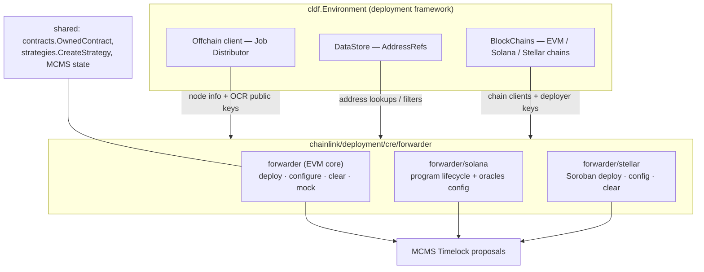
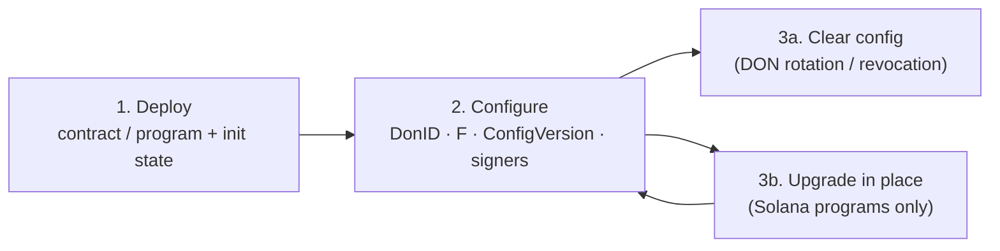
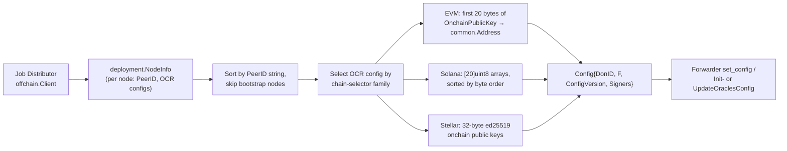
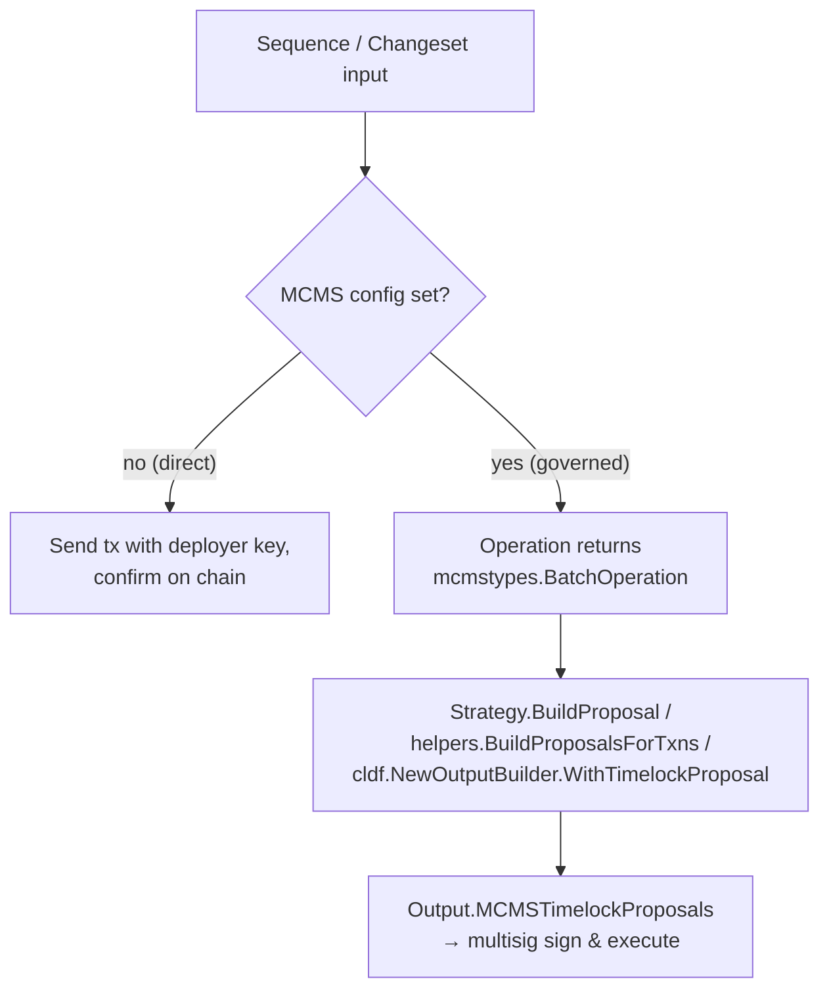

# CRE Forwarder (`chainlink/deployment/cre/forwarder`)

## 1. Purpose

The **cre-forwarder** module deploys and operates **Keystone Forwarders** — the on-chain write path of the Chainlink Runtime Environment (CRE). A forwarder is a chain-native contract/program that accepts a report signed by a consensus DON (validated against a per-DON configuration: `DonID`, `ConfigVersion`, quorum threshold `F`, and an ordered set of signer keys) and forwards the encoded call to a downstream target contract. Workflows produce signed reports; forwarders are what make those reports *executable on-chain*.

This module is the deployment-side counterpart of the runtime forwarder bindings — for the on-chain client used by workflows at runtime, see [EVM forwarder contracts (capability runtime)](../Workflow___Capability_Runtime_(CRE_Engine)/chain_capability_evm/chain_capability_evm_forwarder_contracts.md).

Concretely, the module provides [Changesets](../Deployment_Framework_Core___Product_Deployments/deployment-common.md), **sequences** and **operations** (built on `chainlink-deployments-framework/operations`) to:

| Lifecycle stage | EVM | Solana | Stellar |
|---|---|---|---|
| Deploy forwarder | `DeploySequence` / `DeployOp` | `DeployForwarder` + `DeployForwarderSeq` | `DeployForwarder` |
| Configure DON (signers, F, version) | `ConfigureSeq` / `ConfigureOp` | `ConfigureForwarders` + `ConfigureForwarderOp` | `ConfigureForwarders` |
| Clear a DON config (rotation / revocation) | `ClearConfigSeq` / `ClearConfigOp` | `ClearForwarderConfigOp` | `ClearConfigs` |
| Upgrade in place | — (new deploy per version) | `UpgradeForwarder` + `UpgradeForwarderSeq` | — |
| Mock forwarder (testing) | `DeployMockForwarders` | — | `DeployMockForwarder` |

Everything is available in two execution modes: **direct** (deployer EOA/key sends the transaction) or **governed** (an [MCMS](https://github.com/smartcontractkit/mcms) timelock proposal is built and returned for multisig signing). The mode is selected by passing (or omitting) an `MCMSConfig` / `MCMS` / `TimelockConfig` field on the input.

> **Relationship to the rest of the suite.** Forwarders are usually deployed by the product-level [Keystone deployment suite](keystone.md) (`ForwarderDeploymentOps` in `chainlink/deployment/keystone/changeset/operations/contracts/deploy_configure_forwarders_seq.go` wraps this module). The DON parameters (`DonID`, `F`, `ConfigVersion`) that configure a forwarder come from the [Capabilities Registry](cre-capabilities-registry.md); shared helpers (`OwnedContract` wrappers, `strategies.CreateStrategy`, MCMS resolution) live in [cre-core](cre-core.md).

## 2. Architecture

### 2.1 Module decomposition

The module is organized by **chain family**. The `forwarder` root package holds the EVM implementation plus the chain-agnostic DON configuration types (`DonConfiguration`, `Config`, `Signers`); `solana/` and `stellar/` hold the non-EVM changesets, sequences and operations.

### 2.2 Forwarder lifecycle

* **Deploy** records the deployed address in the datastore as an `AddressRef` with a chain-family-specific `ContractType` and a caller-provided **qualifier** (which distinguishes multiple forwarders on the same chain). EVM deploys additionally label the ref with `deployment-block: <n>` and `deployment-hash: <hash>`.
* **Configure** resolves the DON's signer keys from the Job Distributor (see [§4](#4-data-flow-signer-resolution)), then writes the DON config on-chain — directly or as an MCMS batch. Configs are keyed by `(DonID, ConfigVersion)`; reports for a cleared pair are rejected afterwards.
* **Clear** removes a `(DonID, ConfigVersion)` pair (on Solana the config account is closed and rent refunded, which makes the version reusable).
* **Upgrade** (Solana only) replaces the program binary via a buffer account without touching program ID, state account, or oracles configs.

### 2.3 Datastore contract types

| Chain family | Forwarder `ContractType` | State/account type | Default qualifier | Source |
|---|---|---|---|---|
| EVM | `KeystoneForwarder` (from on-chain `TypeAndVersion`) | — | caller-provided | `forwarder/deploy.go` |
| Solana | `SolanaForwarder` | `SolanaForwarderState` (PDA) | `ks_solana_forwarder` | `forwarder/solana/deploy_forwarder.go` |
| Stellar | `StellarForwarder` | — (Soroban instance) | `stellar_forwarder` | `forwarder/stellar/configure_forwarder.go` |
| Stellar (mock) | `StellarMockForwarder` | — | — | `forwarder/stellar/deploy_mock_forwarder.go` |

On EVM and Solana the sequence code enforces **exactly one** forwarder per `(chainSelector, qualifier)` — duplicate or missing refs abort with an error.

## 3. Sub-modules

Detailed documentation lives in the following sub-pages (generated per chain family):

* **[cre-forwarder_evm](cre-forwarder/cre-forwarder_evm.md)** — the EVM core package: `DeployOp`/`DeploySequence`, `ConfigureSeq`/`ConfigureOp`, `ClearConfigSeq`/`ClearConfigOp`, `DeployMockSequence`/`DeployMockOp`, the changeset wrappers (`ConfigureForwarders`, `ClearForwardersConfig`, `DeployMockForwarders`), and the chain-agnostic `DonConfiguration.ForwarderConfig` + `Signers` helpers. Includes the operations-framework execution hierarchy and MCMS strategy wiring.
* **[cre-forwarder_solana](cre-forwarder/cre-forwarder_solana.md)** — Anchor program lifecycle: `DeployForwarder`, `UpgradeForwarder`, `SetForwarderUpgradeAuthority`, `ConfigureForwarders` changesets; `DeployForwarderSeq` / `UpgradeForwarderSeq`; and the operations for deploy, init, upgrade-authority, in-place upgrade (buffer handling, program-data extension, slot-visibility wait), oracles-config init/update/clear.
* **[cre-forwarder_stellar](cre-forwarder/cre-forwarder_stellar.md)** — Soroban (WASM) lifecycle: `DeployForwarder`, `DeployMockForwarder`, `ConfigureForwarders`, `ClearConfigs` changesets, deterministic-salt addressing, ed25519 signer resolution from the Job Distributor, and the timelock-ownership-checked governed path.

**Dependency direction between the sub-modules:** the Solana (`ConfigureForwarderRequest.DON forwarder.DonConfiguration`, `toSolSigners`) and Stellar (`stellarSigners`) packages both import the EVM core package's `DonConfiguration` / `Config` types, so the EVM page documents the shared DON-config model while the Solana and Stellar pages document their chain-specific projections of it.

## 4. Data flow: signer resolution

All three families derive the forwarder signer set the same way — from node metadata served by the **Job Distributor** offchain client — but project it into chain-native key formats:

* EVM (`forwarder.Signers`) and Stellar (`stellarSigners`) read `n.SelToOCRConfig` and match the family via `chainsel.GetSelectorFamily`; Solana reuses `DonConfiguration.ForwarderConfig("solana", env.Offchain)` and converts the EVM-style addresses via `toSolSigners`.
* The resulting `Config` is deterministic, which is why the operations framework can deduplicate report checks across chains (the `ChainSelector` field injected into op inputs exists precisely so identical configs on different chains are not treated as repeats).

## 5. Execution-mode duality (direct vs. MCMS)

* **EVM**: `strategies.CreateStrategy(...)` (from [cre-core](cre-core.md)) abstracts the choice; sequences assert that a forwarder is *actually* MCMS-owned (`contract.McmsContracts != nil`) before building proposals, and fail if no proposals were generated.
* **Solana**: `submitOrPropose` in the operations layer either confirms instructions locally or wraps them in `helpers.BuildMCMSTxn` against `BPFLoaderUpgradeableProgramID`; timelock authority is resolved as a PDA via `helpers.FetchTimelockSigner` from datastore refs.
* **Stellar**: the governed path is deliberately read-only up to encoding — it checks `requireTimelockOwnership` and encodes `set_config` / `clear_config` batch operations without ever requiring the deployer signing key.

## 6. Consuming modules

| Consumer | Usage |
|---|---|
| [Keystone product suite](keystone.md) | `ForwarderDeploymentOps` orchestrates forwarder deploy + configuration as part of Keystone DON bring-up (`deploy_configure_forwarders_seq.go`). |
| [Capabilities Registry v2](cre-capabilities-registry.md) | Source of the DON identity (`DonID`, `F`, config version) and of the proposal descriptions used by EVM strategies (`cap_reg_v2.ConfigureForwarderDescription`, `ClearForwarderConfigDescription`). |
| [cre-core](cre-core.md) | `OwnedContract` wrappers (`GetOwnedContractV2`), `contracts.MCMSConfig`, `strategies` package, Stellar artifacts (`crestellar.ForwarderWasm`). |
| [Deployment framework common](../Deployment_Framework_Core___Product_Deployments/deployment-common.md) | Solana MCMS operations reused by the Solana forwarder ops (`commonOps.Deploy`, timelock helpers). |
| [Workflow & Capability Runtime](../Workflow___Capability_Runtime_(CRE_Engine)/chain_capability_evm.md) | Runtime counterpart: `CREForwarderClient`/`CREForwarderCodec` submit reports *through* the contracts this module deploys. |

## 7. Cross-cutting notes for maintainers

* **Report deduplication**: op inputs carry a redundant `ChainSelector`/`UseMCMS` "to skip the check for the previous report, since unless inputs are different they are treated as the same and skipped" (see EVM `ConfigureOpInput` / `ClearConfigOpInput`). Changing input shape can silently change dedup semantics.
* **Anchor program ID rebinding**: Solana operations must set the generated `ks_forwarder.ProgramID` package variable to the deployed program ID before building instructions (anchor-go bakes a default).
* **Program visibility after upgrade** (Solana): a program upgraded in slot *N* is only invocable in slot *N+1*; `waitForProgramVisibility` polls `GetSlot` so callers never receive a half-live program.
* **Soroban salt namespacing** (Stellar): a zero salt is auto-replaced by `GenerateDeterministicSalt(owner, contractType)` so a forwarder deploy can never collide with another contract created by the same deployer with a zero salt. Stellar contracts also need TTL extension (the mock deployer logs a warning when extension fails).
* **Backward compatibility**: EVM `DeployOpOutput`/`DeploySequenceOutput` carry both the new `datastore.AddressRefStore` and the legacy `cldf.AddressBook`; prefer the datastore going forward.
* Module dependencies are declared in `chainlink/deployment/go.mod` (notably `chainlink-deployments-framework`, `chainlink-evm/gethwrappers`, `chainlink-solana`, `chainlink-stellar`, `mcms`).
