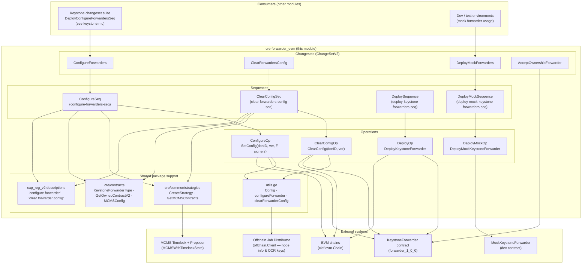
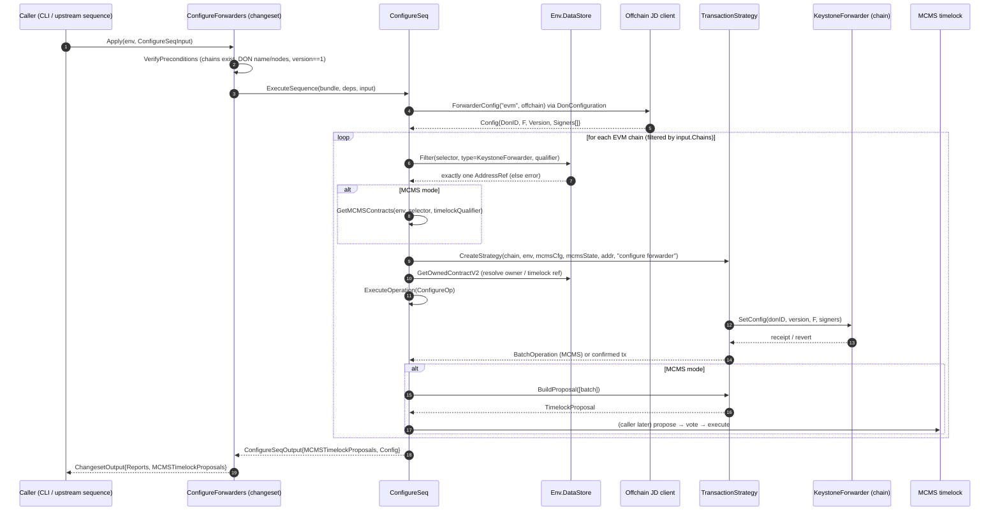
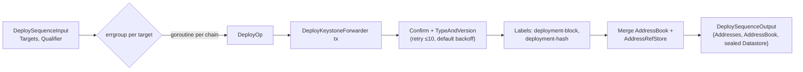
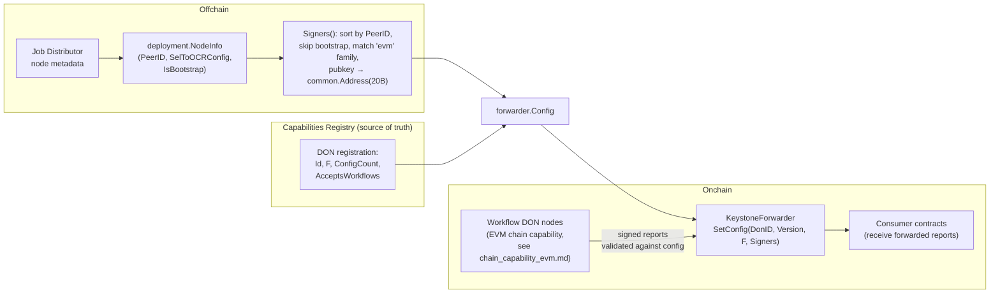
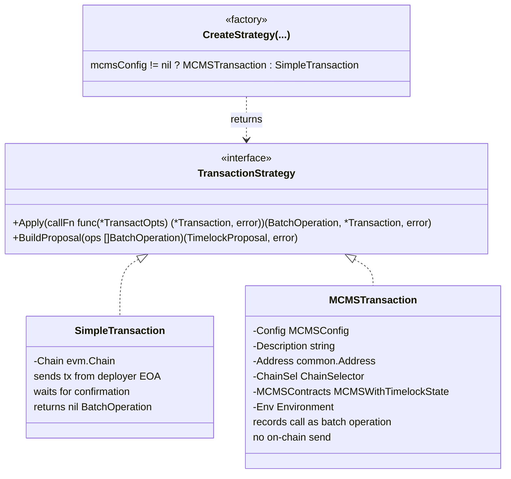
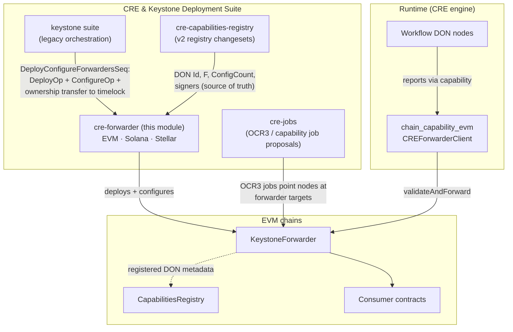

# CRE Forwarder — EVM Family (`chainlink/deployment/cre/forwarder`)

## Introduction

The **`cre-forwarder_evm`** module implements the EVM-family portion of the CRE (Chainlink Runtime Environment) **Keystone Forwarder** deployment tooling, part of the [CRE & Keystone Deployment Suite](../../CRE___Keystone_Deployment_Suite.md). It is the package `forwarder` rooted at `chainlink/deployment/cre/forwarder/` and is the direct counterpart of the Solana ([cre-forwarder_solana](cre-forwarder_solana.md)) and Stellar ([cre-forwarder_stellar](cre-forwarder_stellar.md)) implementations under the shared [cre-forwarder](../cre-forwarder.md) umbrella.

The **Keystone Forwarder** is an on-chain contract that acts as the entry point for CRE workflow reports: nodes in a workflow DON submit consensus-signed reports to the forwarder, which validates them against its stored DON configuration (signer set, threshold `F`, config version) and forwards them to consumer contracts. This module provides the deployment-framework artifacts (changesets → sequences → operations) required to:

- **Deploy** `KeystoneForwarder` contracts (`forwarder_1_0_0` bindings) across multiple EVM chains concurrently.
- **Configure** a forwarder to accept reports from a given workflow DON (`SetConfig`), deriving the signer set from the offchain Job Distributor (JD).
- **Clear** a DON's configuration from forwarders (`ClearConfig`), e.g. during DON retirement.
- **Deploy Mock** forwarders for test/simulation environments.

All state mutations are routed through a pluggable **transaction strategy**: direct EOA execution or an [MCMS](../../Deployment_Framework_Core___Product_Deployments/deployment-common.md) timelock proposal, enabling both devnet convenience and production-grade governance.

The module builds on the [Deployment Framework Core](../../Deployment_Framework_Core___Product_Deployments.md) (changeset/sequence/operation primitives, datastore, address book) and is consumed by the [Keystone changeset suite](../keystone.md).

---

## 1. Architecture Overview

The module follows the three-layer execution model of `chainlink-deployments-framework`: a user-facing **Changeset** (`ChangeSetV2`) validates preconditions and invokes an **Sequence**, which orchestrates per-chain **Operations**. Shared helpers (`utils.go`, `accept_ownership.go`) and two sibling packages (`common/strategies`, `cre/contracts`) provide the transaction strategy abstraction and ownership-aware contract loading.

Key structural points:

- **One operation per chain action.** Each operation encapsulates a single contract interaction (`SetConfig`, `ClearConfig`, deploy) so execution reports are granular and replay-safe.
- **Sequences fan out across chains.** `ConfigureSeq`, `ClearConfigSeq`, `DeploySequence`, and `DeployMockSequence` iterate the environment's EVM chains (optionally filtered by an explicit `Chains` selector map) and execute the corresponding operation per forwarder.
- **Governance is a strategy, not a fork.** The same code path serves EOA deployments and MCMS-secured deployments; the difference is entirely captured by whether `MCMSConfig` is supplied in the input (see [§5](#5-transaction-strategy-abstraction)).

---

## 2. Component Reference

### 2.1 Deployment — `deploy.go`

| Component | Kind | Purpose |
|---|---|---|
| `DeployOp` / `DeployOpDeps` / `DeployOpInput` / `DeployOpOutput` | Operation | Deploys one `KeystoneForwarder` to a single chain (`ChainSelector`, `Qualifier`, optional `Labels`). |
| `DeploySequence` / `DeploySequenceDeps` / `DeploySequenceInput` / `DeploySequenceOutput` | Sequence | Fans `DeployOp` out to all `Targets` chains **concurrently** via `errgroup`, merging results. |

Behavior details:

- Deployment uses the generated binding `forwarder.DeployKeystoneForwarder(auth, chain.Client)` from `chainlink-evm/gethwrappers/keystone/generated/forwarder_1_0_0` (the Go module lives in `chainlink/deployment/go.mod`).
- After the deploy transaction is submitted, the op enters a **retry loop** (`retry.Strategy`, max 10 attempts, default backoff) around `getTypeAndVersionOnce`, which:
  1. confirms the deployment transaction via `chain.Confirm(tx)`;
  2. calls the contract's `TypeAndVersion()` and parses it into a `cldf.TypeAndVersion`;
  3. fetches the transaction receipt and records two labels on the type/version: `deployment-block: <height>` and `deployment-hash: <tx hash>`.
- The result is recorded twice for compatibility: a `datastore.AddressRef` (chain selector, address, contract type, version, qualifier, labels) in a memory `AddressRefStore`, **and** a legacy `cldf.AddressBook` entry. `DeploySequenceOutput` also returns a sealed `datastore.DataStore`.
- **Qualifier semantics:** the qualifier disambiguates multiple forwarders deployed to the same chain; every later lookup (configure, clear, accept-ownership) filters the datastore by `chainSelector + contractType(KeystoneForwarder) + qualifier` and **fails if zero or more than one** match is found — a deliberate guard against misconfiguration.

### 2.2 Mock Deployment — `deploy_mock.go`

`DeployMockForwarders` is a `ChangeSetV2[DeployMockForwardersInput]` for test environments:

- `VerifyPreconditions` requires a non-empty qualifier, resolves each target selector through `chain_selectors.GetChainIDFromSelector`, and requires the chain to exist in the environment's EVM chains.
- `Apply` runs `DeployMockSequence` → `DeployMockOp`, which deploys `MockKeystoneForwarder` (`chainlink-evm .../generated/mock_forwarder`), confirms the transaction, and records `TypeAndVersion` + the same `deployment-block`/`deployment-hash` labels.
- The changeset wraps the sequence's address store into a `ChangesetOutput.DataStore` so downstream changesets can consume the mock addresses. Mock forwarders are the usual target of [system-tests](../../Dev,_Test___Simulation_Environments/system-tests.md) and devenv topologies.

### 2.3 Configuration — `configure.go`

| Component | Kind | Purpose |
|---|---|---|
| `ConfigureForwarders` | Changeset | Entry point; validates preconditions, runs `ConfigureSeq`. |
| `ConfigureSeq` / `ConfigureSeqDeps` / `ConfigureSeqInput` / `ConfigureSeqOutput` | Sequence | Resolves the DON's forwarder `Config` once, then configures one forwarder per chain. |
| `ConfigureOp` / `ConfigureOpDeps` / `ConfigureOpInput` / `ConfigureOpOutput` | Operation | Calls `SetConfig` on a single forwarder via the transaction strategy. |
| `DonConfiguration` / `ForwarderConfig` | Helper | Declarative DON description (name, ID, F, version, node IDs) → on-chain `Config`. |
| `Signers` | Helper | Derives EVM signer addresses from offchain node info. |

**Preconditions** enforced by `ConfigureForwarders.VerifyPreconditions`:

- every requested chain selector exists in `env.BlockChains.EVMChains()`;
- `DON.Name` is non-empty;
- at least one node ID is present;
- `DON.Version == 1` (the forwarder's supported config-version schema).

**Signer derivation (`Signers`).** The forwarder must store the exact onchain public keys of the DON's non-bootstrap nodes, sorted deterministically. The helper:

1. loads node info from the offchain client via `deployment.NodeInfo(nodeIDs, c)` — node IDs may be JD IDs, `p2p_…` peer IDs, or CSA keys;
2. sorts nodes by `PeerID` string;
3. skips bootstrap nodes (they do not sign reports);
4. locates the chain details whose selector family matches `chainFamily` (`"evm"` here);
5. takes the OCR configuration's `OnchainPublicKey` and truncates it to the first 20 bytes as the Ethereum address.

`ConfigureOp` then invokes `fwdr.SetConfig(txOpts, donID, version, F, signers)` through the strategy, ABI-decodes any revert via `cldf.DecodeErr(kf.KeystoneForwarderABI, err)`, and surfaces both an `MCMSOperation` (when MCMS is used) and the applied `Config`. Note that `ConfigureOpInput.ChainSelector` is populated even though unused inside the op body — operation reports are de-duplicated by their inputs, and including the selector prevents identical per-chain reports from being collapsed.

### 2.4 Config Clearing — `clear_config.go`

| Component | Kind | Purpose |
|---|---|---|
| `ClearForwardersConfig` | Changeset | Entry point; validates preconditions, runs `ClearConfigSeq`. |
| `ClearConfigSeq` / `ClearConfigSeqDeps` / `ClearConfigSeqInput` / `ClearConfigSeqOutput` | Sequence | Clears one DON's config from every matching forwarder. |
| `ClearConfigOp` / `ClearConfigOpDeps` / `ClearConfigOpInput` / `ClearConfigOpOutput` | Operation | Calls `ClearConfig(donID, configVersion)` on a single forwarder. |

- Preconditions: requested chains exist, `DonID != 0`, `ConfigVersion != 0`.
- The forwarder's `ClearConfig` requires the **exact config version** the DON was configured with — clearing is a versioned delete, not a blanket wipe.
- Uses the `ClearForwarderConfigDescription` constant from the [cre-capabilities-registry](../cre-capabilities-registry.md) operations package (`"clear forwarder config"`), which becomes the MCMS proposal description for auditability.
- When MCMS is used, the sequence additionally asserts that the resolved forwarder is actually owned by the expected timelock (`contract.McmsContracts != nil`), and errors if **no proposals** were generated across the requested chains.

### 2.5 Shared Helpers — `utils.go` & `accept_ownership.go`

- **`Config`** is the canonical on-chain configuration payload: `DonID`, `F`, `ConfigVersion`, `Signers []common.Address`. It mirrors the DON's registration in the capabilities registry (DonID, F, ConfigCount and the signer set), keeping the forwarder and the registry consistent.
- **`configureForwarder` / `clearForwarderConfig`** are strategy-aware bindings around `SetConfig` / `ClearConfig` shared by both ops; they return a `forwarderTxResponse` (chain selector, DON ID, forwarder address, optional MCMS batch operation).
- **`AcceptOwnershipForwarder`** is a standalone changeset that calls `AcceptOwnership` on forwarders using the environment deployer key — used after a previous owner has called `transferOwnership` toward the deployer EOA (e.g. during MCMS onboarding or handover); it locates forwarders via the same datastore filters as configure/clear.

---

## 3. Execution Flow: Configuring a Forwarder

The following sequence diagram traces a `ConfigureForwarders` changeset end-to-end, in both direct and MCMS modes.

The clear flow (`ClearForwardersConfig` → `ClearConfigSeq` → `ClearConfigOp`) is structurally identical, differing only in the contract call (`ClearConfig(donID, version)`), its preconditions, and its description constant.

The deploy flow differs in shape — it is **concurrent across chains** rather than sequential:

---

## 4. State & Data Flow

### 4.1 Configuration data flow

The forwarder configuration is ultimately a projection of registry state plus offchain key material. The diagram below shows how data moves from the JD and the capabilities registry into the forwarder contract.

Two invariants keep the forwarder usable: the signer list stored on-chain must exactly match the sorted, non-bootstrap signer set registered for the DON (mismatches cause report validation failures at runtime), and `ConfigVersion` must match the registry's `ConfigCount` so that re-configurations are monotonic and clearable by exact version.

### 4.2 Address bookkeeping

Every artifact produced by this module is recorded in the environment's **datastore** (`datastore.AddressRefStore`) and, for backward compatibility, the legacy **address book**:

- `AddressRef` fields used: `ChainSelector`, `Address`, `Type` (`KeystoneForwarder` or `MockKeystoneForwarder`), `Version` (from `TypeAndVersion`), `Qualifier`, `Labels` (including `deployment-block` / `deployment-hash`).
- Ownership detection (`contracts.GetOwnedContractV2` → `NewOwnableV2`) inspects the forwarder's on-chain owner, then resolves that owner in the datastore: if it is an `RBACTimelock` reference, the corresponding `MCMSWithTimelockState` is loaded and validated (with a legacy label-set fallback, tracked upstream as CRE-1360). The resulting `OwnedContract` bundles the contract and its MCMS state, which configure/clear use to assert MCMS ownership before proposing.
- Qualifiers allow multiple forwarders per chain (e.g. per-product or per-environment), and the strict "exactly one match" rule in configure/clear prevents operating on the wrong instance.

---

## 5. Transaction Strategy Abstraction

All contract mutations are expressed as `strategy.Apply(callFn)`, where `callFn` builds the transaction. This is what makes the module governance-agnostic.

- **`SimpleTransaction`** (direct mode): the call is sent from `chain.DeployerKey`, confirmed, and returned. Suitable for devnets and test environments.
- **`MCMSTransaction`** (governed mode): the call is **not** broadcast. `Apply` records the call as an `mcmstypes.BatchOperation`; the sequence then calls `BuildProposal` to assemble an `mcmslib.TimelockProposal` carrying the human-readable description (`"configure forwarder"` / `"clear forwarder config"`). Proposals are returned to the caller (`ChangesetOutput.MCMSTimelockProposals`) for signing, voting, and execution by MCMS participants.
- `CreateStrategy` validates the MCMS configuration against the resolved `MCMSWithTimelockState` before returning an `MCMSTransaction`, failing fast on invalid timelock/proposer bindings.
- The factory is shared across CRE modules, so configure/clear flows for other contracts (e.g. the [capabilities registry](../cre-capabilities-registry.md)) behave identically.

---

## 6. Position in the Overall System

- **Upstream orchestration.** The Keystone changeset suite's `DeployConfigureForwardersSeq` composes this module's `DeployOp` and `ConfigureOp` directly: it deploys the forwarder (skipping chains where the same qualifier already exists), configures it for each registered writer DON that `AcceptsWorkflows` (building `forwarder.Config` from `internal.RegisteredDon` — the registry-backed variant of `DonConfiguration`), transfers ownership to the chain's RBAC timelock, and then registers capabilities / updates the writer DON on the registry. Governance flows in both modules share the same `strategies.CreateStrategy` and `crecontracts.MCMSConfig` types.
- **Downstream runtime.** At runtime, workflow nodes use the EVM chain capability's `CREForwarderClient` (documented in [chain_capability_evm](../../Workflow___Capability_Runtime_(CRE_Engine)/chain_capability_evm.md)) to submit signed reports through the deployed forwarder — the exact contract this module deploys and configures.
- **Cross-family siblings.** Solana ([cre-forwarder_solana](cre-forwarder_solana.md)) and Stellar ([cre-forwarder_stellar](cre-forwarder_stellar.md)) expose the same deploy/configure/clear lifecycle for their chain families, with chain-specific codecs for signer derivation.
- **Testing.** `DeployMockForwarders` provisions `MockKeystoneForwarder` contracts used by [system-tests](../../Dev,_Test___Simulation_Environments/system-tests.md) and the devenv tooling to stand up forwarder topologies without real signing infrastructure.

---

## 7. Key Invariants & Operational Notes

1. **Qualifiers are load-bearing.** Deploy, configure, clear, and accept-ownership all resolve forwarders by `(chainSelector, KeystoneForwarder, qualifier)`; a missing or ambiguous qualifier is a hard error.
2. **Version discipline.** Configure requires `DON.Version == 1`; clear requires the exact version previously set. `ConfigVersion` maps to the registry's `ConfigCount`.
3. **Deterministic signer ordering.** Signers are sorted by peer ID and bootstrap nodes excluded — re-running configure for an unchanged DON is idempotent at the contract level.
4. **MCMS mode is all-or-nothing per input.** Supplying `MCMSConfig` switches every configured chain to proposal generation; the sequences fail if MCMS ownership cannot be established or no proposals would be produced.
5. **Execution reports are deduplicated by inputs.** `ChainSelector` is deliberately included in op inputs so that identical per-chain operations are not collapsed into a single report.
6. **Versioned artifacts.** Every sequence/operation is registered with a semantic version (`1.0.0`) and stable ID (e.g. `configure-forwarders-seq`), enabling the framework's report tracking and re-execution semantics.

---

## 8. Related Documentation

- Parent module: [cre-forwarder](../cre-forwarder.md) — cross-family lifecycle overview and shared conventions.
- Siblings: [cre-forwarder_solana](cre-forwarder_solana.md) · [cre-forwarder_stellar](cre-forwarder_stellar.md)
- Upstream consumers: [keystone](../keystone.md) (`DeployConfigureForwardersSeq`) · [cre-capabilities-registry](../cre-capabilities-registry.md) (DON source of truth, description constants)
- Framework primitives: [Deployment Framework Core](../../Deployment_Framework_Core___Product_Deployments.md) — changeset/sequence/operation model, datastore, MCMS helpers ([deployment-common](../../Deployment_Framework_Core___Product_Deployments/deployment-common.md))
- Runtime counterpart: [chain_capability_evm](../../Workflow___Capability_Runtime_(CRE_Engine)/chain_capability_evm.md) — `CREForwarderClient`, the capability that writes reports through the deployed forwarder
- Test environments: [system-tests](../../Dev,_Test___Simulation_Environments/system-tests.md) · [devenv](../../Dev,_Test___Simulation_Environments/devenv.md)
