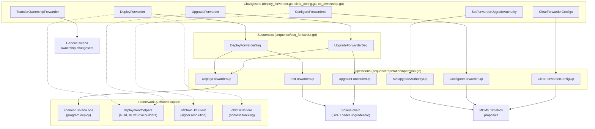
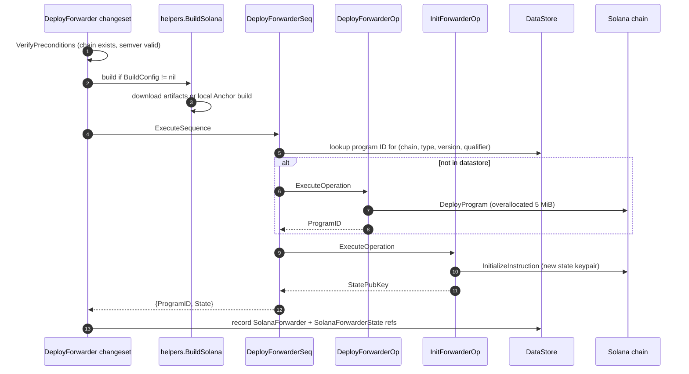
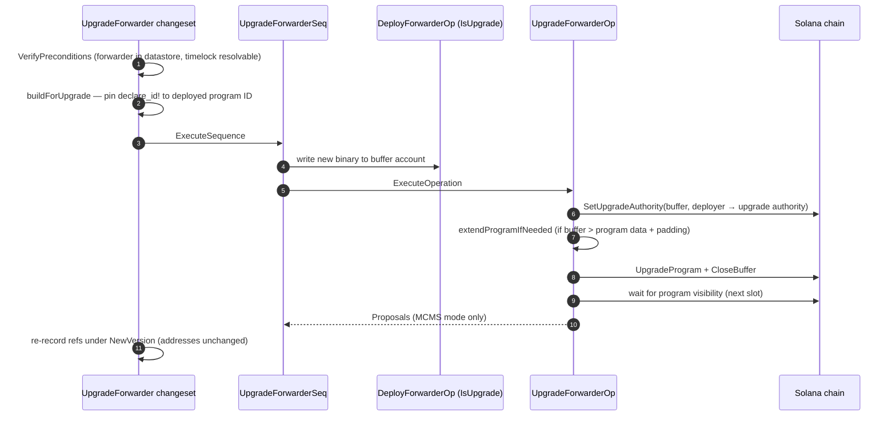
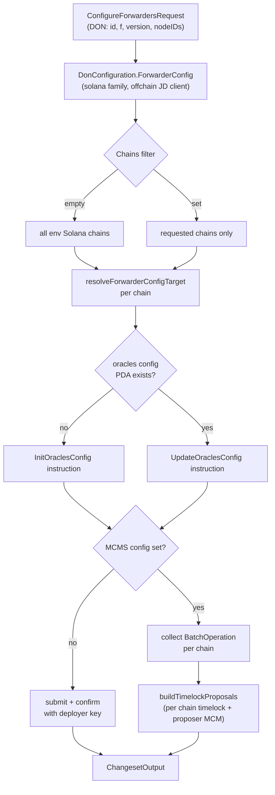
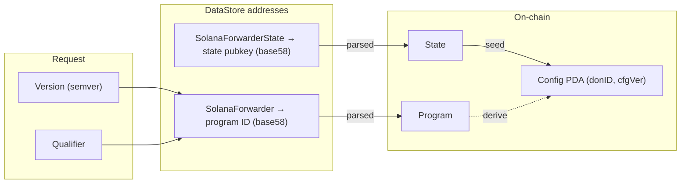

# CRE Forwarder — Solana

> **Module location:** `chainlink/deployment/cre/forwarder/solana/`
> **Part of:** [CRE & Keystone Deployment Suite](../../CRE___Keystone_Deployment_Suite.md) → [cre-forwarder](../cre-forwarder.md)

## Overview

The `cre-forwarder_solana` module contains the deployment code (changesets, sequences, and operations) for the **Keystone Forwarder program on Solana**. The forwarder is the on-chain anchor program that a workflow DON's OCR3 reporting plugin transmits signed reports through: it stores the DON's oracle signer set and forwards validated reports to consumer contracts.

This module is the Solana counterpart of the EVM and Stellar forwarder deployments and follows the same contract:

- **Deploy** the `keystone_forwarder` Anchor program and initialize its state account.
- **Upgrade** the program in place (the program ID, state, and oracles configs survive an upgrade).
- **Configure** the oracles config for a DON (signer set, threshold `F`, config version) — the data the forwarder uses to verify incoming report signatures.
- **Clear** a DON oracles config, refunding the config account's rent.
- **Manage authority** — transfer the program's upgrade authority (typically to an MCMS timelock) and transfer contract ownership.

Everything is expressed with the [chainlink-deployments-framework](../../Deployment_Framework_Core___Product_Deployments/deployment-common.md) primitives: `ChangeSetV2` changesets at the top, `Sequence`s in the middle, and fine-grained, reportable `Operation`s at the bottom.

## Architecture

The module is a strict three-layer stack. Changesets own precondition checks and datastore bookkeeping; sequences orchestrate multi-step flows; operations perform single on-chain instructions and can either submit directly with the deployer key or emit MCMS batch operations.



### On-chain model

The forwarder maintains three kinds of on-chain artifacts. The oracles config is a **program-derived account (PDA)** derived from the state account plus the `(donID, configVersion)` pair, so each DON's configuration is independently addressable and closable.

```mermaid
flowchart LR
    subgraph solana["Solana ledger"]
        P["keystone_forwarder program<br/>(BPF Loader upgradeable)<br/>upgrade authority = deployer or timelock"]
        S["Forwarder state account<br/>(random keypair, init at deploy)"]
        C["Oracles config PDA<br/>seeds: b\"config\", state pubkey,<br/>donID &lt;&lt; 32 | configVersion"]
        B["Buffer account<br/>(holds new binary during upgrade)"]
    end

    P -->|owns / reads| S
    P -->|owns| C
    S -->|seed for| C
    B -->|UpgradeProgram| P

    style P fill:#e8f0fe
    style C fill:#fff3e0
```

| Artifact | Tracking key (`datastore.AddressRef`) |
|---|---|
| Program | `ContractType = SolanaForwarder`, qualifier `ks_solana_forwarder` (default), semver version |
| State account | `ContractType = SolanaForwarderState`, same qualifier/version |
| Oracles config | Derived on demand: `getConfigPDA(state, donID, configVersion, programID)` — not stored, recomputed from seeds |

The deployer key is the initial upgrade authority and config owner. When an `MCMS *TimelockConfig` is supplied, the code instead resolves the timelock signer PDA from the datastore (`helpers.FetchTimelockSigner`) and produces proposals rather than submitting transactions.

## Component reference

### Changesets (`deploy_forwarder.go`, `clear_config.go`, `cs_ownership.go`)

| Changeset | Input | Behavior |
|---|---|---|
| `DeployForwarder` | `ChainSel`, `BuildConfig`, `Qualifier`, `LabelSet`, `Version` | Optionally builds program artifacts, runs `DeployForwarderSeq`, records program ID and state account in the output datastore. |
| `UpgradeForwarder` | `ChainSel`, `BuildConfig`, `Qualifier`, `Version`, `NewVersion`, `LabelSet`, `MCMS` | Builds against the **pinned deployed program ID**, runs `UpgradeForwarderSeq`, optionally re-records both refs under `NewVersion` (addresses are unchanged — only the recorded version moves). |
| `SetForwarderUpgradeAuthority` | `ChainSel`, `NewUpgradeAuthority`, `Qualifier`, `Version`, `MCMS` | Runs `SetUpgradeAuthorityOp` to hand the program's upgrade authority to a new key or timelock. |
| `ConfigureForwarders` | `DON forwarder.DonConfiguration`, `MCMS`, `Chains` (optional), `Qualifier`, `Version` | Resolves DON signers from the offchain JD client, runs `ConfigureForwarderOp` per selected chain, wraps batches into timelock proposals. |
| `ClearForwarderConfigs` | `DonID`, `ConfigVersion`, `MCMS`, `Chains`, `Qualifier`, `Version` | Runs `ClearForwarderConfigOp` to close the oracles config account; the rent is refunded and the `(donID, configVersion)` pair becomes reusable. |
| `TransferOwnershipForwarder` | `ChainSel`, `CurrentOwner`, `ProposedOwner`, `Version`, `Qualifier`, `MCMSCfg` | Delegates to the generic Solana ownership changesets with `ForwarderContract`/`ForwarderState` types. |

Precondition checks are uniform across changesets: the target chain must exist in `env.BlockChains.SolanaChains()`, the referenced forwarder must exist in the datastore for `(chainSel, ForwarderContract, version, qualifier)`, and — when MCMS is used — the chain must hold a deployed MCMS/timelock set (see `verifyForwarderChains` in `forwarder_config.go`).

### Sequences (`sequence/seq_forwarder.go`)

| Sequence | Steps | Output |
|---|---|---|
| `DeployForwarderSeq` | 1. `DeployForwarderOp` (skipped if the program ID is already in the datastore for this version/qualifier). 2. `InitForwarderOp` → fresh state account. | `DeployForwarderSeqOutput{ProgramID, State}` |
| `UpgradeForwarderSeq` | 1. `DeployForwarderOp` with `IsUpgrade: true` → writes the new binary into a **buffer account**. 2. `UpgradeForwarderOp` → in-place upgrade from the buffer. | `UpgradeForwarderSeqOutput{BufferID, Proposals}` |

The deployment over-allocates `KeystoneForwarderProgramSize = 5 * 1024 * 1024` bytes so future upgrades have headroom before the program data account must be extended.

### Operations (`sequence/operation/operation.go`)

| Operation | What it does |
|---|---|
| `DeployForwarderOp` | Delegates to the shared Solana `Deploy` operation (`Chain.DeployProgram`) from [deployment-common](../../Deployment_Framework_Core___Product_Deployments/deployment-common.md). |
| `InitForwarderOp` | Generates a random state keypair, builds `ks_forwarder.NewInitializeInstruction`, confirms on chain, returns `StatePubKey`. |
| `SetUpgradeAuthorityOp` | Builds the BPF-loader `SetUpgradeAuthority` instruction (target `BPFLoaderUpgradeableProgramID`); submits directly or as an MCMS transaction. |
| `UpgradeForwarderOp` | Hands buffer authority to the upgrade authority if needed, extends the program data account if the new binary does not fit (`extendPadding = 1024`), submits upgrade + close-buffer instructions, and waits for program visibility. |
| `ConfigureForwarderOp` | Probes whether the oracles config PDA exists (`oraclesConfigExists`, read at default commitment), then builds `NewInitOraclesConfigInstruction` or `NewUpdateOraclesConfigInstruction`. |
| `ClearForwarderConfigOp` | Verifies the config exists, builds `NewCloseOraclesConfigInstruction`. |

Shared operation types:

- `Deps{Env, Chain, Datastore}` — injected into every operation.
- `ForwarderConfigTarget{MCMS, ProgramID, ForwarderState, ConfigPDA, Owner, DonID, ConfigVersion, Type}` — identifies which config account an instruction targets and how the instruction is submitted; built by `resolveForwarderConfigTarget` in `forwarder_config.go`.
- All outputs either carry a `Batch mcmsTypes.BatchOperation` (proposing mode) or nothing (direct mode).

## Deployment flows

### Fresh deployment



### In-place upgrade



Two subtleties make this flow safe:

1. **Anchor program ID baking.** Anchor validates the `declare_id!` baked at build time against the invoked program. For local builds the changeset pins the deployed program ID into the build config (`withPinnedUpgradeKey`) unless the caller already pinned one; for runtime instruction construction the operations assign the package-level `ks_forwarder.ProgramID` before building instructions.
2. **Slot-boundary visibility.** A program upgraded in a slot only becomes invocable in the *next* slot. `waitForProgramVisibility` polls `GetSlot` (2-minute timeout, 500 ms interval) so the operation never returns a program that would reject its own instructions.

### DON configuration (direct vs. MCMS)

`ConfigureForwarders` is the changeset most frequently invoked after an initial DON setup — it is what enables a workflow DON to deliver reports through the forwarder. The DON's signers are resolved via `DonConfiguration.ForwarderConfig(chain_selectors.FamilySolana, env.Offchain)`, which queries the Job Distributor for each node's OCR onchain public key and converts it to a sorted `[20]uint8` EVM-style address array.



The same dual-mode `submitOrPropose` pattern applies to `ConfigureForwarderOp` and `ClearForwarderConfigOp`, while `SetUpgradeAuthorityOp` and `UpgradeForwarderOp` implement the equivalent branch inline.

## Build and artifact provisioning

When `DeployForwarderRequest.BuildConfig` or `UpgradeForwarderRequest.BuildConfig` is set, artifacts are provisioned before any on-chain work:

- **Remote artifacts** (default): prebuilt `keystone_forwarder` binaries are downloaded from the `chainlink-solana` release referenced by `GitCommitSha` (`solutils.DownloadChainlinkCCIPProgramArtifacts`).
- **Local build**: the `chainlink-solana` repo is cloned, anchor keys are synced (and, for upgrades, `declare_id!` is rewritten to the deployed program ID), then `make build_contracts` runs inside the Anchor project. The module wires this up in `cs_build_solana.go` via `keystoneBuildParams` (`RepoURL`, `AnchorDir = contracts`, `DeployDir = contracts/target/deploy`).

The canonic program name/ID mapping lives in `chainlink/deployment/utils/solutils/directory.go` (`ProgKeystoneForwarder = "keystone_forwarder"`, artifacts from `chainlink-solana`), and the Rust source path used for upgrade-key replacement is `programs/keystone-forwarder/src/lib.rs`.

## Data flow and state tracking

All deployed artifacts are tracked in the CLD datastore as `AddressRef`s keyed by `(chainSelector, contractType, version, qualifier)`. The changeset output datastore is **merged** into the environment datastore, which is why `UpgradeForwarder` deliberately leaves previous-version refs in place while upserting the new-version refs.



## Related modules

- **[cre-forwarder](../cre-forwarder.md)** — parent module; cross-chain forwarder concepts, shared `Config`/`DonConfiguration` types, and the EVM-side configure pipeline.
- **[cre-forwarder_evm](cre-forwarder_evm.md)** — EVM Keystone Forwarder deployment (`ConfigureOp`/`ConfigureSeq`, transaction strategies).
- **[cre-forwarder_stellar](cre-forwarder_stellar.md)** — Stellar counterpart (deploy, configure, clear config, mock forwarder).
- **[deployment-common](../../Deployment_Framework_Core___Product_Deployments/deployment-common.md)** — the shared Solana MCMS init sequence and the common `Deploy` operation this module delegates to, plus the changeset framework contracts.
- **[cre-capabilities-registry](../cre-capabilities-registry.md)** — DON registration; `ConfigureForwarders` mirrors the DON id/`F`/config-version data registered there.
- **[keystone](../keystone.md)** — the product-level Keystone suite (`deploy_configure_forwarders_seq.go`) that composes these forwarder changesets into full DON deployments.
- **[chain_capability_solana](../../Workflow___Capability_Runtime_(CRE_Engine)/chain_capability_solana.md)** — the runtime side: the Solana `WriteReport` capability whose signed reports this forwarder program verifies and forwards. Its monitoring schemas (`write_report.proto`, `log_trigger.proto`) observe the same reports.
- **[system-tests](../../Dev,_Test___Simulation_Environments/system-tests.md)** — the Solana feature tests (`system-tests/lib/cre/features/solana`) exercise these changesets against live devnets.

## Key invariants and operational notes

1. **Program ID stability.** `UpgradeForwarder` never changes the program ID — only the binary. This is what preserves forwarder state and all oracles configs across upgrades.
2. **Version ≠ program ID.** A datastore ref's version identifies the *deployment record*, not on-chain state. Upgrades with `NewVersion` set produce new refs for the same on-chain addresses.
3. **Config version reuse.** Closing a config refunds rent and frees the `(donID, configVersion)` pair — a subsequent `ConfigureForwarders` with the same pair re-initializes it from scratch. The caller must pass the exact config version used at configure time.
4. **Owner vs. upgrade authority.** The oracles config owner (signer of config instructions) and the program upgrade authority are distinct roles; both default to the deployer key and both can be moved to a timelock.
5. **Extend is permissionless.** Growing the program data account is always paid and signed by the deployer key, even when the timelock owns the program, because extension requires no authority.
6. **Commitment-level reads.** `oraclesConfigExists` reads at the default commitment level, so a config written earlier in the same changeset run is visible to later operations in that run.
