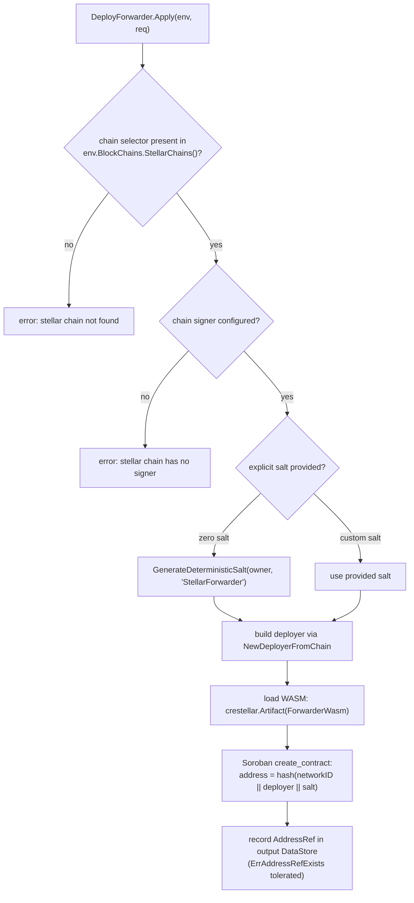
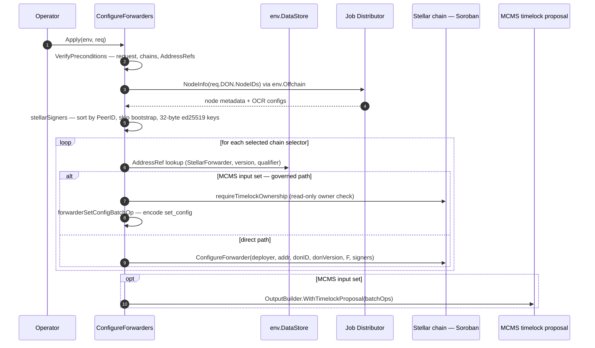
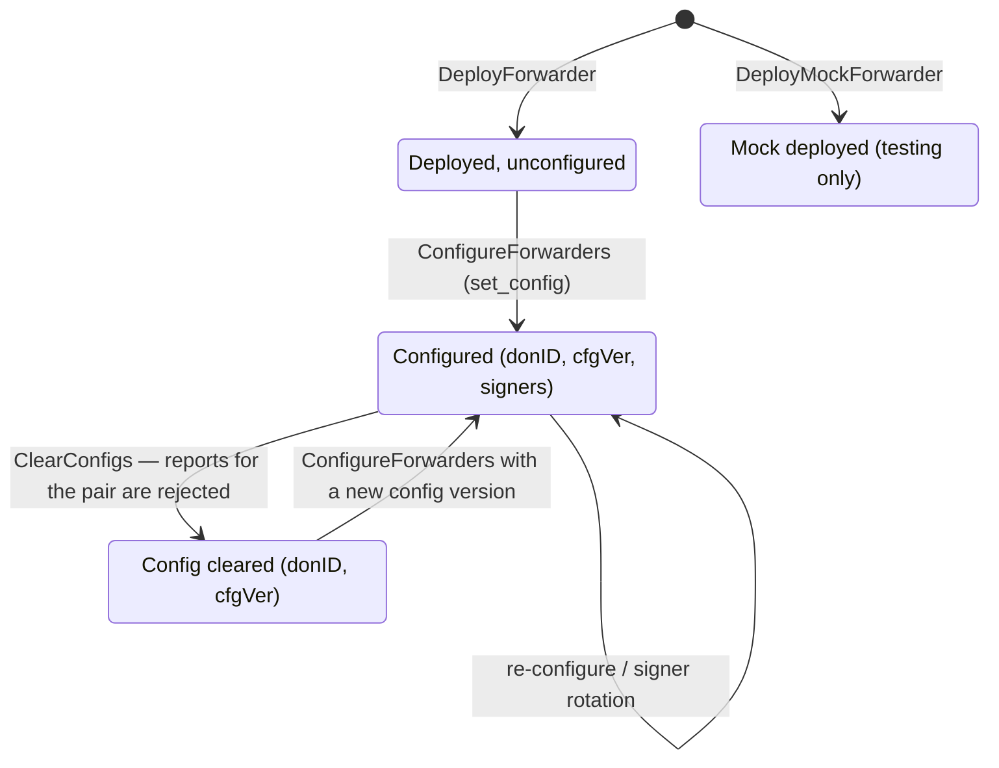

# CRE Forwarder — Stellar (Soroban)

This module implements the **Stellar (Soroban) leg of CRE forwarder contract deployment and administration** inside the [CRE / Keystone Deployment Suite](../../CRE___Keystone_Deployment_Suite.md). It provides four `ChangeSetV2` changesets that:

1. **Deploy** the production CRE forwarder contract (WASM) on a Stellar chain.
2. **Deploy a mock forwarder** for testing (never production-safe).
3. **Configure** a deployed forwarder with a DON's signer set (OCR/Keystone report signers).
4. **Clear** a DON signer configuration (e.g., to rotate out a bad or retired DON config).

Every changeset supports two execution modes: **direct execution with the deployer key** or **MCMS timelock-governed proposal** (required once the forwarder is owned by the MCMS timelock).

Source package: `chainlink/deployment/cre/forwarder/stellar`

---

## 1. Position in the CRE / Keystone Deployment Suite

The CRE forwarder is the on-chain entry point for CRE/Keystone report forwarding: a DON's workflow reports are submitted to the forwarder, which validates them against its configured DON signer set and forwards them to a downstream receiver contract. On Stellar, the runtime side of this flow is the [Stellar chain capability](../../Workflow___Capability_Runtime_(CRE_Engine)/chain_capability_stellar.md), whose `WriteReport` action submits reports through a `CREForwarderClient` bound to the same contract deployed here.

This module is one of three chain-family implementations under the parent [cre-forwarder](../cre-forwarder.md) module, alongside [cre-forwarder_evm](cre-forwarder_evm.md) and [cre-forwarder_solana](cre-forwarder_solana.md). All three expose the same logical operations (deploy, deploy-mock, configure, clear-config) with chain-specific mechanics. The Stellar implementation is distinguished by:

- **WASM-based contract deployment** via Soroban `create_contract`.
- **Deterministic contract addresses** derived from `(networkID, deployer, salt)`.
- **ed25519 32-byte signer keys** resolved from the Job Distributor's per-node Stellar OCR configs.
- **Contract TTL management** (Soroban instance/ledger TTL), surfaced in the mock-forwarder deploy flow.

```mermaid
flowchart TB
    subgraph DEPLOY["Deployment suite (this repo)"]
        MOD["cre-forwarder_stellar<br/>Deploy / DeployMock / Configure / Clear"]
        EVM["cre-forwarder_evm"]
        SOL["cre-forwarder_solana"]
        KS["keystone changesets<br/>ForwarderDeploymentOps"]
        MOD -. "same changeset pattern" .-> EVM
        MOD -. "same changeset pattern" .-> SOL
        KS --> "orchestrates deploy + configure" MOD
    end

    subgraph ONCHAIN["On-chain — Stellar (Soroban)"]
        FWD_C["CRE Forwarder contract"]
        RECV["Receiver contract"]
        FWD_C --> "forwards reports" RECV
    end

    subgraph RUNTIME["Runtime — CRE engine"]
        CAP["chain_capability_stellar<br/>WriteReport via CREForwarderClient"]
    end

    CAP --> "submits signed reports" FWD_C
```

The downstream receiver used to exercise this flow in tests is documented in [cre-core → Stellar fixtures](../cre-core/cre-core_stellar-fixtures.md) (`DeployReceiver`, `DeployReadFixture`), and the Keystone-level orchestration that sequences forwarder deployment with DON configuration is documented in [keystone](../keystone.md).

---

## 2. Architecture

### 2.1 Component overview

| Component | File | Purpose |
|---|---|---|
| `DeployForwarder` | `deploy_forwarder.go` | Deploys the production CRE forwarder WASM on one Stellar chain selector; records the address in the DataStore. |
| `DeployMockForwarder` | `deploy_mock_forwarder.go` | Deploys the CRE **mock** forwarder WASM for testing; records the address under the `StellarMockForwarder` contract type. |
| `ConfigureForwarders` | `configure_forwarder.go` | Resolves DON signers from the Job Distributor and applies `set_config` to one or more forwarders (direct or MCMS-governed). |
| `ClearConfigs` | `clear_config.go` | Removes a `(donID, configVersion)` signer configuration from forwarders so reports for it are rejected (direct or MCMS-governed). |
| Package helpers | package scope (`requireTimelockOwnership`, `forwarderSetConfigBatchOp`, `forwarderClearConfigBatchOp`) | Read-only timelock ownership verification and MCMS batch-op encoding shared by the governed paths. |
| Shared constants | `configure_forwarder.go`, `deploy_mock_forwarder.go` | Contract types and default qualifier/version (see §3). |

### 2.2 Architecture and dependency flow

```mermaid
flowchart TB
    subgraph MOD["chainlink/deployment/cre/forwarder/stellar"]
        DF["DeployForwarder"]
        DMF["DeployMockForwarder"]
        CF["ConfigureForwarders"]
        CC["ClearConfigs"]
        HELP["package helpers<br/>requireTimelockOwnership<br/>forwarderSetConfigBatchOp<br/>forwarderClearConfigBatchOp"]
    end

    subgraph CLDF["chainlink-deployments-framework"]
        ENV["cldf.Environment<br/>BlockChains / DataStore / Offchain / Logger"]
        OUT["OutputBuilder<br/>WithTimelockProposal"]
    end

    subgraph STELLAR_LIB["chainlink-stellar"]
        SDEP["deployment<br/>NewDeployerFromChain<br/>GenerateDeterministicSalt"]
        SFWD["deployment/cre/forwarder<br/>DeployForwarder<br/>DeployMockForwarder<br/>ConfigureForwarder"]
        BIND["bindings/contracts/cre<br/>ForwarderClient.ClearConfig"]
    end

    subgraph CRE_SHARED["chainlink/deployment shared packages"]
        DONCFG["forwarder.DonConfiguration<br/>(parent forwarder package)"]
        NINFO["deployment.NodeInfo + OCRConfig"]
        WASM["cre/stellar.Artifact<br/>ForwarderWasm / MockForwarderWasm"]
    end

    JD[("Job Distributor<br/>offchain client")]
    MCMS[("MCMS timelock<br/>proposal")]
    SOROBAN[("Stellar Soroban chains")]

    DF --> ENV
    DF --> SDEP
    DF --> SFWD
    DF --> WASM
    DMF --> ENV
    DMF --> SDEP
    DMF --> SFWD
    DMF --> WASM
    CF --> ENV
    CF --> DONCFG
    CF --> NINFO
    CF --> SFWD
    CF --> HELP
    CF --> OUT
    CC --> ENV
    CC --> BIND
    CC --> HELP
    CC --> OUT
    NINFO --> JD
    HELP --> MCMS
    SFWD --> SOROBAN
    BIND --> SOROBAN
```



Key framework interactions:

- **`cldf.Environment`** supplies the Stellar chain registry (`env.BlockChains.StellarChains()`), the address book (`env.DataStore.Addresses()`), the offchain/Job Distributor client (`env.Offchain`), structured logging (`env.Logger`), and the changeset output builder.
- **`cldf.ChangeSetV2[T]`** contract: each changeset implements `VerifyPreconditions` (fail fast, no side effects) and `Apply` (execute or encode). All four changesets assert conformance at compile time via `var _ cldf.ChangeSetV2[...] = ...`.
- **`datastore.AddressRefKey`** (`chainSelector, contractType, version, qualifier`) is the addressing scheme used both to *look up* existing forwarders (configure/clear) and to *record* new ones (deploy).

---

## 3. Contract Types & Datastore Addressing

The module pins identities in the deployment DataStore with these contract types and defaults:

| Constant | Value | Defined in | Used for |
|---|---|---|---|
| `ForwarderContract` | `"StellarForwarder"` | `configure_forwarder.go` | Production forwarder address refs. |
| `MockForwarderContract` | `"StellarMockForwarder"` | `deploy_mock_forwarder.go` | Mock forwarder address refs. |
| `DefaultForwarderQualifier` | `"stellar_forwarder"` | `configure_forwarder.go` | Default qualifier for forwarder refs. |
| `DefaultForwarderVersion` | `"1.0.0"` | `configure_forwarder.go` | Default forwarder version. |
| `DefaultMockForwarderVersion` | `"1.0.0"` | `deploy_mock_forwarder.go` | Default mock forwarder version. |

An address ref is keyed by `(chainSelector, contractType, version, qualifier)`, so:

- **Qualifier and version are mandatory** in every request — there is no implicit default applied inside the changesets; callers (or the orchestration layer, e.g. [keystone](../keystone.md)) pass them explicitly. Using distinct qualifiers/versions lets multiple forwarders coexist per chain.
- `VerifyPreconditions` on the configure/clear changesets **fails if no address ref exists** for the requested key — you cannot configure or clear a forwarder that this framework did not deploy.
- Deploy changesets tolerate `datastore.ErrAddressRefExists` when recording, making re-runs idempotent from the bookkeeping perspective.

---

## 4. Core Changesets

### 4.1 `DeployForwarder`

Deploys the production CRE forwarder contract on **one** Stellar chain selector.

**Request (`DeployForwarderRequest`)**

| Field | Type | Required | Notes |
|---|---|---|---|
| `ChainSel` | `uint64` | ✅ | Must exist in `env.BlockChains.StellarChains()`. |
| `Qualifier` | `string` | ✅ | Datastore qualifier for the address ref. |
| `Version` | `string` | ✅ | Must parse as semver. |
| `LabelSet` | `datastore.LabelSet` | — | Labels stored with the address ref. |
| `Salt` | `[32]byte` | — | Soroban `create_contract` salt; zero salt is auto-defaulted (see below). |

**Behavior**

1. Resolve the chain and require a signer (`ch.Signer`); the forwarder **owner is the chain signer address**.
2. **Salt handling (Soroban determinism):** Soroban derives `create_contract` addresses as `hash(networkID ‖ deployer ‖ salt)`. If the caller passes a zero salt, the module substitutes `stellardeployment.GenerateDeterministicSalt(owner, "StellarForwarder")` so this deployment cannot collide with another contract the same deployer instantiates with a zero salt.
3. Build the deployer via `stellardeployment.NewDeployerFromChain(ch)` and load the WASM artifact via `crestellar.Artifact(crestellar.ForwarderWasm)` (sourced from the `chainlink/deployment/cre/stellar` package, shared with the Stellar receiver fixtures).
4. Call `stellarforwarder.DeployForwarder(ctx, deployer, owner, wasm, salt)` and record the resulting address as an `AddressRef` with type `StellarForwarder`, the parsed version, qualifier, and labels in the changeset output DataStore.



> There is **no MCMS path for deployment** in this module: the forwarder is deployed under the chain signer's ownership and is expected to be handed over to MCMS timelock afterwards (e.g., via the ownership-transfer facilities in [cre-core → contract ownership](../cre-core/cre-core_contract-ownership.md)). Configuration changes after that handover must use the governed path (§5).

### 4.2 `DeployMockForwarder`

Deploys the CRE **mock** forwarder (`chainlink-stellar/contracts/cre/mock_forwarder`). The doc comment is explicit: **never point a production receiver at it.**

- Mirrors `DeployForwarder` with type `StellarMockForwarder`, artifact `crestellar.MockForwarderWasm`, and salt namespacing by `"StellarMockForwarder"`.
- Calls `stellarforwarder.DeployMockForwarder(ctx, deployer, wasm, salt)`.
- **TTL nuance:** the underlying deploy attempts to extend the contract's Soroban TTL. If the extension fails *after* the contract was created, the changeset logs a warning —
  *"Deployed Stellar CRE mock forwarder but failed to extend its TTL; extend it with the stellar_extend_contract_ttl changeset"* — and **still records the address**. In other words, a partial failure is surfaced but not fatal to bookkeeping.

### 4.3 `ConfigureForwarders`

Applies a DON's signer configuration (`set_config`) to deployed forwarders on one or more Stellar chains.

**Request (`ConfigureForwarderRequest`)**

| Field | Type | Required | Notes |
|---|---|---|---|
| `DON` | `forwarder.DonConfiguration` | ✅ | Shared DON config type from the parent forwarder package (`Name`, `ID`, `Version`, `F`, `NodeIDs`); documented in [cre-forwarder](../cre-forwarder.md). |
| `Chains` | `map[uint64]struct{}` | — | Chain selectors to configure; **empty ⇒ all Stellar chains in the environment**. |
| `Qualifier` | `string` | ✅ | Must match the qualifier used at deploy time. |
| `Version` | `string` | ✅ | Must parse as semver; must match the deployed ref. |
| `MCMS` | `*cldf.MCMSTimelockProposalInput` | — | When set, builds a governed `set_config` timelock proposal instead of transacting directly. Its `Qualifier` selects the MCMS instance. |

**Preconditions (`VerifyPreconditions`)**

- `DON.Name` and `DON.NodeIDs` non-empty; qualifier/version present and semver-valid; `MCMS.Validate()` if provided.
- For every selected selector: the chain must exist in the environment **and** a forwarder `AddressRef` must already be recorded.

**Signer resolution — `stellarSigners`**

The signer set is *not* taken from the request; it is derived from the Job Distributor so it always matches what the nodes actually run:

1. Requires `env.Offchain` (errors out if nil).
2. `deployment.NodeInfo(req.DON.NodeIDs, offchainClient)` fetches node metadata and OCR configs.
3. Nodes are **sorted by `PeerID` string** to guarantee a deterministic signer ordering across invocations (critical for on-chain signer-set hashing).
4. Bootstrap nodes are skipped.
5. For each node, the code scans `SelToOCRConfig` for a config whose chain-selector family is `chainselectors.FamilyStellar` and requires a **32-byte onchain public key** (ed25519), copied into `[32]byte`.

Any node without a Stellar OCR config, or with a malformed key, fails the whole changeset.

**Apply (per chain)**



### 4.4 `ClearConfigs`

Removes a DON signer configuration from deployed forwarders. Per the module's doc comment: used to rotate out a bad or retired DON config; **reports for the cleared `(donID, configVersion)` pair are rejected afterwards**.

**Request (`ClearConfigRequest`)**

| Field | Type | Required | Notes |
|---|---|---|---|
| `DonID` | `uint32` | ✅ | Must be non-zero. |
| `ConfigVersion` | `uint32` | ✅ | Must be non-zero; identifies the config generation to invalidate. |
| `Chains` | `map[uint64]struct{}` | — | Optional; empty ⇒ all Stellar chains. |
| `Qualifier` / `Version` | `string` | ✅ | Locate the deployed forwarder refs (semver-checked). |
| `MCMS` | `*cldf.MCMSTimelockProposalInput` | — | Governed `clear_config` timelock proposal; `MCMS.Qualifier` selects the MCMS instance. |

**Apply (per chain)**

- **Direct path:** builds `crebindings.NewForwarderClient(deployer, addrRef.Address)` (from `chainlink-stellar/bindings/contracts/cre`) and calls `client.ClearConfig(ctx, donID, configVersion)`.
- **Governed path:** read-only `requireTimelockOwnership` check, then `forwarderClearConfigBatchOp(sel, addr, donID, configVersion)`; batch ops are aggregated into the timelock proposal output.

---

## 5. Execution Modes: Direct vs MCMS-Governed

`ConfigureForwarders` and `ClearConfigs` share a dual execution model. The design invariant stated in the code: *"The governed path only reads (owner check) and encodes; it must not require the deployer signing key."*

| Aspect | Direct (deployer key) | Governed (MCMS timelock) |
|---|---|---|
| Trigger | `MCMS == nil` | `MCMS != nil` (validated upfront) |
| Signing | Chain signer / deployer key signs immediately | No deployer key needed at proposal-build time; only read-only owner checks |
| On-chain effect | Immediate per-chain transaction(s) | None until the proposal is approved & executed by the MCMS timelock |
| Ownership requirement | Deployer must still own the forwarder | Forwarder must already be owned by the MCMS timelock (`requireTimelockOwnership` verifies) |
| Output | Empty `ChangesetOutput` | Timelock proposal containing one `mcmstypes.BatchOperation` per chain |
| When required | Before ownership handover | **Required once the forwarder is owned by the MCMS timelock** |
| Batch op builder | n/a | `forwarderSetConfigBatchOp` / `forwarderClearConfigBatchOp` |

The governed path composes MCMS primitives from `github.com/smartcontractkit/mcms` (`mcmstypes.BatchOperation`) with the framework's `cldf.NewOutputBuilder(env, nil).WithTimelockProposal(...)` output type.

---

## 6. Lifecycle

The changesets map onto a configuration lifecycle per forwarder contract (state is tracked as `(chainSelector, StellarForwarder, version, qualifier)` address refs, plus per-`(donID, configVersion)` configs on-chain):



Notes:

- `ClearConfigs` clears a *specific* `(donID, configVersion)` pair, not the whole forwarder; other DON configs on the same contract are unaffected.
- Because Soroban contract addresses are salt-derived, redeploying the "same" contract with a different salt yields a fresh address and a fresh DataStore ref (use a new qualifier or version).

---

## 7. Dependencies

### 7.1 Go module dependencies

From `chainlink/deployment/go.mod` (module `github.com/smartcontractkit/chainlink/deployment`):

| Dependency | Pinned version | Role in this module |
|---|---|---|
| `chainlink-deployments-framework` | `v0.123.3` | `cldf.Environment`, `ChangeSetV2`, `DataStore`/`AddressRef`, `MCMSTimelockProposalInput`, output builder. |
| `chainlink-stellar/bindings` | `v0.0.0-20261005072841-71e45e418098` | `crebindings.ForwarderClient` (`ClearConfig`) and the CRE contract bindings. |
| `chainlink-stellar/deployment` | `v0.0.0-20261005072841-71e45e418098` | `NewDeployerFromChain`, `GenerateDeterministicSalt`, `stellarforwarder.DeployForwarder` / `DeployMockForwarder` / `ConfigureForwarder`. |
| `mcms` | `v0.55.2` | `mcmstypes.BatchOperation` and timelock proposal plumbing. |
| `Masterminds/semver/v3` | `v3.5.0` | Forwarder version parsing/validation. |
| `chain-selectors` | `v1.0.112` | `GetSelectorFamily` / `FamilyStellar` for signer-config filtering. |
| `stellar/go-stellar-sdk` | `v0.7.3` | Stellar/Soroban client primitives (transitively via the stellar deployment lib). |

### 7.2 In-repo dependencies

| Package | Used for | Documented in |
|---|---|---|
| `chainlink/deployment/cre/forwarder` (root) | Shared `DonConfiguration` type and the EVM-oriented op/sequence counterparts. | [cre-forwarder](../cre-forwarder.md), [cre-forwarder_evm](cre-forwarder_evm.md) |
| `chainlink/deployment` | `NodeInfo` / `OCRConfig` (Job Distributor node lookup used by `stellarSigners`). | [Deployment Framework Core](../../Deployment_Framework_Core___Product_Deployments/deployment-common.md) |
| `chainlink/deployment/cre/stellar` | WASM artifacts (`ForwarderWasm`, `MockForwarderWasm`) plus the test receiver/read fixture. | [cre-core → Stellar fixtures](../cre-core/cre-core_stellar-fixtures.md) |
| `chainlink/deployment/keystone/changeset/...` | `ForwarderDeploymentOps` orchestration that sequences deploy + configure across DONs. | [keystone](../keystone.md) |
| `capabilities/chain_capabilities/stellar` (runtime) | The on-chain reporter that submits signed reports to the forwarder via its `CREForwarderClient`. | [Stellar chain capability](../../Workflow___Capability_Runtime_(CRE_Engine)/chain_capability_stellar.md) |

---

## 8. Validation & Error Handling

All changesets follow the framework's two-phase pattern; `VerifyPreconditions` performs **all** request/state checks before `Apply` mutates anything.

| Check | Where | Failure mode |
|---|---|---|
| Non-nil request | all | `"request is required"` |
| Chain selector present in `env.BlockChains.StellarChains()` | all | `"stellar chain not found for chain selector %d"` |
| Non-empty qualifier & version, semver-parseable version | all | `"forwarder qualifier/version is required"`, `"invalid forwarder version %q"` |
| Forwarder `AddressRef` exists for `(selector, type, version, qualifier)` | configure, clear | `"failed to get stellar forwarder for ref key %s"` |
| `MCMS.Validate()` on governed input | configure, clear | `"invalid MCMS timelock proposal input"` |
| Chain signer present (deploy only) | deploy, deploy-mock | `"stellar chain has no signer"` |
| DON name & node IDs present (configure only) | configure | `"DON name is required"`, `"DON node IDs are required"` |
| Offchain client present (configure only) | configure | `"offchain client is required to resolve stellar OCR signers"` |
| ≥1 signer resolved; every non-bootstrap node has a Stellar OCR config with a 32-byte onchain public key | configure | `"no stellar signers found for DON %q"`, `"no stellar OCR2 config for node %s"`, `"expected 32-byte stellar onchain public key..."` |
| Non-zero `DonID` / `ConfigVersion` (clear only) | clear | `"DON ID is required"`, `"config version is required"` |
| Timelock ownership (governed paths) | configure, clear | surfaced by `requireTimelockOwnership` |
| WASM artifact availability | deploy, deploy-mock | `"failed to source (mock )forwarder WASM"` |
| Mock TTL extension failure | deploy-mock | **Non-fatal**: warning logged, address still recorded (see §4.2) |

Per-chain errors abort the changeset with a wrapped error that includes the chain selector and forwarder address, so partial application is visible in logs (`env.Logger.Infow` per successful chain).

---

## 9. Operational Guidance

- **Qualifier/version conventions.** Default to `DefaultForwarderQualifier` / `DefaultForwarderVersion` (`stellar_forwarder` / `1.0.0`) unless you intentionally run multiple forwarders per chain. The same qualifier+version used at deploy time must be used by configure/clear, since they look the contract up by that key.
- **Salt determinism.** Prefer the zero-salt default (namespaced by contract type) unless you need a specific address; a custom salt changes the Soroban-derived address. Deterministic salts keep re-deploys across environments reproducible for the same deployer.
- **Ownership handover.** Deploy with the chain signer, transfer ownership to MCMS timelock, and from that point on always pass `MCMS` to configure/clear — the direct path will no longer be able to act, and `requireTimelockOwnership` on the governed path will fail if ownership hasn't been transferred.
- **Deterministic signer sets.** `stellarSigners` sorts by PeerID and drops bootstrap nodes; never bypass this helper with hand-built signer arrays, since ordering feeds on-chain config hashing.
- **Mock safety & TTL.** Treat `StellarMockForwarder` as test-only; if deployment reports the TTL-extension warning, run the `stellar_extend_contract_ttl` changeset before using the mock in long-running tests.
- **Idempotency.** Deploy changesets tolerate pre-existing address refs (`ErrAddressRefExists`), so re-running a deploy sequence with unchanged keys is safe from a bookkeeping standpoint.

---

## 10. Related Documentation

- [cre-forwarder](../cre-forwarder.md) — parent module; shared forwarder types and cross-family patterns.
- [cre-forwarder_evm](cre-forwarder_evm.md) · [cre-forwarder_solana](cre-forwarder_solana.md) — sibling chain-family implementations.
- [keystone](../keystone.md) — `ForwarderDeploymentOps` and higher-level deploy/configure sequencing.
- [cre-core → Stellar fixtures](../cre-core/cre-core_stellar-fixtures.md) — test receiver and read fixture consuming forwarder reports.
- [cre-core → contract ownership](../cre-core/cre-core_contract-ownership.md) — ownership transfer / MCMS handover facilities.
- [CRE / Keystone Deployment Suite](../../CRE___Keystone_Deployment_Suite.md) — suite overview.
- [Deployment Framework Core](../../Deployment_Framework_Core___Product_Deployments/deployment-common.md) — `Environment`, DataStore, changeset/operation/sequence model.
- [Stellar chain capability (runtime)](../../Workflow___Capability_Runtime_(CRE_Engine)/chain_capability_stellar.md) — the runtime reporter that writes reports to the forwarder deployed by this module.
