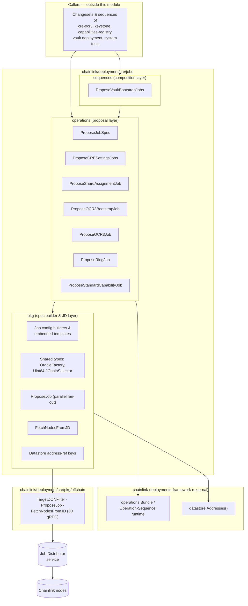
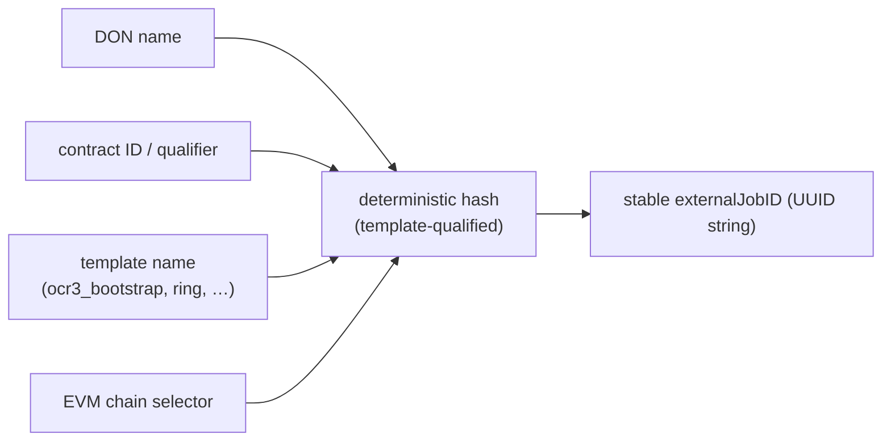
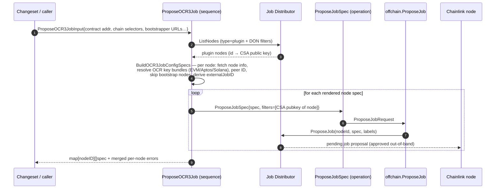
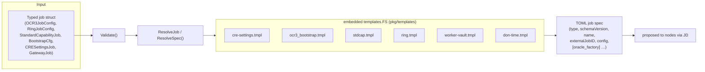

# cre-jobs — CRE Job Proposal Layer

> Module path: `github.com/smartcontractkit/chainlink/deployment/cre/jobs` (part of the `chainlink/deployment` Go module, see `chainlink/deployment/go.mod`)

## 1. Purpose & Overview

The `cre-jobs` module is the **off-chain job delivery layer** of the [CRE / Keystone Deployment Suite](../CRE___Keystone_Deployment_Suite.md). After a CRE stack's on-chain contracts (OCR3 capability contracts, Capabilities Registry, forwarders, etc.) are deployed by the changesets in sibling modules, each Chainlink node in the DON still needs one or more **job specs** — TOML documents that tell the node which capability to run, which contract to watch/transmit to, and which OCR keys to sign with.

This module closes that gap. It provides, as reusable building blocks of the [chainlink-deployments-framework operations runtime](../Deployment_Framework_Core___Product_Deployments.md):

- **Job spec builders** that render production TOML job specs from embedded Go templates (`pkg/templates/`),
- **Deterministic external job IDs** (hashed from DON name + contract + template + chain selector) that make job proposals idempotent and re-runnable,
- **Node targeting** via Job Distributor (JD) label filters (environment, product, DON membership, node type `bootstrap`/`plugin`, CSA public key, P2P ID),
- **Operations & sequences** that compose the above to propose jobs to every node of a DON through the JD's `ProposeJob` RPC.

A *job proposal* is intentionally asynchronous: the JD stores the proposed spec per node and it is approved/picked up out-of-band (e.g. by ops tooling or the [`jdtestutils.JobApprover`](../Dev,_Test___Simulation_Environments/deployment-environment.md)). Consequently every operation in this module returns the proposed specs as `map[nodeID][]string` rather than a receipt.

### Job types supported

| Job type (TOML `type =`) | Producer | Consumed by nodes as |
|---|---|---|
| `cresettings` | `CRESettingsJob` / `ShardAssignmentJob` (cre-settings.tmpl) | Node-wide CRE settings, incl. shard assignment config |
| `ocr3boot` (bootstrap) | `BootstrapCfg` (ocr3_bootstrap.tmpl) | OCR3 bootstrap nodes |
| OCR3 multichain capability | `OCR3JobConfig` (worker-vault.tmpl & variants) | OCR3 plugin nodes (vault/DKG pipelines) |
| Ring capability | `RingJobConfig` (ring.tmpl) | Ring plugin nodes |
| `standardcapabilities` | `StandardCapabilityJob` (stdcap.tmpl) | Standard capability plugin nodes (EVM/Solana/Stellar chain caps) |
| Gateway | `GatewayJob` (gateway_job.go) | Gateway nodes |
| DON time | don-time.tmpl | DON time capability |

## 2. Architecture

The module is organised in three Go packages that form a strict layering. Upper layers *compose* lower layers; nothing lower depends on anything above it.



### Layer responsibilities

| Package | Role | Details |
|---|---|---|
| `operations` | One proposal unit per job family; validates inputs, resolves nodes/specs and delegates the actual proposal to `ProposeJobSpec`. | See [cre-jobs_operations.md](cre-jobs/cre-jobs_operations.md) |
| `pkg` | Spec rendering (embedded `templates.FS`), deterministic external job IDs, per-node OCR config resolution, JD node fetching, datastore address-ref helpers, YAML/TOML-tolerant numeric types. | See [cre-jobs_spec-builder.md](cre-jobs/cre-jobs_spec-builder.md) |
| `sequences` | Multi-step compositions of operations (e.g. bootstrap jobs for the Vault plugin **and** DKG contracts). | See [cre-jobs_sequences.md](cre-jobs/cre-jobs_sequences.md) |

## 3. Core Concepts

### 3.1 Operation vs Sequence

Built on `chainlink-deployments-framework/operations`:

- `operations.NewOperation[I, O, D]` — a single unit of reportable work (`ProposeJobSpec`, `ProposeCRESettingsJobs`, `ProposeShardAssignmentJob`, `ProposeOCR3BootstrapJob`).
- `operations.NewSequence[I, O, D]` — a multi-step unit that fans out to operations (`ProposeOCR3Job`, `ProposeRingJob`, `ProposeStandardCapabilityJob`, `ProposeVaultBootstrapJobs`).

All of them receive an `operations.Bundle` (context, logger, reporter) and a `Deps{Env cldf.Environment}` struct, and produce operation reports that callers can assert on in tests.

### 3.2 Deterministic external job IDs

External job IDs are derived, not random (`pkg.ExternalJobID` family):



- OCR3 bootstrap: `BootstrapExternalJobID(donName + "-bootstrap", contractID, "ocr3_bootstrap", evmChainSel)`.
- Re-proposing the same job therefore yields the same ID, making proposals idempotent.
- `ProposeStandardCapabilityJob` additionally *looks up existing jobs by name* on the node (including a legacy `evm-capabilities-v2` name variant) and reuses their external job IDs instead of generating new ones — preventing duplicate capability jobs on upgrades.

### 3.3 Node targeting via JD filters

`ProposeJobSpec` translates an input into a `nodeapiv1.ListNodesRequest_Filter`:

- **Node type**: `type = bootstrap` or `type = plugin` (constants `BootstrapNodeTypeKey` / `PluginNodeType`).
- **DON scope**: caller-provided `[]offchain.TargetDONFilter` (label key/value pairs, e.g. `don-<name>` exists, `environment`, `product`).
- **Single-node pinning**: OCR3/Ring/StdCap sequences re-target each rendered spec to exactly one node via its CSA public key (`offchain.FilterKeyCSAPublicKey`) or P2P peer ID.
- `offchain.ProposeJob` always ANDs in `product` and `environment` selectors and requires nodes to be `Enabled`.

### 3.4 Output contract

Every operation/sequence returns:

```go
type *Output struct {
    Specs map[string][]string // node ID -> proposed TOML specs
}
```

Per-node failures inside the OCR3/Ring sequences are **accumulated, not fatal** (`errors.Join` / merged error) so one bad node doesn't block proposals to the rest of the DON.

## 4. Proposal Flow (typical: `ProposeOCR3Job`)



The **`ProposeStandardCapabilityJob`** flow is richer: it validates the job, matches provided per-node TOML configs against the DON node list exactly, optionally generates a per-node `OracleFactory` (from datastore address refs for the OCR3 contract or Capabilities Registry plus the node's per-chain OCR signing config), reuses existing external job IDs when a chain-cap job already exists on the node, and finally proposes **one spec per node**. See [cre-jobs_operations.md](cre-jobs/cre-jobs_operations.md).

The **`ProposeVaultBootstrapJobs`** sequence composes two `ProposeOCR3BootstrapJob` runs after resolving `<prefix>_plugin` and `<prefix>_dkg` contract addresses from the deployment datastore. See [cre-jobs_sequences.md](cre-jobs/cre-jobs_sequences.md).

## 5. Specification Rendering Pipeline



Notes:

- `cre-settings.tmpl` embeds the caller's TOML `settings` blob plus a SHA-256 `hash` of it and a **fixed external job UUID** — there is exactly one CRESettings job per node (`8561c20c-…`), and one shard-assignment job (`a3f8c1d2-…`).
- `stdcap.tmpl` conditionally emits the `[oracle_factory]` block (bootstrap peers, OCR contract address, key bundle ID, chain ID, transmitter ID, and multi-chain `onchainSigningStrategy.config` map keyed by chain family: `evm`, `aptos`, `solana`, `stellar`).
- `pkg/types.go` defines `Int`/`Uint64`/`ChainSelector` wrappers that accept numerics or quoted strings (post environment-variable substitution) in YAML/JSON/TOML so pipeline configs can be templated safely.

## 6. Sub-module Documentation

| Sub-module | Page | Contents |
|---|---|---|
| Job proposal operations | [cre-jobs_operations.md](cre-jobs/cre-jobs_operations.md) | All seven `operations`-package entry points, inputs/outputs, targeting and error semantics |
| Spec builder & JD layer (`pkg`) | [cre-jobs_spec-builder.md](cre-jobs/cre-jobs_spec-builder.md) | Job config structs, embedded templates, external job ID derivation, node fetching, address-ref helpers |
| Proposal sequences | [cre-jobs_sequences.md](cre-jobs/cre-jobs_sequences.md) | `ProposeVaultBootstrapJobs` composition |

## 7. Related Modules

- [CRE / Keystone Deployment Suite](../CRE___Keystone_Deployment_Suite.md) — parent module group; the changesets that call these operations.
- [cre-ocr3](cre-ocr3.md) — deploys/configures the OCR3 & Vault contracts whose addresses feed the job specs proposed here.
- [cre-capabilities-registry](cre-capabilities-registry.md) — deploys the Capabilities Registry referenced by `GetCapRegAddressRefKey` for standard-capability oracle factories.
- [cre-core](cre-core.md) — shared offchain/JD integration (`cre/pkg/offchain`), DON configuration and node registration.
- [cre-forwarder](cre-forwarder.md) — forwarder contracts that OCR3 transmitter jobs write through.
- [Node Platform Services / job_service](../Node_Platform_Services/job_service.md) — the node-side job domain model, spawner and ORM that eventually consume approved job specs.
- [Deployment Framework Core & Product Deployments](../Deployment_Framework_Core___Product_Deployments.md) — the operations/sequence runtime, datastore and changeset conventions this module builds on.
- [Dev, Test & Simulation Environments](../Dev,_Test___Simulation_Environments/deployment-environment.md) — `jdtestutils.JobApprover` and CRE environment tooling used to approve the proposals this module creates.

## 8. Build & Test Context

The package lives in the `github.com/smartcontractkit/chainlink/deployment` Go module (`chainlink/deployment/go.mod`), which pins the `chainlink/v2` root via a local `replace` directive. Tests co-located with the code (`propose_std_cap_job_test.go`, `propose_gateway_job_test.go`, `pkg/*_test.go`, `types/*_test.go`) exercise spec rendering and proposal flows against fake JD clients, so behaviour changes here are covered without spinning up real nodes.
