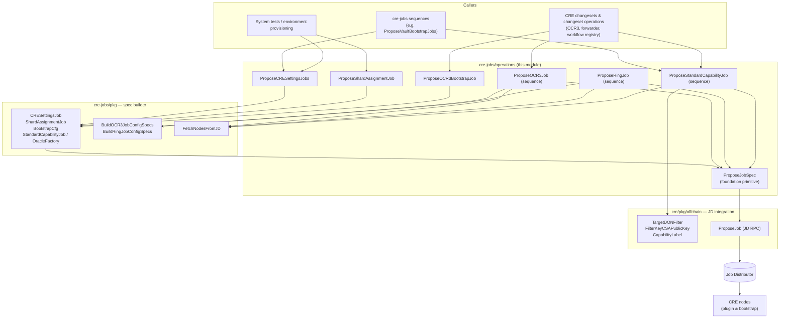
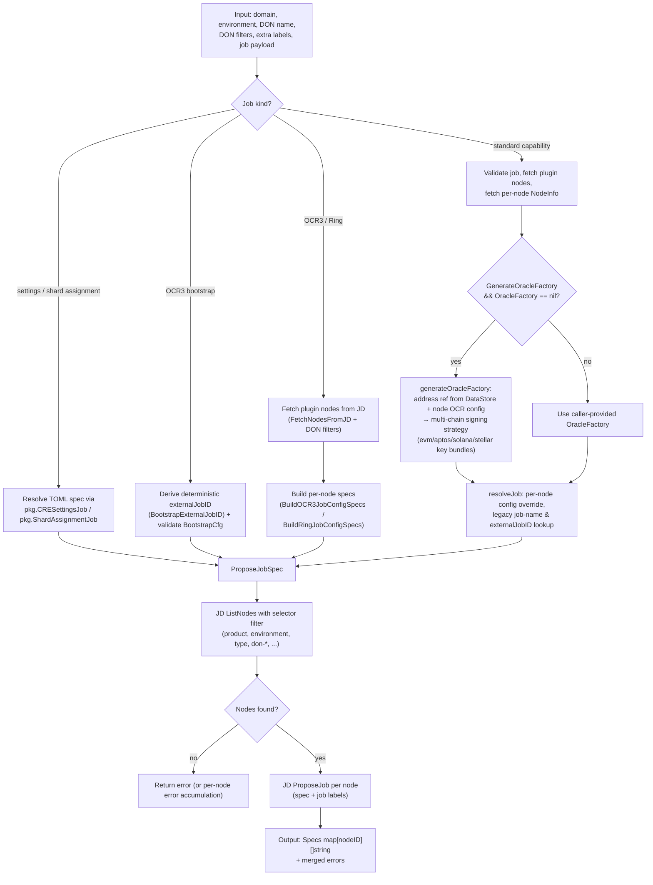
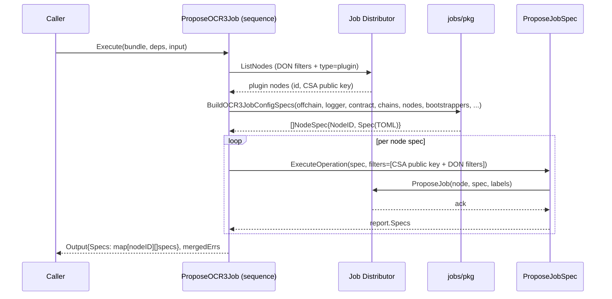
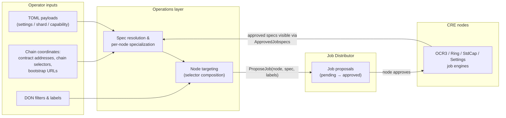

# cre-jobs — Operations (`chainlink/deployment/cre/jobs/operations`)

The **operations** package is the executable layer of the CRE job-proposal pipeline. It turns declarative inputs (TOML job settings, chain/DON coordinates, node filters) into concrete job-spec proposals that are pushed to CRE nodes through the **Job Distributor (JD)**. It sits between the high-level [sequences](cre-jobs_sequences.md) and the low-level [spec builder](cre-jobs_spec-builder.md) package (`chainlink/deployment/cre/jobs/pkg`) and the JD RPC integration in `chainlink/deployment/cre/pkg/offchain`.

All operations are built on the `chainlink-deployments-framework/operations` primitives (`NewOperation`, `NewSequence`, `ExecuteOperation`, `Bundle`) — the same framework used across the [Deployment Framework Core](../../Deployment_Framework_Core___Product_Deployments.md) — which gives every step a stable ID, a semantic version, structured inputs/outputs, and composable execution reports.

> Parent module: [cre-jobs](../cre-jobs.md) · Suite: [CRE / Keystone Deployment Suite](../../CRE___Keystone_Deployment_Suite.md)

---

## 1. Purpose and Core Functionality

This module answers one question: *given a deployment environment and a set of nodes, how do we get the right job spec onto the right nodes?*

Concretely, it provides seven versioned units of work:

| ID | Kind | Purpose |
|---|---|---|
| `propose-job-spec-op` (v1.0.0) | Operation | **Foundation primitive.** Proposes a raw TOML job spec to the JD for a filtered set of nodes (bootstrap vs. plugin selection built in). |
| `propose-cre-settings-job-op` (v1.0.0) | Operation | Resolves a `pkg.CRESettingsJob` from a TOML settings blob and proposes it via `ProposeJobSpec`. |
| `propose-shard-assignment-job-op` (v1.0.0) | Operation | Resolves a `pkg.ShardAssignmentJob` and proposes it via `ProposeJobSpec`. |
| `propose-ocr3-bootstrap-job-op` (v1.0.0) | Operation | Derives a deterministic external job ID, builds and validates a `pkg.BootstrapCfg`, and proposes the bootstrap job to **bootstrap** nodes. |
| `propose-ocr3-job-seq` (v1.0.0) | Sequence | Fetches plugin nodes from the JD, builds **per-node OCR3 job specs** (`pkg.BuildOCR3JobConfigSpecs`), and proposes each spec scoped to exactly one node (by CSA public key). Fault-tolerant. |
| `propose-ring-job-seq` (v1.0.0) | Sequence | Same pattern as OCR3 but for Ring jobs (`pkg.BuildRingJobConfigSpecs`, including shard-config wiring). Fault-tolerant. |
| `propose-standard-capability-job-seq` (v1.0.0) | Sequence | The richest flow: validates the `pkg.StandardCapabilityJob`, discovers DON nodes, optionally **generates an `OracleFactory`** (multi-chain OCR signing strategy), reuses existing `externalJobID`s for idempotency, and proposes **one unique spec per node**. Fails fast. |

Every operation returns the same output shape — `Specs map[string][]string` mapping **node ID → proposed specs** — so callers (sequences, changesets, test harnesses) can uniformly verify what was proposed where.

---

## 2. Architecture

The package is a thin orchestration layer. All spec content is produced by the [spec builder](cre-jobs_spec-builder.md); all node discovery and RPC delivery is handled by the JD integration layer ([cre-core — offchain/JD](../cre-core/cre-core_offchain-jd.md)).



**Layering rules**

- Operations never talk to the JD directly for proposal delivery — `ProposeJobSpec` delegates to `pkg.ProposeJob` (backed by `offchain.ProposeJob`, see [cre-core_offchain-jd](../cre-core/cre-core_offchain-jd.md)).
- Sequences may query the JD directly for *discovery* (`pkg.FetchNodesFromJD`, `offchain.FetchNodesFromJD`, `deployment.NodeInfo`) but still route every mutation through `ProposeJobSpec`, keeping a single auditable proposal path.
- Spec *content* always originates from `cre-jobs/pkg` types/templates — operations only assemble inputs and target nodes.

---

## 3. Operation Lifecycle and Process Flow

All seven units follow the same skeleton, specialized by the kind of job:



### 3.1 Targeting model (node selectors)

Jobs are scoped to nodes purely through JD label selectors. `ProposeJobSpec` always injects `product` and `environment` filters (enforced by `pkg.ProposeJobRequest.Validate`); the callers add the rest:

| Selector key | Injected by | Meaning |
|---|---|---|
| `product` = domain | always | Product domain (e.g. `cre`) |
| `environment` | always | Target environment name |
| `type` = `plugin` / `bootstrap` | `ProposeJobSpec` via `IsBootstrap` | Node class — bootstrap jobs never land on plugin nodes and vice versa |
| `type` = `plugin` (forced) | `ProposeOCR3Job`, `ProposeRingJob` | OCR3/Ring jobs target only plugin nodes |
| `don-&lt;DONName&gt;` `EXIST` | `ProposeStandardCapabilityJob` | Node membership in the DON |
| `p2p_id` = peer ID | `ProposeStandardCapabilityJob` | Pin a spec to a single node |
| CSA public key (`offchain.FilterKeyCSAPublicKey`) | `ProposeOCR3Job`, `ProposeRingJob` | Pin a per-node spec to exactly the node whose CSA key pairs with it |

Additional `offchain.TargetDONFilter{Key, Value}` entries from the caller's `DONFilters` are merged on top (`AddToFilter` / `AddToFilterIfNotPresent`), enabling environment-wide curation (e.g. staging subsets of a DON).

---

## 4. Operation Reference

### 4.1 `ProposeJobSpec` — the foundation primitive

```go
ProposeJobSpec = operations.NewOperation[ProposeJobSpecInput, ProposeJobSpecOutput, ProposeJobSpecDeps](
    "propose-job-spec-op", semver.MustParse("1.0.0"), "Propose Job Spec", ...)
```

- **Input:** `Spec` (TOML), `Domain`, `Environment`, `DONName`, `DONFilters`, `JobLabels`, `IsBootstrap`.
- **Behavior:** builds a `pkg.ProposeJobRequest`, selects node class via a `type` selector (`BootstrapNodeTypeKey` = `"bootstrap"` vs `PluginNodeType` = `"plugin"`), appends caller `DONFilters`, and executes the JD proposal through `pkg.ProposeJob`.
- **Output:** `Specs map[string][]string` from the JD report.
- All other operations in this package are composed on top of it via `operations.ExecuteOperation(b, ProposeJobSpec, ProposeJobSpecDeps(deps), ...)`.

### 4.2 Simple settings operations

**`ProposeCRESettingsJobs`** and **`ProposeShardAssignmentJob`** are near-identical adapters:

1. Wrap the raw TOML payload (`input.Settings` / `input.ShardAssignment`) in `pkg.CRESettingsJob` / `pkg.ShardAssignmentJob` (see [spec builder](cre-jobs_spec-builder.md)).
2. Call `ResolveJob()` to expand the payload into a full job spec.
3. Delegate to `ProposeJobSpec` with the caller's domain, environment, DON and filters.

These jobs are environment-level configuration (CRE settings, shard assignment) rather than oracle plumbing, so they target whatever node set the DON filters select — no node-class override.

### 4.3 `ProposeOCR3BootstrapJob`

Bootstrap jobs are the seeds of an OCR3 network: they tell bootstrap nodes where the OCR3 contract lives.

1. Compute a **deterministic external job ID** from `(DONName, ContractID, ChainSelectorEVM)` via `pkg.BootstrapExternalJobID` — re-running the operation yields a stable job identity.
2. Map `ChainSelectorEVM` to a chain ID with `chainsel.GetChainIDFromSelector`.
3. Build and validate `pkg.BootstrapCfg{JobName, ExternalJobID, ContractID, ChainID}` (default job name: `"OCR3 MultiChain Capability Bootstrap"`).
4. Resolve the spec (`cfg.ResolveSpec()`) and propose via `ProposeJobSpec` with **`IsBootstrap: true`**, so only bootstrap nodes receive it.

Typically paired with the [cre-ocr3](../cre-ocr3.md) contract deployment operations, which produce the `ContractID`.

### 4.4 `ProposeOCR3Job` (sequence)

OCR3 worker jobs must be **unique per node** (each embeds the node's identity), so this is a sequence, not an operation:



Key behaviors:

- **Per-node pinning:** each proposal is filtered by the node's CSA public key, so exactly one node receives each spec.
- **Fault tolerance:** a failed proposal for one node does **not** abort the sequence — the error is accumulated (`mergedErrs`) and iteration continues, so a partially healthy DON still gets specs everywhere possible. Output and errors are returned together.
- Optional worker-vault specifics (`DKGContractAddress`, `VaultRequestExpiryDuration` — default `"10s"` —, `Auth0`) feed the [vault](../cre-ocr3.md) OCR3 job template; an explicit `ExternalJobID` overrides the deterministic one.

### 4.5 `ProposeRingJob` (sequence)

Structurally identical to `ProposeOCR3Job`, but delegates to `pkg.BuildRingJobConfigSpecs` and additionally passes `ShardConfigAddr` (the deployed [shard-config contract](../cre-core/cre-core_shard-config.md) address, deployed by [cre-core shard-config operations](../cre-core/cre-core_shard-config.md)). Error accumulation uses `errors.Join(errs...)`.

### 4.6 `ProposeStandardCapabilityJob` (sequence)

Proposes standard-capability jobs (the EVM/Solana/Stellar chain-capability jobs run by the [capabilities runtime](../../Workflow___Capability_Runtime_(CRE_Engine)/core_capabilities_runtime.md)). This is the most involved flow:

```mermaid
sequenceDiagram
    participant C as Caller
    participant S as ProposeStandardCapabilityJob (sequence)
    participant JD as Job Distributor
    participant DS as Env.DataStore
    participant R as resolveJob / generateOracleFactory
    participant P as ProposeJobSpec

    C->>S: Execute(bundle, deps, input)
    S->>S: input.Job.Validate()
    S->>JD: ListNodes (don-&lt;name&gt; EXIST, environment, product, type=plugin)
    JD-->>S: plugin nodes
    alt NodeIDToConfig provided
        S->>S: verify exact 1:1 node/config mapping
    end
    S->>JD: deployment.NodeInfo(nodeIDs)
    JD-->>S: node infos (OCR configs, peer IDs)
    loop per node (NodeInfo)
        alt GenerateOracleFactory and no OracleFactory
            S->>DS: Addresses().Get(GetCapRegAddressRefKey | GetOCR3CapabilityAddressRefKey)
            DS-->>S: contract address ref
            S->>R: generateOracleFactory(env, nodeInfo, job)
            Note over R: multi-chain signing strategy:<br/>evm + optional aptos/solana/stellar<br/>OCR2 key bundles from NodeInfo
            R-->>S: *pkg.OracleFactory
        end
        S->>R: resolveJob(...)
        R->>JD: view.ApprovedJobspecs(node) — legacy-name lookup
        JD-->>R: existing approved job (externalJobID?)
        R-->>S: resolved TOML spec
        S->>P: ExecuteOperation(spec, filters=[p2p_id + DON filters])
        P->>JD: ProposeJob(node, spec, labels[capability=&lt;JobName&gt;])
        JD-->>P: ack
    end
    S-->>C: Output{Specs}
```

Highlights:

- **Strict node/config validation:** if `NodeIDToConfig` is set, its keys must match the DON's node set exactly (count and membership), otherwise the sequence errors out — per-node overrides can't silently skip or invent nodes.
- **Oracle factory generation** (`generateOracleFactory`):
  - `MinimalOracleFactory` → minimal `{Enabled: true}` config.
  - Otherwise resolves the OCR3/capability-registry contract address from the deployment `DataStore` (`pkg.GetCapRegAddressRefKey` honoring `CapRegVersion`, or `pkg.GetOCR3CapabilityAddressRefKey`), validates chain-selector consistency, and derives chain ID via `chain-selectors`.
  - Builds a multi-chain on-chain signing strategy: the EVM key bundle is mandatory; Aptos/Solana/Stellar bundles are added when their chain selectors are provided. `OCRSigningStrategy` defaults to `"multi-chain"`.
  - The transmitter and key-bundle IDs come from `nodeInfo.OCRConfigForChainSelector` — i.e., from keys the node already registered with the JD.
- **Idempotency via spec lookup:** `lookupChainCapJobByName` fetches a node's *approved* jobspecs (`view.ApprovedJobspecs`) and, if a job with the current name (or its **legacy** name — the shortened `evm-cap-v2` prefix replacing `evm-capabilities-v2`) already exists, reuses its `externalJobID` instead of generating a new one. This makes re-proposals stable and upgrades from long job names safe.
- **One spec per node:** unlike OCR3/Ring (spec built per node up-front), StdCap resolves one spec per `NodeInfo` iteration and pins it via the `p2p_id` selector. It **fails fast** — any proposal error aborts the sequence (contrast with §4.4/4.5).
- Jobs are labeled with `offchain.CapabilityLabel = JobName` plus the caller's `ExtraLabels`, which downstream tooling (e.g. the workflow registry's [capabilities pickup](../cre-workflow-registry.md)) can key off.

---

## 5. Error Handling Semantics

| Unit | On per-node proposal failure |
|---|---|
| `ProposeJobSpec` | Delegates error aggregation to `pkg.ProposeJob` — errors for all targeted nodes are joined; the proposal attempt continues across nodes. |
| `ProposeCRESettingsJobs`, `ProposeShardAssignmentJob`, `ProposeOCR3BootstrapJob` | Fail fast (single `ProposeJobSpec` call). |
| `ProposeOCR3Job`, `ProposeRingJob` | **Continue**: collect per-node errors (`mergedErrs` / `errors.Join`) and still return successfully-proposed specs. |
| `ProposeStandardCapabilityJob` | **Fail fast** on the first proposal error. |

Discovery failures (no nodes found for the DON/filter combination) always abort with a descriptive error, since proposing to an empty node set is never meaningful.

---

## 6. Dependencies

| Dependency | Role | Documented in |
|---|---|---|
| `chainlink-deployments-framework/operations` | Operation/Sequence primitives, `Bundle`, reports | [Deployment Framework Core](../../Deployment_Framework_Core___Product_Deployments.md) |
| `chainlink-deployments-framework/deployment` (`cldf.Environment`) | Environment handle: `Offchain` client, `Logger`, `DataStore` (address refs) | [Deployment Framework Core](../../Deployment_Framework_Core___Product_Deployments.md) |
| `chainlink/deployment/cre/jobs/pkg` | Job spec types, templates, spec builders, `FetchNodesFromJD`, `ProposeJobRequest` | [cre-jobs spec-builder](cre-jobs_spec-builder.md) |
| `chainlink/deployment/cre/pkg/offchain` | `TargetDONFilter`, selector constants, JD RPC (`ProposeJob`, node listing) | [cre-core — offchain/JD](../cre-core/cre-core_offchain-jd.md) |
| `chainlink-protos/job-distributor` (v1) | gRPC contracts: `ListNodesRequest_Filter`, `ProposeJobRequest`, selectors, labels | — |
| `smartcontractkit/chain-selectors` | Chain selector ↔ chain ID resolution | — |
| `job-distributor` node proto types | Bootstrap/plugin node classification | — |

Module wiring lives in `chainlink/deployment/go.mod` (module `github.com/smartcontractkit/chainlink/deployment`), which pins `chainlink-deployments-framework v0.123.3`, `chainlink-protos/job-distributor v0.20.1`, and `chain-selectors v1.0.112`.

**Cross-module relationships**

- **Consumers:** [cre-jobs sequences](cre-jobs_sequences.md) (e.g. `ProposeVaultBootstrapJobs` composes `ProposeOCR3Job` + `ProposeOCR3BootstrapJob`), the [cre-ocr3](../cre-ocr3.md) and [cre-forwarder](../cre-forwarder.md) change flows, and the CRE [system tests](../../Dev,_Test___Simulation_Environments/system-tests.md), which use these operations to wire up DONs during environment provisioning.
- **Contract sources:** contract addresses consumed by `generateOracleFactory` come from the DataStore address refs written by [cre-capabilities-registry](../cre-capabilities-registry.md) deployments and OCR3 contract deployments ([cre-ocr3](../cre-ocr3.md)); bootstrap URLs come from the OCR3 bootstrap jobs proposed by this very module (circular pairing: bootstrap job → worker job).
- **Domain context:** the OCR2/OCR3 key bundles referenced by the signing strategies are the same key concepts documented in the node's [keystore](../../Node_Platform_Services/keystore.md) and the OCR engines ([Oracle Engines](../../Oracle_Engines___Data_Pipelines/ocr.md)).

---

## 7. Data Flow Summary



The feedback loop on the bottom (approved specs → `lookupChainCapJobByName`) is what keeps `externalJobID`s stable across repeated deployments — proposals are declarative and convergent rather than append-only.

---

## 8. Extension Notes for Maintainers

- **Adding a new job type:** add the spec builder to `cre-jobs/pkg` (template + `Resolve`), then either (a) a thin `Operation` wrapping `ProposeJobSpec` if the spec is DON-wide, or (b) a `Sequence` in this package if the spec is per-node. Follow the OCR3/Ring pattern for fault tolerance and the StdCap pattern for idempotent external job IDs.
- **Version discipline:** every unit carries a semver; bump it when input/output shapes or targeting semantics change, since the deployment framework records these versions in execution reports.
- **Selector additions:** new node-targeting dimensions should reuse `offchain.TargetDONFilter` rather than ad-hoc selectors so they compose with every operation's filter chain automatically.
