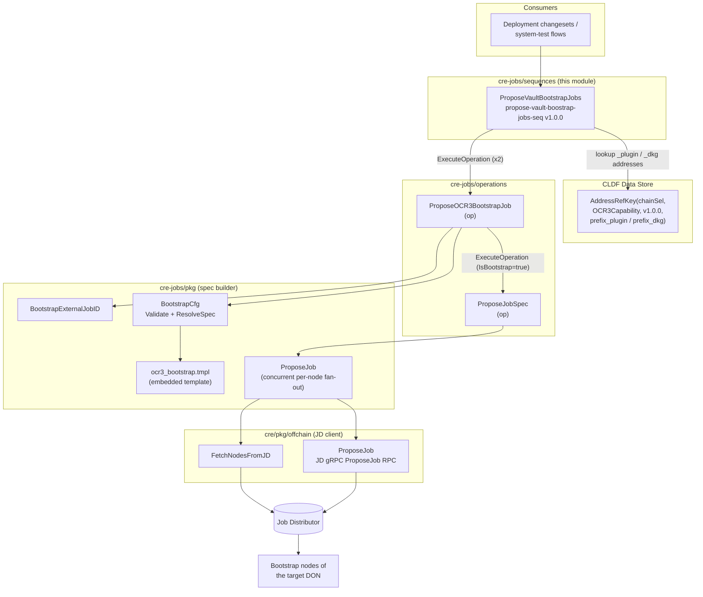
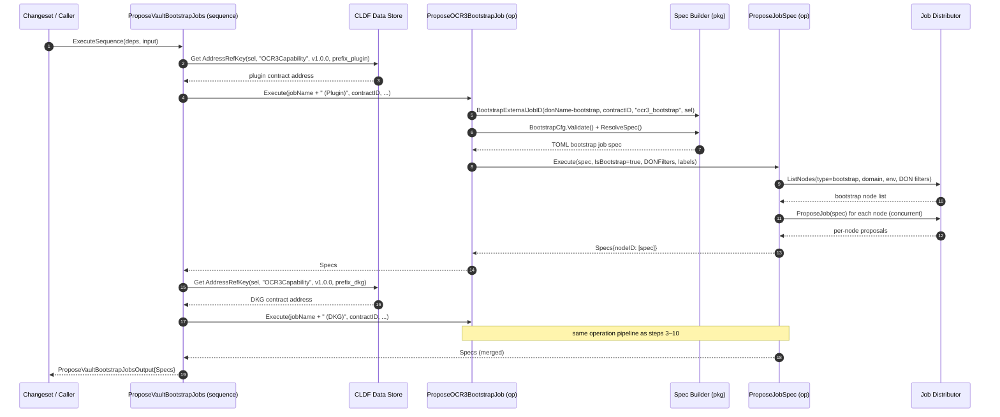
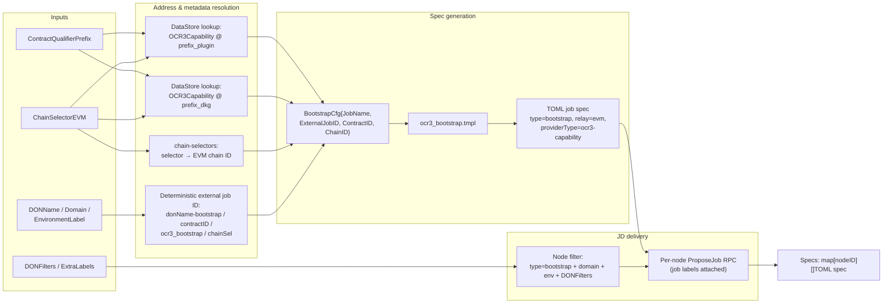

# CRE Jobs — Sequences

> **Module path:** `chainlink/deployment/cre/jobs/sequences`
> **Parent:** [cre-jobs](../cre-jobs.md) · **Suite:** [CRE & Keystone Deployment Suite](../../CRE___Keystone_Deployment_Suite.md)

## 1. Introduction

The `cre-jobs_sequences` module is the **sequence layer** of the CRE jobs deployment package. In the [Chainlink Deployments Framework (CLDF)](../../Deployment_Framework_Core___Product_Deployments/deployment-common.md) execution model, a **sequence** is a named, versioned orchestration unit that composes one or more atomic **operations** into a higher-level, reusable deployment step.

This module currently exposes a single sequence:

| Sequence ID | Version | Purpose |
|---|---|---|
| `propose-vault-boostrap-jobs-seq` | `1.0.0` | Proposes **OCR3 bootstrap jobs** to the bootstrap nodes of a target DON for both Vault OCR3 contracts (the **Plugin** and **DKG** contracts) via the Job Distributor (JD). |

Unlike the lower-level operations in [cre-jobs operations](cre-jobs_operations.md), which each perform a single unit of work (propose one job spec), this sequence bundles the two bootstrap-job proposals required by the Vault capability and guarantees that both contracts' bootstrap jobs are proposed in one atomic, reproducible step.

---

## 2. Core Component: `ProposeVaultBootstrapJobs`

```go
var ProposeVaultBootstrapJobs = operations.NewSequence(
    "propose-vault-boostrap-jobs-seq",
    semver.MustParse("1.0.0"),
    "Propose Vault Bootstrap Jobs",
    func(b operations.Bundle, deps ProposeVaultBootstrapJobsDeps, input ProposeVaultBootstrapJobsInput) (ProposeVaultBootstrapJobsOutput, error)
)
```

### 2.1 Dependencies (`ProposeVaultBootstrapJobsDeps`)

| Field | Type | Description |
|---|---|---|
| `Env` | `cldf.Environment` | The CLDF deployment environment providing the Job Distributor offchain client, logger, and the **data store** used for on-chain address resolution. |

### 2.2 Input (`ProposeVaultBootstrapJobsInput`)

| Field | Type | Description |
|---|---|---|
| `DONName` | `string` | Name of the target DON whose bootstrap nodes receive the jobs. |
| `Domain` | `string` | Product/domain label used to filter nodes in JD. |
| `ContractQualifierPrefix` | `string` | Prefix used to build the two contract qualifiers: `<prefix>_plugin` and `<prefix>_dkg`. Must match the qualifiers written by the OCR3 deployment sequence (see [cre-ocr3](../cre-ocr3.md)). |
| `EnvironmentLabel` | `string` | Environment label (e.g. `staging`, `testnet`, `mainnet`) used for node filtering. |
| `ChainSelectorEVM` | `uint64` | EVM chain selector of the chain hosting the Vault OCR3 contracts. |
| `JobName` | `string` | Optional base job name. The sequence appends `" (Plugin)"` / `" (DKG)"` to it. If empty, the resulting names are `" (Plugin)"` / `" (DKG)"` — see §7 (quirks). |
| `DONFilters` | `[]offchain.TargetDONFilter` | Extra label filters (`don_name`, CSA keys, custom labels) applied to node selection in JD. See [cre-core offchain-jd](../cre-core/cre-core_offchain-jd.md). |
| `ExtraLabels` | `map[string]string` | Labels attached to the proposed job objects in JD. |

### 2.3 Output (`ProposeVaultBootstrapJobsOutput`)

| Field | Type | Description |
|---|---|---|
| `Specs` | `map[string][]string` | Map of **JD node ID → list of proposed TOML job specs**. Each of the two sub-proposals contributes one spec per node; the sequence appends both into a single map. |

---

## 3. Architecture

The sequence is a thin composition layer. It resolves contract addresses from the CLDF data store, then reuses the bootstrap-job **operation** from `cre-jobs/operations`, which in turn uses the spec builders from `cre-jobs/pkg` (the [spec-builder module](cre-jobs_spec-builder.md)) and the JD client helpers from the offchain package ([cre-core offchain-jd](../cre-core/cre-core_offchain-jd.md)).



**Contract-address producers:** the OCR3 contracts referenced here are deployed and registered in the data store by the [cre-ocr3](../cre-ocr3.md) module (e.g. the `DeployVault` sequence deploys the plugin and DKG contracts with qualifiers `<prefix>_plugin` / `<prefix>_dkg`, using the same prefix convention).

---

## 4. Execution Flow



### Step details

1. **Plugin address resolution.** The sequence builds `GetOCR3CapabilityAddressRefKey(chainSelectorEVM, "<prefix>_plugin")` — a `datastore.AddressRefKey` keyed by `(chainSelector, type="OCR3Capability", version=1.0.0, qualifier)` — and fetches the address from `Env.DataStore.Addresses()`. A missing reference aborts the sequence immediately.
2. **Plugin bootstrap proposal.** Executes `ProposeOCR3BootstrapJob` with `JobName: input.JobName + " (Plugin)"` and copies all fields (`Domain`, `DONName`, `EnvironmentLabel`, `ChainSelectorEVM`, `DONFilters`, `ExtraLabels`).
3. **DKG address resolution.** Same lookup with qualifier `<prefix>_dkg`.
4. **DKG bootstrap proposal.** Executes `ProposeOCR3BootstrapJob` with `JobName: input.JobName + " (DKG)"`.
5. **Output merge.** Both operations' `Specs` maps are merged: per node ID, specs are appended; `nil` slices are normalized to empty slices before appending. Note the merge is not defensive against `nil` maps in `r1.Output.Specs` — it relies on operations always returning initialized maps.

---

## 5. Data Flow



The rendered bootstrap spec (`chainlink/deployment/cre/jobs/pkg/templates/ocr3_bootstrap.tmpl`) is:

```toml
type = "bootstrap"
schemaVersion = 1
name = "{{ .JobName }}"
externalJobID = "{{ .ExternalJobID }}"
contractID = "{{ .ContractID }}"
contractConfigTrackerPollInterval = "1s"
contractConfigConfirmations = 1
relay = "evm"

[relayConfig]
chainID = {{ .ChainID }}
providerType = "ocr3-capability"
```

---

## 6. Dependencies

### Internal module dependencies

| Dependency | Role | Documentation |
|---|---|---|
| `chainlink/deployment/cre/jobs/operations` | Provides `ProposeOCR3BootstrapJob` and `ProposeJobSpec` operations executed by this sequence. | [cre-jobs operations](cre-jobs_operations.md) |
| `chainlink/deployment/cre/jobs/pkg` | Spec builders (`BootstrapCfg`, `BootstrapExternalJobID`), embedded TOML templates, address-ref key helpers, and the JD-aware `ProposeJob` fan-out. | [cre-jobs spec-builder](cre-jobs_spec-builder.md) |
| `chainlink/deployment/cre/pkg/offchain` | `TargetDONFilter`, `FetchNodesFromJD`, low-level `ProposeJob` against the JD gRPC API. | [cre-core offchain-jd](../cre-core/cre-core_offchain-jd.md) |
| `chainlink/deployment/cre/ocr3/...` | Upstream producer of the `OCR3Capability` addresses (plugin/DKG) this sequence consumes. | [cre-ocr3](../cre-ocr3.md) |

### External dependencies

All resolved via the `chainlink/deployment` Go module (`chainlink/deployment/go.mod`):

| Package | Purpose |
|---|---|
| `github.com/smartcontractkit/chainlink-deployments-framework v0.123.3` | `operations.NewSequence` / `ExecuteOperation`, `deployment.Environment`, `datastore.AddressRefKey`. |
| `github.com/smartcontractkit/chain-selectors` | Chain-selector → EVM chain-ID resolution. |
| `github.com/smartcontractkit/chainlink-protos/job-distributor` | JD node/job gRPC API types (`ListNodesRequest_Filter`, selectors, labels). |

---

## 7. Behavioral Notes, Error Handling & Known Quirks

**Error handling — fail fast, no partial-merge recovery:**

- Missing plugin or DKG address references abort the sequence **before** any proposal is made (lookup errors are wrapped with chain selector and qualifier context).
- Operation failures from either sub-proposal abort the sequence; already-proposed jobs from a prior step are **not rolled back**. Callers should treat the sequence as re-runnable: because external job IDs are deterministic (`pkg.BootstrapExternalJobID` derives them from `DONName + "-bootstrap"`, contract ID, job type, and chain selector), re-running produces the same job identities and JD upserts rather than duplicates.

**Known quirks (worth knowing when maintaining this file):**

1. **Sequence ID typo is intentional.** The ID `propose-vault-boostrap-jobs-seq` contains `boostrap` and carries a `// typos:ignore` comment (enforced by `chainlink/_typos.toml`). Renaming would change reporting identity; fix only with a coordinated migration.
2. **DKG error message references the wrong qualifier.** The DKG lookup error wraps `pluginContractQualifier` instead of `dkgContractQualifier`, and its message text says *"failed to propose Vault Plugin bootstrap job"* — misleading when debugging DKG steps.
3. **Empty `JobName` produces awkward defaults.** The package-level `DefaultBootstrapJobName` constant is shadowed by the always-applied `input.JobName + suffix` concatenation, so an empty `JobName` yields job names `" (Plugin)"` / `" (DKG)"`. Always pass a base name for clarity.
4. **Output merge normalizes `nil` slices but trusts non-nil maps** returned by the operations.
5. **The rendered spec is EVM-only** (`relay = "evm"`), consistent with the `ChainSelectorEVM` input.

**Node selection semantics:** `ProposeJobSpec` filters JD nodes by `type = "bootstrap"` (because `IsBootstrap: true`), then applies each `offchain.TargetDONFilter` (`don_name` → `don-<name>` existence selector, CSA public keys, or arbitrary label equality). If no node matches, the underlying fan-out fails with a "no nodes found" error.

---

## 8. Usage Example

```go
out, err := operations.ExecuteSequence(
    env.OperationsBundle,
    sequences.ProposeVaultBootstrapJobs,
    sequences.ProposeVaultBootstrapJobsDeps{Env: env},
    sequences.ProposeVaultBootstrapJobsInput{
        DONName:                 "vault-don",
        Domain:                  offchain.ProductLabel,
        ContractQualifierPrefix: "vault",
        EnvironmentLabel:        "testnet",
        ChainSelectorEVM:        chainSel,
        JobName:                 "Vault OCR3 Bootstrap",
        DONFilters:              []offchain.TargetDONFilter{{Key: offchain.FilterKeyDONName, Value: "vault-don"}},
        ExtraLabels:             map[string]string{"capability": "vault"},
    },
)
// out.Output.Specs: map[nodeID][]string — one bootstrap spec per node
// for the plugin contract and one for the DKG contract
```

A typical end-to-end flow is: run `DeployVault` (see [cre-ocr3](../cre-ocr3.md)) to deploy and register the plugin/DKG OCR3 contracts, then run this sequence to distribute the corresponding bootstrap job specs to the DON's bootstrap nodes through JD.

---

## 9. Related Documentation

- [cre-jobs](../cre-jobs.md) — parent module: job proposal operations, sequences, and spec builders.
- [cre-jobs operations](cre-jobs_operations.md) — the atomic operations (`ProposeOCR3BootstrapJob`, `ProposeJobSpec`, `ProposeOCR3Job`, `ProposeStandardCapabilityJob`, …) invoked here.
- [cre-jobs spec-builder](cre-jobs_spec-builder.md) — TOML templates, `BootstrapCfg`, `OracleFactoryConfig`, external-job-ID derivation.
- [cre-core offchain-jd](../cre-core/cre-core_offchain-jd.md) — Job Distributor client helpers and DON filters.
- [cre-ocr3](../cre-ocr3.md) — deployment of the OCR3 plugin/DKG contracts referenced by this sequence.
- [Deployment Framework Core & Product Deployments](../../Deployment_Framework_Core___Product_Deployments/deployment-common.md) — the CLDF changeset/operation/sequence model and shared data store.
- [Workflow & Capability Runtime (CRE Engine)](../../Workflow___Capability_Runtime_(CRE_Engine).md) — the runtime that ultimately consumes OCR3 capability jobs on nodes.
- [Dev, Test & Simulation Environments — system-tests](../../Dev,_Test___Simulation_Environments/system-tests.md) — where CRE vault/job-proposal flows are exercised end-to-end.
