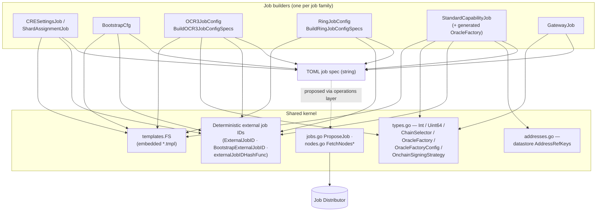
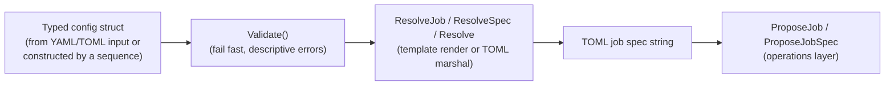
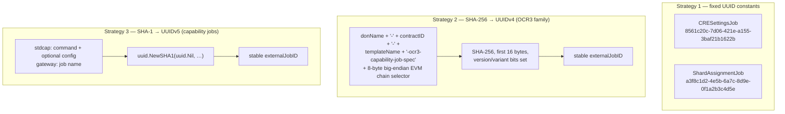
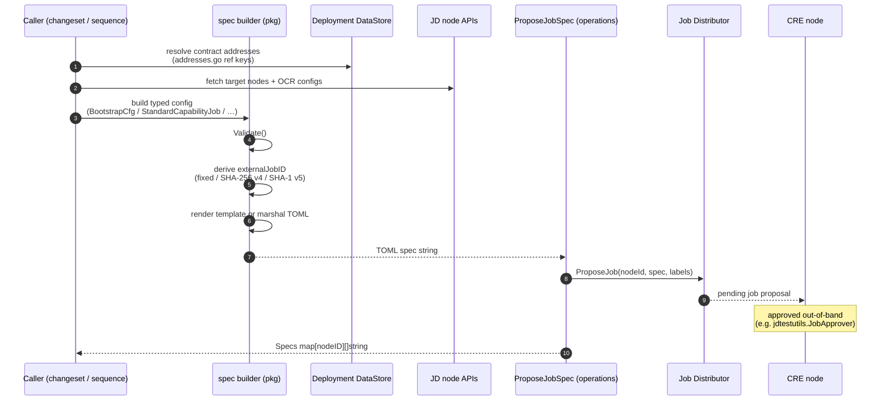
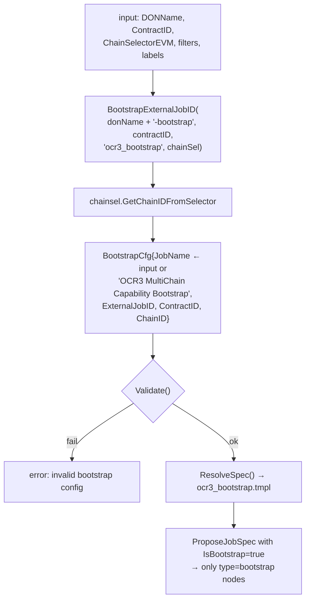
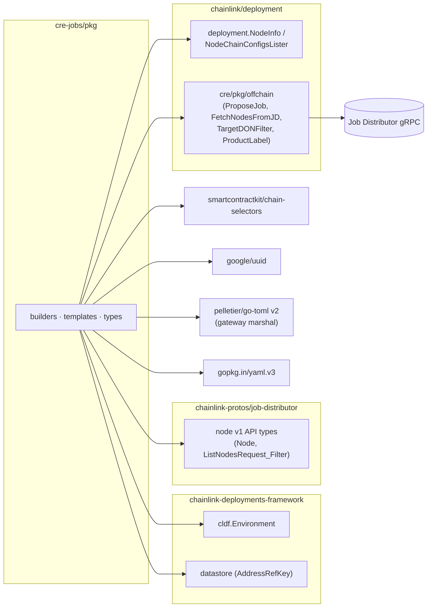

# cre-jobs — Spec Builder (`chainlink/deployment/cre/jobs/pkg`)

> Package path: `github.com/smartcontractkit/chainlink/deployment/cre/jobs/pkg` (part of the `github.com/smartcontractkit/chainlink/deployment` Go module, see `chainlink/deployment/go.mod`)

The **spec builder** is the pure, side-effect-free engine of the [cre-jobs module](../cre-jobs.md). While the [operations layer](cre-jobs_operations.md) decides *where* and *to whom* a job is proposed, and the [sequence layer](cre-jobs_sequences.md) composes multiple proposals, this package decides **what the job looks like**: it holds the typed Go representations of every CRE job family, validates them, derives stable external job IDs, and renders production TOML job specs from templates embedded into the binary.

It has no knowledge of blockchains, RPCs or the Job Distributor (JD) wire protocol beyond thin helper functions — which makes it fully unit-testable and safe to reuse from changesets, system tests and the standalone CRE engine tooling alike.

> Parent module: [cre-jobs](../cre-jobs.md) · Suite: [CRE / Keystone Deployment Suite](../../CRE___Keystone_Deployment_Suite.md)

---

## 1. Purpose and Core Functionality

A Chainlink CRE node only runs work that is described by a **TOML job spec** — a document declaring the job type (`cresettings`, `bootstrap`, `standardcapabilities`, `offchainreporting2`, `gateway`, …), a stable `externalJobID`, the contracts to watch/transmit to, keys, peers and plugin configuration. This package is the single source of truth for producing those documents programmatically. Concretely it provides:

| Capability | Where | Summary |
|---|---|---|
| **Settings job specs** | `cre_settings_job.go` | `CRESettingsJob` / `ShardAssignmentJob` render node-wide CRE settings (including shard-assignment config) from a caller-supplied TOML blob, embedding a SHA-256 integrity hash and a **fixed external job UUID** (exactly one job of each kind per node). |
| **OCR3 bootstrap specs** | `ocr3_bootstrap_job.go` | `BootstrapCfg` validates and renders `ocr3_bootstrap.tmpl` for bootstrap nodes; `BootstrapExternalJobID` derives a deterministic UUID from `(DON name, contract, chain selector)`. |
| **Shared config types** | `types.go` | `OracleFactory` / `OracleFactoryConfig` / `OnchainSigningStrategy` describe the `[oracle_factory]` block of standard-capability jobs; `Int`, `Uint64` and `ChainSelector = Uint64` are numeric wrappers that tolerate *quoted or numeric* literals in YAML/JSON/TOML (essential after environment-variable substitution). |
| **Per-node worker builders** | `ocr3_job.go`, `ring_job.go`, `std_cap.go` | `BuildOCR3JobConfigSpecs` / `BuildRingJobConfigSpecs` / `StandardCapabilityJob` turn JD node info (P2P ID, OCR key bundles, transmitters) into one spec per node. |
| **Gateway specs** | `gateway_job.go` | `GatewayJob` is the only non-template builder — it marshals a richly nested Go struct directly to TOML. |
| **JD proposal fan-out** | `jobs.go` | `ProposeJob` proposes one spec to every node matching a `ListNodesRequest_Filter`, concurrently, accumulating errors. |
| **JD discovery helpers** | `nodes.go` | `FetchNodesFromJD`, `FetchNodeChainConfigsFromJD` (nodes + their chain configs, grouped per node). |
| **Datastore address refs** | `addresses.go` | `GetOCR3CapabilityAddressRefKey`, `GetCapRegAddressRefKey`, forwarder/shard-config keys — the standard way job builders look up deployed contract addresses. |

The defining idiom of the package is the **spec-resolution contract** (§3.1): every job type exposes `Validate()` and a resolver (`ResolveJob` / `ResolveSpec` / `Resolve`) that returns the final TOML string.

---

## 2. Architecture

The package is organised as a **kernel + builders** structure: a tiny shared kernel (templates, types, external-job-ID derivation, JD plumbing) plus one file per job family. Everything ultimately funnels into either a template render or a TOML marshal, and every proposal path goes through `ProposeJob`.



**Design rules**

- Builders are **pure functions of their inputs** — all blockchain lookups (node info, contract addresses) are performed by callers ([operations](cre-jobs_operations.md)) or injected via `deployment.NodeChainConfigsLister`.
- Exactly one delivery primitive exists: `pkg.ProposeJob` → `offchain.ProposeJob` (JD gRPC, see [cre-core — offchain/JD](../cre-core/cre-core_offchain-jd.md)). Nothing else in the package mutates off-chain state.
- Spec *content* semantics (schema versions, default timeouts, rate limiters, handler configs) are owned here so all callers emit identical specs.

---

## 3. Core Concepts

### 3.1 The spec-resolution contract

Every job type follows the same two-method protocol, which is what the operations layer is wired against:



| Job type | Validation notes | Resolver | Template / output |
|---|---|---|---|
| `CRESettingsJob` | none (caller blob) | `ResolveJob()` | `cre-settings.tmpl` |
| `ShardAssignmentJob` | none | `ResolveJob()` | `cre-settings.tmpl` (prefixes `config_type = "shard_assignment"`) |
| `BootstrapCfg` | `JobName`, `ContractID`, `ChainID` required | `ResolveSpec()` | `ocr3_bootstrap.tmpl` |
| `OCR3JobConfig` | identity, keys, bootstrappers required; `worker-ocr3` template **deprecated** (`ErrWorkerOCR3Deprecated`); `worker-vault` requires DKG address, expiry duration, optional Auth0 | `ResolveJob()` | `worker-vault.tmpl` / other `<name>.tmpl` |
| `RingJobConfig` | identity, keys, bootstrappers, `ShardConfigAddr` required | `ResolveJob()` | `ring.tmpl` |
| `StandardCapabilityJob` | `JobName` required; oracle-factory fields validated only when `GenerateOracleFactory` is set (contract qualifier or `CapRegVersion`, chain selector, bootstrap peers) | `Resolve()` | `stdcap.tmpl` |
| `GatewayJob` | name, DONs/Services, timeout ≥ 5 s, port/scheme/CIDR ranges, Auth0-only-on-vault | `Resolve(gatewayNodeIdx)` | direct TOML marshal |

### 3.2 Deterministic external job IDs

External job IDs are **derived, never random**, so re-running a deployment produces identical job identity — this is what makes proposals idempotent and updatable. The package implements three strategies:



| Strategy | Used by | Key inputs | Callers may override? |
|---|---|---|---|
| Fixed UUID constants | `CRESettingsJob`, `ShardAssignmentJob` | none — exactly **one** job per node per kind | no |
| `ExternalJobID` (SHA-256/UUIDv4) | OCR3 worker jobs, `BootstrapExternalJobID` (`"ocr3_bootstrap"` template, donName suffixed with `-bootstrap`) | donName, contract ID, template name, EVM chain selector | yes — `OCR3JobConfigInput.ExternalJobID` |
| `externalJobIDHashFunc` (SHA-1/UUIDv5) | `StandardCapabilityJob` (also: `GatewayJob` derives from job name) | capability `command` + `config` (or job name) | yes — `ExternalJobID` field |

Because chain selectors participate in the hash, the *same* contract on a *different* chain gets a different job ID — collisions across environments are structurally impossible as long as DON names are unique.

### 3.3 Configuration-tolerant numeric types

`types.go` defines `Int`, `Uint64` and the alias `type ChainSelector = Uint64`. Their only job is to accept **either a numeric literal or a quoted string** in YAML/JSON/text, because deployment inputs are frequently produced by env-var templating (`CHAIN_SELECTOR: "16015286602157805033"`) and rendered configs must stay numeric on output (`Auth0.TenantID`, `chainID = {{ .ChainID }}` in `ocr3_bootstrap.tmpl`):

- `Uint64.UnmarshalJSON` — accepts `123`, `"123"`, or an empty payload.
- `Uint64.UnmarshalYAML` / `UnmarshalText` — parse the raw scalar as a base-10 integer.
- **No marshal overrides** — TOML/JSON output remains numeric (e.g. `tenantID` is unquoted in `worker-vault.tmpl`).

`OracleFactory` (YAML-facing, used inside `StandardCapabilityJob` and rendered by `stdcap.tmpl`) and `OracleFactoryConfig` (TOML-facing, used by standalone/ops tooling that reads node TOML) are two views of the same `[oracle_factory]` block:

```go
// YAML view — embedded in stdcap.tmpl output
OracleFactory{ Enabled, BootstrapPeers []string, OCRContractAddress, OCRKeyBundleID,
               ChainID, TransmitterID, OnchainSigningStrategy }
// TOML view — e.g. for ops tooling
OracleFactoryConfig{ Enabled, BootstrapPeers, OCRContractAddress, ChainID, Network }
```

`OnchainSigningStrategy{StrategyName string, Config map[string]string}` carries the multi-chain signing map (chain family → OCR key bundle, e.g. `"evm" → "…"`, `"aptos" → "…"`), rendered as the `[oracle_factory.onchainSigningStrategy.config]` table.

### 3.4 Embedded template inventory

`templates/fs.go` embeds every `*.tmpl` via `//go:embed`; builders parse them with `text/template` + `ParseFS`/`ExecuteTemplate` at resolve time.

| Template | Producer | Key fields rendered |
|---|---|---|
| `cre-settings.tmpl` | `CRESettingsJob`, `ShardAssignmentJob` | `type="cresettings"`, fixed `externalJobID`, SHA-256 `hash`, settings blob |
| `ocr3_bootstrap.tmpl` | `BootstrapCfg` | `type="bootstrap"`, `contractID`, `relayConfig.chainID` (numeric), `providerType="ocr3-capability"` |
| `stdcap.tmpl` | `StandardCapabilityJob` | `type="standardcapabilities"`, `command`, `config`, conditional `[oracle_factory]` + `onchainSigningStrategy.config` |
| `worker-vault.tmpl` | `OCR3JobConfig` | `type="offchainreporting2"`, `pluginType="vault-plugin"`, `pluginConfig.dkg`, optional `[pluginConfig.auth0]` |
| `ring.tmpl` | `RingJobConfig` | ring capability worker spec (incl. shard config) |
| `don-time.tmpl` | DON-time capability | DON time worker spec |

---

## 4. Component Reference

### 4.1 `CRESettingsJob` and `ShardAssignmentJob` (`cre_settings_job.go`)

These wrap a caller-authored TOML settings blob into a `cresettings` job spec. Both share `cre-settings.tmpl`; the differences are the payload prefix and the fixed external job UUID:

```go
// CRESettingsJob — node-wide CRE settings
type CRESettingsJob struct{ Settings string /* toml */ }
// renders: ExternalJobID = 8561c20c-7d06-421e-a155-3baf21b1622b,
//          Hash = hex(sha256(Settings)), Settings = <blob>

// ShardAssignmentJob — shard-assignment config for the workflows engine
type ShardAssignmentJob struct{ ShardAssignment string /* toml */ }
// settings := "config_type = \"shard_assignment\"\n" + blob
// renders: ExternalJobID = a3f8c1d2-4e5b-6a7c-8d9e-0f1a2b3c4d5e,
//          Hash = hex(sha256(settings)), Settings = settings
```

The embedded SHA-256 `hash` lets nodes/tooling verify that the proposed settings match what the deployer intended. Because the UUIDs are constants, proposing twice **replaces** rather than duplicates the job — one CRE-settings and one shard-assignment job per node, ever. Consumed by [`ProposeCRESettingsJobs`](cre-jobs_operations.md) and [`ProposeShardAssignmentJob`](cre-jobs_operations.md); the shard assignment config drives the [workflows sharding](../../Workflow___Capability_Runtime_(CRE_Engine)/workflows/workflows_sharding.md) behaviour on the node.

### 4.2 `BootstrapCfg` and `BootstrapJobInput` (`ocr3_bootstrap_job.go`)

The bootstrap job is the seed of an OCR3 network: it tells *bootstrap* nodes where the OCR3 capability contract lives.

- **`BootstrapJobInput`** — the declarative YAML/JSON shape used by callers: `contractQualifier` (to look up the OCR contract in the deployment datastore) and `chainSelector` (a `Uint64`-tolerant `ChainSelector`).
- **`BootstrapCfg`** — the resolved, validated render model: `JobName`, `ExternalJobID` (generated if empty), `ContractID`, `ChainID`. `Validate()` rejects empty name/contract/chain; `ResolveSpec()` renders `ocr3_bootstrap.tmpl`.
- **`BootstrapExternalJobID(donName, contractID, evmChainSel)`** — delegates to the shared `ExternalJobID` with the template name hard-coded to `"ocr3_bootstrap"` and the DON name suffixed `-bootstrap`.

Typical wiring (as done by [`ProposeOCR3BootstrapJob`](cre-jobs_operations.md)): derive the ID → map selector to chain ID via `chain-selectors` → validate → resolve → propose with `IsBootstrap: true`. The `ContractID` comes from the OCR3 deployment in [cre-ocr3](../cre-ocr3.md) (datastore address refs, §4.4).

### 4.3 `OracleFactory` / `OracleFactoryConfig` / `OnchainSigningStrategy` (`types.go`)

See §3.3 for the dual YAML/TOML views and the tolerant numeric wrappers. In the standard-capability flow ([`ProposeStandardCapabilityJob`](cre-jobs_operations.md)) the operations layer *generates* an `OracleFactory` per node: it resolves the OCR3 contract (or Capabilities Registry, via `GetCapRegAddressRefKey` honouring `CapRegVersion`) from the deployment [datastore](../../Deployment_Framework_Core___Product_Deployments.md), then fills `OCRKeyBundleID`/`TransmitterID` per chain family from the node's registered OCR configs. `stdcap.tmpl` emits the block only when `OracleFactory.Enabled` is true.

### 4.4 Supporting builders and helpers

| File | Exports | Notes |
|---|---|---|
| `jobs.go` | `ProposeJobRequest`, `ProposeJob` | Concurrent (WaitGroup) fan-out of one spec to all nodes matching `DONFilter`; domain defaults to `offchain.ProductLabel`; per-node failures merged via `errors.Join`; returns `map[nodeID][]spec`. |
| `nodes.go` | `FetchNodesFromJD`, `FetchNodeChainConfigsFromJD` | Thin wrappers over the JD gRPC client (`ListNodes`, `ListNodeChainConfigs`), results grouped per node ID; errors clearly indicate a missing offchain client. |
| `addresses.go` | `GetOCR3CapabilityAddressRefKey`, `GetKeystoneForwarderCapabilityAddressRefKey`, `GetSolanaForwarderProgramRefKey`/`StateRefKey`, `GetStellarForwarderAddressRefKey`, `GetCapRegAddressRefKey`, `GetShardConfigAddressRefKey` | Canonical `datastore.AddressRefKey` factories (chain selector + contract type + semver + qualifier) used by builders and changesets to read deployed addresses. Forwarder contracts themselves are managed by [cre-forwarder](../cre-forwarder.md). |
| `ocr3_job.go` | `OCR3JobConfigInput`, `OCR3JobConfig`, `Auth0Config`, `OCR3JobConfigSpec`, `BuildOCR3JobConfigSpecs`, `ExternalJobID`, `ErrWorkerOCR3Deprecated` | Per-node builder: resolves node info via `deployment.NodeInfo`, skips bootstrap nodes, picks OCR key bundles for EVM (mandatory) and Aptos/Solana (optional), names each job `<name> (<node name>)`, validates, renders. |
| `ring_job.go` | `RingJobConfigInput`, `RingJobConfig`, `RingJobConfigSpec`, `BuildRingJobConfigSpecs` | Same pattern plus `ShardConfigAddr` ([shard-config contract](../cre-core/cre-core_shard-config.md)). |
| `std_cap.go` | `StandardCapabilityJob`, `externalJobIDHashFunc`, `ErrorEmptyJobName` | Extensible model covering legacy OCR3 contracts and the v2 Capabilities Registry (`UseCapRegOCRConfig` + `CapRegVersion`); `MinimalOracleFactory` emits a bare `{enabled=true}` block deferring the rest to node TOML. |
| `gateway_job.go` | `GatewayJob` (+ internal config structs) | Marshals the full gateway spec (connection manager, node/user servers, HTTP client allow-lists, handler rate limiters, DON-centric vs service-centric format) straight to TOML; Auth0 is only valid on vault handlers. |
| `vault_bootstrap_jobs.go` | `VaultBootstrapJobsInput` | Input for the [vault bootstrap sequence](cre-jobs_sequences.md): qualifier prefix + chain selector; the sequence resolves `<prefix>_plugin` and `<prefix>_dkg` contracts and composes two `ProposeOCR3BootstrapJob` runs. |

---

## 5. Data Flow and Process Flows

### 5.1 End-to-end rendering & proposal flow



### 5.2 Worked example — `ProposeOCR3BootstrapJob`



### 5.3 Worked example — `CRESettingsJob` / `ShardAssignmentJob`

```text
input.Settings (TOML blob)
   │  (+ "config_type = \"shard_assignment\"" prefix for ShardAssignmentJob)
   ▼
sha256 → hex "Hash"          fixed UUID → "ExternalJobID"
   │                                │
   └──────────┬─────────────────────┘
              ▼
      cre-settings.tmpl  ⇒  type = "cresettings"
                            schemaVersion = 1
                            externalJobID = "8561c20c-…" (or a3f8c1d2-…)
                            hash = "<sha256 hex>"
                            settings = '''<blob>'''
```

The operations wrappers then propose the rendered spec unchanged to whatever nodes the DON filters select.

---

## 6. Dependencies



Key pinned dependencies (see `chainlink/deployment/go.mod`): `chainlink-deployments-framework v0.123.3` (Environment/operations/datastore runtime), `chainlink-protos/job-distributor v0.20.x` (JD API), `chain-selectors` (selector → chain ID), `google/uuid` (deterministic UUID derivation), `pelletier/go-toml/v2` (gateway spec marshalling). The module replaces `chainlink/v2` with the local checkout, so package changes here are compiled against the in-repo node code.

---

## 7. Integration with the rest of cre-jobs

- **Upstream consumers:** every unit in [cre-jobs_operations.md](cre-jobs_operations.md) calls this package (`ProposeJobSpec` → `ProposeJob`; the specialised operations wrap `CRESettingsJob`, `ShardAssignmentJob`, `BootstrapCfg`, `BuildOCR3JobConfigSpecs`, `BuildRingJobConfigSpecs`, `StandardCapabilityJob`); [cre-jobs_sequences.md](cre-jobs_sequences.md) composes bootstrap proposals for the vault plugin.
- **Upstream producers of inputs:** [cre-ocr3](../cre-ocr3.md) (OCR3/Vault contract addresses), [cre-capabilities-registry](../cre-capabilities-registry.md) (registry address for `UseCapRegOCRConfig` oracle factories), [cre-core shard-config](../cre-core/cre-core_shard-config.md) (`ShardConfigAddr` for ring jobs), [cre-forwarder](../cre-forwarder.md) (forwarder address refs used by transmitter-side jobs).
- **Downstream consumption of outputs:** approved specs are executed by the node's job engine ([Node Platform Services — job_service](../../Node_Platform_Services/job_service.md)); standard-capability jobs run inside the [capabilities runtime](../../Workflow___Capability_Runtime_(CRE_Engine)/core_capabilities_runtime.md); proposals are approved in CI/e2e via the [deployment-environment tooling](../../Dev,_Test___Simulation_Environments/deployment-environment.md).

---

## 8. Build & Test Context

The package lives in the `github.com/smartcontractkit/chainlink/deployment` Go module (`chainlink/deployment/go.mod`), which `replace`s `chainlink/v2` with the repository root. Templates are compiled into the binary via `go:embed` (`templates/fs.go`), so adding a job type means adding a `.tmpl` file plus its builder — no runtime asset handling.

Unit tests are co-located and exercise rendering and validation without a JD or database: `pkg/cre_settings_job_test.go` (hash + fixed-ID assertions), `pkg/types_test.go` (tolerant unmarshalling of `Int`/`Uint64`/`ChainSelector`), `pkg/std_cap_test.go` and `pkg/gateway_job_test.go` (spec shape), plus `operations/propose_std_cap_job_test.go` and `operations/propose_gateway_job_test.go` for the operation wiring on top. When changing a template, update both the corresponding builder test and any system-test fixtures that snapshot expected TOML.
