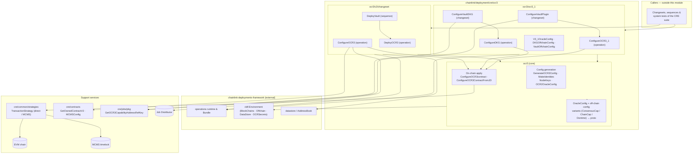
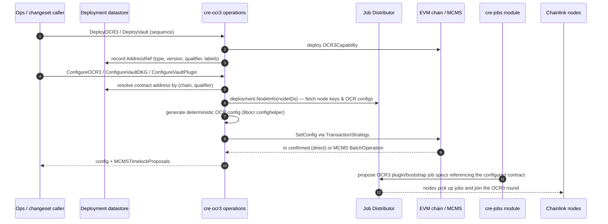
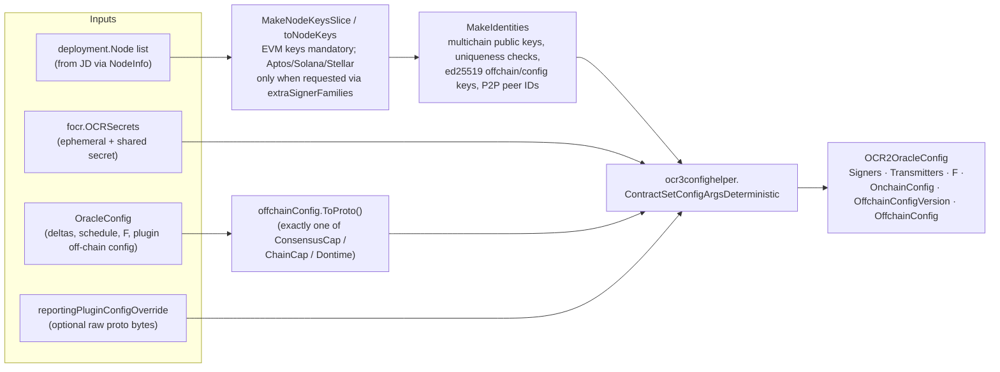
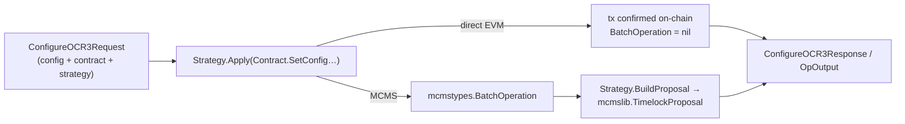
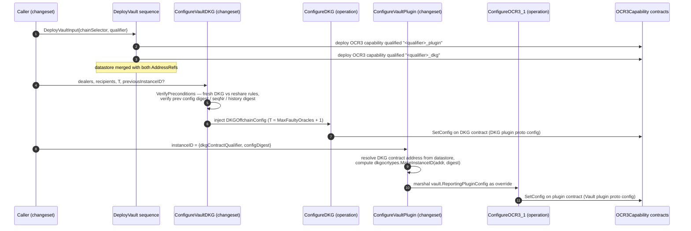

# cre-ocr3 — OCR3 Capability Contract Deployment & Configuration

> Module path: `github.com/smartcontractkit/chainlink/deployment/cre/ocr3` (part of the `chainlink/deployment` Go module, see `chainlink/deployment/go.mod`)

## 1. Purpose & Overview

The `cre-ocr3` module owns the **on-chain lifecycle of the OCR3Capability contract** — the keystone reporting contract that CRE DONs use to reach consensus and transmit reports (Vault secret management, DKG, consensus, chain capabilities, DON-time). Within the [CRE / Keystone Deployment Suite](../CRE___Keystone_Deployment_Suite.md) it is the piece that answers two questions:

1. **How is the contract deployed and registered?** — atomic operations that deploy `OCR3Capability` onto an EVM chain and record its address in the deployment datastore/address book.
2. **How is a DON's OCR configuration written on-chain?** — deterministic, reproducible generation of the `SetConfig` payload (signers, transmitters, fault-tolerance threshold `F`, on-chain and off-chain config) from node identities fetched from the Job Distributor (JD), applied either as a plain EVM transaction or wrapped into an **MCMS timelock proposal**.

The module supports two configuration "flavors":

| Flavor | Package | Reporting plugin off-chain config | Use case |
|---|---|---|---|
| **Generic OCR3 (v2)** | `cre/ocr3` + `cre/ocr3/v2/...` | Consensus capability, EVM chain capability, or DON-time plugin configs (protobuf) | Standard OCR3 capability deployments, Vault plugin contract config |
| **OCR3.1 (Vault/DKG)** | `cre/ocr3/ocr3_1/...` | DKG plugin config (`smdkg`) or Vault plugin config (`vault.ReportingPluginConfig`) | Vault master-key dealing/resharing and Vault secret plugin binding |

All operations follow the [chainlink-deployments-framework](../Deployment_Framework_Core___Product_Deployments/deployment-common.md) `operations`/`sequences` conventions: versioned, reportable, composable units of work with typed inputs/outputs/dependencies.

## 2. Architecture

### 2.1 Package layout

### 2.2 Layer responsibilities

| Layer | Package | Responsibility | Details |
|---|---|---|---|
| Configuration model | `ocr3` (`config.go`, `oracle_config.go`) | Typed OCR timing/off-chain configuration, JSON/YAML parsing with legacy-field migration guards, conversion to the protobuf payloads the plugins expect | [cre-ocr3_config.md](cre-ocr3/cre-ocr3_config.md) |
| Config generation | `ocr3` (`config.go`) | Deterministic mapping *nodes → identities → `SetConfig` arguments* via libocr's `ocr3confighelper`, including multichain signer families (EVM/Aptos/Solana/Stellar) | [cre-ocr3_config.md](cre-ocr3/cre-ocr3_config.md) |
| Lifecycle (v2) | `ocr3/v2/changeset/...` | `DeployOCR3` / `ConfigureOCR3` operations and the `DeployVault` deploy-both-contracts sequence; datastore registration; generated-config export; MCMS proposal building | [cre-ocr3_v2_lifecycle.md](cre-ocr3/cre-ocr3_v2_lifecycle.md) |
| Vault / OCR3.1 | `ocr3/ocr3_1/...` | DKG and Vault plugin configuration: fresh-DKG vs resharing semantics, DKG instance-ID binding, vault reporting-plugin limits | [cre-ocr3_1_vault.md](cre-ocr3/cre-ocr3_1_vault.md) |

## 3. Where the module fits in the CRE deployment lifecycle

After contracts are deployed and configured here, the sibling [cre-jobs](cre-jobs.md) module proposes the corresponding `ocr3boot`/OCR3 plugin job specs to the DON's nodes (its `ProposeVaultBootstrapJobs` sequence resolves the `<prefix>_plugin` / `<prefix>_dkg` addresses that `DeployVault` registered). The capabilities that run behind these contracts are documented in [Workflow & Capability Runtime (CRE Engine)](../Workflow___Capability_Runtime_(CRE_Engine).md); the node-side OCR stack is described in [Oracle Engines & Data Pipelines / ocr](../Oracle_Engines___Data_Pipelines/ocr.md).

## 4. Core Concepts

### 4.1 Deterministic OCR config generation

The heart of the module is the translation from *node inventory* to *on-chain configuration*:

Invariants enforced by the generator:

- **Transmission schedule** must be exactly one entry equal to the number of oracles (every node transmits in the same round).
- **OCR secrets are mandatory** — `secrets.IsEmpty()` is rejected.
- **Extra signer families** (`extraSignerFamilies`) are validated against Aptos, Solana and Stellar only (`ValidateExtraSignerFamilies`); EVM is always included.
- **Key uniqueness**: every on-chain public key across all oracles must be globally unique.
- **Missing EVM OCR config for the registry chain selector panics** — a node without EVM keys cannot participate.

### 4.2 Apply semantics: direct transactions vs MCMS

Every mutation goes through a `strategies.TransactionStrategy`:

- **Dry-run** (`DryRun: true`) short-circuits before any transaction is built and still returns the fully generated `OCR2OracleConfig` — used to preview and export the generated config (`WriteGeneratedConfig` writer).
- With **MCMS** (`MCMSConfig != nil`), the returned `BatchOperation` is wrapped into a `TimelockProposal`; operations additionally require the target contract to actually be MCMS-owned (`contract.McmsContracts != nil`), failing loudly otherwise.
- ABI-level revert reasons are decoded via `cldf.DecodeErr(OCR3CapabilityABI, err)` for actionable errors.

### 4.3 Vault (OCR3.1) pipeline

The Vault product uses **two OCR3 contracts** (a DKG contract and a Vault plugin contract) and a two-stage configuration:

Key semantics documented in the code:

- **Fresh DKG vs resharing** (`ConfigureVaultDKG`): with `PreviousInstanceID == nil` the node IDs, dealer keys and recipient keys must all coincide (everyone deals and receives); with a `PreviousInstanceID` set, the *outgoing committee* runs the reshare (`len(nodeIDs) == len(dealerPublicKeys)`), and the smdkg plugin rejects configs where dealers do not match the previous instance's recipients. Resharing preserves the group public key; a fresh dealing mints a new one.
- **DKG instance binding** (`ConfigureVaultPlugin`): the Vault plugin's off-chain config must reference the *live* DKG instance. The instance ID is deterministically derived from the DKG contract address and the DKG config digest, so plugin and DKG contract can never be paired ambiguously.
- **Exactly one plugin config** per `V3_1OracleConfig` / `OracleConfig` — `getPluginConfig` (and the v2 `getOffchainCfg`) reject multiple simultaneous off-chain configs.

## 5. Sub-module Documentation

The module is documented in three generated sub-module pages under `cre-ocr3/`:

| Sub-module | Page | Contents |
|---|---|---|
| OCR3 configuration model & generation | [cre-ocr3/cre-ocr3_config.md](cre-ocr3/cre-ocr3_config.md) | `OracleConfig`, off-chain config variants (ConsensusCap/ChainCap/Dontime), `TopLevelConfigSource`, `OCR2OracleConfig` (+ `aliasT` JSON alias), `NodeKeys`, identity building and deterministic config generation |
| Contract lifecycle (v2 operations) | [cre-ocr3/cre-ocr3_v2_lifecycle.md](cre-ocr3/cre-ocr3_v2_lifecycle.md) | `DeployOCR3` operation, `ConfigureOCR3` operation, `DeployVault` sequence, datastore registration and generated-config export |
| Vault / OCR3.1 configuration | [cre-ocr3/cre-ocr3_1_vault.md](cre-ocr3/cre-ocr3_1_vault.md) | `V3_1OracleConfig`, DKG & Vault off-chain configs, `ConfigureDKG` / `ConfigureOCR3_1` operations, `ConfigureVaultDKG` / `ConfigureVaultPlugin` changesets |

**How the sub-modules relate:** the [configuration model](cre-ocr3/cre-ocr3_config.md) is the dependency-free foundation consumed by both the [v2 lifecycle operations](cre-ocr3/cre-ocr3_v2_lifecycle.md) (which drive deployment and `SetConfig` for generic OCR3 plugins) and the [Vault/OCR3.1 operations](cre-ocr3/cre-ocr3_1_vault.md) (which reuse the same core apply path — `ConfigureOCR3contract` — but substitute DKG/Vault-specific off-chain configs and instance binding). The Vault pipeline composes both: `DeployVault` (v2 sequence) deploys the plugin and DKG contracts, then the OCR3.1 changesets configure the DKG instance and bind the Vault plugin to it.

## 6. Related Modules

- [CRE / Keystone Deployment Suite](../CRE___Keystone_Deployment_Suite.md) — parent module group and suite-wide conventions.
- [cre-jobs](cre-jobs.md) — proposes the OCR3 plugin/bootstrap job specs that reference the contracts configured here (uses the same `<prefix>_plugin` / `<prefix>_dkg` address-ref qualifiers).
- [cre-capabilities-registry](cre-capabilities-registry.md) — deploys and configures the Capabilities Registry that nodes learn workflow capabilities from.
- [cre-forwarder](cre-forwarder.md) — forwarder contracts used for report transmission on non-EVM chains.
- [cre-core](cre-core.md) — shared offchain/JD integration, node registration and DON configuration.
- [keystone](keystone.md) — legacy Keystone changesets that compose OCR3 deployment into full product stacks (`deploy_ocr3_op`, forwarders, workflow registry).
- [Deployment Framework Core & Product Deployments](../Deployment_Framework_Core___Product_Deployments/deployment-common.md) — the operations/sequence runtime, datastore and changeset framework this module builds on.
- [Workflow & Capability Runtime (CRE Engine)](../Workflow___Capability_Runtime_(CRE_Engine).md) — the runtime and capability definitions (incl. the Vault capability whose `ReportingPluginConfig` this module marshals on-chain).
- [Oracle Engines & Data Pipelines / ocr](../Oracle_Engines___Data_Pipelines/ocr.md) — the node-side OCR3/OCR2 oracle stack that consumes the configuration written here.

## 7. Build & Test Context

The package is part of the `github.com/smartcontractkit/chainlink/deployment` Go module (`chainlink/deployment/go.mod`, go 1.27.1, with `replace github.com/smartcontractkit/chainlink/v2 => ../`). Notable pinned dependencies that shape this module's behaviour:

- `github.com/smartcontractkit/chainlink-deployments-framework v0.123.3` — `cldf.Environment`, operations/sequences runtime, datastore & address book.
- `github.com/smartcontractkit/chainlink-evm/gethwrappers` — generated `ocr3_capability_1_0_0` binding used for deployment and `SetConfig`.
- `github.com/smartcontractkit/ccip-owner-contracts` (MCMS) — `mcmstypes.BatchOperation` / `mcmslib.TimelockProposal` produced when governance is enabled.
- `github.com/smartcontractkit/chainlink-common/keystore` — multichain core key types (`corekeys.EVM/Aptos/Solana/Stellar`) used when assembling oracle identities.
- libocr (`offchainreporting2plus` config helpers, pulled transitively) — deterministic contract-set config generation.

Operations are exercised through the shared `chainlink/deployment/cre` test suites and CRE system tests (see [Dev, Test & Simulation Environments](../Dev,_Test___Simulation_Environments/system-tests.md)), which run the deploy → configure → job-proposal flow against simulated chains and a JD instance.
