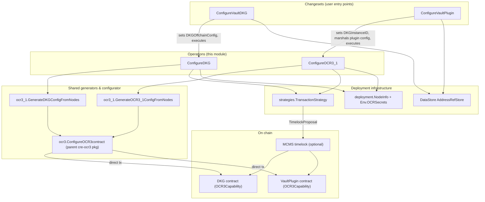
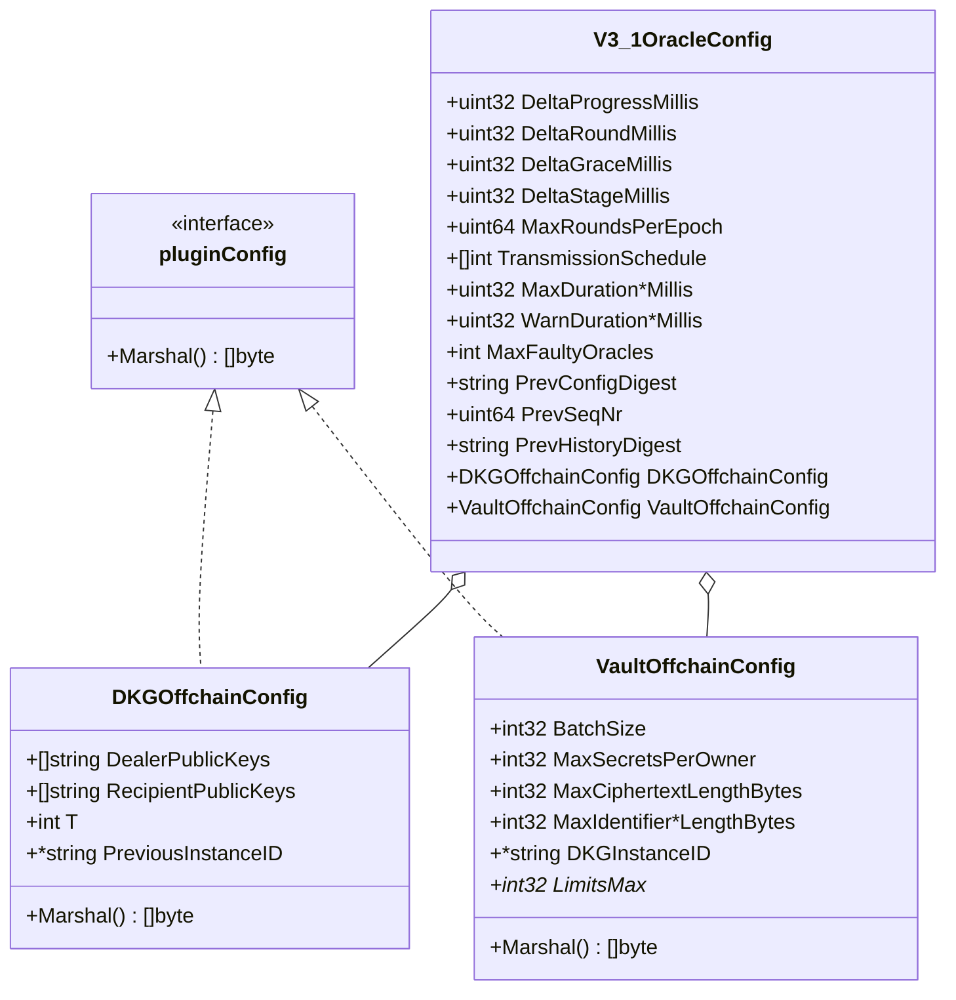
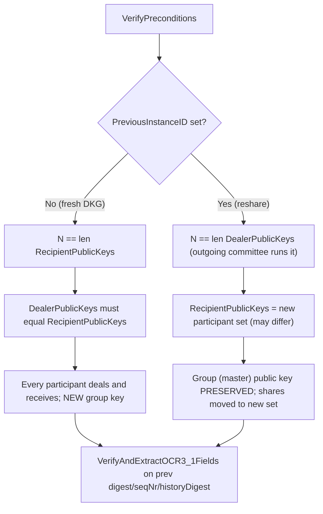
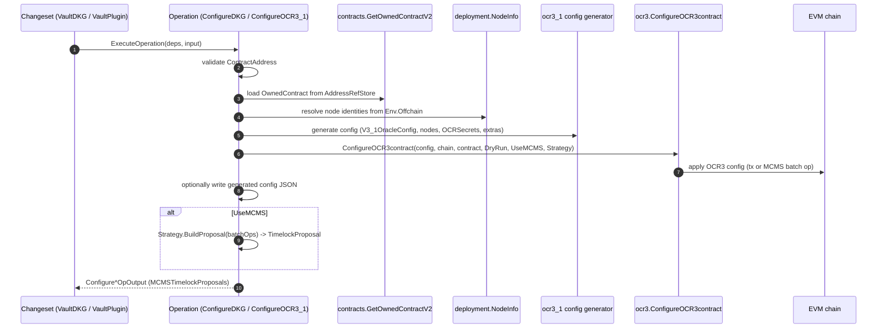
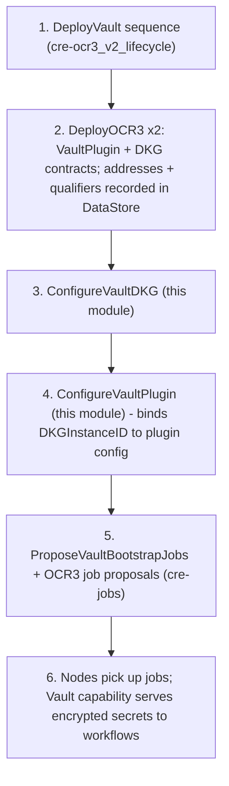

# cre-ocr3_1_vault

> **Module path:** `chainlink/deployment/cre/ocr3/ocr3_1/` · **Go module:** `github.com/smartcontractkit/chainlink/deployment` (see [chainlink/deployment/go.mod](https://github.com/smartcontractkit/chainlink/blob/main/chainlink/deployment/go.mod))

The `cre-ocr3_1_vault` module provides the on-chain **configuration tooling for the OCR3.1 Vault capability** — the secrets-management plugin of the Chainlink Runtime Environment (CRE). It exposes reusable [operations](#operations-configuredkg--configureocr3_1) and [changesets](#changesets-configurevaultdkg--configurevaultplugin) that configure the two OCR3 capability contracts of a Vault DON:

- the **DKG contract**, which runs the `smdkg` OCR plugin to *generate or reshare* the vault master secret key, and
- the **VaultPlugin contract**, which runs the Vault OCR3.1 reporting plugin that stores and distributes encrypted workflow secrets protected by that key.

This module is a child of [cre-ocr3](../cre-ocr3.md) within the [CRE & Keystone Deployment Suite](../../CRE___Keystone_Deployment_Suite.md). Contract *deployment* (which produces the addresses these changesets consume) is handled by the sibling [cre-ocr3_v2_lifecycle](cre-ocr3_v2_lifecycle.md) module; shared config plumbing is documented in [cre-ocr3_config](cre-ocr3_config.md).

---

## Component map

| File (under `chainlink/deployment/cre/ocr3/ocr3_1/`) | Component | Kind |
|---|---|---|
| `changeset/operations/contracts/configure_dkg.go` | `ConfigureDKG` (+ `ConfigureDKGDeps`, `ConfigureDKGInput`, `ConfigureDKGOpOutput`) | Operation |
| `changeset/operations/contracts/configure_ocr3_1.go` | `ConfigureOCR3_1` (+ `ConfigureOCR3_1Deps`, `ConfigureOCR3_1Input`, `ConfigureOCR3_1OpOutput`) | Operation |
| `changeset/operations/contracts/configure_vault_dkg.go` | `ConfigureVaultDKG`, `DKGDon`, `ConfigureVaultDKGInput` | Changeset (`cldf.ChangeSetV2`) |
| `changeset/operations/contracts/configure_vault_plugin.go` | `ConfigureVaultPlugin`, `InstanceIDComponents`, `ConfigureVaultPluginInput` | Changeset (`cldf.ChangeSetV2`) |
| `oracle_config.go` | `pluginConfig`, `DKGOffchainConfig`, `VaultOffchainConfig`, `getPluginConfig` | Config model |
| `config.go` | `V3_1OracleConfig` | Config model |

External helpers this module depends on (defined in sibling packages of the same deployment module):

- `ocr3.ConfigureOCR3contract` — shared OCR3 contract configurator in the parent [cre-ocr3](../cre-ocr3.md) package; performs the actual `SetOCR3Config`-style transaction (directly or via MCMS).
- `ocr3_1.GenerateDKGConfigFromNodes` / `ocr3_1.GenerateOCR3_1ConfigFromNodes` — build the full OCR3 config (signers, transmission schedule, plugin-specific offchain config) from node info and `Env.OCRSecrets`.
- `ocr3_1.VerifyAndExtractOCR3_1Fields` / `ocr3_1.HexStringTo32ByteArray` — OCR3.1 chaining/verification helpers.
- `pkg.GetOCR3CapabilityAddressRefKey` — canonical DataStore address-ref key for OCR3 capability contracts (from [cre-jobs](../cre-jobs.md) `pkg`).
- `strategies.TransactionStrategy`, `strategies.CreateStrategy`, `strategies.GetMCMSContracts` — execution-mode abstraction (direct tx vs. MCMS timelock proposal).
- `contracts.GetOwnedContractV2`, `contracts.MCMSConfig` — owned-contract loading from the DataStore and MCMS settings.
- `deployment.NodeInfo` — resolves DON node identities from the offchain (Job Distributor) environment.
- `dkgocrtypes.MakeInstanceID`, `dkgocrtypes.ReportingPluginConfig` — smdkg plugin primitives.
- `vault.ReportingPluginConfig` — Vault capability wire config from `chainlink-common` (see [capabilities_vault](../../Workflow___Capability_Runtime_(CRE_Engine)/capabilities/capabilities_vault.md)).

---

## Architecture

The module follows the deployment-framework layering: **changesets** (user-facing, validated entry points) compose **operations** (versioned, reportable units of work), which delegate to shared generators and the parent package's contract configurator, and finally to the chain — either directly or through MCMS.



Key architectural points:

- **Config-only changesets.** Both changesets create no new addresses; they only mutate contract configuration. Operations explicitly note "does not create any new addresses".
- **Dry-run support.** Every input carries `DryRun`; in that mode no transaction is submitted but the generated config is still produced.
- **MCMS-optional governance.** Supplying `MCMSConfig` switches execution from an immediate confirmed transaction to an [`mcmslib.TimelockProposal`](#transaction-strategies-and-mcms) built from the returned batch operation.
- **Generated-config artifact.** Operations can emit the marshaled OCR config as JSON via `WriteGeneratedConfig` (used for audit/tooling); the changesets wire `io.Discard` (or omit it) because the config is surfaced through the operation report instead.

---

## Configuration model

All OCR3.1 configuration is expressed as a single `V3_1OracleConfig` that carries OCR timing parameters, prior-config chaining data, and *exactly one* plugin-specific offchain config.



### `V3_1OracleConfig`

The top-level oracle config (`ocr3_1/config.go`):

- **OCR timing** — `DeltaProgress/Round/Grace/Stage` (millis), `MaxRoundsPerEpoch`, `TransmissionSchedule`, plus `MaxDuration*` and `WarnDuration*` phase budgets.
- **Fault tolerance** — `MaxFaultyOracles`. This single value also derives the DKG threshold: the DKG changeset sets `T = MaxFaultyOracles + 1`.
- **Prior-config chaining** — `PrevConfigDigest`, `PrevSeqNr`, `PrevHistoryDigest`. Both changesets verify these with `VerifyAndExtractOCR3_1Fields` during precondition checks, guaranteeing a new config correctly chains from the currently-live OCR3.1 config.
- **Plugin offchain config** — one of `DKGOffchainConfig` or `VaultOffchainConfig` (mutually exclusive, see below).

### `pluginConfig` interface and selection

`oracle_config.go` defines the `pluginConfig` interface (`Marshal() ([]byte, error)`) and `getPluginConfig(cfg V3_1OracleConfig)`, which picks the configured offchain config and **errors if both `DKGOffchainConfig` and `VaultOffchainConfig` are set** — a config describes either the DKG plugin or the Vault plugin, never both.

### `DKGOffchainConfig`

Describes the smdkg OCR plugin configuration:

- `DealerPublicKeys` / `RecipientPublicKeys` — hex-encoded `P256ParticipantPublicKey`s, decoded at `Marshal()` time into `dkgocrtypes.ReportingPluginConfig`.
- `T` — DKG threshold (dealers needed to reconstruct).
- `PreviousInstanceID` — `nil` for a *fresh* DKG; the live instance ID (e.g. `sanmarinodkg/v1/<dkgContract>/<configDigest>`) for a *reshare*. `Marshal()` propagates it as `dkgocrtypes.InstanceID` and serializes via `MarshalBinary()`.

### `VaultOffchainConfig`

Mirrors `vault.ReportingPluginConfig` (from `chainlink-common/pkg/capabilities/actions/vault`) for embedding in YAML/JSON sources:

- **Storage policy** — `BatchSize`, `MaxSecretsPerOwner`, `MaxCiphertextLengthBytes`.
- **Identifier limits** — max lengths for secret identifier `key`, `owner`, and `namespace` components.
- **Plugin processing limits** — `LimitsMaxQueryLength`, `LimitsMaxObservationLength`, `LimitsMaxReportsPlusPrecursorLength`, `LimitsMaxReportLength`, `LimitsMaxReportCount`, `LimitsMaxKeyValueModifiedKeys(+Values)Length`, and per-oracle unexpired-blob payload/count caps.
- **`DKGInstanceID`** — computed at runtime (not from user input); `Marshal()` fails if it is unset. Serialized as protobuf via `proto.Marshal`.

---

## Changesets: `ConfigureVaultDKG` & `ConfigureVaultPlugin`

Both changesets implement `cldf.ChangeSetV2[Input]` (verify/apply contract of the deployment framework, see [Deployment Framework Core](../../Deployment_Framework_Core___Product_Deployments.md)) and share the same apply skeleton:

1. Resolve MCMS contracts via `strategies.GetMCMSContracts` when `MCMSConfig` is set.
2. Look up the EVM chain by `ContractChainSelector` in `Env.BlockChains.EVMChains()`.
3. Fetch the target contract address from the DataStore using `pkg.GetOCR3CapabilityAddressRefKey(selector, ContractQualifier)`.
4. Create the `TransactionStrategy` via `strategies.CreateStrategy` (annotated with `changeset.ConfigureOCR3Description`).
5. Execute the corresponding operation through `e.OperationsBundle` and return its `MCMSTimelockProposals` plus a generic operations report in `cldf.ChangesetOutput`.

### `ConfigureVaultDKG` — DKG contract configuration

Sets the smdkg plugin config on the DKG contract. The distinguishing input type is `DKGDon`, which extends `contracts.DonNodeSet` with DKG membership:

| Field | Meaning |
|---|---|
| `NodeIDs` (embedded `DonNodeSet`) | Nodes that *run* the DKG instance (N = participant count). |
| `DealerPublicKeys` | P256 public keys of dealers (share contributors). |
| `RecipientPublicKeys` | P256 public keys of the resulting share-holding participant set. |
| `PreviousInstanceID` | `nil` → fresh DKG; set → resharing of the live instance. |

**Fresh DKG vs. reshare invariants** (enforced in `VerifyPreconditions`):



Additional preconditions: non-zero chain selector, non-empty `ContractQualifier`, DON name, node IDs, dealer/recipient key sets, and a non-nil `OracleConfig`.

The apply step injects the plugin offchain config into the oracle config:

```go
input.OracleConfig.DKGOffchainConfig = dkgOffchainConfig(don, maxFaultyOracles+1)
// DKGOffchainConfig{T, DealerPublicKeys, RecipientPublicKeys, PreviousInstanceID}
```

and then executes `ConfigureDKG` with `WriteGeneratedConfig: io.Discard` (the generated DKG config is reported through the operations report rather than written to a file).

### `ConfigureVaultPlugin` — VaultPlugin contract configuration

Configures the Vault reporting plugin on the VaultPlugin contract. Beyond the common fields, the input adds:

- `InstanceID` (`InstanceIDComponents`): `DKGContractQualifier` (locates the DKG contract in the DataStore) and `ConfigDigest` (hex-encoded 32 bytes — the digest of the DKG config, validated with `HexStringTo32ByteArray`).
- `ReportingPluginConfig` (`*vault.ReportingPluginConfig`): the protobuf wire config for the Vault plugin (its fields are mirrored by `VaultOffchainConfig` above).

**DKG instance-ID binding.** The Vault plugin must be told *which* DKG instance's key material it uses. The changeset computes this deterministically on-chain:

```go
dkgAddr      := resolved from DataStore via InstanceID.DKGContractQualifier
digestBytes  := hex.DecodeString(InstanceID.ConfigDigest)        // 32 bytes
instanceID   := string(dkgocrtypes.MakeInstanceID(dkgAddr, [32]byte(digestBytes)))
ReportingPluginConfig.DKGInstanceID = &instanceID
```

The config is then protobuf-marshaled and passed to `ConfigureOCR3_1` as `ReportingPluginConfigOverride`, which the config generator embeds into the OCR3.1 offchain config instead of (or as an override to) the declarative `VaultOffchainConfig`.

Preconditions additionally require the `OracleConfig` to pass `VerifyAndExtractOCR3_1Fields`, and validate both instance-ID components.

---

## Operations: `ConfigureDKG` & `ConfigureOCR3_1`

Both operations are declared with `operations.NewOperation` (versioned `1.0.0`) and share an identical execution pattern:



Differences between the two operations:

| | `ConfigureDKG` | `ConfigureOCR3_1` |
|---|---|---|
| Config generator | `GenerateDKGConfigFromNodes` | `GenerateOCR3_1ConfigFromNodes` |
| Extra input | — | `ReportingPluginConfigOverride []byte` (used by `ConfigureVaultPlugin` to inject the DKG-instance-bound Vault plugin config) |
| Typical target | DKG contract | VaultPlugin contract |

Shared behaviors:

- **Owned-contract loading.** `GetOwnedContractV2[*ocr3_capability.OCR3Capability]` filters the DataStore address refs by chain selector + address, wraps the contract as ownable, and (when MCMS is used) requires `contract.McmsContracts != nil` — i.e. the contract must already be owned by MCMS, otherwise configuration fails with *"expected … to be owned by MCMS"*.
- **Generated-config emission.** If `WriteGeneratedConfig` is non-nil, the marshaled `resp.OcrConfig` is pretty-printed (logged) and written; a short write is an error.
- **MCMS outputs.** With MCMS enabled, the strategy's batch operation is wrapped in a `mcmslib.TimelockProposal`; output is `ConfigureDKGOpOutput` / `ConfigureOCR3_1OpOutput{ MCMSTimelockProposals }`. Without MCMS, the output is empty (transactions are confirmed directly).

### Transaction strategies and MCMS

The `strategies.TransactionStrategy` interface abstracts execution mode:

```go
Apply(callFn func(opts *bind.TransactOpts) (*types.Transaction, error))
    (*mcmstypes.BatchOperation, *types.Transaction, error)
BuildProposal(operations []mcmstypes.BatchOperation) (*mcmslib.TimelockProposal, error)
```

- **Direct mode:** `Apply` submits and confirms the transaction; the returned batch operation is `nil`.
- **MCMS mode:** `Apply` only records calls; the returned batch operation feeds `BuildProposal`, producing a timelock proposal that governance (MCMS voters) must approve and execute. `strategies.GetMCMSContracts` resolves the `MCMSWithTimelockState` for the chain from `MCMSConfig`.

---

## End-to-end Vault DON bring-up

The full lifecycle spans several modules; this module owns the two *configuration* steps (steps 3–4):



Notes:

- Step 3 must complete before step 4 in practice: the `ConfigDigest` consumed by `ConfigureVaultPlugin.InstanceID` is the digest of the DKG config set on-chain in step 3.
- The `ProposeVaultBootstrapJobs` sequence in [cre-jobs](../cre-jobs.md) delivers the resulting job specs (`Specs map[string][]string`) to node operators.
- CRE system tests exercise this exact path end-to-end (see the Vault feature in [system-tests](../../Dev,_Test___Simulation_Environments/system-tests.md)).

---

## Key invariants & operational notes

1. **Exactly one offchain config.** `getPluginConfig` rejects a `V3_1OracleConfig` with both `DKGOffchainConfig` and `VaultOffchainConfig` set.
2. **Fresh vs. reshare consistency.** Fresh DKG: `NodeIDs` = dealers = recipients (equal length, dealers == recipients). Reshare: `NodeIDs` == dealers (outgoing committee), recipients define the new share-holding set; the smdkg plugin rejects configs where dealers don't match the prior instance's recipients.
3. **Threshold derivation.** `T = MaxFaultyOracles + 1` — the DKG threshold is never specified independently.
4. **Runtime-only `DKGInstanceID`.** Users never set it directly; `ConfigureVaultPlugin` derives it from the DKG contract address + config digest, and `VaultOffchainConfig.Marshal` fails if it's missing.
5. **Config chaining.** Both changesets validate `PrevConfigDigest` / `PrevSeqNr` / `PrevHistoryDigest` so configuration changes always chain from the live OCR3.1 config.
6. **No address creation.** These changesets never register new addresses; ownership must already be MCMS when MCMS mode is used.
7. **`ExtraSignerFamilies`** is plumbed (JSON/YAML tagged) through both changesets into the config generators.

---

## Related documentation

- [cre-ocr3](../cre-ocr3.md) — parent module: shared OCR3 deployment package (`ConfigureOCR3contract`, `ConfigureOCR3Description`).
- [cre-ocr3_v2_lifecycle](cre-ocr3_v2_lifecycle.md) — deployment of the contracts (`DeployOCR3`, `DeployVault`) whose DataStore records this module consumes.
- [cre-ocr3_config](cre-ocr3_config.md) — shared top-level config sources (`TopLevelConfigSource`) and the v2 `offchainConfig` interface.
- [cre-jobs](../cre-jobs.md) — job-spec proposal sequences (including `ProposeVaultBootstrapJobs`) and the `pkg.GetOCR3CapabilityAddressRefKey` helper.
- [keystone](../keystone.md) — the legacy Keystone OCR3 workflow within the same deployment suite.
- [capabilities_vault](../../Workflow___Capability_Runtime_(CRE_Engine)/capabilities/capabilities_vault.md) — the Vault capability wire types (`vault.ReportingPluginConfig`, `messages.proto`) consumed by this module.
- [system-tests](../../Dev,_Test___Simulation_Environments/system-tests.md) — CRE system tests driving Vault DON deployments end-to-end.
- [Deployment Framework Core](../../Deployment_Framework_Core___Product_Deployments.md) — the changeset/operation/MCMS primitives (`ChangeSetV2`, `operations.NewOperation`, timelock proposals) used throughout.
