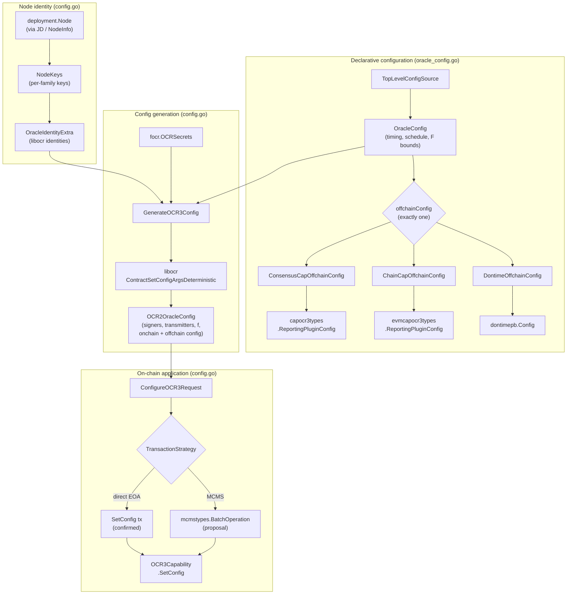
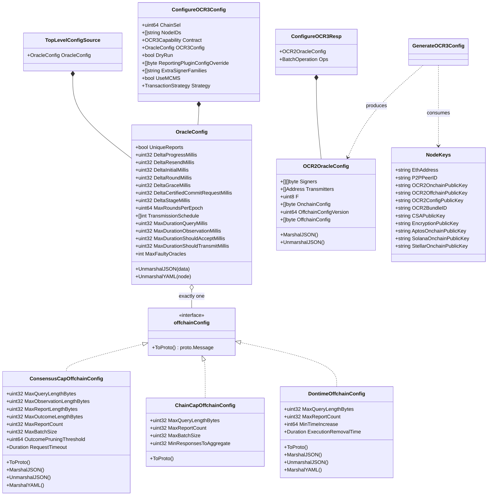
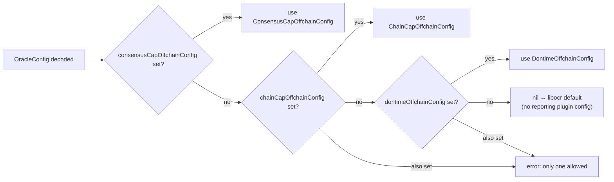
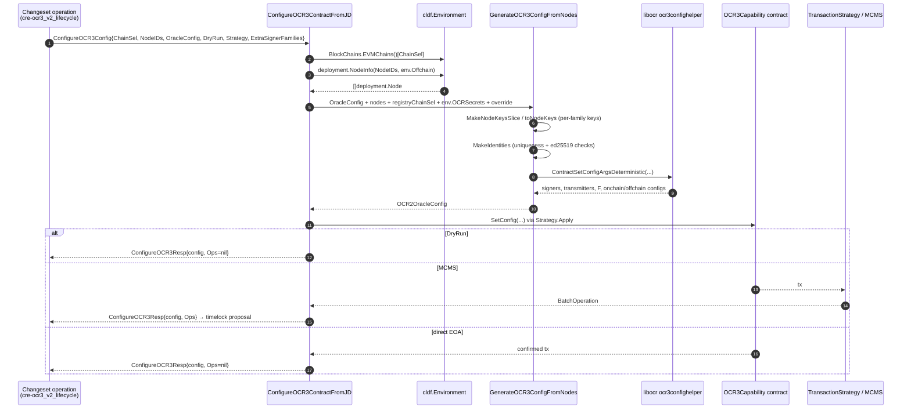

# cre-ocr3_config

| | |
|---|---|
| **Package** | `ocr3` (`chainlink/deployment/cre/ocr3`) |
| **Go module** | `github.com/smartcontractkit/chainlink/deployment` (see `chainlink/deployment/go.mod`) |
| **Files** | `chainlink/deployment/cre/ocr3/config.go` · `chainlink/deployment/cre/ocr3/oracle_config.go` |
| **Parent module** | [cre-ocr3](../cre-ocr3.md) — CRE OCR3 deployment |
| **Sibling modules** | [cre-ocr3_1_vault](cre-ocr3_1_vault.md) (v1/OCR3.1 + vault path) · [cre-ocr3_v2_lifecycle](cre-ocr3_v2_lifecycle.md) (v2 deploy/configure/vault lifecycle) |
| **Suite** | [CRE & Keystone Deployment Suite](../../CRE___Keystone_Deployment_Suite.md) |

## 1. Purpose and scope

`cre-ocr3_config` is the **configuration backbone of the OCR3 (Keystone `OCR3Capability`) deployment flow**. It owns two tightly coupled concerns:

1. **Declarative configuration schema** (`oracle_config.go`) — the operator-facing `OracleConfig` document (YAML/JSON) that describes an OCR3 oracle set: consensus timing parameters, the transmission schedule, fault-tolerance bounds, and exactly **one** reporting-plugin offchain configuration payload. Each offchain variant can serialize itself into the protobuf `ReportingPluginConfig` consumed at runtime by the corresponding [capabilities consensus plugin](../../Workflow___Capability_Runtime_(CRE_Engine)/capabilities/capabilities_consensus.md).

2. **Deterministic oracle-set config generation and on-chain application** (`config.go`) — the machinery that converts node identity data (multi-chain OCR2 key bundles, P2P peer IDs, CSA keys) plus the declarative `OracleConfig` into a canonical, deterministic `OCR2OracleConfig` (signers / transmitters / f / onchain + offchain config) via `libocr`'s `ocr3confighelper.ContractSetConfigArgsDeterministic`, and then applies it to the `OCR3Capability` contract through `SetConfig` — either as a direct EOA transaction or as an [MCMS](../../Deployment_Framework_Core___Product_Deployments.md) batch operation.

In short: **operators author `OracleConfig`; this module turns it (plus node metadata from the Job Distributor) into the byte-exact contract configuration that brings a DON's OCR3 capability online.**

---

## 2. Where this module fits

```
CRE & Keystone Deployment Suite
└── cre-ocr3                         (parent module)
    ├── cre-ocr3_config              ← THIS MODULE  (schema + generation + SetConfig plumbing)
    ├── cre-ocr3_v2_lifecycle        (v2 operations/sequences that CALL this module's APIs)
    └── cre-ocr3_1_vault             (OCR3.1 / vault configuration path, shares schema conventions)
```

- The **v2 lifecycle** module (`ConfigureOCR3Input.Config *ocr3.OracleConfig`) is the primary consumer: its `configure_ocr3` operation takes this module's `OracleConfig` and delegates to `ConfigureOCR3ContractFromJD`. See [cre-ocr3_v2_lifecycle](cre-ocr3_v2_lifecycle.md).
- The **v1 / OCR3.1 vault path** in [cre-ocr3_1_vault](cre-ocr3_1_vault.md) follows the same schema conventions (including the legacy-field migration guards introduced here).
- Resulting deployments are surfaced through the CRE state views ([cre-core_state-views](../cre-core/cre-core_state-views.md)), e.g. `OCR3ConfigViewLegacy`.
- At node runtime, the generated offchain config is interpreted by OCR3 reporting plugins served over the Loop gRPC framework ([loop-grpc-bindings OCR3 reporting](<../../Plugin_Process_Framework_(Loop)/loop-grpc-bindings/loop-grpc-bindings_ocr-reporting.md>)).

---

## 3. Architecture



The module bridges three worlds:

| World | Artifact | Direction |
|---|---|---|
| Operator configuration (YAML/JSON documents) | `TopLevelConfigSource`, `OracleConfig`, offchain variants | in |
| Node identity metadata (Job Distributor / offchain store) | `deployment.Node` → `NodeKeys` → libocr identities | in |
| On-chain contract state (`OCR3Capability`) | `OCR2OracleConfig` → `SetConfig` (EOA or MCMS) | out |

---

## 4. Type model



> **Note on `aliasT`** — both files define an unexported `aliasT` type. In `config.go` it is the JSON alias struct used by `OCR2OracleConfig.UnmarshalJSON` to read hex-encoded strings and decode them into `[]byte` / `common.Address`. In `oracle_config.go`, `type aliasT OracleConfig` (and its two offchain-config counterparts) is the standard Go idiom for shadowing the type inside its own custom unmarshalers, preventing infinite recursion. Neither is part of the public API; they exist to make the human-facing serialization (hex strings, duration strings) safe.

---

## 5. Oracle configuration schema (`OracleConfig`)

`OracleConfig` is the single declarative source for an OCR3 oracle set. It decodes from both JSON and YAML with identical semantics and rejects stale schemas (see §5.3).

### 5.1 Fields

| Field (YAML key) | Type | Meaning |
|---|---|---|
| `uniqueReports` | `bool` | Require unique reports across rounds. |
| `deltaProgressMillis` | `uint32` | OCR round `ΔProgress`. |
| `deltaResendMillis` | `uint32` | OCR round `ΔResend`. |
| `deltaInitialMillis` | `uint32` | OCR round `ΔInitial`. |
| `deltaRoundMillis` | `uint32` | OCR round `ΔRound`. |
| `deltaGraceMillis` | `uint32` | OCR round `ΔGrace`. |
| `deltaCertifiedCommitRequestMillis` | `uint32` | OCR3 `ΔCertifiedCommitRequest`. |
| `deltaStageMillis` | `uint32` | OCR round `ΔStage`. |
| `maxRoundsPerEpoch` | `uint64` | Max rounds per epoch. |
| `transmissionSchedule` | `[]int` | **Constrained:** must be a single entry equal to the number of nodes (all oracles transmit in one round). |
| `maxDurationQueryMillis` / `maxDurationObservationMillis` / `maxDurationShouldAcceptMillis` / `maxDurationShouldTransmitMillis` | `uint32` | libocr phase duration caps. |
| `maxFaultyOracles` | `int` | `MaxFaultyOracles` (drives `F`). |
| `consensusCapOffchainConfig` | object | Reporting-plugin config for the **consensus capability** plugin. |
| `chainCapOffchainConfig` | object | Reporting-plugin config for **v2 chain-capability consensus** plugins. |
| `dontimeOffchainConfig` | object | Reporting-plugin config for **dontime**. |

### 5.2 Offchain config variants

Exactly **one** variant may be set; `getOffchainCfg` rejects multiple (`multiple offchain configs specified`). Each implements the `offchainConfig` interface (`ToProto() (proto.Message, error)`), which is the seam between declarative config and the protobuf blob embedded in the on-chain offchain config.

| Variant | Proto target | Extras |
|---|---|---|
| `ConsensusCapOffchainConfig` | `capocr3types.ReportingPluginConfig` (chainlink-common capabilities consensus OCR3 — see [capabilities_consensus](<../../Workflow___Capability_Runtime_(CRE_Engine)/capabilities/capabilities_consensus.md>)) | `RequestTimeout` serialized as a Go duration string; when `0`, `ToProto` emits `nil` so plugin defaults apply. `MaxBatchSize` is unused by plugin **v2** (still used by v1). |
| `ChainCapOffchainConfig` | `evmcapocr3types.ReportingPluginConfig` (v2 chain-capability consensus) | Adds `MinResponsesToAggregate`. |
| `DontimeOffchainConfig` | `dontimepb.Config` | Adds `MinTimeIncrease` and `ExecutionRemovalTime` (duration string). |



### 5.3 Legacy-field migration guard

Both `UnmarshalJSON` and `UnmarshalYAML` first decode into a raw map and run `ensureNoLegacyFields`, failing fast if the historical top-level offchain fields are still present at the root of the document:

- JSON: `MaxQueryLengthBytes`, `MaxObservationLengthBytes`, `MaxReportLengthBytes`, `MaxOutcomeLengthBytes`, `MaxReportCount`, `MaxBatchSize`, `OutcomePruningThreshold`, `RequestTimeout`
- YAML: `maxQueryLengthBytes`, `maxObservationLengthBytes`, `maxReportLengthBytes`, `maxOutcomeLengthBytes`, `maxReportCount`, `maxBatchSize`, `outcomePruningThreshold`, `requestTimeout`

The error instructs the operator to move these into `ConsensusCapOffchainConfig`. This is the documented migration path from the pre-split `OracleConfig` shape (relevant to deployments maintained via [cre-ocr3_1_vault](cre-ocr3_1_vault.md)).

---

## 6. Node identity and multi-chain keys

### 6.1 `NodeKeys`

`NodeKeys` is a flattened, per-node view of the credentials needed to assemble a libocr oracle identity. EVM keys are **always required**; additional chain-family keys are filled from the node's `SelToOCRConfig` map **only when that family is requested via `extraSignerFamilies`**:

| Family | Fields sourced | Requirement |
|---|---|---|
| EVM (registry chain) | `EthAddress`, `OCR2BundleID`, `OCR2OnchainPublicKey`, `OCR2OffchainPublicKey`, `OCR2ConfigPublicKey` | mandatory — `toNodeKeys` **panics** if the node has no OCR config for `registryChainSel` |
| Aptos (`extraSignerFamilies` opt-in) | `AptosBundleID`, `AptosOnchainPublicKey` | optional |
| Solana (`extraSignerFamilies` opt-in) | `SolanaBundleID`, `SolanaOnchainPublicKey` | optional |
| Stellar (`extraSignerFamilies` opt-in) | `StellarBundleID`, `StellarOnchainPublicKey` | optional |
| Node-level | `P2PPeerID` (`p2p_` prefix stripped), `CSAPublicKey`, `EncryptionPublicKey` | `EncryptionPublicKey` currently defaults to the CSA key (`csa_` prefix stripped) — see `DEVSVCS-760` |

`ValidateExtraSignerFamilies` accepts only `aptos`, `solana`, `stellar` (chain-selector families beyond the EVM registry chain).

### 6.2 `MakeIdentities`

`MakeIdentities([]NodeKeys) ([]confighelper.OracleIdentityExtra, error)` assembles the libocr identities:

1. Builds each oracle's onchain public-key map — EVM (required, hex→`common.HexToAddress`), plus optional Aptos/Solana/Stellar keys decoded from hex.
2. Enforces **global uniqueness** of every onchain public key across all nodes (duplicate ⇒ error).
3. Serializes the map via `ocrcommon.MarshalMultichainPublicKey` into the multichain `OnchainPublicKey`.
4. Requires the offchain and config-encryption public keys to be exactly `ed25519.PublicKeySize` (32 bytes) each.
5. Emits `OracleIdentityExtra{OnchainPublicKey, OffchainPublicKey, PeerID, TransmitAccount, ConfigEncryptionPublicKey}` in node order.

---

## 7. Config generation and on-chain application

### 7.1 Generation (`GenerateOCR3Config` / `GenerateOCR3ConfigFromNodes`)

`GenerateOCR3ConfigFromNodes` adapts deployment node metadata into `NodeKeys` (honoring `extraSignerFamilies`) and delegates to `GenerateOCR3Config`, which:

1. **Validates** the transmission schedule — exactly one entry equal to `len(nca)` (all oracles transmit together in one round) — and requires non-empty `focr.OCRSecrets` (ephemeral + shared secrets).
2. **Resolves the reporting-plugin config bytes**: the `reportingPluginConfigOverride` parameter wins if non-nil; otherwise the selected offchain config (§5.2) is converted `ToProto()` and `proto.Marshal`ed. If neither is present, `nil` is passed (libocr default).
3. Calls `ocr3confighelper.ContractSetConfigArgsDeterministic` with the secrets, all timing parameters (converted from the `*Millis` fields), `MaxRoundsPerEpoch`, the schedule, identities, phase-duration caps, and `MaxFaultyOracles` — producing a **deterministic** signer/transmitter set, `F`, onchain config, offchain config version and offchain config.
4. Maps transmitters to EVM addresses and returns an `OCR2OracleConfig`.

### 7.2 On-chain application

`ConfigureOCR3contract(ConfigureOCR3Request)` applies the config to a bound `OCR3Capability` contract:

- `DryRun: true` short-circuits and returns the config with `nil` ops (validation only).
- Otherwise the `SetConfig(signers, transmitters, f, onchainConfig, offchainConfigVersion, offchainConfig)` call is executed through the injected `strategies.TransactionStrategy` (interface in `chainlink/deployment/cre/common/strategies/strategies.go`):
  - **Direct strategy** → transaction submitted and confirmed; `Ops` is `nil`.
  - **MCMS strategy** → the call is wrapped into an `mcmstypes.BatchOperation` for inclusion in a timelock proposal (see [Deployment Framework Core](../../Deployment_Framework_Core___Product_Deployments.md)).
- Contract reverts are ABI-decoded via `cldf.DecodeErr(OCR3CapabilityABI, err)` for actionable error messages.

`ConfigureOCR3ContractFromJD(env, ConfigureOCR3Config)` is the high-level entry point used by changeset operations:



> `UseMCMS` on the request struct is advisory/legacy; behavior is governed by the injected `Strategy`. It currently only surfaces in error messages.

---

## 8. Public API reference

### From `config.go`

| Symbol | Kind | Summary |
|---|---|---|
| `OCR3Capability` | `cldf.ContractType` | Contract-type marker `"OCR3Capability"` used for addressing/versioning in the deployment framework. |
| `TopLevelConfigSource` | struct | Root wrapper for serialized config documents; embeds `OracleConfig`. |
| `NodeKeys` | struct | Flattened per-node, per-family key material (§6.1). |
| `OCR2OracleConfig` | struct | The canonical `SetConfig` payload; JSON uses hex strings (signers, `0x`-prefixed configs) and checksum transmitter addresses; unmarshal tolerates an optional `0x` prefix. |
| `GenerateOCR3ConfigFromNodes` | func | `OracleConfig + []deployment.Node → OCR2OracleConfig` (adapts node keys, then generates). |
| `GenerateOCR3Config` | func | Deterministic config generation via libocr (§7.1). |
| `getOffchainCfg` | func (unexported) | Picks the single offchain config or errors on multiples. |
| `ConfigureOCR3Request` / `ConfigureOCR3Response` | structs | Contract-level configure call + result (dry-run aware, MCMS batch op). |
| `ConfigureOCR3contract` | func | Executes `SetConfig` through the strategy (§7.2). |
| `ConfigureOCR3Config` / `ConfigureOCR3Resp` | structs | High-level JD-driven request and combined result. |
| `ConfigureOCR3ContractFromJD` | func | End-to-end: environment + node IDs + `OracleConfig` → configured contract / MCMS ops. |
| `ValidateExtraSignerFamilies` | func | Whitelist check for `aptos`, `solana`, `stellar`. |
| `MakeNodeKeysSlice` / `toNodeKeys` | funcs | `[]deployment.Node → []NodeKeys` with per-family key selection. |
| `MakeIdentities` | func | `[]NodeKeys → []confighelper.OracleIdentityExtra` with validation (§6.2). |

### From `oracle_config.go`

| Symbol | Kind | Summary |
|---|---|---|
| `OracleConfig` | struct | Declarative oracle-set configuration (§5.1); JSON+YAML custom unmarshalers with legacy-field guard. |
| `offchainConfig` | interface | `ToProto() (proto.Message, error)` — declarative → protobuf reporting-plugin config. |
| `ConsensusCapOffchainConfig` | struct | Consensus-capability plugin config; `RequestTimeout` as duration string; `ToProto` → `capocr3types.ReportingPluginConfig`. |
| `ChainCapOffchainConfig` | struct | Chain-capability plugin config incl. `MinResponsesToAggregate`; `ToProto` → `evmcapocr3types.ReportingPluginConfig`. |
| `DontimeOffchainConfig` | struct | Dontime plugin config incl. `MinTimeIncrease`, `ExecutionRemovalTime`; `ToProto` → `dontimepb.Config`. |

---

## 9. Usage example

Operator-authored configuration document (wrapped by `TopLevelConfigSource`):

```yaml
oracleConfig:
  uniqueReports: true
  deltaProgressMillis: 2000
  deltaResendMillis: 4000
  deltaInitialMillis: 10000
  deltaRoundMillis: 1000
  deltaGraceMillis: 500
  deltaCertifiedCommitRequestMillis: 1000
  deltaStageMillis: 3000
  maxRoundsPerEpoch: 10
  transmissionSchedule: [5]        # exactly one entry == number of DON nodes
  maxDurationQueryMillis: 250
  maxDurationObservationMillis: 400
  maxDurationShouldAcceptMillis: 2000
  maxDurationShouldTransmitMillis: 1000
  maxFaultyOracles: 1
  consensusCapOffchainConfig:      # exactly one of the three variants
    maxQueryLengthBytes: 16384
    maxObservationLengthBytes: 16384
    maxReportLengthBytes: 65536
    maxOutcomeLengthBytes: 65536
    maxReportCount: 5
    maxBatchSize: 5
    outcomePruningThreshold: 240
    requestTimeout: 30s
```

Programmatic flow from a v2 changeset operation (consumer shown in [cre-ocr3_v2_lifecycle](cre-ocr3_v2_lifecycle.md)):

```go
resp, err := ocr3.ConfigureOCR3ContractFromJD(env, ocr3.ConfigureOCR3Config{
    ChainSel:         chainSel,
    NodeIDs:          donNodeIDs,
    Contract:         ocr3Capability,        // bound OCR3Capability contract
    OCR3Config:       &oracleConfig,          // decoded from the document above
    DryRun:           false,
    ExtraSignerFamilies: []string{"solana"},  // validated via ValidateExtraSignerFamilies
    UseMCMS:          true,
    Strategy:         mcmsStrategy,           // strategies.TransactionStrategy
})
// resp.OCR2OracleConfig — canonical SetConfig payload (also persisted to state)
// resp.Ops              — *mcmstypes.BatchOperation for the timelock proposal (nil when dry-run/direct)
```

---

## 10. Operational notes and gotchas

- **Transmission schedule is rigid**: `GenerateOCR3Config` errors unless `transmissionSchedule` is `[len(nodes)]`. This encodes "all oracles transmit in one round" and is intentionally not a free-form knob.
- **Missing EVM OCR config panics**: `toNodeKeys` panics if a node lacks an OCR2 config for `registryChainSel`. Ensure node metadata is registered in the JD/offchain store before configuring.
- **Key uniqueness is global**: any duplicated onchain public key across the DON aborts generation (`MakeIdentities`).
- **Key sizes are strict**: offchain and config-encryption public keys must be exactly 32 bytes (ed25519).
- **`RequestTimeout: 0` is meaningful**: serialized as `nil` in the proto so downstream consensus-plugin defaults apply — don't emit `0s` expecting an explicit zero timeout.
- **Max-batch-size caveat**: `MaxBatchSize` in `ConsensusCapOffchainConfig` is only consumed by consensus plugin **v1**; v2 ignores it.
- **Legacy configs fail fast**: documents with top-level offchain fields are rejected with an explicit migration error (§5.3) rather than silently misconfigured.
- **Dry-run is side-effect free**: `DryRun` returns the resolved `OCR2OracleConfig` (useful for reviewing signers/transmitters before signing an MCMS proposal).

---

## 11. Related documentation

- [cre-ocr3](../cre-ocr3.md) — parent module (OCR3 deployment overview).
- [cre-ocr3_v2_lifecycle](cre-ocr3_v2_lifecycle.md) — v2 deploy/configure operations and vault sequence; primary caller of `ConfigureOCR3ContractFromJD`.
- [cre-ocr3_1_vault](cre-ocr3_1_vault.md) — OCR3.1 + DKG/vault configuration path sharing these schema conventions.
- [cre-core_state-views](../cre-core/cre-core_state-views.md) — `CREView` / `OCR3ConfigViewLegacy` for inspecting deployed config.
- [Deployment Framework Core & Product Deployments](../../Deployment_Framework_Core___Product_Deployments.md) — changeset/operation/sequence model, MCMS timelock governance.
- [Capabilities runtime: consensus capability](<../../Workflow___Capability_Runtime_(CRE_Engine)/capabilities/capabilities_consensus.md>) — runtime consumers of the generated reporting-plugin protobufs.
- [Plugin Process Framework (Loop): OCR3 reporting bindings](<../../Plugin_Process_Framework_(Loop)/loop-grpc-bindings/loop-grpc-bindings_ocr-reporting.md>) — how plugins receive the config at runtime.
- [Keystone deployment](../keystone.md) — end-to-end Keystone (Keystone→CRE) deployment that includes OCR3 configuration.
