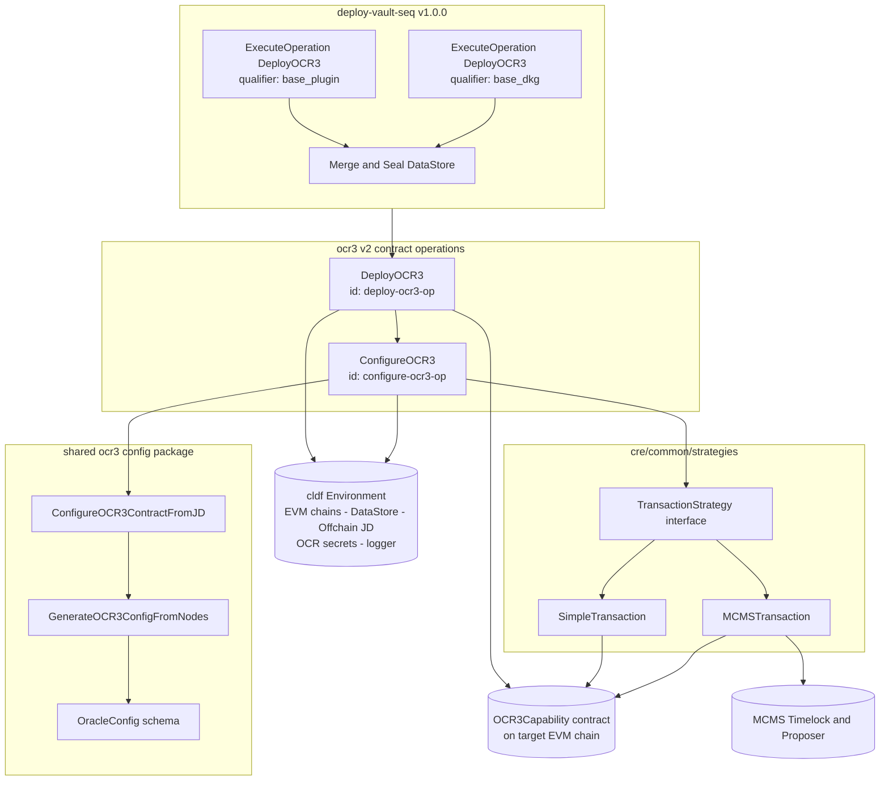
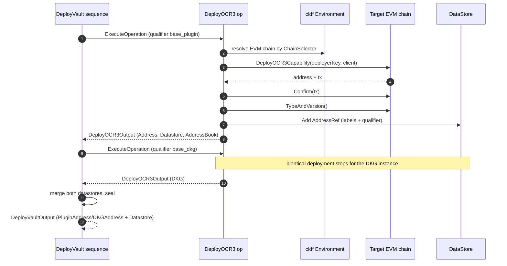
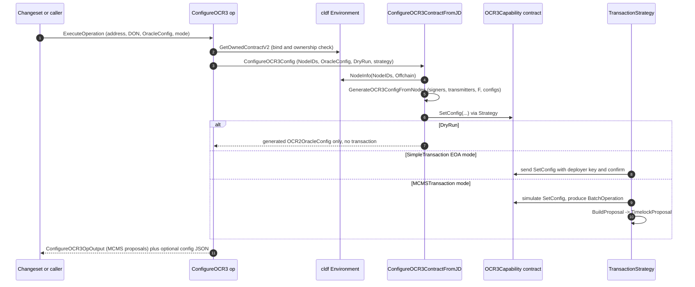
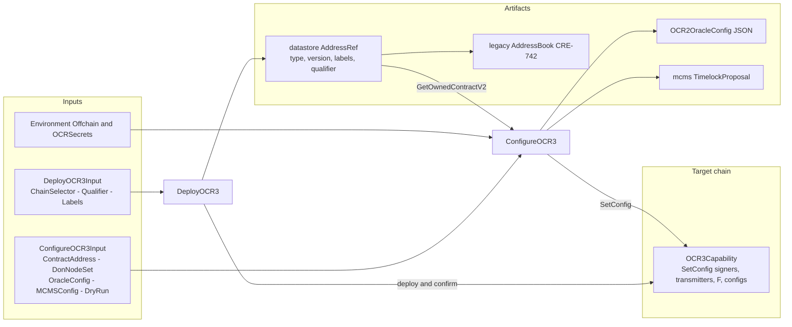

# CRE OCR3 v2 Lifecycle — Deploy & Configure

The `cre-ocr3_v2_lifecycle` module implements the **v2 deployment lifecycle for OCR3 contracts** in the Chainlink Runtime Environment (CRE) deployment suite. It lives under `chainlink/deployment/cre/ocr3/v2/changeset/` and provides two building blocks — a `DeployOCR3` operation and a `ConfigureOCR3` operation — plus a `DeployVault` sequence that composes the deploy operation to stand up a full Vault (OCR3 plugin + DKG) contract pair.

All components are built on the [chainlink-deployments-framework](../../Deployment_Framework_Core___Product_Deployments/deployment-common.md) `operations` primitives: an **operation** is a versioned, single-side-effect unit of work, and a **sequence** composes operations while merging their state artifacts (datastores).

> For the configuration schema that feeds this lifecycle (`OracleConfig`, `TopLevelConfigSource`, key generation), see [cre-ocr3_config](cre-ocr3_config.md). For the legacy (ocr3_1) vault configuration operations, see [cre-ocr3_1_vault](cre-ocr3_1_vault.md). For the OCR3/OCR2 runtime that ultimately consumes these contracts, see [OCR2/OCR3 delegate](../../Oracle_Engines___Data_Pipelines/ocr/ocr2_delegate.md).

---

## 1. Purpose and Core Functionality

Deploying an OCR3-based product on a chain requires two logically distinct steps:

1. **Deploy** the `OCR3Capability` contract (from the generated keystone wrapper `chainlink-evm/gethwrappers/keystone/generated/ocr3_capability_1_0_0`) and register its address in the deployment datastore.
2. **Configure** the deployed contract with an OCR3 signing committee (`SetConfig`) derived from the nodes of a DON, using either a direct EOA transaction or an MCMS timelock proposal.

This module packages both steps as reusable, versioned operations so that changesets (and the `DeployVault` sequence) can compose them without duplicating on-chain plumbing, address registration, or MCMS proposal building.

The code resides in the `chainlink/deployment` Go module (see `chainlink/deployment/go.mod`), which depends on `chainlink-deployments-framework` (operations, datastore, environment), `chainlink-evm` (contract wrappers) and `mcms` (timelock proposals).

### Component inventory

| File | Component | Kind | Summary |
|---|---|---|---|
| `changeset/operations/contracts/deploy_ocr3.go` | `DeployOCR3` | Operation `deploy-ocr3-op` (v1.0.0) | Deploys and registers one `OCR3Capability` contract on a target EVM chain. |
| `changeset/operations/contracts/deploy_ocr3.go` | `DeployOCR3Deps`, `DeployOCR3Input`, `DeployOCR3Output` | Types | Dependency, input and output contracts of the deploy operation. |
| `changeset/operations/contracts/configure_ocr3.go` | `ConfigureOCR3` | Operation `configure-ocr3-op` (v1.0.0) | Configures a deployed OCR3 contract with a DON committee; emits MCMS proposals when MCMS mode is used. |
| `changeset/operations/contracts/configure_ocr3.go` | `ConfigureOCR3Deps`, `ConfigureOCR3Input`, `ConfigureOCR3OpOutput` | Types | Dependency, input and output contracts of the configure operation. |
| `changeset/operations/contracts/types.go` | `DonNodeSet` | Type | `{Name, NodeIDs}` — identifies the DON whose nodes form the OCR3 committee. |
| `changeset/sequences/deploy_vault.go` | `DeployVault` | Sequence `deploy-vault-seq` (v1.0.0) | Deploys the Vault pair: an OCR3 **plugin** contract and an OCR3 **DKG** contract, merging their datastores. |
| `changeset/sequences/deploy_vault.go` | `DeployVaultDeps`, `DeployVaultInput`, `DeployVaultOutput` | Types | Dependency, input and output contracts of the vault sequence. |

---

## 2. Architecture

The module is a thin, composable layer on top of shared infrastructure. `DeployOCR3` and `ConfigureOCR3` are independent operations; `DeployVault` is a sequence that fans out to `DeployOCR3` twice. `ConfigureOCR3` delegates all OCR-specific configuration logic to the shared `ocr3` package (`ConfigureOCR3ContractFromJD`), and all transaction execution to a pluggable `TransactionStrategy`.

### Component relationships

- **Operations framework** (`operations.NewOperation` / `operations.NewSequence` from `chainlink-deployments-framework`): every operation is registered with a stable ID, semantic version and human-readable description. A `Bundle` carries per-execution context (reporting/artifacts); typed `Deps` structs inject the `cldf.Environment`.
- **`cldf.Environment`** is the single integration point with the outside world: `BlockChains.EVMChains()` resolves target chains by chain selector, `DataStore.Addresses()` provides address lookups, `Offchain` provides Job-Distributor-backed node metadata, and `OCRSecrets` supplies keys for offchain config generation.
- **`strategies.TransactionStrategy`** decouples "what to send" from "how to send it" (see §5). `strategies.CreateStrategy` returns an `MCMSTransaction` when an `MCMSConfig` is supplied, otherwise a `SimpleTransaction`.
- **`DonNodeSet`** carries only node identity (`Name`, `NodeIDs`); keys and addresses are resolved at configure time from the environment's offchain client, so deploy-time artifacts never need to embed node keys.

---

## 3. Lifecycle Flows

### 3.1 Deploy phase — `DeployOCR3` operation

Registered as `deploy-ocr3-op` v1.0.0 ("Deploy OCR3 Contract").

**Input — `DeployOCR3Input`:**

| Field | Type | Description |
|---|---|---|
| `ChainSelector` | `uint64` | Chain on which to deploy; must exist in `Env.BlockChains.EVMChains()`. |
| `Qualifier` | `string` | Disambiguates multiple OCR3 contracts of the same type on one chain (e.g. `myenv_plugin`). |
| `Labels` | `[]string` | Extra labels appended to the contract's on-chain type/version labels in the datastore. |

**Execution steps:**

1. Resolve the EVM chain for `ChainSelector` (error if missing).
2. Deploy via the generated wrapper `ocr3_capability.DeployOCR3Capability(chain.DeployerKey, chain.Client)` and wait for `chain.Confirm(tx)`.
3. Read the on-chain `TypeAndVersion()` to determine the contract type, version and labels.
4. Build a `datastore.AddressRef` (chain selector, address, contract type, version pointer, merged label set, qualifier).
5. Store the ref in a **fresh in-memory mutable datastore** and return it in the output — deliberately unsealed so the subsequent configure step can resolve the address.
6. Additionally save the address to a legacy `cldf.AddressBook` (marked `TODO: CRE-742 remove AddressBook`; the datastore is the forward-looking source of truth).

**Output — `DeployOCR3Output`:** `Address`, `ChainSelector`, `Qualifier`, `Type`, `Version`, `Labels`, `Datastore` (mutable) and `AddressBook` (legacy).

### 3.2 Vault composition — `DeployVault` sequence

Registered as `deploy-vault-seq` v1.0.0 ("Deploy Vault Contracts (OCR3 and DKG)"). It composes `DeployOCR3` twice with deterministic qualifiers:

1. **Vault Plugin** contract — qualifier `<base>_plugin`.
2. **Vault DKG** contract — qualifier `<base>_dkg` (distributed key generation instance).

The two mutable datastores from the deploy outputs are merged into a single `datastore.DataStore` and returned, so callers (system tests, changesets) can look up both addresses downstream in one artifact.

### 3.3 Configure phase — `ConfigureOCR3` operation

Registered as `configure-ocr3-op` v1.0.0 ("Configure OCR3 Contract"). It creates **no new addresses**; its side effect is a single `SetConfig` call on an existing contract (or an MCMS proposal for that call).

**Input — `ConfigureOCR3Input`:**

| Field | Type | Description |
|---|---|---|
| `ContractAddress` | `*common.Address` | Required. Address of the deployed OCR3 contract. |
| `ChainSelector` | `uint64` | Chain the contract lives on. |
| `DON` | `DonNodeSet` | Target DON; `NodeIDs` are resolved against `Env.Offchain`. |
| `Config` | `*ocr3.OracleConfig` | Offchain configuration schema (timings, quorum, plugin sub-configs) — see [cre-ocr3_config](cre-ocr3_config.md). |
| `DryRun` | `bool` | Generates the full config without sending any transaction. |
| `ReportingPluginConfigOverride` | `[]byte` | Optional raw override injected into the generated reporting-plugin offchain config. |
| `ExtraSignerFamilies` | `[]string` | Additional signer key families collected per node during key slicing. |
| `MCMSConfig` | `*contracts.MCMSConfig` | Non-nil switches the operation into MCMS mode (`UseMCMS()`); carries per-chain timelock qualifiers and the action used to select the MCMS instance. |

**Deps — `ConfigureOCR3Deps`:** `Env`, `WriteGeneratedConfig` (`io.Writer` that receives the generated `OCR2OracleConfig` as indented JSON — useful for auditing and for feeding job proposals, see [cre-jobs](../cre-jobs.md)), and `Strategy` (`strategies.TransactionStrategy`).

**Execution steps:**

1. Validate that `ContractAddress` is set and resolve the chain.
2. Bind to the contract via `contracts.GetOwnedContractV2[*ocr3_capability.OCR3Capability](Env.DataStore.Addresses(), chain, address, "")`. The returned binding includes `McmsContracts` when the contract is MCMS-owned, which the operation later requires in MCMS mode.
3. Delegate to `ocr3.ConfigureOCR3ContractFromJD`, which:
   - resolves node metadata via `deployment.NodeInfo(NodeIDs, Env.Offchain)`;
   - generates the complete `OCR2OracleConfig` (signers, transmitters, F threshold, onchain config, offchain config version and payload) via `GenerateOCR3ConfigFromNodes`, using `Env.OCRSecrets`, the optional reporting-plugin override and extra signer families;
   - invokes `contract.SetConfig(signers, transmitters, F, onchainConfig, offchainConfigVersion, offchainConfig)` **through the configured strategy**.
4. If `WriteGeneratedConfig` is set, marshal the generated config to JSON and write it (errors if not all bytes are written).
5. In MCMS mode, require both the returned batch operation and the contract's `McmsContracts`, then build a `mcmslib.TimelockProposal` via `Strategy.BuildProposal`.

**Output — `ConfigureOCR3OpOutput`:** `MCMSTimelockProposals []mcmslib.TimelockProposal` (empty in EOA/dry-run mode).

---

## 4. Data Flow and Persisted State

The lifecycle produces three classes of artifacts:

1. **On-chain state** — the deployed `OCR3Capability` contracts and their `SetConfig` committee configuration.
2. **Datastore artifacts** — `datastore.AddressRef` entries (address, type, version, labels, qualifier) that make contracts discoverable by later changesets via `Env.DataStore`. `DeployOCR3` returns them in a *mutable* store; `DeployVault` seals the merged store. The legacy `AddressBook` copy is retained only for backward compatibility (CRE-742).
3. **Off-chain artifacts** — the generated `OCR2OracleConfig` JSON (optionally streamed to `WriteGeneratedConfig`) and MCMS timelock proposals for multi-sig execution.

---

## 5. Execution Modes: EOA vs MCMS

The `TransactionStrategy` abstraction (in `chainlink/deployment/cre/common/strategies`) decides how `SetConfig` reaches the chain:

| Strategy | `Apply` behaviour | `BuildProposal` behaviour | Selected when |
|---|---|---|---|
| `SimpleTransaction` | Sends the call with `chain.DeployerKey` and confirms it. Returns `nil` batch operation. | Returns `nil` (not applicable). | `MCMSConfig == nil`. |
| `MCMSTransaction` | Executes the call with simulated transact opts, converts the calldata into an `mcmstypes.BatchOperation` targeted at the contract. | Assembles a `mcmslib.TimelockProposal` bound to the timelock/proposer from the pre-deployed `MCMSWithTimelockState` (selected per `MCMSConfig.MCMSAction`). | `MCMSConfig != nil` (requires pre-deployed MCMS contracts on the chain). |

Consequences for `ConfigureOCR3`:

- In **EOA mode** the output carries no proposals and the transaction is confirmed within the operation.
- In **MCMS mode** the operation fails fast if the contract is not actually MCMS-owned (`contract.McmsContracts == nil`), and the caller is responsible for proposing/approving/executing the returned `TimelockProposal` through MCMS governance.

---

## 6. Design Notes and Conventions

- **Versioned, single-purpose units.** Both operations and the sequence are pinned at v1.0.0, following the changeset-framework convention that each operation performs exactly one side effect (deploy+register, or configure). Recomposition, not extension, is the preferred evolution path.
- **Datastore is the source of truth.** `DeployOCR3` intentionally returns an unsealed mutable datastore so the configure step (or the enclosing sequence) can chain address lookups; `DeployVault` seals merged stores into an immutable `DataStore`. The `AddressBook` output exists solely for legacy callers and is slated for removal (CRE-742).
- **Qualifier conventions.** `DeployVault` appends `_plugin` and `_dkg` suffixes to the input qualifier. Custom deployments should follow a similar `<base>_<role>` pattern so datastore refs remain unambiguous.
- **Dry runs are side-effect free.** With `DryRun=true` the full OCR3 config is still generated (and can still be written via `WriteGeneratedConfig`), but no transaction is broadcast — the recommended way to validate `OracleConfig` and node keys before committing.
- **Node identity is deferred.** `DonNodeSet` holds only node IDs; keys/signers are resolved at configure time from the Job Distributor-backed offchain client, keeping deploy artifacts stable even if node keys rotate before configuration.
- **Keystone lineage.** The legacy Keystone pipeline exposes equivalent building blocks (`DeployOCR3ContractSequence*` in `chainlink/deployment/keystone/...`); see [keystone](../keystone.md) for that flavor and its job-spec generation (`OCR3JobConfigSpec`).

### Execution prerequisites

- An environment with the target EVM chain registered under the given chain selector.
- For configure: a datastore/address reference for the deployed OCR3 contract (typically the output of `DeployOCR3`/`DeployVault`), node IDs registered with the offchain client, and OCR secrets present in the environment.
- For MCMS mode: MCMS with timelock contracts already deployed on the chain, plus an `MCMSConfig` carrying the correct timelock qualifier and action.

---

## 7. Where This Fits in the System

- **Within the CRE suite:** OCR3 contracts are the on-chain backbone for CRE reporting capabilities. The [capabilities registry](../cre-capabilities-registry.md) registers DONs and capabilities; [cre-jobs](../cre-jobs.md) then proposes OCR3/bootstrap jobs that point nodes at the contracts deployed and configured here; forwarders ([cre-forwarder](../cre-forwarder.md)) relay workflow reports to destination chains.
- **Across the platform:** the deployed contracts are consumed at runtime by the OCR3/OCR2 plugin machinery ([OCR oracle engines](../../Oracle_Engines___Data_Pipelines/ocr/ocr2_delegate.md)) and by the workflow/capability runtime ([CRE engine](../../Workflow___Capability_Runtime_(CRE_Engine).md)). System tests exercise this same lifecycle through the Vault feature in [system-tests](../../Dev,_Test___Simulation_Environments/system-tests.md).
- **Framework layering:** this module follows the changeset → sequence → operation hierarchy described in [deployment framework core](../../Deployment_Framework_Core___Product_Deployments/deployment-common.md); it should be read together with the parent [cre-ocr3](../cre-ocr3.md) overview and the [suite index](../../CRE___Keystone_Deployment_Suite.md).
