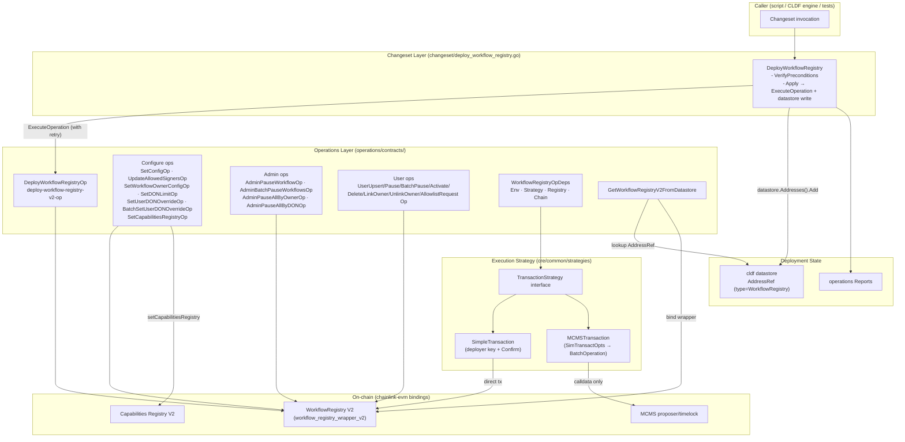
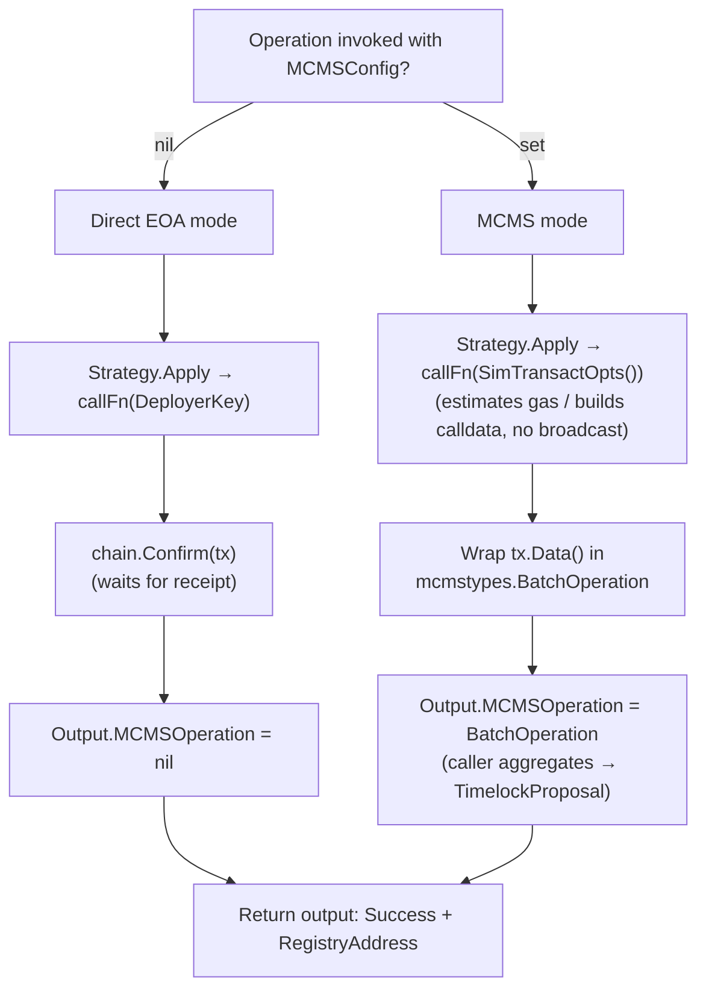
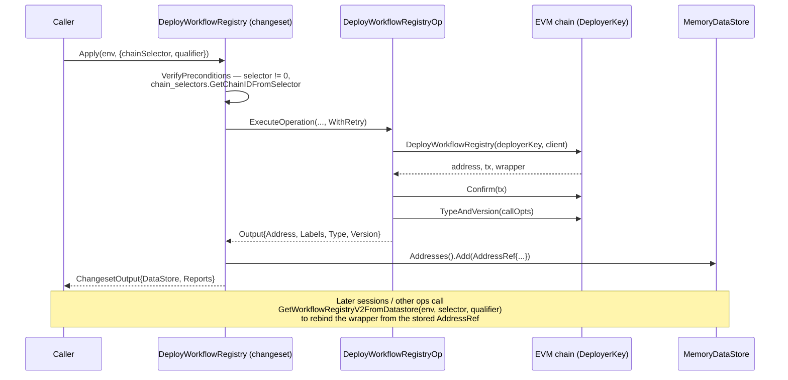

# cre-workflow-registry — Workflow Registry V2 Deployment Automation

> **Module page:** `CRE___Keystone_Deployment_Suite/cre-workflow-registry.md`
> **Repository root:** `chainlink/deployment/cre/workflow_registry/v2/`
> **Go module:** `github.com/smartcontractkit/chainlink/deployment` (see `chainlink/deployment/go.mod`)

## 1. Purpose and Scope

The **cre-workflow-registry** module provides the deployment automation for the **WorkflowRegistry V2** smart contract — the on-chain access-control and lifecycle registry that CRE (Chainlink Runtime Environment) workflows use to register, activate, pause, and delete workflow definitions.

It packages that functionality in the idioms of the Chainlink Deployments Framework (CLDF):

| Framework concept | Role in this module |
|---|---|
| **Changeset** (`cldf.ChangeSetV2`) | Top-level, user-facing unit of change: `DeployWorkflowRegistry`. Validates preconditions, orchestrates operations, and returns a datastore + reports. |
| **Operation** (`operations.NewOperation`) | Atomic, retryable side effect against one chain: deploy the registry, configure it, or mutate a workflow's lifecycle state. Every operation is versioned (semver) and identified by a stable op ID. |
| **Transaction strategy** (`strategies.TransactionStrategy`) | Dual-mode execution: either a **direct EOA transaction** (deployer key + on-chain confirmation) or an **MCMS multisig proposal** (simulated calldata assembled into a `BatchOperation`). |
| **Datastore** (`datastore.MemoryDataStore`) | Address book of deployed contracts, stored as `AddressRef` entries (chain selector, address, type, version, qualifier, labels). |

Concretely, the module lets a deployer:

1. **Deploy** a `WorkflowRegistry` V2 contract to a target EVM chain and record it in the datastore (`DeployWorkflowRegistry` changeset → `DeployWorkflowRegistryOp`).
2. **Configure** the registry as an admin: metadata limits, allowed signers, per-owner configs, DON limits and user overrides, and the linked Capabilities Registry.
3. **Manage workflow lifecycle** as users or admins: upsert, activate, pause (single/batch/all-by-owner/all-by-DON), delete, link/unlink owners, and allowlist requests.

Every mutating operation supports both execution modes and always reports the resulting `mcmstypes.BatchOperation` (nil for direct execution) plus the registry address, so higher-level callers can aggregate operations into MCMS timelock proposals.

## 2. Position in the CRE/Keystone Deployment Suite

This module is one of the product sub-modules of the [CRE & Keystone Deployment Suite](../CRE___Keystone_Deployment_Suite.md). It is tightly related to, but distinct from, its siblings:

- **[Capabilities Registry V2 deployment](cre-capabilities-registry.md)** — deploys and configures the *Capabilities Registry* contract. The Workflow Registry links to it via the `SetCapabilitiesRegistryOp` operation (`setCapabilitiesRegistry(registry, chainSelectorDON)`), so the two registries are usually deployed in sequence, workflow-registry-last.
- **[Keystone deployment module](keystone.md)** — contains the *predecessor* (V1-style) workflow-registry changesets under `chainlink/deployment/keystone/changeset/` (`deploy_workflow_registry_op.go`, `config_workflow_registry_seq.go`, `workflowregistry/strategies.go`). Those use the keystone-local `StrategyV2`/`SimpleTransactionV2`/`MCMSTransactionV2` strategy types and a different output schema (an `Addresses` AddressRefStore + legacy AddressBook). The module documented here is the **V2 rewrite** under `chainlink/deployment/cre/workflow_registry/v2/`, using the shared `cre/common/strategies` package and the CLDF datastore + generic-report pipeline. When working on CRE workflow deployments, prefer this module; the keystone copies remain for legacy keystone flows.
- **[cre-jobs](cre-jobs.md)** — proposes the OCR3/standard-capability jobs that consume workflow registrations on the node side.

### Shared framework dependencies

The module does not stand alone; it consumes the deployment framework core documented in [Deployment Framework Core & Product Deployments](../Deployment_Framework_Core___Product_Deployments.md) (`cldf.Environment`, operations bundle, datastore, MCMS helpers) and shared key dependencies pinned in `chainlink/deployment/go.mod`:

- `github.com/smartcontractkit/chainlink-deployments-framework` — changeset/operation/datastore abstractions
- `github.com/smartcontractkit/chainlink-evm` — generated `workflow_registry_wrapper_v2` Go bindings
- `github.com/smartcontractkit/mcms` — multisig control system types (`BatchOperation`, `TimelockProposal`)
- `github.com/smartcontractkit/chain-selectors` — chain-selector → chain-ID resolution
- `github.com/Masterminds/semver/v3` — operation/contract versioning

## 3. Architecture Overview

### Layered responsibilities

1. **Changeset layer** — single file, single changeset. `DeployWorkflowRegistry` is the only entry point that produces a `cldf.ChangesetOutput` (datastore + reports). All other functionality is exposed through reusable operations that higher-level sequences/changesets (e.g. keystone's `ConfigWorkflowRegistrySeq`) can compose. See [cre-workflow-registry_changeset](cre-workflow-registry/cre-workflow-registry_changeset.md).
2. **Operations layer** — 16 operations grouped by concern (deploy / configure / admin-pause / user-lifecycle), plus shared `WorkflowRegistryOpDeps` and the datastore-lookup helper. See:
   - [cre-workflow-registry_operations](cre-workflow-registry/cre-workflow-registry_operations.md) — deps, deploy op, and configuration ops
   - [cre-workflow-registry_lifecycle-operations](cre-workflow-registry/cre-workflow-registry_lifecycle-operations.md) — admin pause ops and user workflow lifecycle ops
3. **Strategy layer** — `strategies.TransactionStrategy` (in `chainlink/deployment/cre/common/strategies/`) abstracts *how* a contract call is executed. `SimpleTransaction` signs with the chain's `DeployerKey` and waits via `chain.Confirm`; `MCMSTransaction` uses `cldf.SimTransactOpts()` to build calldata without broadcasting and wraps it in a `mcmstypes.BatchOperation`.
4. **Contract layer** — the generated `workflow_registry_wrapper_v2` bindings; all contract reverts are normalized through `cldf.DecodeErr(WorkflowRegistryABI, err)`.

## 4. Dual Execution Modes (Direct vs MCMS)

Every mutating operation accepts an optional `MCMSConfig *contracts.MCMSConfig`. This is the module's central control flow:

Two operations deviate from the pure strategy pattern and are worth calling out:

- **`BatchSetUserDONOverrideOp`** bypasses the strategy abstraction so it can merge *N* overrides into a **single** `BatchOperation` (1 batch, N transactions) instead of N separate batches. When `MCMSConfig` is nil it requires `deps.Chain` to sign and confirm each transaction directly; when set, it only needs the registry + strategy and validates that `deps.Chain` (if provided) and `input.ChainSelector` agree to avoid proposals targeting the wrong chain.
- **Deploy ops** never take an `MCMSConfig` — deployment is always direct (the deployer must own the deployer key), while subsequent configuration can be routed through MCMS.

## 5. Data Flow: Deploy → Record → Retrieve

The datastore round-trip matters: operations never hard-code contract addresses. `GetWorkflowRegistryV2FromDatastore` filters `Addresses().Filter(AddressRefByChainSelector(...))` for `Type == "WorkflowRegistry"` and the requested `Qualifier`, binds a fresh wrapper via the chain's client, and emits rich debug logging (listing all available addresses) when the lookup fails. The `Qualifier` is therefore the mechanism for keeping multiple registries per chain distinct.

## 6. Sub-modules

Detailed documentation for each sub-module is maintained in its own page under `CRE___Keystone_Deployment_Suite/cre-workflow-registry/`:

| Sub-module | Contents | Source files | Documentation page |
|---|---|---|---|
| **Changeset entry point** | `DeployWorkflowRegistry` changeset, `DeployWorkflowRegistryInput`, `DeployWorkflowRegistryDeps` | `changeset/deploy_workflow_registry.go` | [cre-workflow-registry_changeset](cre-workflow-registry/cre-workflow-registry_changeset.md) |
| **Core & configuration operations** | `WorkflowRegistryOpDeps`, `DeployWorkflowRegistryOp`, `SetConfigOp`, `UpdateAllowedSignersOp`, `SetWorkflowOwnerConfigOp`, `SetDONLimitOp`, `SetUserDONOverrideOp`, `BatchSetUserDONOverrideOp`, `SetCapabilitiesRegistryOp`, `GetWorkflowRegistryV2FromDatastore` | `operations/contracts/deploy_workflow_registry_op.go`, `operations/contracts/configure_workflow_registry_ops.go` | [cre-workflow-registry_operations](cre-workflow-registry/cre-workflow-registry_operations.md) |
| **Lifecycle operations (admin & user)** | `AdminPauseWorkflowOp`, `AdminBatchPauseWorkflowsOp`, `AdminPauseAllByOwnerOp`, `AdminPauseAllByDONOp`, `UserUpsertWorkflowOp`, `UserPauseWorkflowOp`, `UserBatchPauseWorkflowOp`, `UserActivateWorkflowOp`, `UserDeleteWorkflowOp`, `UserLinkOwnerOp`, `UserUnlinkOwnerOp`, `UserAllowlistRequestOp` | `operations/contracts/admin_workflow_registry_ops.go`, `operations/contracts/user_workflow_registry_ops.go` | [cre-workflow-registry_lifecycle-operations](cre-workflow-registry/cre-workflow-registry_lifecycle-operations.md) |

## 7. Operation Catalog

| Operation ID | Input → Output | MCMS? | Access | Purpose |
|---|---|---|---|---|
| `deploy-workflow-registry-v2-op` | `{chainSelector, qualifier}` → `{address, labels, type, version}` | never | deployer | Deploy the registry contract and read its on-chain type/version |
| `set-metadata-config-op` | name/tag/url/attr/expiry lengths | opt-in | admin | Set metadata length limits used for workflow name/tag/URL validation |
| `update-allowed-signers-op` | signers[] + allowed flag | opt-in | admin | Grant/revoke signer allowlist (≥1 signer required) |
| `set-workflow-owner-config-op` | owner + config bytes | opt-in | admin | Per-owner workflow configuration blob |
| `set-don-limit-op` | donFamily, donLimit, userDefaultLimit | opt-in | admin | DON-family workflow quotas |
| `set-user-don-override-op` | user, donFamily, limit, enabled | opt-in | admin | Per-user DON quota override |
| `batch-set-user-don-override-op` | overrides[] | merged single batch / direct | admin | Bulk quota overrides (1 BatchOperation, N txs) |
| `set-capabilities-registry-op` | registry address, chainSelectorDON | opt-in | admin | Link the Capabilities Registry |
| `admin-pause-workflow-op` | workflowID | opt-in | admin | Pause a single workflow |
| `admin-batch-pause-workflows-op` | workflowIDs[] | opt-in | admin | Pause multiple workflows (≥1 ID) |
| `admin-pause-all-by-owner-op` | owner, limit | opt-in | admin | Pause all workflows of an owner (bounded by limit) |
| `admin-pause-all-by-don-op` | donFamily, limit | opt-in | admin | Pause all workflows in a DON family (bounded by limit) |
| `user-upsert-workflow-op` | name/tag/ID/status/donFamily/URLs/attrs/keepAlive | opt-in | user | Register or update a workflow definition |
| `user-pause-workflow-op` / `user-batch-pause-workflow-op` | workflowID(s) | opt-in | user | Owner-initiated pause |
| `user-activate-workflow-op` | workflowID, donFamily | opt-in | user | Re-activate a paused workflow |
| `user-delete-workflow-op` | workflowID | opt-in | user | Remove a workflow |
| `user-link-owner-op` / `user-unlink-owner-op` | validityTimestamp, proof/signature | opt-in | user | Ownership binding (signature-verified) |
| `user-allowlist-request-op` | requestDigest, expiryTimestamp | opt-in | user | Allowlist a request digest with expiry |

All lifecycle ops return `{Success, RegistryAddress, MCMSOperation}` so results can be chained into MCMS proposals by callers.

## 8. Design Notes & Invariants

- **JSON-serializable inputs.** Changeset/operation inputs carry no private fields or live pointers (except via deps), so they can be persisted and replayed by the CLDF engine. `DeployWorkflowRegistryInput` documents this requirement explicitly.
- **Revert fidelity.** Every contract call error passes through `cldf.DecodeErr(workflow_registry_v2.WorkflowRegistryABI, err)` so callers get decoded revert reasons instead of raw ABI errors.
- **Retryable operations.** The changeset executes the deploy op with `operations.WithRetry(...)`, making transient RPC failures safe to retry.
- **Unique op identity.** Ops embed `ChainSelector` + `Qualifier` in their inputs purely to make invocations uniquely identifiable (the registry binding itself travels via `WorkflowRegistryOpDeps`).
- **No address hard-coding.** Contract discovery always flows through the CLDF datastore (`GetWorkflowRegistryV2FromDatastore`), keeping deployment state authoritative and portable.
- **Chain-selector agreement.** `BatchSetUserDONOverrideOp` refuses to build a proposal when `input.ChainSelector` and `deps.Chain` disagree — a guard against silently targeting the wrong chain in MCMS-only invocations.

## 9. Related Documentation

- Parent suite overview: [CRE & Keystone Deployment Suite](../CRE___Keystone_Deployment_Suite.md)
- Capabilities Registry V2 (linked via `SetCapabilitiesRegistryOp`): [cre-capabilities-registry](cre-capabilities-registry.md)
- Legacy keystone workflow-registry flows (predecessor implementation): [keystone](keystone.md)
- Shared deployment framework (changesets, operations, datastore, MCMS helpers): [Deployment Framework Core & Product Deployments](../Deployment_Framework_Core___Product_Deployments.md)
- Consumer-side CLI that talks to a deployed registry (deploy/activate/pause/delete strategies): [cre-cli-workflow-commands](../../Developer_Toolchain_(CLI,_SDKs___API_Clients)/cre-cli-workflow-commands.md)
