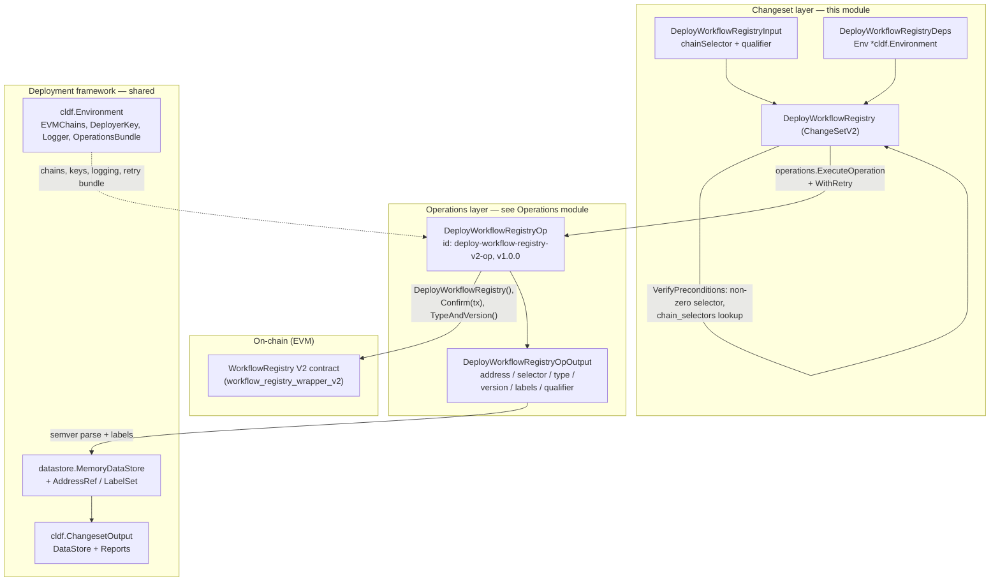
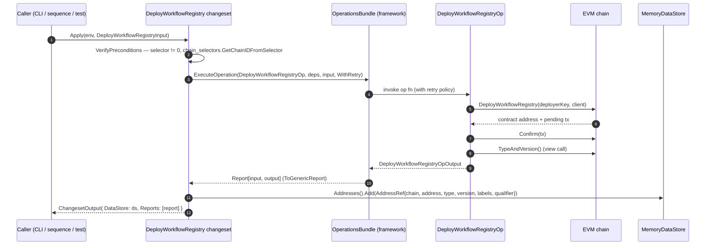
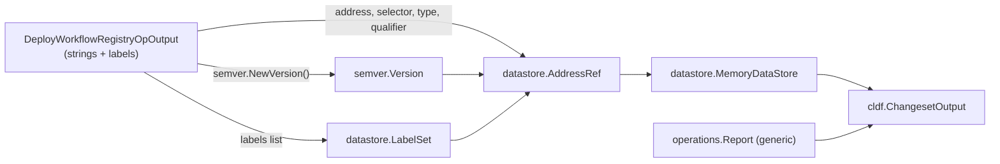
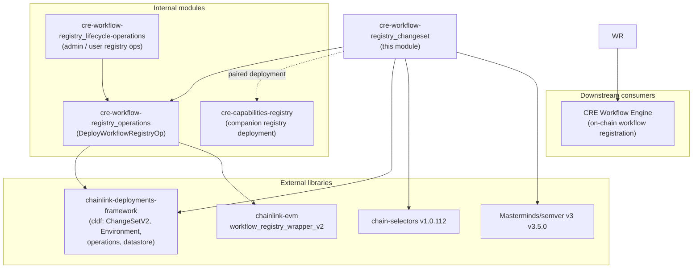

# CRE Workflow Registry V2 — Changeset Layer (`cre-workflow-registry_changeset`)

## 1. Introduction

The `cre-workflow-registry_changeset` module provides the **high-level changeset entry points** for deploying the **Workflow Registry V2** on-chain contract as part of CRE (Chainlink Runtime Environment) deployments. It is a leaf module of the [cre-workflow-registry](../cre-workflow-registry.md) family inside the [CRE & Keystone Deployment Suite](../../CRE___Keystone_Deployment_Suite.md).

A *changeset* is the outermost, declarative unit of work in the deployment framework: it accepts a JSON-serializable configuration, verifies preconditions, orchestrates one or more **operations** (the atomic units that touch chain state), and returns a structured output containing **reports** and a **datastore** describing everything that was created. This module implements exactly one changeset — `DeployWorkflowRegistry` — which deploys the Workflow Registry V2 contract onto a target EVM chain and records its address reference in the framework datastore.

The heavy lifting (actual contract deployment, transaction confirmation, on-chain metadata extraction) is delegated to the operations layer documented in [cre-workflow-registry_operations](cre-workflow-registry_operations.md); the per-workflow lifecycle operations (pause/activate/upsert, etc.) are documented in [cre-workflow-registry_lifecycle-operations](cre-workflow-registry_lifecycle-operations.md).

- **Source file:** `chainlink/deployment/cre/workflow_registry/v2/changeset/deploy_workflow_registry.go`
- **Go module:** `github.com/smartcontractkit/chainlink/deployment` (see `chainlink/deployment/go.mod`, Go 1.27.1)
- **Framework:** [Deployment Framework Core & Product Deployments](../../Deployment_Framework_Core___Product_Deployments.md) (`chainlink-deployments-framework`)

---

## 2. Core Functionality

### 2.1 The `DeployWorkflowRegistry` changeset

The changeset implements the framework interface `cldf.ChangeSetV2[DeployWorkflowRegistryInput]`, guaranteeing it can be executed by any framework-compliant runner (CLI, test harness, sequence orchestrator).

```go
// Source: chainlink/deployment/cre/workflow_registry/v2/changeset/deploy_workflow_registry.go

type DeployWorkflowRegistryInput struct {
    ChainSelector uint64 `json:"chainSelector"`
    Qualifier     string `json:"qualifier,omitempty"`
}

type DeployWorkflowRegistryDeps struct {
    Env *cldf.Environment
}

type DeployWorkflowRegistry struct{}

var _ cldf.ChangeSetV2[DeployWorkflowRegistryInput] = DeployWorkflowRegistry{}
```

| Component | Role |
|---|---|
| `DeployWorkflowRegistryInput` | JSON-serializable request: the target `ChainSelector` and an optional `Qualifier` used to disambiguate multiple registries of the same type on one chain. Must contain **no private fields** (a framework requirement for state persistence/replay). |
| `DeployWorkflowRegistryDeps` | Dependency bundle injected into the changeset; currently carries the framework `*cldf.Environment` (chain clients, deployer keys, logger, operations bundle). |
| `DeployWorkflowRegistry` | Stateless changeset value with `VerifyPreconditions` and `Apply` methods. |

### 2.2 Preconditions (`VerifyPreconditions`)

Before any chain interaction, the changeset validates its input:

1. **Selector presence** — `ChainSelector == 0` is rejected outright.
2. **Selector resolvability** — the selector is resolved to a chain ID via `chain_selectors.GetChainIDFromSelector` (from `github.com/smartcontractkit/chain-selectors`), failing fast on unknown chains.

This ensures the operations layer never receives an invalid selector — the operations themselves re-resolve the chain from `Env.BlockChains.EVMChains()` and fail with `chain not found for selector %d` if the environment has no EVM chain bound to it.

### 2.3 Execution (`Apply`)

`Apply` orchestrates the deployment in three phases:

1. **Operation execution** — runs `contracts.DeployWorkflowRegistryOp` through `operations.ExecuteOperation` on the environment's `OperationsBundle`, wrapped with `operations.WithRetry` for automatic transient-failure retries. The operation deploys the contract using the `workflow_registry_wrapper_v2` geth bindings, confirms the transaction, reads the on-chain `TypeAndVersion()` and returns a `DeployWorkflowRegistryOpOutput`.
2. **Datastore materialization** — creates an in-memory `datastore.MemoryDataStore`, re-parses the reported version string into a `semver.Version`, and constructs a `datastore.AddressRef` from the operation output (chain selector, address, contract type, version, qualifier, labels).
3. **Structured output** — returns a `cldf.ChangesetOutput` carrying the populated datastore plus the generic operation report.

---

## 3. Architecture

The module sits at the **changeset layer** of a three-tier deployment stack: changesets (composable, user-facing) → operations (atomic side effects) → on-chain contracts. Supporting infrastructure is provided by the shared deployment framework.



**Key architectural properties**

- **Thin changeset / fat operation.** The changeset contains zero chain logic; all side effects are confined to the retried, reportable operation. This keeps the changeset idempotent to orchestrate and trivially testable.
- **Stateless composition.** `DeployWorkflowRegistry` is an empty struct; the only mutable state is the framework-provided environment and the datastore returned to the caller.
- **Schema-stable output.** `DeployWorkflowRegistryInput` and the operation output are explicitly designed to be JSON-serializable, allowing deployments to be checkpointed and replayed by the framework.

---

## 4. Deployment Process Flow

The end-to-end flow of a registry deployment, from caller invocation to persisted output:



Failure behavior at each stage:

| Stage | Failure mode | Handling |
|---|---|---|
| Precondition check | zero selector / unresolvable selector | Immediate error, no chain interaction |
| Chain resolution (inside op) | selector present but no EVM chain in environment | `chain not found for selector %d` |
| Deployment tx | contract deploy fails | ABI-aware error via `cldf.DecodeErr(WorkflowRegistryABI, ...)`; retried by `WithRetry` |
| Confirmation | tx confirmation failure | Wrapped error; retried |
| Metadata read | `TypeAndVersion()` call or parse failure | Wrapped error; retried |
| Datastore write | version parse or `Addresses().Add` failure | Error propagated, deployment output **not** returned (caller should re-run; the operation is retryable) |

---

## 5. Data Flow & Output Contract

The changeset is also responsible for converting the operation's ad-hoc output into framework-native state records:



The resulting `cldf.ChangesetOutput` is the canonical record other changesets, sequences, and view loaders consume. This differs from the **legacy keystone (v1) counterpart** — `chainlink/deployment/keystone/changeset/operations/contracts/deploy_workflow_registry_op.go`, whose output returned an `AddressBook` alongside the datastore for backward compatibility. The CRE v2 changeset is datastore-only, reflecting the framework's migration toward datastore-centric state (see [Deployment Framework Core & Product Deployments](../../Deployment_Framework_Core___Product_Deployments/deployment-common.md)).

---

## 6. Dependencies



| Dependency | Purpose | Citation |
|---|---|---|
| `chainlink-deployments-framework` | `ChangeSetV2` contract, `Environment`, `ChangesetOutput`, `operations.ExecuteOperation`, `datastore` | `chainlink/deployment/go.mod` |
| `github.com/smartcontractkit/chain-selectors` | Chain selector ↔ chain ID resolution and validation | `chainlink/deployment/go.mod` (v1.0.112) |
| `github.com/Masterminds/semver/v3` | Re-parsing the deployed contract's version for the datastore record | `chainlink/deployment/go.mod` (v3.5.0) |
| `workflow_registry_wrapper_v2` (chainlink-evm) | Generated go-ethereum bindings used by the operation to deploy and read `TypeAndVersion` | see [cre-workflow-registry_operations](cre-workflow-registry_operations.md) |
| `contracts.DeployWorkflowRegistryOp{,Deps,Input,Output}` | The atomic deploy operation this changeset delegates to | `.../v2/changeset/operations/contracts/deploy_workflow_registry_op.go` |

---

## 7. Integration with the Broader System

Within the [CRE & Keystone Deployment Suite](../../CRE___Keystone_Deployment_Suite.md), this module plays a specific role:

- **Registry provisioning step.** Before any workflow can be registered, paused, or activated on-chain (the admin/user operations in [cre-workflow-registry_lifecycle-operations](cre-workflow-registry_lifecycle-operations.md)), the registry contract must exist. This module provides that provisioning step and is typically the first changeset in a workflow-registry deployment sequence.
- **Paired with the Capabilities Registry.** In full CRE stacks, the workflow registry is deployed alongside the Capabilities Registry (documented in [cre-capabilities-registry](../cre-capabilities-registry.md)); the registry later links to the capabilities registry contract via its configuration operations.
- **Keystone lineage.** The suite retains the legacy keystone v1 deployment code in [keystone](../keystone.md). Its workflow-registry output (`Addresses` + `AddressBook`) has been superseded by the datastore-based output introduced in this v2 module.
- **Runtime counterpart.** The deployed on-chain registry is consumed at runtime by the workflow syncer / engine in the [Workflow & Capability Runtime (CRE Engine)](../../Workflow___Capability_Runtime_(CRE_Engine).md), where workflow registration state is read and validated against capabilities in the [Capabilities Registry](../../Workflow___Capability_Runtime_(CRE_Engine)/capabilities/capabilities_registry.md).
- **Framework contract.** As a `ChangeSetV2` implementation, the module plugs into any deployment runner built on the [Deployment Framework Core](../../Deployment_Framework_Core___Product_Deployments.md), including sequences composed of multiple changesets.

---

## 8. Developer Notes

- **Adding a qualifier.** `Qualifier` flows verbatim from input → operation → output → `AddressRef.Qualifier`, enabling multiple workflow registry instances (e.g., different owners or environments) on the same chain.
- **Testing.** The changeset is covered by `chainlink/deployment/cre/workflow_registry/v2/changeset/deploy_workflow_registry_test.go` alongside a shared test fixture (`fixture_test.go`) that builds a simulated environment. The same package hosts the sibling `configure_`, `admin_`, and `user_workflow_registry` changesets, whose operation layers are documented in the sibling pages.
- **Extending the changeset.** To add steps (e.g., post-deploy configuration), append further `operations.ExecuteOperation` calls in `Apply` and merge their reports into the `reports` slice; keep the datastore population last so a failure short-circuits with no partial records. See [cre-workflow-registry_operations](cre-workflow-registry_operations.md) for the available operation inventory.
- **Retry semantics.** `operations.WithRetry` retries only the operation (transient RPC/confirmation failures); precondition failures are never retried.

## 9. References

- Core source: `chainlink/deployment/cre/workflow_registry/v2/changeset/deploy_workflow_registry.go`
- Delegated operation: `chainlink/deployment/cre/workflow_registry/v2/changeset/operations/contracts/deploy_workflow_registry_op.go`
- Go module manifest: `chainlink/deployment/go.mod`
- Parent module: [cre-workflow-registry](../cre-workflow-registry.md)
- Sibling modules: [cre-workflow-registry_operations](cre-workflow-registry_operations.md) · [cre-workflow-registry_lifecycle-operations](cre-workflow-registry_lifecycle-operations.md)
- Suite overview: [CRE & Keystone Deployment Suite](../../CRE___Keystone_Deployment_Suite.md)