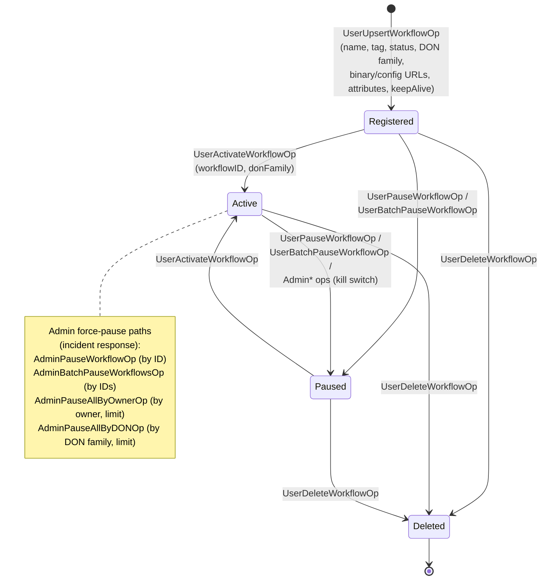
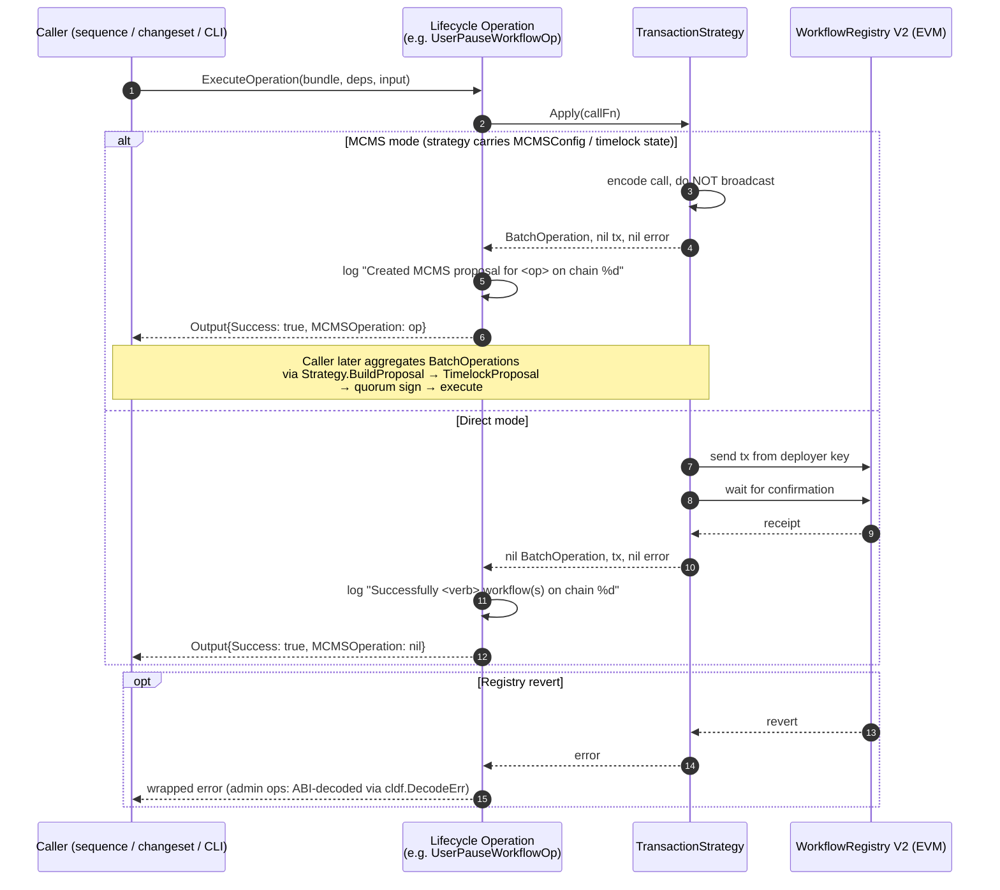
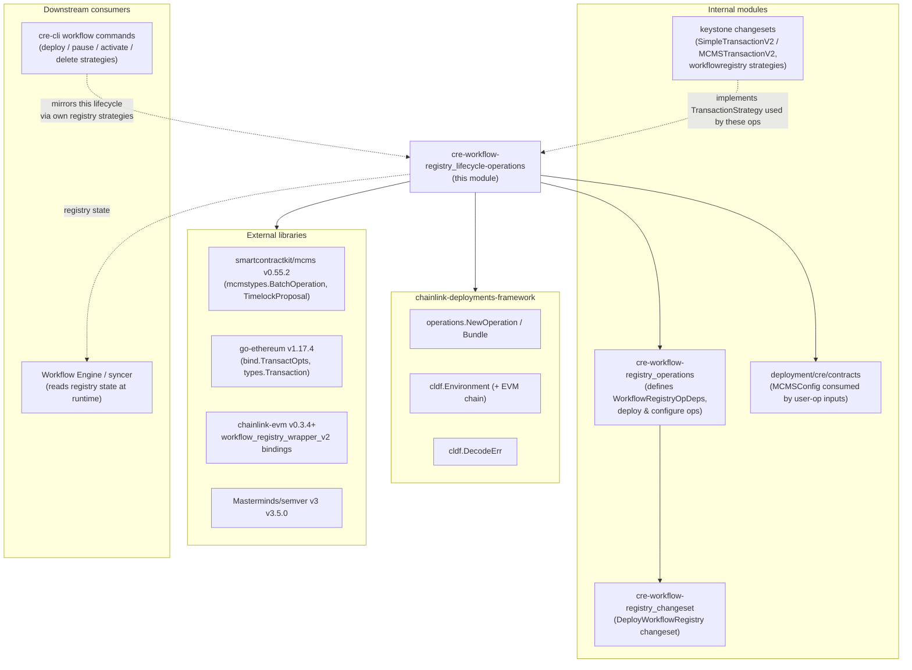

# CRE Workflow Registry V2 — Lifecycle Operations (`cre-workflow-registry_lifecycle-operations`)

## 1. Introduction

The `cre-workflow-registry_lifecycle-operations` module implements the **per-workflow lifecycle operations** for the **Workflow Registry V2** on-chain contract: registering (upserting), activating, pausing, and deleting workflows, plus the ownership-linking and allowlist-request flows and the privileged admin "kill switch" batch controls. It is a leaf module of the [cre-workflow-registry](../cre-workflow-registry.md) family inside the [CRE & Keystone Deployment Suite](../../CRE___Keystone_Deployment_Suite.md).

Whereas the sibling modules cover the *plumbing* — the deployment changeset in [cre-workflow-registry_changeset](cre-workflow-registry_changeset.md) and the deploy/configure operations in [cre-workflow-registry_operations](cre-workflow-registry_operations.md) — this module exposes the **day-2 operations surface**: everything that changes the state of a *registered workflow* (or of a whole population of workflows) after the registry contract itself has been deployed and configured.

- **Source files:**
  - `chainlink/deployment/cre/workflow_registry/v2/changeset/operations/contracts/admin_workflow_registry_ops.go` (4 admin operations)
  - `chainlink/deployment/cre/workflow_registry/v2/changeset/operations/contracts/user_workflow_registry_ops.go` (8 user operations)
- **Go module:** `github.com/smartcontractkit/chainlink/deployment` (Go 1.27.1, `chainlink/deployment/go.mod`)
- **Framework:** [Deployment Framework Core & Product Deployments](../../Deployment_Framework_Core___Product_Deployments.md) (`chainlink-deployments-framework` v0.123.3) and `mcms` v0.55.2 for proposal plumbing

### 1.1 Operation inventory

All twelve operations are package-level `operations.Operation` values created via `operations.NewOperation`, versioned `1.0.0`, and typed as `contracts` ops against the `workflow_registry_wrapper_v2` bindings.

**Admin (privileged) operations** — `admin_workflow_registry_ops.go`:

| Operation ID | Go symbol | Registry call | Purpose |
|---|---|---|---|
| `admin-pause-workflow-op` | `AdminPauseWorkflowOp` | `AdminPauseWorkflow(workflowID)` | Pause a single workflow by 32-byte ID |
| `admin-batch-pause-workflows-op` | `AdminBatchPauseWorkflowsOp` | `AdminBatchPauseWorkflows(workflowIDs)` | Pause many workflows in one call (rejects empty ID list) |
| `admin-pause-all-by-owner-op` | `AdminPauseAllByOwnerOp` | `AdminPauseAllByOwner(owner, limit)` | Pause every workflow owned by an address, capped by `limit` |
| `admin-pause-all-by-don-op` | `AdminPauseAllByDONOp` | `AdminPauseAllByDON(donFamily, limit)` | Pause every workflow in a DON family, capped by `limit` |

**User (workflow-owner) operations** — `user_workflow_registry_ops.go`:

| Operation ID | Go symbol | Registry call | Purpose |
|---|---|---|---|
| `user-upsert-workflow-op` | `UserUpsertWorkflowOp` | `UpsertWorkflow(name, tag, id, status, donFamily, binaryURL, configURL, attributes, keepAlive)` | Create or update a workflow's registration metadata |
| `user-pause-workflow-op` | `UserPauseWorkflowOp` | `PauseWorkflow(workflowID)` | Owner pauses one workflow |
| `user-batch-pause-workflow-op` | `UserBatchPauseWorkflowOp` | `BatchPauseWorkflows(workflowIDs)` | Owner pauses many workflows |
| `user-activate-workflow-op` | `UserActivateWorkflowOp` | `ActivateWorkflow(workflowID, donFamily)` | Activate (or re-activate) a workflow against a DON family |
| `user-delete-workflow-op` | `UserDeleteWorkflowOp` | `DeleteWorkflow(workflowID)` | Remove a workflow registration |
| `user-link-owner-op` | `UserLinkOwnerOp` | `LinkOwner(validityTimestamp, proof, signature)` | Bind a caller to an owner identity via signed proof |
| `user-unlink-owner-op` | `UserUnlinkOwnerOp` | `UnlinkOwner(address, validityTimestamp, signature)` | Release a caller↔owner binding via signed message |
| `user-allowlist-request-op` | `UserAllowlistRequestOp` | `AllowlistRequest(requestDigest, expiryTimestamp)` | Submit a time-bounded allowlist request by digest |

---

## 2. Core Functionality

### 2.1 Uniform operation shape

Every operation in this module follows the same skeleton, which is what makes the surface predictable and composable:

```go
// Shared dependency bundle (defined in configure_workflow_registry_ops.go, same package)
type WorkflowRegistryOpDeps struct {
    Env      *cldf.Environment
    Strategy strategies.TransactionStrategy
    Registry *workflow_registry_v2.WorkflowRegistry
    Chain    *cldf_evm.Chain // optional; see comment in source
}

var SomeLifecycleOp = operations.NewOperation(
    "some-op-id", semver.MustParse("1.0.0"), "Description",
    func(b operations.Bundle, deps WorkflowRegistryOpDeps, input SomeOpInput) (SomeOpOutput, error) {
        operation, _, err := deps.Strategy.Apply(func(opts *bind.TransactOpts) (*types.Transaction, error) {
            return deps.Registry.SomeRegistryMethod(opts, /* payload */)
        })
        // decode / wrap errors, log MCMS-vs-direct outcome, return output
    },
)
```

| Element | Role |
|---|---|
| `Input` struct | JSON-serializable request payload plus routing fields (`ChainSelector`, `Qualifier`) and, for user ops, an optional `MCMSConfig *contracts.MCMSConfig` consumed by the caller when constructing the strategy. |
| `WorkflowRegistryOpDeps` | Injected bundle: framework environment, the **transaction strategy** (direct vs MCMS), the typed registry binding, and optionally the EVM chain. |
| `deps.Strategy.Apply(...)` | The single execution choke point. Receives a closure that performs the contract call and returns either an `*mcmstypes.BatchOperation` (MCMS path) or `nil` (direct path, tx signed and confirmed by the strategy). |
| `Output` struct | **Identical across all twelve ops:** `{ Success bool; RegistryAddress common.Address; MCMSOperation *mcmstypes.BatchOperation }`. |
| Description constants | Per-op string constants (`PauseWorkflowDescription`, `UpsertWorkflowUserDescription`, …) used as MCMS proposal descriptions. |

### 2.2 Admin operations — privileged kill switches

The admin operations are **incident-response controls**. All four funnel into the registry's `Admin*` functions, which are callable only by the registry admin and can force workflows into a paused state en masse:

- **`AdminPauseWorkflowOp`** — targeted pause of one `workflowID`.
- **`AdminBatchPauseWorkflowsOp`** — pauses a caller-supplied batch; the only lifecycle op with its own input validation (`len(input.WorkflowIDs) == 0` → error `must provide at least one workflow ID`).
- **`AdminPauseAllByOwnerOp`** — pauses all workflows of a `common.Address` owner, bounded by an optional `*big.Int` `limit` (allowing incremental, gas-bounded sweeps).
- **`AdminPauseAllByDONOp`** — pauses all workflows in a `donFamily` string, also bounded by `limit`.

Notable behaviors:

1. **ABI-aware error decoding.** All four admin ops route errors through `cldf.DecodeErr(workflow_registry_v2.WorkflowRegistryABI, err)` so revert reasons surface as human-readable messages.
2. **No `MCMSConfig` in the admin inputs.** The execution mode is decided entirely by whichever `Strategy` the composing changeset/sequence wires into `WorkflowRegistryOpDeps` — keeping the admin surface strategy-agnostic.
3. **Outcome logging.** Each op logs an MCMS-proposal message (`Created MCMS proposal for <op> … on chain %d`) when `operation != nil`, otherwise a success message for the direct-execution path.

### 2.3 User operations — owner-facing lifecycle

The user operations cover the full CRUD + lifecycle surface for workflow owners:

- **Registration (`UserUpsertWorkflowOp`).** The richest input: `WorkflowID [32]byte`, `WorkflowName`, `WorkflowTag`, `WorkflowStatus uint8`, `DonFamily`, `BinaryURL`, `ConfigURL`, `Attributes []byte`, and `KeepAlive bool`. It maps 1:1 to the registry's `UpsertWorkflow` and is the only op that touches *all* workflow metadata at once.
- **State transitions (`UserPauseWorkflowOp`, `UserBatchPauseWorkflowOp`, `UserActivateWorkflowOp`, `UserDeleteWorkflowOp`).** See the state machine in §4.
- **Identity binding (`UserLinkOwnerOp`, `UserUnlinkOwnerOp`).** These implement the registry's signature-verified owner-binding scheme: linking takes a `ValidityTimestamp *big.Int`, a `Proof [32]byte`, and a `Signature []byte`; unlinking takes the `Address` to release plus `ValidityTimestamp` and `Signature`. This allows a workflow owner identity to be exercised by a different on-chain caller without transferring keys.
- **Access (`UserAllowlistRequestOp`).** Submits an `AllowlistRequest` with a `RequestDigest [32]byte` and `ExpiryTimestamp uint32` — a time-bounded, digest-scoped permission request.

Differences from the admin surface:

| Aspect | Admin ops | User ops |
|---|---|---|
| Input carries `MCMSConfig` | No | Yes (`*contracts.MCMSConfig`, `omitempty`) — used by callers to select the MCMS strategy |
| Error handling | ABI-decoded via `cldf.DecodeErr(WorkflowRegistryABI, …)` | Wrapped with `fmt.Errorf("%w")` (call error + execution error) |
| Scope | Single / batch / owner-wide / DON-wide pause | Per-workflow CRUD, identity, allowlist |
| Authority | Registry admin | Workflow owner / linked caller |

### 2.4 The strategy seam

The central design element is `strategies.TransactionStrategy` (`chainlink/deployment/cre/common/strategies/strategies.go`):

```go
type TransactionStrategy interface {
    Apply(callFn func(opts *bind.TransactOpts) (*types.Transaction, error))
        (*mcmstypes.BatchOperation, *types.Transaction, error)
    BuildProposal(operations []mcmstypes.BatchOperation) (*mcmslib.TimelockProposal, error)
}
```

Every lifecycle operation calls the registry **exclusively through `Strategy.Apply`**, so the identical op code produces either:

- a **direct transaction** (signed by the environment deployer key and confirmed by the strategy; `MCMSOperation == nil` in the output), or
- an **MCMS batch operation** (accumulated by the strategy and later assembled into a `TimelockProposal` via `BuildProposal`; `MCMSOperation != nil`).

Reference strategy implementations used with these ops include the keystone changeset strategies `SimpleTransactionV2` and `MCMSTransactionV2` (see [keystone](../keystone.md)) and the CLI-side workflow strategies (see §7).

---

## 3. Architecture

### 3.1 Component map

```mermaid
flowchart TB
    subgraph CALLERS["Composition layer (changesets / sequences / CLI)"]
        CS["Workflow-registry changesets &amp; sequences<br/>(build WorkflowRegistryOpDeps:<br/>Env + Strategy + Registry + Chain)"]
    end

    subgraph THIS["This module — lifecycle operations (v2/changeset/operations/contracts)"]
        subgraph ADMIN["admin_workflow_registry_ops.go"]
            OP1["AdminPauseWorkflowOp"]
            OP2["AdminBatchPauseWorkflowsOp"]
            OP3["AdminPauseAllByOwnerOp"]
            OP4["AdminPauseAllByDONOp"]
        end
        subgraph USER["user_workflow_registry_ops.go"]
            UP1["UserUpsertWorkflowOp"]
            UP2["UserPauseWorkflowOp"]
            UP3["UserBatchPauseWorkflowOp"]
            UP4["UserActivateWorkflowOp"]
            UP5["UserDeleteWorkflowOp"]
            UP6["UserLinkOwnerOp"]
            UP7["UserUnlinkOwnerOp"]
            UP8["UserAllowlistRequestOp"]
        end
        DEPS["WorkflowRegistryOpDeps<br/>{Env, Strategy, Registry, Chain}"]
        OUTS["Uniform outputs:<br/>{Success, RegistryAddress, MCMSOperation}"]
    end

    subgraph SEAM["Strategy seam"]
        STRAT["strategies.TransactionStrategy<br/>Apply / BuildProposal"]
        DIRECT["Direct path:<br/>deployer key + Confirm"]
        MCMS["MCMS path:<br/>BatchOperation → TimelockProposal"]
    end

    subgraph ONCHAIN["On-chain (EVM)"]
        WR["WorkflowRegistry V2<br/>(workflow_registry_wrapper_v2)"]
    end

    CS -->|"ExecuteOperation(deps, input)"| ADMIN &amp; USER
    DEPS --> ADMIN &amp; USER
    ADMIN &amp; USER --> OUTS
    ADMIN &amp; USER -->|"deps.Strategy.Apply(callFn)"| STRAT
    STRAT --> DIRECT -->|"sends &amp; confirms tx"| WR
    STRAT --> MCMS -->|"deferred via timelock"| WR
```

### 3.2 Key architectural properties

- **One op = one registry call = one output record.** Operations never loop, fan out, or hold state; batching (pause-all, batch-pause) is pushed into the registry contract call itself, keeping each operation atomic and retryable.
- **Strategy-injected execution authority.** The *same* op produces a direct transaction or an MCMS proposal depending only on the wired strategy — no branching inside the ops.
- **Schema-stable, JSON-serializable inputs/outputs** (all fields tagged), enabling the deployment framework to checkpoint and replay operations.
- **Consistent output contract.** Consumers (sequences, view layers, CLI) can treat all twelve ops uniformly: check `Success`, read `RegistryAddress`, and inspect `MCMSOperation` to learn how the change will land.

---

## 4. Workflow Lifecycle State Machine

The user operations implement the workflow state machine exposed by the registry; the admin operations provide privileged transitions into `Paused`.



Independent of the execution state, the **identity plane** is managed by `UserLinkOwnerOp` / `UserUnlinkOwnerOp` (signed proof + validity timestamp), and **access grants** flow through `UserAllowlistRequestOp` (digest + expiry). These operate orthogonally to the state machine above.

---

## 5. Execution Flow

### 5.1 End-to-end sequence (both modes)



### 5.2 Failure handling

| Failure mode | Admin ops | User ops |
|---|---|---|
| Registry revert | Decoded against `WorkflowRegistryABI` via `cldf.DecodeErr`, then wrapped — revert reasons are readable | Wrapped with context (`failed to call <Method>: %w` → `failed to execute <Method>: %w`) |
| Empty input | `AdminBatchPauseWorkflowsOp` rejects empty `WorkflowIDs` before touching the chain | n/a (no op-level validation) |
| Strategy errors | Propagated; no partial output returned | Propagated; no partial output returned |
| Retriability | Ops are stateless single side effects, so composers may wrap them in `operations.WithRetry` (as the sibling changeset does for deployment) | Same |

---

## 6. Dependencies



| Dependency | Purpose | Citation |
|---|---|---|
| `chainlink-deployments-framework` v0.123.3 | `operations.NewOperation`, `operations.Bundle`, `cldf.Environment`, `cldf.DecodeErr` | `chainlink/deployment/go.mod` |
| `github.com/smartcontractkit/mcms` v0.55.2 | `mcmstypes.BatchOperation` returned by every op; proposal building | `chainlink/deployment/go.mod` |
| `github.com/ethereum/go-ethereum` v1.17.4 | `bind.TransactOpts`, `types.Transaction` in the strategy seam | `chainlink/deployment/go.mod` |
| `workflow_registry_wrapper_v2` (chainlink-evm) | Typed registry bindings (`AdminPauseWorkflow`, `UpsertWorkflow`, `ActivateWorkflow`, …) and `WorkflowRegistryABI` for error decoding | `chainlink/deployment/go.mod` |
| `github.com/Masterminds/semver/v3` v3.5.0 | Operation version stamps (`1.0.0`) | `chainlink/deployment/go.mod` |
| `deployment/cre/common/strategies` | `TransactionStrategy` interface consumed by `WorkflowRegistryOpDeps` | `chainlink/deployment/cre/common/strategies/strategies.go` |
| `deployment/cre/contracts` | `contracts.MCMSConfig` referenced by user-op inputs | `chainlink/deployment/cre/contracts/contracts.go` |

---

## 7. Integration with the Broader System

Within the [CRE & Keystone Deployment Suite](../../CRE___Keystone_Deployment_Suite.md):

- **Consumed by workflow-registry changesets/sequences.** The lifecycle ops are the building blocks that higher-level changesets and sequences execute against a deployed registry (see sibling pages [cre-workflow-registry_changeset](cre-workflow-registry_changeset.md) and [cre-workflow-registry_operations](cre-workflow-registry_operations.md)). The keystone-side configuration sequence `ConfigWorkflowRegistrySeq*` ([keystone](../keystone.md)) and the keystone `workflowregistry` strategies (`SimpleTransactionV2` / `MCMSTransactionV2`) are the reference wiring for direct vs MCMS execution.
- **Mirrored by the CRE CLI.** The [cre-cli workflow commands](../../Developer_Toolchain_(CLI,_SDKs___API_Clients)/cre-cli-workflow-commands.md) (`cre workflow deploy/pause/activate/delete`) implement their own `registry*Strategy` interfaces against the same Workflow Registry V2 contract, giving operators a one-command path over the same lifecycle this module automates in deployment pipelines.
- **Runtime counterpart.** Once workflows are registered and activated here, the on-chain registry is polled by the workflow syncer/engine described in [Workflow & Capability Runtime (CRE Engine)](../../Workflow___Capability_Runtime_(CRE_Engine).md) — e.g. the v2 syncer reads the registry to hydrate engine state, and pause/allowlist changes immediately gate execution.
- **Authorization model.** The registry's admin functions are typically exercised through MCMS/timelock governance (hence the proposal outputs), while user functions are exercised by workflow owners — either directly or via the linked-owner identities established by `UserLinkOwnerOp`.

---

## 8. Developer Notes

- **Choosing the execution mode.** Wire a `Strategy` that matches the governance posture of the target deployment: `MCMSTransactionV2`-style strategies for admin-governed registries (outputs feed `BuildProposal`), `SimpleTransactionV2`-style for non-governed/test deployments. Never assume from the op alone how a change landed — always inspect `Output.MCMSOperation`.
- **`Chain` field caveat.** `WorkflowRegistryOpDeps.Chain` is optional. Most lifecycle ops route everything through the strategy and may run with `Chain == nil`; the chain selector then comes from the op input. When provided it must agree with the input selector (validated to avoid emitting a proposal against the wrong chain) — see the comment in `configure_workflow_registry_ops.go`.
- **Adding a new lifecycle op.** Copy an existing op: define `XOpInput`/`XOpOutput` (reusing the three-field output shape), a description constant for the MCMS proposal, and a single `Strategy.Apply` call. Prefer encoding batch semantics in the registry call (as the pause ops do) over looping inside the op.
- **Error-style consistency.** Admin ops decode ABI errors (`cldf.DecodeErr`); user ops currently only wrap. If you extend the user surface, consider adopting ABI decoding there too for uniform operator diagnostics.
- **Testing.** The uniform output shape and strategy seam make these ops trivially mockable: stub `TransactionStrategy` to return a canned `BatchOperation` or error, and use a fake `*workflow_registry_v2.WorkflowRegistry` binding.

## 9. References

- Admin operations: `chainlink/deployment/cre/workflow_registry/v2/changeset/operations/contracts/admin_workflow_registry_ops.go`
- User operations: `chainlink/deployment/cre/workflow_registry/v2/changeset/operations/contracts/user_workflow_registry_ops.go`
- Shared deps & configure ops: `chainlink/deployment/cre/workflow_registry/v2/changeset/operations/contracts/configure_workflow_registry_ops.go`
- Strategy interface: `chainlink/deployment/cre/common/strategies/strategies.go`
- Strategy implementations: `chainlink/deployment/keystone/changeset/workflowregistry/strategies.go`
- Go module manifest: `chainlink/deployment/go.mod`
- Parent module: [cre-workflow-registry](../cre-workflow-registry.md)
- Sibling modules: [cre-workflow-registry_changeset](cre-workflow-registry_changeset.md) · [cre-workflow-registry_operations](cre-workflow-registry_operations.md)
- Suite overview: [CRE & Keystone Deployment Suite](../../CRE___Keystone_Deployment_Suite.md)
- Related: [keystone](../keystone.md) · [Workflow & Capability Runtime (CRE Engine)](../../Workflow___Capability_Runtime_(CRE_Engine).md) · [Deployment Framework Core & Product Deployments](../../Deployment_Framework_Core___Product_Deployments.md)
