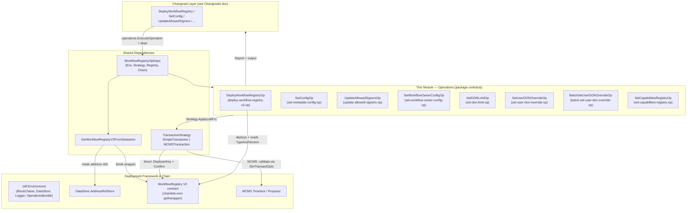
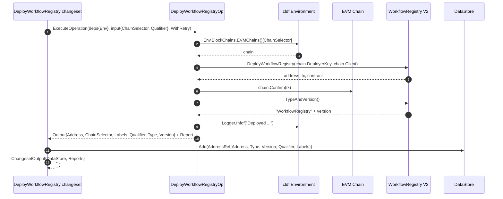
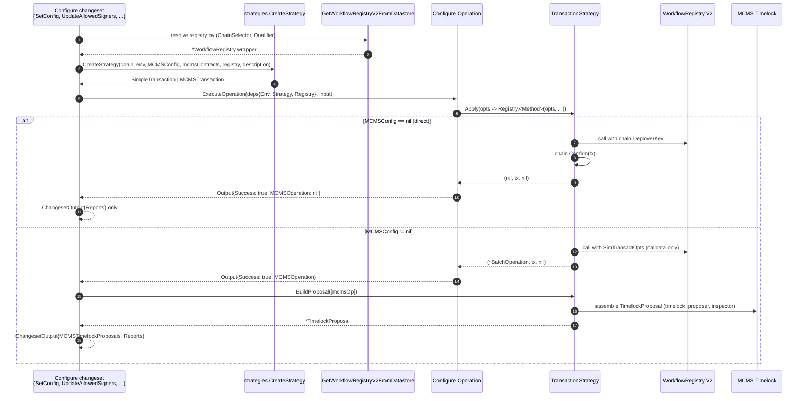
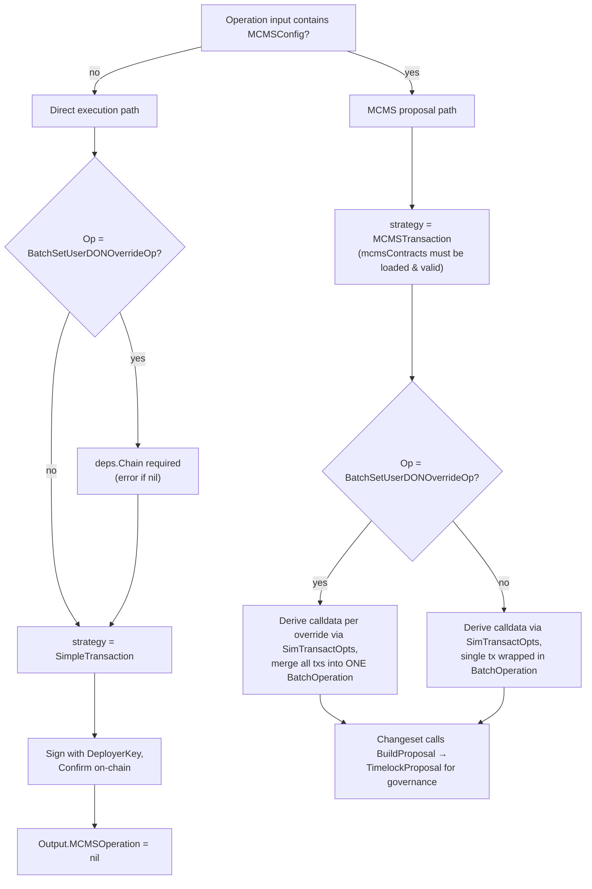
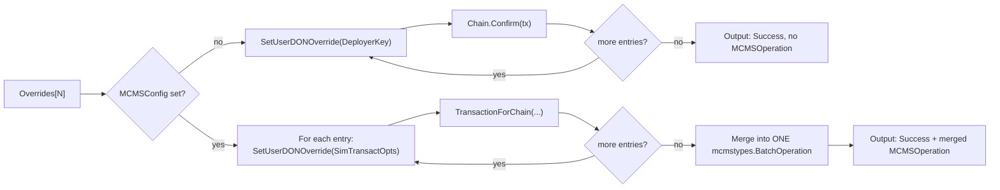

# Workflow Registry V2 — Operations

## Overview

The `cre-workflow-registry_operations` module implements the **atomic contract operations** for the Workflow Registry V2 contract within the [CRE & Keystone Deployment Suite](../../CRE___Keystone_Deployment_Suite.md). Each operation is a small, individually versioned unit of on-chain side effects built on the `chainlink-deployments-framework` operations framework. Operations are the lowest execution layer of the deployment framework: they perform exactly one side effect (deploy a contract or invoke one registry administrative method), return JSON-serializable inputs/outputs, produce `operations.Report` artifacts for auditability, and delegate transaction execution to a pluggable **transaction strategy** that supports either direct EOA signing or MCMS timelock governance.

The module is consumed exclusively by the changeset layer (see [Workflow Registry Changesets](cre-workflow-registry_changeset.md)), which handles precondition verification, dependency assembly, MCMS proposal construction, and datastore persistence. Operations for the *workflow lifecycle* (pause/activate/delete, admin controls) live in the sibling module [Workflow Registry Lifecycle Operations](cre-workflow-registry_lifecycle-operations.md); this module covers **deployment** and **global configuration** operations only.

Source files:

- `chainlink/deployment/cre/workflow_registry/v2/changeset/operations/contracts/deploy_workflow_registry_op.go`
- `chainlink/deployment/cre/workflow_registry/v2/changeset/operations/contracts/configure_workflow_registry_ops.go`

## Architecture



### Component relationships

| Component | Kind | Responsibility |
|---|---|---|
| `DeployWorkflowRegistryOp` | Operation | Deploys the V2 `WorkflowRegistry` contract and returns its registered identity (address, type, version, labels). |
| `SetConfigOp` | Operation | Sets global metadata validation limits (name/tag/URL/attribute/expiry lengths). |
| `UpdateAllowedSignersOp` | Operation | Allows or disallows a set of signer addresses. |
| `SetWorkflowOwnerConfigOp` | Operation | Sets owner-specific configuration bytes for a workflow owner. |
| `SetDONLimitOp` | Operation | Sets per-DON-family workflow limits and the per-user default limit. |
| `SetUserDONOverrideOp` | Operation | Sets a single user's DON-family limit override. |
| `BatchSetUserDONOverrideOp` | Operation | Applies N user overrides in one invocation, merging into a single MCMS `BatchOperation` when in MCMS mode. |
| `SetCapabilitiesRegistryOp` | Operation | Links the workflow registry to a Capabilities Registry address and a DON chain selector. |
| `WorkflowRegistryOpDeps` | Shared deps struct | Carries `Env`, the `TransactionStrategy`, the bound `WorkflowRegistry` wrapper, and optionally the EVM `Chain`. |
| `GetWorkflowRegistryV2FromDatastore` | Helper | Resolves and binds the registry wrapper from `Env.DataStore` by chain selector + qualifier. |

All operations are created via `operations.NewOperation(id, version, description, fn)`, which makes each one addressable, versioned, and independently reportable in the operations framework (`chainlink/deployment/go.mod` pins `chainlink-deployments-framework` and `chainlink-evm`, which provide the `cldf.Environment` types and the generated `workflow_registry_wrapper_v2` bindings used throughout).

## Key abstractions

### `WorkflowRegistryOpDeps`

All configure operations share one dependency struct:

```go
type WorkflowRegistryOpDeps struct {
    Env      *cldf.Environment
    Strategy strategies.TransactionStrategy
    Registry *workflow_registry_v2.WorkflowRegistry
    Chain    *cldf_evm.Chain
}
```

- `Env` provides logging, block chains, the datastore, and the `OperationsBundle` used by the changeset layer to execute the operation.
- `Strategy` decides *how* the transaction is executed (see [Data flow](#data-flow)).
- `Registry` is the bound contract wrapper; every operation keeps `ChainSelector` and `Qualifier` on its **input** (rather than deriving them from the registry) so that each operation invocation is uniquely identifiable in reports and datastore queries.
- `Chain` is optional and only strictly required by `BatchSetUserDONOverrideOp` when `MCMSConfig == nil`, since that operation bypasses the strategy abstraction to sign with `chain.DeployerKey` and confirm on-chain. When provided, it must agree with `input.ChainSelector`; mismatch is a hard error to prevent silently building a proposal against the wrong chain.

### `MCMSConfig`

`contracts.MCMSConfig` is an alias for `cldfproposalutils.TimelockConfig`. Its presence (non-nil) on any operation input switches that operation from direct execution to MCMS proposal generation. Proposal descriptions are standardized via exported constants (e.g. `SetConfigDescription = "setConfig on workflow registry v2"`) that the changeset layer forwards into `strategies.CreateStrategy`.

### `TransactionStrategy` (external, in `cre/common/strategies`)

```go
type TransactionStrategy interface {
    Apply(callFn func(opts *bind.TransactOpts) (*types.Transaction, error)) (*mcmstypes.BatchOperation, *types.Transaction, error)
    BuildProposal(operations []mcmstypes.BatchOperation) (*mcmslib.TimelockProposal, error)
}
```

- **`SimpleTransaction`** — signs with `chain.DeployerKey` and waits via `chain.Confirm(tx)`; returns a `nil` `BatchOperation`.
- **`MCMSTransaction`** — invokes `callFn` with simulated options (`cldf.SimTransactOpts()`) to derive calldata without broadcasting, wraps it via `BatchOperationForChain`, and can later merge batch operations into a `TimelockProposal` through `BuildProposal`.

The factory `strategies.CreateStrategy(chain, env, mcmsConfig, mcmsContracts, target, description)` validates the MCMS configuration and returns the appropriate implementation. Strategy details are documented in the [Deployment Framework Core](../../Deployment_Framework_Core___Product_Deployments/deployment-common.md).

## Operation catalog

| Operation ID | Input fields (beyond `ChainSelector`/`Qualifier`) | Target registry method | MCMS-aware |
|---|---|---|---|
| `deploy-workflow-registry-v2-op` (v1.0.0) | — | `DeployWorkflowRegistry` (constructor) | N/A (uses deployer key) |
| `set-metadata-config-op` (v1.0.0) | `NameLen uint8`, `TagLen uint8`, `URLLen uint8`, `AttrLen uint16`, `ExpiryLen uint32`, `MCMSConfig` | `SetConfig` | ✅ |
| `update-allowed-signers-op` (v1.0.0) | `Signers []common.Address`, `Allowed bool`, `MCMSConfig` | `UpdateAllowedSigners` | ✅ |
| `set-workflow-owner-config-op` (v1.0.0) | `Owner common.Address`, `Config []byte`, `MCMSConfig` | `SetWorkflowOwnerConfig` | ✅ |
| `set-don-limit-op` (v1.0.0) | `DONFamily string`, `DONLimit uint32`, `UserDefaultLimit uint32`, `MCMSConfig` | `SetDONLimit` | ✅ |
| `set-user-don-override-op` (v1.0.0) | `User common.Address`, `DONFamily string`, `Limit uint32`, `Enabled bool`, `MCMSConfig` | `SetUserDONOverride` | ✅ |
| `batch-set-user-don-override-op` (v1.0.0) | `Overrides []SetUserDONOverrideEntry`, `MCMSConfig` | `SetUserDONOverride` × N | ✅ (merged batch) |
| `set-capabilities-registry-op` (v1.0.0) | `Registry common.Address`, `ChainSelectorDON uint64`, `MCMSConfig` | `SetCapabilitiesRegistry` | ✅ |

All inputs and outputs are JSON-serializable with no private fields, per the changeset framework's requirements. Every configure operation output shares the shape:

```go
type <Name>OpOutput struct {
    Success         bool
    RegistryAddress common.Address
    MCMSOperation   *mcmstypes.BatchOperation // nil in direct-execution mode
}
```

## Data flow

### 1. Deployment flow



Notable behaviors:

- The operation resolves the target chain from `deps.Env.BlockChains.EVMChains()[input.ChainSelector]` and fails fast if the selector is unknown.
- Contract errors from the deploy call are enriched via `cldf.DecodeErr(WorkflowRegistryABI, err)` so callers see ABI-level revert reasons.
- The on-chain `TypeAndVersion()` read-back is the source of truth for the recorded `Type`, `Version`, and `Labels`; the changeset converts the output into a `datastore.AddressRef` in a fresh in-memory `DataStore` returned as `ChangesetOutput.DataStore`. This is what later makes the registry resolvable by `GetWorkflowRegistryV2FromDatastore`.
- The changeset executes the operation with `operations.WithRetry`, so transient failures are retried at the framework level (refer to [Workflow Registry Changesets](cre-workflow-registry_changeset.md) for the full changeset contract).

### 2. Configuration flow (generic)

All seven configure operations follow the same shape; the changeset prepares deps, the operation applies the call through the strategy, and the changeset finalizes the output:



### 3. Execution-mode decision flow



## Deep dive: `BatchSetUserDONOverrideOp`

This operation is the only one that bypasses the shared strategy abstraction, because it needs to aggregate N calls. Its semantics differ by mode:

- **Direct mode (`MCMSConfig == nil`)**: iterates `Overrides`, signs each `SetUserDONOverride` with `deps.Chain.DeployerKey`, and confirms each transaction individually (`deps.Chain.Confirm(tx)`). A confirmation failure for one user aborts with the tx hash in the error message.
- **MCMS mode (`MCMSConfig != nil`)**: builds calldata for every entry using simulated options, converts each to an MCMS transaction via `cldfproposalutils.TransactionForChain`, and emits a **single merged `BatchOperation`** (`1 batch, N transactions`). This keeps the resulting proposal compact instead of producing N separate batch operations as repeated single `SetUserDONOverrideOp` executions would.

Safety rules enforced by the operation:

1. `len(input.Overrides) == 0` → error ("must provide at least one override").
2. `input.MCMSConfig == nil && deps.Chain == nil` → error; direct mode cannot sign without a chain.
3. Chain-selector agreement: when `deps.Chain` is present, the authoritative selector is `deps.Chain.ChainSelector()`, and a mismatch with `input.ChainSelector` is rejected with "refusing to build proposal with ambiguous target chain". This guarantees the on-chain lookup that produced `deps.Registry` and the proposal target are always the same chain.



## Datastore resolution: `GetWorkflowRegistryV2FromDatastore`

Configure operations do not take a registry address; they resolve it from the environment datastore:

1. Filter address references by `datastore.AddressRefByChainSelector(chainSelector)`.
2. Find the entry with `Type == "WorkflowRegistry"` and matching `qualifier` (the deploy flow stores exactly this shape — see the deployment flow above).
3. Bind the generated wrapper with `workflow_registry_v2.NewWorkflowRegistry(registryAddr, chain.Client)` on the chain looked up from `Env.BlockChains.EVMChains()`.

Failure diagnostics are deliberate: if no entry matches, the helper logs every available address ref for that chain (type, address, qualifier) to aid troubleshooting, then returns an error naming the missing selector/qualifier combination.

## Error handling and validation summary

| Check | Where | Behavior |
|---|---|---|
| Unknown chain selector | `DeployWorkflowRegistryOp` | Error: `chain not found for selector %d` |
| Deployment / confirmation failure | `DeployWorkflowRegistryOp` | ABI-decoded error via `cldf.DecodeErr`, or wrapped confirm error |
| `TypeAndVersion` read/parse failure | `DeployWorkflowRegistryOp` | Wrapped error including the raw string |
| Empty signer list | `UpdateAllowedSignersOp` (and changeset precondition) | Error before any transaction |
| Empty override list | `BatchSetUserDONOverrideOp` | Error before any transaction |
| Missing `deps.Chain` in direct batch mode | `BatchSetUserDONOverrideOp` | Error (cannot sign/confirm) |
| Chain selector mismatch | `BatchSetUserDONOverrideOp` | Error: refuses ambiguous proposal target |
| Registry method revert | all configure ops | ABI-decoded via `cldf.DecodeErr(WorkflowRegistryABI, err)` |
| Registry not in datastore | `GetWorkflowRegistryV2FromDatastore` | Error + debug dump of available address refs |

## Integration with the broader system

- **Upstream (changesets):** Every operation here is wrapped 1:1 by a `ChangeSetV2` implementation (`DeployWorkflowRegistry`, `SetConfig`, `UpdateAllowedSigners`, `SetWorkflowOwnerConfig`, `SetDONLimit`, `SetUserDONOverride`, `BatchSetUserDONOverride`, `SetCapabilitiesRegistry`) in the sibling [Changesets](cre-workflow-registry_changeset.md) module. Changesets own precondition checks, MCMS contract loading (`strategies.GetMCMSContracts`), strategy construction, and proposal finalization.
- **Capabilities Registry linkage:** `SetCapabilitiesRegistryOp` connects the workflow registry to the on-chain Capabilities Registry deployed by the [Capabilities Registry operations](../cre-capabilities-registry/cre-capabilities-registry_operations.md) module (`Registry` address + `ChainSelectorDON`).
- **Workflow lifecycle:** Once the registry is deployed and configured, workflow registration/pause/activation is handled by the [Lifecycle Operations](cre-workflow-registry_lifecycle-operations.md) module (user and admin operations) and, off-chain, by `cre-cli` workflow commands (see [Developer Toolchain](../../Developer_Toolchain_(CLI,_SDKs___API_Clients).md)).
- **MCMS governance:** When `MCMSConfig` is supplied, outputs feed `MCMSTimelockProposals` in `ChangesetOutput`, enabling multi-sig/timelock-governed execution paths consistent with other suites (e.g. [CCIP Deployment Suite](../../CCIP_Deployment_Suite.md)).
- **Registry consumer:** The deployed registry is the on-chain source of truth for workflow metadata consumed by the node-side workflow syncer (see [Workflow & Capability Runtime (CRE Engine)](../../Workflow___Capability_Runtime_(CRE_Engine).md)).

## Related documentation

- [CRE & Keystone Deployment Suite](../../CRE___Keystone_Deployment_Suite.md) — parent suite
- [Workflow Registry (overview)](../cre-workflow-registry.md) — module parent
- [Workflow Registry Changesets](cre-workflow-registry_changeset.md) — upstream consumer of these operations
- [Workflow Registry Lifecycle Operations](cre-workflow-registry_lifecycle-operations.md) — admin/user workflow lifecycle operations
- [Capabilities Registry Operations](../cre-capabilities-registry/cre-capabilities-registry_operations.md) — the registry linked via `SetCapabilitiesRegistryOp`
- [Deployment Framework Core & Product Deployments](../../Deployment_Framework_Core___Product_Deployments/deployment-common.md) — shared changeset/strategy/datastore primitives
