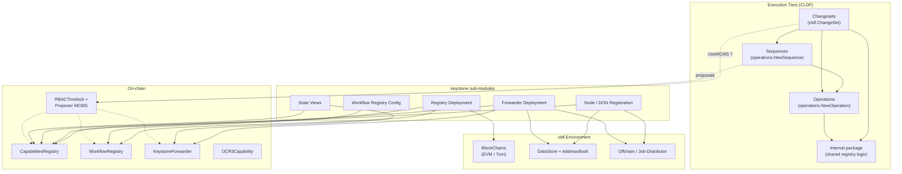
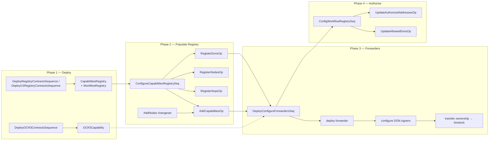
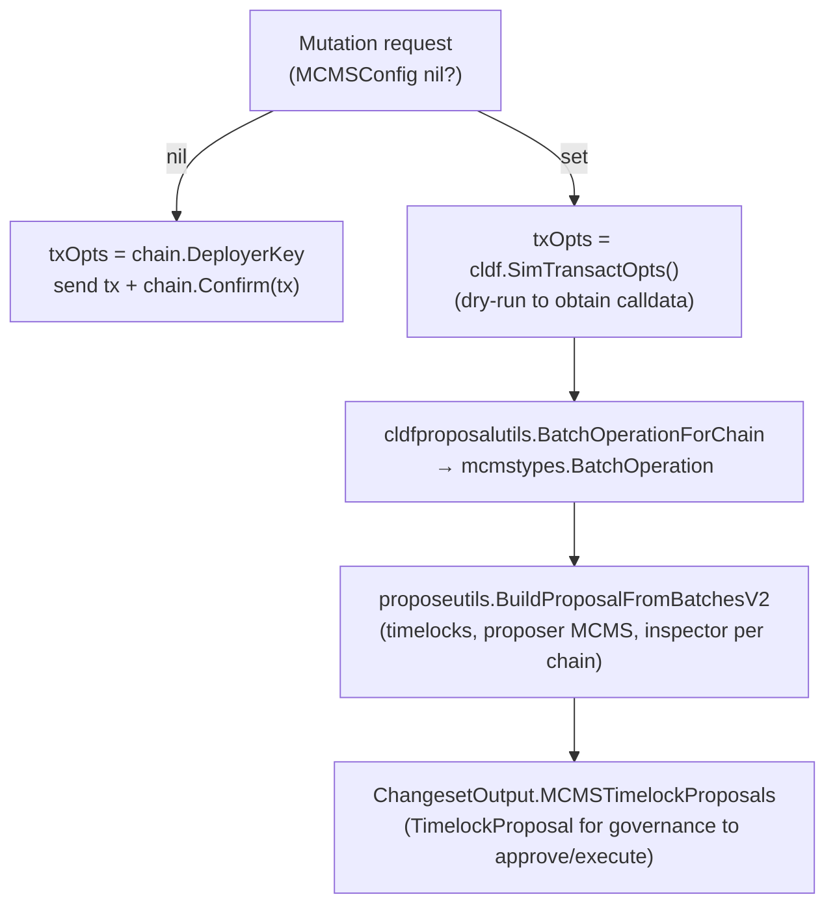
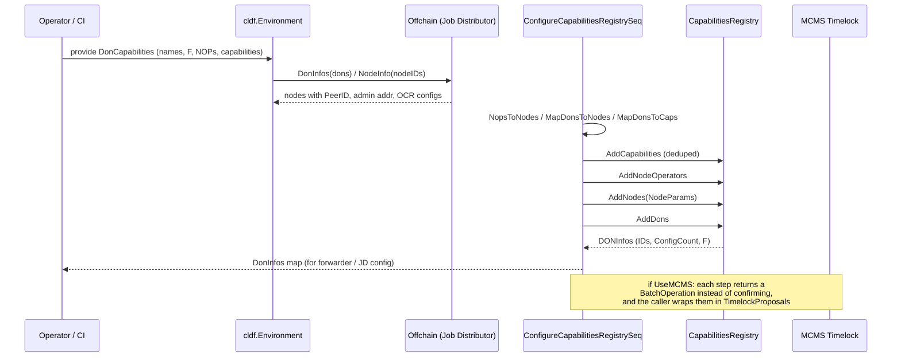

# Keystone Deployment Module (`chainlink/deployment/keystone`)

> **Module page:** `CRE___Keystone_Deployment_Suite/keystone.md`
> **Source root:** `chainlink/deployment/keystone/changeset/`

## 1. Introduction and Purpose

The **keystone** module provides the deployment *changesets* for **Keystone**, SmartContractKit's capability-based workflow automation product and the direct predecessor of the CRE (Capability-based Workflow Runtime Engine). While the product runtime has since moved to the [CRE Deployment Suite](../CRE___Keystone_Deployment_Suite.md), these changesets remain the deployment vehicle for Keystone's on-chain infrastructure:

| On-chain contract | `cldf.ContractType` | Role |
|---|---|---|
| `CapabilitiesRegistry` | `CapabilitiesRegistry` | Central registry of node operators (NOPs), nodes, capabilities and DONs |
| `WorkflowRegistry` | `WorkflowRegistry` | On-chain allow-list of workflows, owners and permitted DONs |
| `KeystoneForwarder` | `KeystoneForwarder` | Per-chain forwarder that routes signed workflow reports to consumer contracts |
| `OCR3Capability` | `OCR3Capability` | OCR3 reporting capability contract |
| `FeedConsumer` | `FeedConsumer` | Example/experimental feed consumer |
| `RBACTimelock`, `ProposerManyChainMultiSig` | `RBACTimelock`, `ProposerManyChainMultiSig` | MCMS governance stack (deployed by shared changesets, referenced here for ownership transfer) |

The module composes everything on top of the **chainlink-deployments-framework (CLDF)** — the generic changeset/operation/sequence engine documented in [Deployment Framework Core & Product Deployments](../Deployment_Framework_Core___Product_Deployments.md) (`chainlink/deployment/go.mod`).

### What this module does NOT contain

- It does **not** run workflows or host capabilities; it only *provisions* the on-chain plumbing that a Keystone/CRE node uses.
- The OCR3 *capability job* spec builders in `ocr3_job.go` are **deprecated stubs** (see [§7 Deprecated Functionality](#7-deprecated-functionality)); new deployments should use the job proposers of [cre-jobs](cre-jobs.md).

## 2. Architecture Overview

The module follows the CLDF three-tier execution model. Every public entry point is a **Changeset** (`cldf.ChangeSet`); changesets either call the `internal` package directly (legacy V1 path) or compose versioned **Operations** and **Sequences** (V2 path). All state lives in the `cldf.Environment` (chains, `DataStore`/`AddressBook`, off-chain Job-Distributor client), and all privileged mutations can be routed through **MCMS** timelock governance instead of a direct EOA transaction.

### 2.1 Sub-modules

| Sub-module | Responsibility | Documentation |
|---|---|---|
| **Node / DON Registration** | Registering capabilities, node operators, nodes and DONs in the `CapabilitiesRegistry`; mutating node capabilities and DON membership | [keystone_node_registration](keystone/keystone_node_registration.md) |
| **Registry Contract Deployment** | Deploying the `CapabilitiesRegistry`, `WorkflowRegistry` and OCR3 contracts (composable sequences) | [keystone_registry_deployment](keystone/keystone_registry_deployment.md) |
| **Forwarder Deployment & Configuration** | Deploying `KeystoneForwarder` on target chains (EVM + Tron), configuring them with DON signers, and transferring ownership to MCMS timelocks | [keystone_forwarders](keystone/keystone_forwarders.md) |
| **Workflow Registry Configuration** | Allow-listing DONs and workflow owners in the `WorkflowRegistry`, via the direct-transaction or MCMS transaction *strategy* pattern | [keystone_workflow_registry_config](keystone/keystone_workflow_registry_config.md) |
| **State Views** | Read-only, best-effort JSON views of all deployed Keystone contracts for observability and RDD pipelines | [keystone_state_views](keystone/keystone_state_views.md) |

### 2.2 Core building blocks (from the core component files)

- **Identity resolution types** (`add_nodes.go`): `NOPIdentity`, `CapabilityIdentity`, `CreateNodeRequest` accept *either* on-chain IDs or declarative (name/version) descriptions and resolve them against the live registry before building `CapabilitiesRegistryNodeParams`.
- **Domain model** (`internal/types.go`): `DonCapabilities`, `NOP`, `DonNode`, `CapabilityHost`, `RegisteredDon` bridge the off-chain Job-Distributor view of a DON into on-chain registry calls (`NopsToNodes`, `MapDonsToNodes`, `MapDonsToCaps`).
- **Operations** (`operations/contracts/`): thin, versioned contract wrappers (`AddCapabilitiesOp`, `RegisterNopsOp`, `RegisterNodesOp`, `RegisterDonsOp`, `DeployCapabilityRegistryOp`, `DeployWorkflowRegistryOp`, `UpdateAllowedDonsOp`, `UpdateAuthorizedAddressesOp`, ...).
- **Sequences**: multi-step orchestration — `DeployRegistryContractsSequence`, `ConfigureCapabilitiesRegistrySeq`, `ConfigWorkflowRegistrySeq`, `DeployConfigureForwardersSeq`, `DeployOCR3ContractsSequence`.
- **Transaction strategies** (`workflowregistry/strategies.go`): `StrategyV2` implemented by `SimpleTransactionV2` (EOA signs & confirms) and `MCMSTransactionV2` (simulate → extract calldata → wrap into an MCMS `TimelockProposal`).

## 3. Sub-module Documentation Index

1. [**Node / DON Registration**](keystone/keystone_node_registration.md) — capability, NOP, node and DON registration operations/sequences; the `AddNodes`, `UpdateDon` and `UpdateNodeCapabilities` changesets; and the identity-resolution types (`NOPIdentity`, `CapabilityIdentity`, `CreateNodeRequest`).
2. [**Registry Contract Deployment**](keystone/keystone_registry_deployment.md) — the `DeployCapabilityRegistryOp` and `DeployWorkflowRegistryOp` operations plus the composable `DeployRegistryContractsSequence` (V1/V2) and `DeployOCR3ContractsSequence`.
3. [**Forwarder Deployment & Configuration**](keystone/keystone_forwarders.md) — the multi-chain `DeployConfigureForwardersSeq` (EVM) and the Tron forwarder changesets and on-chain state loader.
4. [**Workflow Registry Configuration**](keystone/keystone_workflow_registry_config.md) — the `UpdateAllowedDonsOp` / `UpdateAuthorizedAddressesOp` operations, the `ConfigWorkflowRegistrySeq` configuration sequence and the `StrategyV2` (EOA vs MCMS) transaction abstraction.
5. [**State Views**](keystone/keystone_state_views.md) — the `KeystoneView`/`KeystoneViewV2` report types and the legacy-view migration path.

## 4. Deployment Lifecycle

The typical Keystone deployment proceeds in four phases. Each phase is an independent changeset/sequence, and phase 1 produces the datastore addresses that all later phases consume.

**Phase details**

1. **Deploy registries** — `DeployRegistryContractsSequence` (or the V2 variant) deploys the `CapabilitiesRegistry` and `WorkflowRegistry` via `DeployCapabilityRegistryOp` / `DeployWorkflowRegistryOp`, recording addresses in both the `AddressBook` and the new `DataStore`. OCR3 contracts are deployed separately with `DeployOCR3ContractsSequence` (reusing the CRE OCR3 ops).
2. **Populate the registry** — `ConfigureCapabilitiesRegistrySeq` resolves off-chain DON metadata from the Job-Distributor (`internal.DonInfos`, `MapDonsToNodes`), then executes, in order: `AddCapabilitiesOp` → `RegisterNopsOp` → `RegisterNodesOp` → `RegisterDonsOp`. Node attributes (signer, P2P ID, encryption key) come from `CreateNodeRequest`s or node configs.
3. **Forwarders** — `DeployConfigureForwardersSeq` deploys a `KeystoneForwarder` per target chain (skipping ones already in the datastore by qualifier), configures it for every workflow-DON (`DonID`, `F`, `ConfigVersion`, `Signers`), and — when MCMS is in use — transfers ownership to the chain's RBAC timelock, batching the `acceptOwnership` call into a proposal.
4. **Authorize workflows** — `ConfigWorkflowRegistrySeq` allow-lists DON IDs (`UpdateAllowedDonsOp`) and workflow owner addresses (`UpdateAuthorizedAddressesOp`) on the `WorkflowRegistry`, either directly or through MCMS.

### 4.1 Execution modes: direct transaction vs MCMS

Every mutating component accepts an optional `*MCMSConfig`. The internal helpers implement the canonical pattern:

Key invariants enforced by the code:

- When MCMS is used, the contract **must** be MCMS-owned (`capReg.McmsContracts != nil`), otherwise the changeset fails fast.
- Capability adds are **deduplicated against the registry** (`internal.dedupCapabilities`) before inclusion, because a duplicate would revert the whole MCMS batch.
- `UpdateDon` merges the append-capabilities proposals and the DON-update batch operation into a **single proposal batch**, making the whole DON reconfiguration all-or-nothing.

## 5. Relationship to Other Modules

| Module | Relationship |
|---|---|
| [cre-capabilities-registry](cre-capabilities-registry.md) | Keystone's `DeployV2RegistryContractsSequence` and forwarder configuration reuse the CRE V2 capabilities-registry operations (`cap_reg_v2.DeployCapabilitiesRegistry`, `ConfigureForwarderDescription`), and both maintain the same datastore conventions (`AddressRef`, qualifiers). |
| [cre-forwarder](cre-forwarder.md) | `DeployConfigureForwardersSeq` composes the CRE forwarder ops (`creforwarder.DeployOp`, `ConfigureOp`, `DeployMockForwarderOp`) rather than duplicating them; the Keystone sequence adds MCMS ownership transfer and writer-DON capability appends. |
| [cre-ocr3](cre-ocr3.md) | `DeployOCR3ContractsSequence` delegates deployment to `contracts.DeployOCR3` from the CRE OCR3 v2 package. |
| [cre-workflow-registry](cre-workflow-registry.md) | Sibling registry product; keystone keeps its own V1/V2 deployer (`workflowregistry/deploy.go`) plus its `StrategyV2` transaction abstraction. |
| [Deployment Framework Core & Product Deployments](../Deployment_Framework_Core___Product_Deployments.md) | Provides the CLDF `Environment`, `operations` engine, MCMS changeset utilities (`cld-changesets`), and address-book/datastore primitives used throughout. |
| [CCIP Cross-Chain Protocol](../CCIP_Cross-Chain_Protocol.md) | No direct dependency; CCIP shares the same deployment framework and MCMS tooling but is deployed independently. |

## 6. Key Data Flow: Off-chain DON metadata → On-chain registry

## 7. Deprecated Functionality

`ocr3_job.go` (`OCR3JobConfig`, `OCR3JobConfigSpec`, `BuildOCR3JobConfigSpecs`, `ExternalJobID`, `ResolveOCR3Job`) is a **deprecation shim**: every entry point returns `ErrOCR3JobDeprecated` because the `chainlink-ocr3-capability` plugin and its job spec were removed. New OCR3 job provisioning must go through the job proposers of [cre-jobs](cre-jobs.md) (`ProposeOCR3JobOutput`, `ProposeOCR3BootstrapJobOutput`, ...). `OCR3JobConfigSpec` is retained only as the (now never-filled) spec type so downstream signatures keep compiling.

Similarly, the `KeystoneChainViewLegacy` / `KeystoneViewLegacy` types in `view_contracts.go` exist purely for **auto-migration**: they carry the legacy `OCR3ConfigViewLegacy` shape and convert it field-by-field into the current view via `Migrate()`.

## 8. Build & Testing Context

- This module is part of the `github.com/smartcontractkit/chainlink/deployment` Go module (`chainlink/deployment/go.mod`), which pulls in `chainlink-evm` gethwrappers (`capabilities_registry_1_1_0`, `forwarder_1_0_0`, `workflow_registry_wrapper_v1`), the MCMS libraries (`mcms`, `mcms/sdk`, `mcms/types`), and `chainlink-deployments-framework`.
- Unit tests live next to their components (e.g. `internal/update_don_test.go`, `workflowregistry/update_allowed_dons_test.go`, `tron/deploy_forwarder_test.go`) and exercise both direct-transaction and MCMS paths against simulated chains; shared environment fixtures are in `changeset/test/` (`env_setup.go`, `registry.go`, `dons.go`).
- Repo-level build targets for the deployment module are documented in the [Build, CI & Release Infrastructure](../Build,_CI___Release_Infrastructure.md) module.
