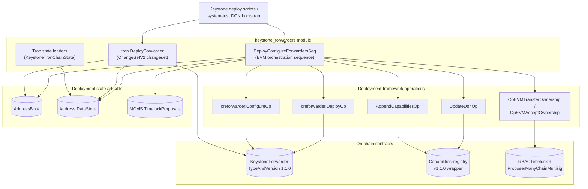
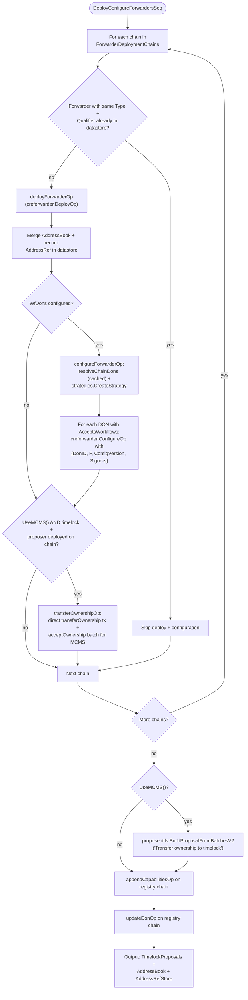
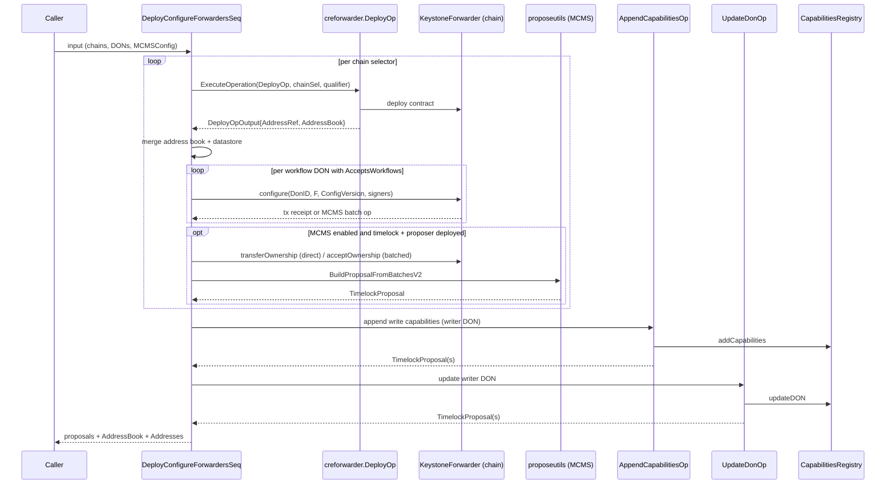
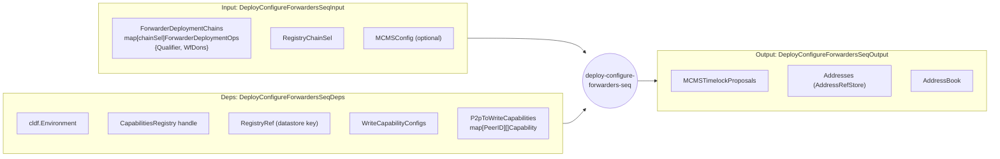
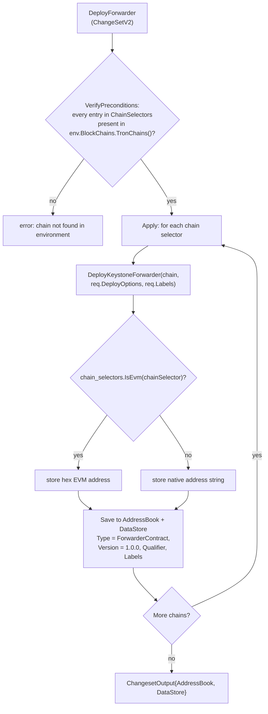
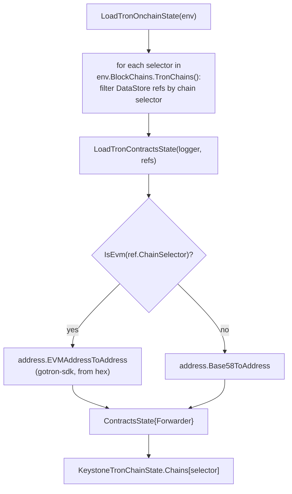
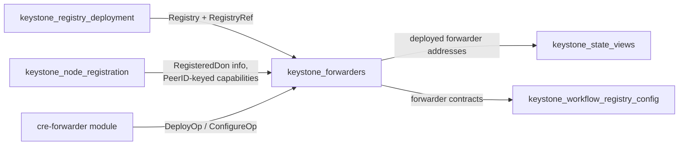

# Keystone Forwarders

The `keystone_forwarders` module deploys and configures **Keystone Forwarder** contracts — the on-chain write surface through which a Keystone/CRE workflow DON delivers signed reports to consumer contracts. A forwarder holds the per-DON signer configuration (DON id, quorum threshold `F`, config version, signer set) and validates incoming workflow reports before executing the encoded call on behalf of the workflow.

The module is part of the [Keystone](../keystone.md) changeset suite in the `github.com/smartcontractkit/chainlink/deployment` Go module (see `chainlink/deployment/go.mod`) and provides two families of entry points:

1. **EVM orchestration** — `DeployConfigureForwardersSeq`, a deployment-framework `operations.Sequence` that, per target chain: deploys a forwarder, configures it with the workflow DON signer sets, transfers ownership to the MCMS RBAC timelock, and synchronizes the writer DON's write capabilities in the on-chain Capabilities Registry.
2. **Tron family** — the `DeployForwarder` `ChangeSetV2` changeset plus the Tron on-chain state loaders (`KeystoneTronChainState` / `ContractsState`).

Forwarder flows for the other non-EVM families (Solana, Stellar) are provided by the shared [cre-forwarder](../cre-forwarder.md) module; this page covers only the Keystone-specific orchestration on top of those shared operations.

---

## Component inventory

| Component | File | Kind | Purpose |
|---|---|---|---|
| `DeployConfigureForwardersSeq` | `chainlink/deployment/keystone/changeset/operations/contracts/deploy_configure_forwarders_seq.go` | `operations.Sequence` ("deploy-configure-forwarders-seq", v1.0.0, "Configure Keystone Forwarders") | Orchestrates deploy → configure → ownership transfer → registry sync for new chains |
| `DeployConfigureForwardersSeqDeps` | same | deps struct | Environment, Capabilities Registry handle, writer-DON capability inputs |
| `DeployConfigureForwardersSeqInput` / `UseMCMS()` | same | input struct | Per-chain deployment specs, registry chain selector, optional MCMS config |
| `DeployConfigureForwardersSeqOutput` | same | output struct | MCMS timelock proposals, `AddressRefStore`, `AddressBook` |
| `ForwarderDeploymentOps` | same | per-chain spec | `Qualifier` (idempotency key) + `WfDons` (workflow DONs to configure) |
| internal helpers: `resolveChainDons`, `deployForwarderOp`, `configureForwarderOp`, `transferOwnershipOp`, `appendCapabilitiesOp`, `updateDonOp` | same | functions | Single-responsibility steps executed by the sequence |
| `DeployForwarder` | `chainlink/deployment/keystone/changeset/tron/deploy_forwarder.go` | `cldf.ChangeSetV2[*DeployForwarderRequest]` | Deploys KeystoneForwarder contracts on Tron chains |
| `DeployForwarderRequest` | same | input struct | `ChainSelectors`, `Labels`, `Qualifier`, `DeployOptions` |
| `ContractsState` / `KeystoneTronChainState` | `chainlink/deployment/keystone/changeset/tron/state.go` | state structs | Per-chain view of the deployed forwarder address |
| `LoadTronOnchainState` / `LoadTronContractsState` | same | functions | Build the state from the deployment datastore |

---

## Architecture

The module is a thin orchestration layer: it composes shared deployment-framework operations (from [cre-forwarder](../cre-forwarder.md), the capabilities-registry operations, and cld-changesets EVM ops) into a single reproducible sequence, and records everything it touches in the deployment `AddressBook` and address `DataStore`.

### Supporting operations (external to the module)

| Operation | Source | Contract | Output consumed by the sequence |
|---|---|---|---|
| `creforwarder.DeployOp` | `chainlink/deployment/cre/forwarder/deploy.go` | deploys the forwarder contract | `DeployOpOutput{Addresses, AddressBook, AddressRef}` |
| `creforwarder.ConfigureOp` | `chainlink/deployment/cre/forwarder/configure.go` | writes per-DON signer config | `ConfigureOpOutput{MCMSOperation, Forwarder, Config}` |
| `AppendCapabilitiesOp` | `.../keystone/changeset/operations/contracts/add_capabilities_op.go` | registers write capabilities for the writer DON | `AppendCapabilitiesOpOutput{MCMSTimelockProposals}` |
| `UpdateDonOp` | `.../keystone/changeset/operations/contracts/update_don.go` | updates the writer DON in the registry (returns `UpdateDonResponse{DonInfo}`) | MCMS timelock proposals |
| `OpEVMTransferOwnership` / `OpEVMAcceptOwnership` | cld-changesets EVM ops | ownership hand-over to the timelock | batch operations for the MCMS proposal |

Transaction signing is abstracted by `strategies.CreateStrategy` (from `deployment/cre/common/strategies`), which returns either a direct-transaction strategy or an MCMS proposal strategy based on `MCMSConfig`; `strategies.GetMCMSContracts` resolves the timelock/proposer bundle when MCMS mode is requested.

---

## `DeployConfigureForwardersSeq` deep dive

> "Use this to deploy keystone forwarders and configure them with the given DONs on **NEW CHAINS**." (sequence doc comment)

### Inputs (`DeployConfigureForwardersSeqInput`)

| Field | Type | Meaning |
|---|---|---|
| `ForwarderDeploymentChains` | `map[uint64]ForwarderDeploymentOps` | Target chain selector → deployment spec (`Qualifier`, `WfDons`). The `Qualifier` is the idempotency key: if a forwarder of the same contract type and qualifier already exists for the chain, deployment and configuration are skipped. |
| `RegistryChainSel` | `uint64` | Chain selector of the chain hosting the Capabilities Registry. |
| `MCMSConfig` | `*crecontracts.MCMSConfig` | Optional. When non-nil, governance-sensitive changes are *proposed* via MCMS instead of executed directly (`UseMCMS()` helper). |

### Dependencies (`DeployConfigureForwardersSeqDeps`)

| Field | Type | Meaning |
|---|---|---|
| `Env` | `*cldf.Environment` | Chains, datastore, logger. |
| `Registry` | `*capabilities_registry.CapabilitiesRegistry` | Contract handle on the registry chain. Deployed by [keystone_registry_deployment](keystone_registry_deployment.md). |
| `RegistryRef` | `datastore.AddressRefKey` | Datastore reference of the registry contract. |
| `WriteCapabilityConfigs` | `[]internal.CapabilityConfig` | Capability configs to attach to the writer DON. |
| `P2pToWriteCapabilities` | `map[p2pkey.PeerID][]CapabilitiesRegistryCapability` | Write capabilities keyed by node peer ID (see [keystone_node_registration](keystone_node_registration.md), which owns the `internal.CapabilityHost` / `DonNode` node model). |

### Outputs (`DeployConfigureForwardersSeqOutput`)

| Field | Type | Meaning |
|---|---|---|
| `MCMSTimelockProposals` | `[]mcmslib.TimelockProposal` | All timelock proposals produced by the run (ownership, capability append, DON update). Not yet aggregated — the code carries an explicit `TODO: aggregate proposals`. |
| `Addresses` | `datastore.AddressRefStore` | Address refs recorded for the deployed forwarders. |
| `AddressBook` | `cldf.AddressBook` | Legacy address book containing the deployed Keystone Forwarders. |

### Process flow

Step by step:

1. **Pre-flight per target chain.** The sequence filters `Env.DataStore.Addresses()` by chain selector and (a) skips the chain when a forwarder ref with the matching `Type`/`Qualifier` exists (idempotency), and (b) collects the chain's `RBACTimelock` and `ProposerManyChainMultisig` addresses, which gate the ownership-transfer step.
2. **Deployment** — `deployForwarderOp` executes `creforwarder.DeployOp` with `{ChainSelector, Qualifier}`, merges the produced address book into the sequence-local one, and copies the forwarder `AddressRef` into the sequence-local memory datastore.
3. **Configuration** — `configureForwarderOp`:
   - Resolves each `ConfigureKeystoneDON` into an `internal.RegisteredDon` (`resolveChainDons`), caching by DON name across chains so identical DONs are only resolved once. `RegisteredDon` carries the registry DON info (`Id`, `F`, `ConfigCount`, `AcceptsWorkflows`) and node signer identities.
   - Loads the owned forwarder binding via `crecontracts.GetOwnedContractV2[*forwarder.KeystoneForwarder]` and builds the transaction strategy (direct or MCMS, described by `contracts2.ConfigureForwarderDescription`).
   - For every DON where `don.Info.AcceptsWorkflows` is true, executes `creforwarder.ConfigureOp` with `Config{DonID: don.Info.Id, F: don.Info.F, ConfigVersion: don.Info.ConfigCount, Signers: don.Signers("evm")}` — i.e., the forwarder stores exactly the signer set that workflow reports will be validated against.
4. **Ownership hand-over (MCMS mode only).** `transferOwnershipOp` loads the forwarder as an ownable contract and:
   - executes `OpEVMTransferOwnership` **directly on-chain** (the deployer still owns the contract, so no proposal is needed);
   - executes `OpEVMAcceptOwnership` and appends the resulting call as an `mcmstypes.BatchOperation` — the timelock must be the signer of `acceptOwnership`, so it flows through MCMS. Both ops are marked deprecated upstream (replacement pending in cld-changesets `op_transfer_accept_ownership.go`).
   - After all chains are processed, `proposeutils.BuildProposalFromBatchesV2` assembles the batches into a single `TimelockProposal` per governance scope.
5. **Registry synchronization** (always runs, on `RegistryChainSel`):
   - `appendCapabilitiesOp` executes `AppendCapabilitiesOp` to register the writer DON's write capabilities from `P2pToWriteCapabilities`;
   - `updateDonOp` executes `UpdateDonOp` to update the writer DON with `WriteCapabilityConfigs`;
   - both append their `MCMSTimelockProposals` to the output when MCMS mode is enabled.

### Component interaction

### Data flow

Key data-flow properties:

- **Idempotent writes.** Existence checks read the environment datastore; new artifacts are accumulated in sequence-local memory stores (`cldf.NewMemoryAddressBook()`, `datastore.NewMemoryDataStore()`) and returned rather than committed globally, leaving persistence decisions to the caller.
- **Proposal accumulation.** `proposals` is threaded through `transferOwnershipOp` (via batches), `appendCapabilitiesOp`, and `updateDonOp`; MCMS and non-MCMS artifacts never mix — direct transactions are executed immediately, MCMS actions are only *proposed*.
- **DON resolution cache.** `donMapCache` (name → `internal.RegisteredDon`) prevents re-deriving registry DON info when the same workflow DON is configured on several forwarder chains.

### Governance model (direct vs MCMS)

| Action | Direct mode | MCMS mode (`MCMSConfig != nil`) |
|---|---|---|
| Deploy forwarder | executed by deployer EOA | executed by deployer EOA |
| Configure forwarder per DON | executed directly | executed through the MCMS strategy (`ConfigureForwarderDescription`) |
| `transferOwnership` to timelock | skipped (no timelock) | executed directly (deployer still owns) |
| `acceptOwnership` | skipped | batched into the timelock proposal (timelock must sign) |
| Registry capability append / DON update | executed directly | proposed, proposals returned in output |

Ownership transfer to the timelock is skipped entirely when either the `RBACTimelock` or the `ProposerManyChainMultisig` ref is missing for the chain — the sequence logs and continues rather than failing.

---

## Tron deployment (`tron.DeployForwarder`)

The Tron family exposes a single deploy-only changeset (configuration of Tron forwarders is not part of this changeset; state loading below is how consumers discover what was deployed).

### Changeset flow

- `VerifyPreconditions` fails fast with `chain not found in environment` if any requested selector is absent from the environment's Tron chains.
- `Apply` deploys one forwarder per chain, logging the resulting `TypeAndVersion`, selector and address. Because Tron chains in the deployment framework may be EVM-keyed, addresses are normalized: EVM selectors store the `EthAddress().Hex()` form, all others store the native address string.
- The address book entry and the `datastore.AddressRef` both use `ForwarderContract` as the contract type with version `1.0.0`, plus the request's `Qualifier` and the contract labels from the deploy response.

### Tron on-chain state

`KeystoneTronChainState` is the read-side view of the same deployment:

- `ContractsState` holds a single `Forwarder` field of the gotron-sdk `address.Address` type — the module's Tron view assumes at most one forwarder ref per chain.
- `LoadTronContractsState` stops at the first ref whose `Type == ForwarderContract`, applying the same EVM-hex vs Base-58 conversion logic as the deployer, so state loading is symmetric with what `DeployForwarder` wrote.

---

## Versioning and identity

- The EVM sequence records forwarders as `TypeAndVersion(KeystoneForwarder, 1.1.0)` (using the generated `forwarder_1_0_0` gethwrapper binding from `chainlink-evm/gethwrappers/keystone/generated/`), and the registry wrapper is the `capabilities_registry_1_1_0` binding.
- Tron datastore records use version `1.0.0` with type `ForwarderContract`.
- The `Qualifier` field (present in `ForwarderDeploymentOps`, `DeployForwarderRequest`, and the stored `AddressRef`) is the supported mechanism for multiple forwarder instances per chain; the EVM sequence's skip-check matches on type **and** qualifier, so differently-qualified forwarders coexist.

## Multi-chain coverage

| Family | Entry point | Location | Scope |
|---|---|---|---|
| EVM | `DeployConfigureForwardersSeq` | `chainlink/deployment/keystone/changeset/operations/contracts/deploy_configure_forwarders_seq.go` | Full deploy + configure + ownership + registry sync, MCMS-aware |
| Tron | `tron.DeployForwarder` | `chainlink/deployment/keystone/changeset/tron/deploy_forwarder.go` | Deploy-only changeset + state loaders |
| Solana | `solana.ConfigureForwarders` (see [cre-forwarder](../cre-forwarder.md)) | `chainlink/deployment/cre/forwarder/solana/deploy_forwarder.go` | Shared forwarder ops, Keystone-agnostic |
| Stellar | `stellar.DeployForwarder` (see [cre-forwarder](../cre-forwarder.md)) | `chainlink/deployment/cre/forwarder/stellar/deploy_forwarder.go` | Shared forwarder ops, Keystone-agnostic |

## Relationship to other modules

- **[Keystone](../keystone.md)** — parent module grouping the Keystone changeset suite.
- **[keystone_registry_deployment](keystone_registry_deployment.md)** — deploys the Capabilities Registry that this module reads from (`Registry`) and writes to (via `AppendCapabilitiesOp` / `UpdateDonOp`).
- **[keystone_node_registration](keystone_node_registration.md)** — registers nodes, NOPs and DONs; the resulting registry DON info (`Id`, `F`, `ConfigCount`, signers) is exactly what `resolveChainDons` consumes, and `P2pToWriteCapabilities` is keyed by the same `p2pkey.PeerID`s.
- **[keystone_state_views](keystone_state_views.md)** — `KeystoneViewLegacy` / `KeystoneChainViewLegacy` expose a `Forwarders` map built from the addresses this module records.
- **[keystone_workflow_registry_config](keystone_workflow_registry_config.md)** — configures the workflow registry that ultimately consumes forwarder-verified workflow reports.
- **[cre-forwarder](../cre-forwarder.md)** — owns the shared per-family forwarder operations (`DeployOp`, `ConfigureOp`, Solana/Stellar flows, clear-config and mock-forwarder variants) reused by the Keystone sequence.
- **[deployment-common](../../Deployment_Framework_Core___Product_Deployments/deployment-common.md)** — the underlying changeset/operations framework (`operations.Sequence`, `Bundle`, `AddressBook`, `datastore`) and MCMS tooling.

## Source references

- `chainlink/deployment/keystone/changeset/operations/contracts/deploy_configure_forwarders_seq.go` — EVM sequence and step operations
- `chainlink/deployment/keystone/changeset/tron/deploy_forwarder.go` — Tron deploy changeset
- `chainlink/deployment/keystone/changeset/tron/state.go` — Tron state structs and loaders
- `chainlink/deployment/cre/forwarder/deploy.go`, `chainlink/deployment/cre/forwarder/configure.go` — shared forwarder ops
- `chainlink/deployment/keystone/changeset/operations/contracts/add_capabilities_op.go`, `update_don.go` — registry sync ops
- `chainlink/deployment/go.mod` — Go module definition for the deployment suite
