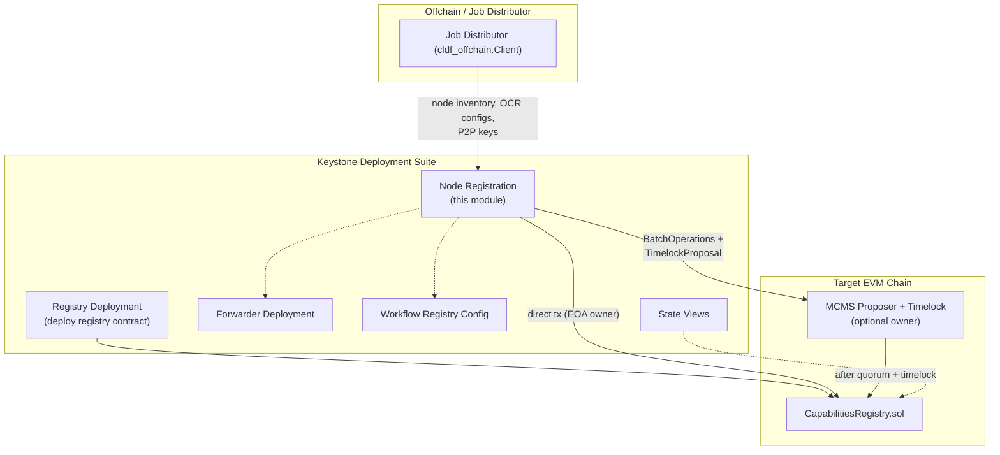
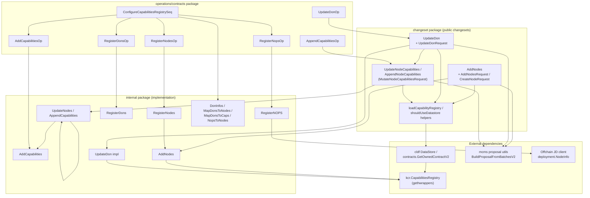
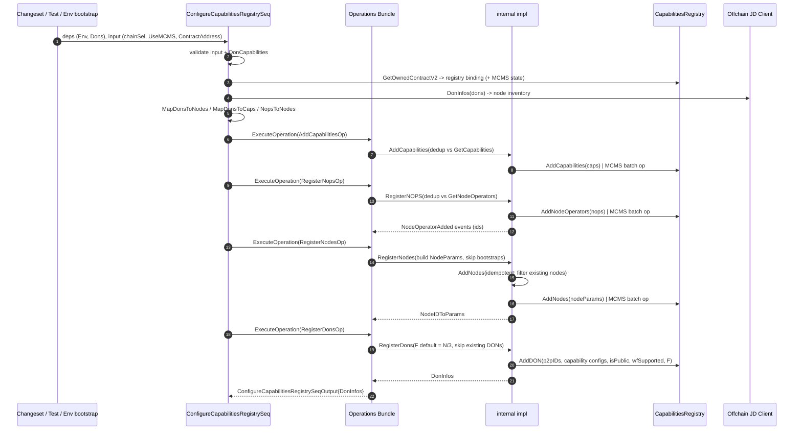
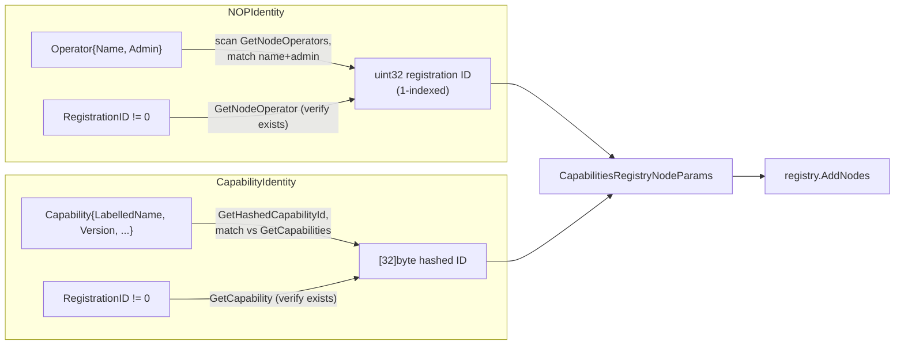

# Keystone Node Registration

## Overview

The `keystone_node_registration` module implements on-chain registration and lifecycle management of Keystone's decentralized oracle participants inside the **`CapabilitiesRegistry` contract**. It is part of the [Keystone Deployment Suite](../../CRE___Keystone_Deployment_Suite.md) and answers three questions for any Keystone/CRE environment:

1. **Who operates nodes?** — Node operators (NOPs) are registered with a name and an admin address.
2. **Which nodes exist and what can they do?** — Nodes are registered with a P2P identity, signer/encryption public keys, and the set of capabilities they host.
3. **Which DONs (Decentralized Oracle Networks) are formed?** — DONs are registered as a membership set of node P2P IDs together with per-capability protobuf configurations and a fault-tolerance threshold `F`.

The module is organized in three layers:

| Layer | Package | Responsibility |
|---|---|---|
| **Changesets** (public API) | `chainlink/deployment/keystone/changeset` | Request validation, request → implementation translation, MCMS proposal assembly, changeset output |
| **Operations / Sequences** | `.../changeset/operations/contracts` | Reusable, versioned operations (`operations.NewOperation`) and a composite sequence (`operations.NewSequence`) that orchestrates full registry configuration |
| **Implementation (internal)** | `.../changeset/internal` | Direct contract calls or MCMS batch-operation generation, deduplication, key extraction, offchain (Job Distributor) data mapping |

All layers operate against generated Go bindings for the Keystone `CapabilitiesRegistry` (`capabilities_registry_1_1_0`), executed through the [chainlink-deployments-framework](../../Deployment_Framework_Core___Product_Deployments.md) `cldf.Environment` (EVM chains, datastore/address book, offchain JD client, logger).

## Position in the System



- The registry contract itself is deployed by the [Keystone Registry Deployment](keystone_registry_deployment.md) module and referenced via a `datastore.AddressRefKey`.
- Registration is typically a prerequisite for [Forwarder deployment](keystone_forwarders.md) and [Workflow Registry configuration](keystone_workflow_registry_config.md), both of which depend on registered DONs.
- Inspection of the resulting on-chain state is provided by [Keystone State Views](keystone_state_views.md).
- The CRE-side (v2) equivalents of these operations live in the [CRE Capabilities Registry](../cre-capabilities-registry.md) module; this module covers the Keystone (legacy/v1) changesets and the shared Keystone-internal operations package.

## Architecture

### Component Relationships



### Request Types (`changeset/internal/types.go`)

| Type | Purpose |
|---|---|
| `DonNode` | Pair of DON name and node name (not globally unique) |
| `CapabilityHost` | A node (by globally unique `NodeID`) and the capabilities it hosts |
| `Nop` | NOP profile: name + list of node P2P IDs; validated with `p2pkey.MakePeerID` |
| `DonCapabilities` | CLO-facing representation of a DON: name, `F`, NOPs, and `DONCapabilityWithConfig` list (every capability hosted on every NOP) |
| `DONCapabilityWithConfig` | Registry capability struct + protobuf `CapabilityConfig` + `UseCapRegOCRConfig` flag |
| `RegisteredDon` | On-chain `DONInfo` joined with enriched offchain `deployment.Node` data |
| `RegisteredCapability` | Capability + resolved `[32]byte` hashed ID + protobuf config |

Contract-type constants (`CapabilitiesRegistry`, `WorkflowRegistry`, `KeystoneForwarder`, `OCR3Capability`, `FeedConsumer`, `RBACTimelock`, `ProposerManyChainMultiSig`) are defined here and re-exported by the `changeset` package (`types.go`).

## Public Changesets

### AddNodes (`add_nodes.go`)

`AddNodes(env, *AddNodesRequest)` registers individual nodes with explicit identities. Each node is described by a `CreateNodeRequest`:

```text
CreateNodeRequest
├── NOPIdentity                  // operator: either Operator{Name, Admin} or RegistrationID (1-indexed)
├── Signer               [32]byte  // NOP signer address (OCR on-chain public key)
├── P2PID                [32]byte  // node P2P identity
├── EncryptionPublicKey  [32]byte  // node encryption (workflow) public key
└── CapabilityIdentities           // capabilities the node hosts; all must exist in the registry
```

Execution flow:

1. **Validate** — every request must be complete (no zero signer/P2P ID/encryption key; exactly one of operator-or-registration-ID set per identity). `shouldUseDatastore` enforces that a migrated environment always supplies a `RegistryRef`.
2. **Load registry** — `loadCapabilityRegistry` resolves the `OwnedContract[*CapabilitiesRegistry]` (contract binding + optional MCMS ownership state) from the environment datastore via `contracts.GetOwnedContractV2`.
3. **Resolve identities** — `CreateNodeRequest.Resolve` converts identities into `kcr.CapabilitiesRegistryNodeParams` (see [Identity Resolution](#identity-resolution)).
4. **Deduplicate by P2P ID** — duplicate P2P IDs across the request are rejected.
5. **Delegate** to `internal.AddNodes` (direct tx or MCMS batch).
6. **MCMS output** — if `MCMSConfig` is set, a `mcms.TimelockProposal` is built from the batch operation using the registry's timelock/proposer addresses and a chain-scoped MCMS inspector.

### UpdateNodeCapabilities / AppendNodeCapabilities (`update_node_capabilities.go`, `append_node_capabilities.go`)

Both changesets share the `MutateNodeCapabilitiesRequest` type:

- `RegistryChainSel` — chain hosting the registry (validated against `chain-selectors` and the environment).
- `P2pToCapabilities` — map of node P2P IDs to the full set of capabilities the node must host.
- `MCMSConfig`, `RegistryRef`.

- **`UpdateNodeCapabilities`** replaces the node capability sets: `internal.UpdateNodeCapabilitiesImpl` first registers any missing capabilities (`AddCapabilities`), then rewrites each node via `UpdateNodes` with the merged parameter set (signer, encryption key, operator ID and hashed capability IDs are preserved from on-chain state when not supplied).
- **`AppendNodeCapabilities`** adds capabilities on top of what a node already hosts: `internal.AppendCapabilities` reads the node's existing hashed capability IDs, resolves the full capability structs, merges and dedups, then updates the node.
- A utility `NewP2PSignerEnc` derives a node's signer/encryption key pair from its offchain OCR configuration for a given registry chain selector.

### UpdateDon (`update_don.go`)

`UpdateDon(env, *UpdateDonRequest)` is a compound change that reconfigures a DON's membership and capabilities:

- **Input**: `P2PIDs` (membership), `CapabilityConfigs` (per-capability protobuf configs; a `nil` config falls back to a default), optional `DonID` (inferred from P2P IDs when omitted), optional `F` and `IsPrivate` (defaults read from on-chain state), `MCMSConfig`, `RegistryRef`.
- **Execution**:
  1. `AppendNodeCapabilities` is invoked first so all nodes host the required capabilities (and any missing capabilities exist in the registry).
  2. `internal.UpdateDon` resolves the DON (by ID or by sorted-P2P-ID membership hash), **refuses to update a DON that already accepts workflows** (forwarder compatibility cannot be validated at config version boundaries), computes capability configurations, and calls `registry.UpdateDON`.
  3. Under MCMS, the `UpdateDON` transaction is **appended to the proposal batch produced in step 1**, making the entire update all-or-nothing (one proposal, one batch, one transaction).
- **Output**: `UpdateDonResponse{DonInfo}` plus the (optional) MCMS proposals in `cldf.ChangesetOutput`.

## Operations and the Configuration Sequence

The `operations/contracts` package wraps the internal implementation as versioned operations (all `1.0.0`), composable through the deployments-framework operations bundle:

| Operation | Input → Output | Delegates to |
|---|---|---|
| `AddCapabilitiesOp` | `UseMCMS` → `BatchOperation` | `internal.AddCapabilities` |
| `RegisterNopsOp` | `UseMCMS`, `RegistryChainSel` → added NOPs + `BatchOperation` | `internal.RegisterNOPS` |
| `RegisterNodesOp` | `RegistryChainSel`, NOP results, `UseMCMS` → `NodeIDToParams` + `BatchOperation` | `internal.RegisterNodes` |
| `RegisterDonsOp` | `RegistryChainSel`, `NodeIDToParams`, `UseMCMS` → `DonInfos` + `BatchOperation` | `internal.RegisterDons` |
| `AppendCapabilitiesOp` | `RegistryChainSel`, `MCMSConfig` → `MCMSTimelockProposals` | changeset `AppendNodeCapabilities` |
| `UpdateDonOp` | `RegistryChainSel`, `MCMSConfig` → `MCMSTimelockProposals` | changeset `UpdateDon` |

### ConfigureCapabilitiesRegistrySeq

`ConfigureCapabilitiesRegistrySeq` is the end-to-end entry point that configures a freshly deployed registry with a complete DON topology (`[]internal.DonCapabilities` sourced from the Job Distributor environment):

1. Validate input (registry contract address set; chain selector known) and every DON (`DonCapabilities.Validate`: non-empty name/NOPs/capabilities, valid P2P IDs).
2. Load the owned registry via `contracts.GetOwnedContractV2` from the **datastore** address store; if `UseMCMS`, the registry must be MCMS-owned.
3. Expand DON definitions into `internal.DonInfo` (node inventory fetched from the offchain JD client via `deployment.NodeInfo`).
4. Precompute reusable mappings: don→nodes, don→capabilities (hashed IDs), NOP→node IDs.
5. Execute, in order: `AddCapabilitiesOp` → `RegisterNopsOp` → `RegisterNodesOp` → `RegisterDonsOp`.
6. Return the on-chain `DonInfos` keyed by DON name.



> In MCMS mode the per-operation contract calls are **simulated** (`cldf.SimTransactOpts`) and converted into `mcmstypes.BatchOperation`s instead of being broadcast; the sequence returns the batch operations, which callers assemble into proposals.

## Internal Implementation Details (`internal/deploy.go`, `internal/update_nodes.go`, `internal/capability_management.go`)

### RegisterNOPS

- Fetches `GetNodeOperators` and deduplicates the request; already-registered NOPs are echoed back with their existing IDs.
- Direct mode: `AddNodeOperators` tx + `Confirm` + `WaitMined`, then `ParseNodeOperatorAdded` on each receipt log to recover assigned operator IDs.
- MCMS mode: simulated `AddNodeOperators` converted with `BatchOperationForChain`.

### RegisterNodes → AddNodes

- Builds `CapabilitiesRegistryNodeParams` per node: operator ID (from NOP results), signer (OCR `OnchainPublicKey` for the registry chain), P2P ID, encryption public key (hex-decoded `WorkflowKey` from `ExtractSignerEncryptionKeys`), and the DON's hashed capability IDs.
- **Bootstrap nodes are skipped** — they belong to the DON but do not host capabilities.
- Nodes appearing in multiple DONs accumulate (deduplicated) capability IDs.
- `AddNodes` is **idempotent**: `getNodesToRegister` queries `GetNode` per P2P ID and only registers nodes that do not exist (`NodeDoesNotExist`); an empty encryption key on a *new* node is rejected.
- Direct mode confirms the bulk `AddNodes` transaction; MCMS mode returns a single batch operation containing one simulated `AddNodes` call.

### RegisterDons

- A DON's identity is the `SortedHash` of its non-bootstrap member P2P IDs; a DON whose membership hash already exists is skipped.
- Capability configs are protobuf-marshaled into `CapabilitiesRegistryCapabilityConfiguration`s; a capability of type `2` (OCR3) enables `wfSupported` (workflow support).
- Calls `AddDON(p2pIDs, cfgs, isPublic=true, wfSupported, F)`. If `F` is unset it defaults to `len(nodes)/3` with a logged warning (overflow-guarded against `uint8`).
- MCMS mode accumulates one `mcmstypes.Transaction` per DON into a single batch operation.

### UpdateNodes / AppendCapabilities / UpdateDon

- `UpdateNodes` merges partial `NodeUpdate`s (signer, encryption key, operator ID, capabilities) onto the current on-chain node state fetched via `GetNodesByP2PIds`, producing a deterministically sorted parameter list. In MCMS mode new transactions can be appended to an existing batch (`req.Ops`).
- `UpdateDon` (impl) blocks updates to workflow-accepting DONs and preserves existing `F`/`IsPublic` when the request omits them.

### Capability Management

- `AddCapabilities` deduplicates against `GetCapabilities` (via `GetHashedCapabilityId`) **and** within the request — the registry reverts on duplicates, which under MCMS would revert the entire proposal batch.
- `CapabilityID` defines the capability identity as `"<LabelledName>@<Version>"`.

## Identity Resolution

`add_nodes.go` implements a uniform "either-or" identity pattern: callers may reference an entity by its **full definition** or by its **on-chain registration ID**, but not both and not neither. Resolution happens against the live registry before any write:



Both resolvers fail closed: an unknown operator/capability aborts the changeset before any transaction is attempted.

## Governance Modes: Direct vs MCMS

Every write path supports two execution modes, selected by whether `MCMSConfig` is `nil`:

| Aspect | Direct (EOA deployer) | MCMS (proposer + timelock owner) |
|---|---|---|
| Tx signing | `chain.DeployerKey` | Simulated via `cldf.SimTransactOpts()` |
| Confirmation | `chain.Confirm(tx)` (+ `WaitMined`, log parsing for NOP IDs) | None — `BatchOperation` returned |
| Output | Confirmed txs, parsed events (`NodeOperatorAdded`, node params) | `mcms.TimelockProposal` built by `BuildProposalFromBatchesV2` with per-chain timelock/proposer/inspector resolved from `OwnedContract.McmsContracts` |
| Atomicity | Per call | Batch-level: e.g., `UpdateDon` merges "append node capabilities" + "update DON" into one batch so the proposal is all-or-nothing |

The MCMS contract bindings themselves (RBAC timelock, proposer/bypasser/canceller MCMS) are loaded by `MaybeLoadMCMSWithTimelockChainState` in `internal/state_mcms.go`; ownership transfer to MCMS is handled by `AcceptAllOwnershipsProposal` in `accept_ownership.go`.

## Integration with Other Modules

- **[Keystone Registry Deployment](keystone_registry_deployment.md)** — `DeployCapabilityRegistryV2` deploys the registry and records an `AddressRef` in the datastore; `loadCapabilityRegistry` consumes that ref. `DeployResponse`/`DeployRequest` types are shared via `changeset/internal`.
- **[Keystone Forwarders](keystone_forwarders.md)** — forwarder deployment/configuration requires registered DONs; the deprecated `ConfigureContracts` orchestrator in `internal/deploy.go` shows the combined registration + forwarder + OCR3 flow.
- **[Workflow Registry Configuration](keystone_workflow_registry_config.md)** — workflow DON usage gates (`AcceptsWorkflows`) enforced by `UpdateDon` keep registry state consistent with forwarder/workflow-registry expectations.
- **[Keystone State Views](keystone_state_views.md)** — `ViewKeystone`/`ViewKeystoneV2` (and legacy `KeystoneViewLegacy`) read the same contract set to produce deployment state reports; `getContractsPerChain` reuses `contracts.GetOwnedContractV2`.
- **[CRE Capabilities Registry (v2)](../cre-capabilities-registry.md)** — the CRE-side `RegisterNodes`/`RegisterDons` operations under `deployment/cre/capabilities_registry/v2` mirror this module for the CRE workflow; both share the `deployment/cre/contracts` owned-contract helpers.
- **[Dev, Test & Simulation Environments](../../Dev,_Test___Simulation_Environments.md)** — the `changeset/test` package (`env_setup.go`, `dons.go`, `registry.go`) boots simulated chains, JD-backed node inventories and MCMS test helpers (`DonConfig` requires `N >= 4`; `F` defaults to `floor((N-1)/3)+1` there) used by the changeset test suites (`add_nodes_test.go`, `update_don_test.go`, `update_node_capabilities_test.go`, …).
- **Deployment framework (`cldf`)** — environments, datastore/address-book, operations bundle, MCMS proposal utilities and ABI error decoding (`cldf.DecodeErr`) come from `chainlink-deployments-framework`; see [Deployment Framework Core](../../Deployment_Framework_Core___Product_Deployments.md).

## Key Invariants and Operational Notes

1. **Idempotency** — capabilities, NOPs, nodes and DONs are all deduplicated against current registry state; re-running a sequence converges without reverts. (DON identity = sorted hash of member P2P IDs.)
2. **Ordering matters** — capabilities must exist before nodes reference them; nodes must exist before DON registration; the sequence enforces Add → NOPs → Nodes → DONs.
3. **No duplicates in one call** — request-level duplicates (P2P IDs, capability IDs per node) are rejected or deduplicated because a registry revert would invalidate a whole MCMS batch.
4. **Bootstrap nodes** — included in DON membership but never registered as capability-hosting nodes.
5. **Workflow DON guard** — `UpdateDon` refuses to touch DONs with `AcceptsWorkflows` to avoid breaking forwarder compatibility at config-version boundaries.
6. **Testnet admin workaround** — `adminAddr` rewrites the zero address (`0x000...0`) to `0xfff...f` because the registry rejects the zero admin address while some testnet NOP inventories use it.
7. **Datastore migration guard** — `shouldUseDatastore` fails when an environment has datastore addresses but a changeset request omits `RegistryRef`, preventing accidental use of a stale address book.
8. **Deterministic ordering** — node parameter lists are sorted by (operator ID, P2P ID) before being sent to the registry.

## Related Documentation

- [CRE & Keystone Deployment Suite](../../CRE___Keystone_Deployment_Suite.md) — parent module overview
- [Keystone Registry Deployment](keystone_registry_deployment.md) — deploying the Capabilities/Workflow registries
- [Keystone Forwarders](keystone_forwarders.md) — forwarder deployment and configuration
- [Keystone Workflow Registry Configuration](keystone_workflow_registry_config.md) — post-registration workflow registry setup
- [Keystone State Views](keystone_state_views.md) — inspecting deployed state
- [CRE Capabilities Registry (v2)](../cre-capabilities-registry.md) — CRE-side registration operations
- [Deployment Framework Core & Product Deployments](../../Deployment_Framework_Core___Product_Deployments.md) — underlying changeset/operations framework
- [Dev, Test & Simulation Environments](../../Dev,_Test___Simulation_Environments.md) — test environment tooling used by this module's test suite
