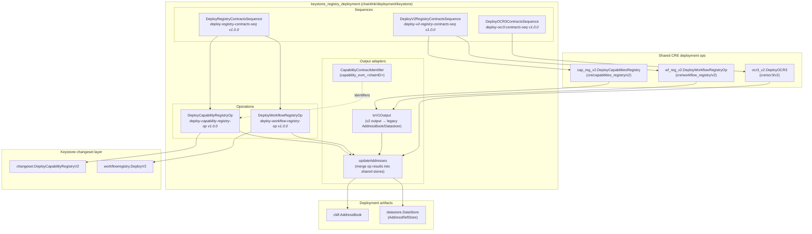
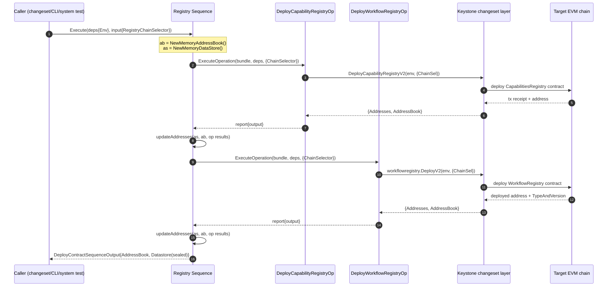
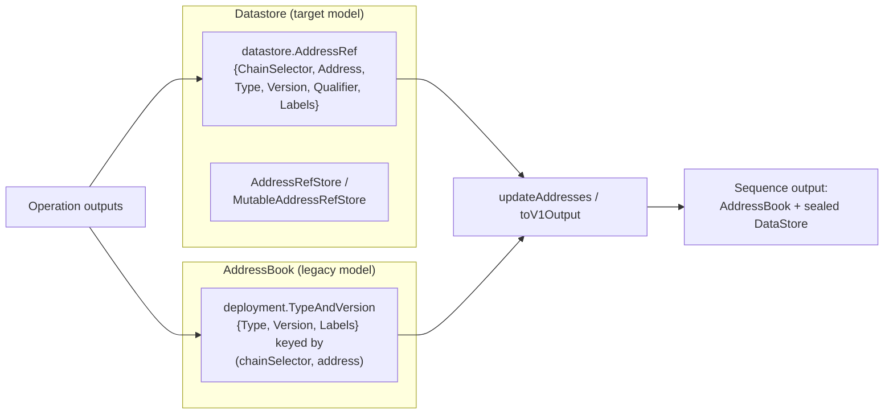
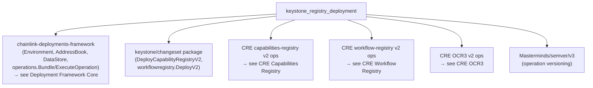
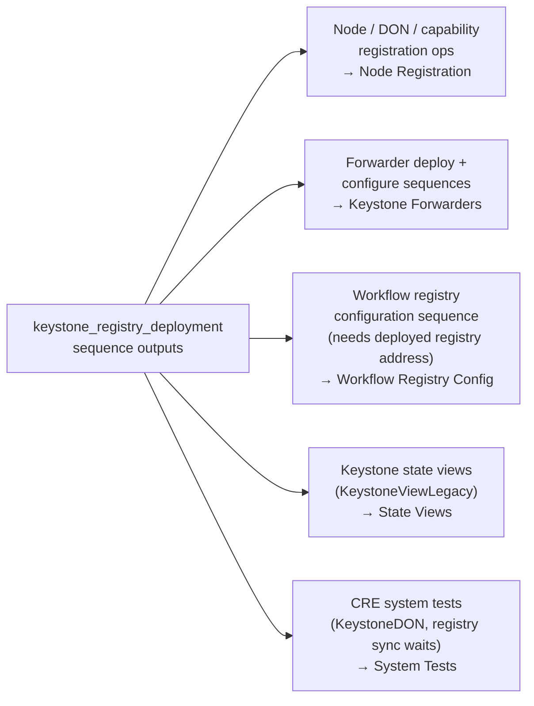
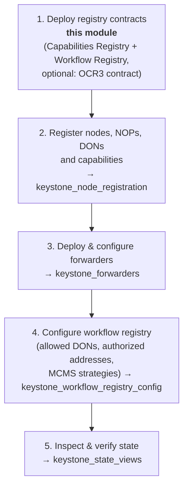

# Keystone Registry Deployment

The `keystone_registry_deployment` module provides the **versioned deployment operations and sequences** that stand up the foundational on-chain contracts required by Keystone workflows in the Chainlink Runtime Environment (CRE). It is the *ground floor* of the Keystone deployment stack: before nodes can be registered, forwarders deployed, or workflow registries configured, the **Capabilities Registry** and **Workflow Registry** contracts (and, where needed, the **OCR3 contract**) must exist on the target chain.

All code lives in `chainlink/deployment/keystone/changeset/operations/contracts/` and is built on the [Chainlink Deployments Framework](../../Deployment_Framework_Core___Product_Deployments/deployment-common.md) (`chainlink-deployments-framework`), specifically its `operations` layer of composable, semver-versioned `Operation` and `Sequence` primitives.

---

## 1. Module Purpose & Responsibilities

| Responsibility | Detail |
|---|---|
| Deploy the **Capabilities Registry** contract | Wraps the keystone changeset (`DeployCapabilityRegistryV2`) as a reusable operation |
| Deploy the **Workflow Registry** contract | Wraps the keystone workflow-registry changeset (`workflowregistry.DeployV2`) as a reusable operation |
| Compose both deployments into a single atomic **registry sequence** | `DeployRegistryContractsSequence` (v1 path) and `DeployV2RegistryContractsSequence` (v2 path with output adaptation) |
| Deploy the **OCR3 contract** for Keystone OCR3 jobs | `DeployOCR3ContractsSequence`, delegating to the shared CRE OCR3 v2 operation with a deployment `Qualifier` |
| Consolidate deployment artifacts | Merges per-operation results into a single `AddressBook` + `DataStore` snapshot for downstream consumers |

**Explicit non-goals** — the sequence docstrings are emphatic:

> *"do not add optional contracts here (ocr, forwarder...), as this sequence is used to deploy the registry contracts that other sequences depend on"*

Forwarder deployment is owned by the [Keystone Forwarders](keystone_forwarders.md) module, workflow-registry *configuration* (allowed DONs, authorized addresses, MCMS strategies) by the [Workflow Registry Configuration](keystone_workflow_registry_config.md) module, and node/DON/capability registration by the [Node Registration](keystone_node_registration.md) module.

---

## 2. Architecture Overview

The module is a thin, well-layered composition of framework primitives. Every deployable unit is an `operations.Operation` (single contract action); sequences fan out to operations and aggregate their address records.



### Layering contract

1. **Operations** are the smallest units. Each has a stable name and semver, takes a `Deps` struct (carrying `*cldf.Environment`) plus a serializable input, and returns a serializable output.
2. **Sequences** execute operations via `operations.ExecuteOperation`, thread the `operations.Bundle` through, and merge every result into one memory `AddressBook` and one memory `DataStore`.
3. **Consumers** (CLI runners, system tests, other sequences) take the sequence output and pass its addresses into follow-up sequences (e.g., [workflow registry configuration](keystone_workflow_registry_config.md)).

---

## 3. Component Reference

### 3.1 `DeployCapabilityRegistryOp`

*File: `chainlink/deployment/keystone/changeset/operations/contracts/deploy_capability_registry_op.go`*

An operation (`deploy-capability-registry-op`, v1.0.0) that deploys the Capability Registry contract by delegating to the keystone changeset `changeset.DeployCapabilityRegistryV2` with a `DeployRequestV2{ChainSel}`.

| Aspect | Type / Value |
|---|---|
| Deps | `DeployCapabilityRegistryOpDeps{ Env *cldf.Environment }` |
| Input | `DeployCapabilityRegistryInput{ ChainSelector uint64 }` |
| Output | `DeployCapabilityRegistryOutput{ Addresses datastore.AddressRefStore, AddressBook cldf.AddressBook }` |

The output carries both storage mechanisms; the `AddressBook` field is retained **for backward compatibility** while consumers migrate to the datastore.

### 3.2 `DeployWorkflowRegistryOp`

*File: `chainlink/deployment/keystone/changeset/operations/contracts/deploy_workflow_registry_op.go`*

An operation (`deploy-workflow-registry-op`, v1.0.0) that deploys the Workflow Registry contract by delegating to `workflow_registry_changeset.DeployV2`. That changeset (in `chainlink/deployment/keystone/changeset/workflowregistry/deploy.go`):

1. Resolves the EVM chain from `env.BlockChains.EVMChains()[req.ChainSel]` (fails fast if absent),
2. Deploys the WorkflowRegistry via `deployWorkflowRegistry(chain, ab)`,
3. Records an `AddressRef{ChainSelector, Address, Type, Version, Qualifier, Labels}` in a fresh memory datastore,
4. Returns `cldf.ChangesetOutput{AddressBook, DataStore}`.

| Aspect | Type / Value |
|---|---|
| Deps | `DeployWorkflowRegistryOpDeps{ Env *cldf.Environment }` |
| Input | `DeployWorkflowRegistryInput{ ChainSelector uint64 }` |
| Output | `DeployWorkflowRegistryOutput{ Addresses datastore.AddressRefStore, AddressBook cldf.AddressBook }` |

### 3.3 `DeployRegistryContractsSequence` (v1 path)

*File: `chainlink/deployment/keystone/changeset/operations/contracts/deploy_contracts_seq.go`*

A sequence (`deploy-registry-contracts-seq`, v1.0.0) that deploys **both registry contracts** in order and merges results:

1. Execute `DeployCapabilityRegistryOp` for `input.RegistryChainSelector`.
2. Merge the op's `Addresses` into the sequence-level datastore and its `AddressBook` into the sequence-level address book (`updateAddresses`).
3. Execute `DeployWorkflowRegistryOp`.
4. Merge again; return `DeployContractSequenceOutput{AddressBook, Datastore}` with the datastore **sealed** (`as.Seal()`) to make it immutable.

```go
type DeployRegistryContractsSequenceInput struct {
    RegistryChainSelector uint64
}

type DeployContractSequenceOutput struct {
    AddressBook deployment.AddressBook
    Datastore   datastore.DataStore // backward-compatible address store
}
```

### 3.4 `DeployV2RegistryContractsSequence` (v2 path)

Same file, sequence id `deploy-v2-registry-contracts-seq`, v1.0.0. Instead of the keystone-local ops it executes the **shared CRE v2 operations**:

- `cap_reg_v2.DeployCapabilitiesRegistry` (from `chainlink/deployment/cre/capabilities_registry/v2/changeset/operations/contracts`)
- `wf_reg_v2.DeployWorkflowRegistryOp` (from `chainlink/deployment/cre/workflow_registry/v2/changeset/operations/contracts`)

Because the v2 operations return flat, JSON-serializable outputs (single `Address`/`Type`/`Version`/`Labels` rather than populated stores), the sequence runs each output through **`toV1Output`**, which:

- Reconstructs a `datastore.AddressRef` (chain selector, address, contract type, parsed semver version, qualifier, labels), and
- Saves the equivalent `deployment.TypeAndVersion` entry into a memory `AddressBook`.

This adapter keeps the **public output shape identical between the v1 and v2 sequences**, so downstream consumers need not care which path was used. Unsupported v2 output types fail with `unsupported input type for transform: %T`.

### 3.5 `DeployOCR3ContractsSequence`

*File: `chainlink/deployment/keystone/changeset/operations/contracts/deploy_ocr3_op.go`*

A sequence (`deploy-ocr3-contracts-seq`, v1.0.0) that deploys the OCR3 contract by executing the shared CRE op `contracts.DeployOCR3` (`chainlink/deployment/cre/ocr3/v2/changeset/operations/contracts`). The input includes a **`Qualifier`** so multiple independent OCR3 deployments can coexist on one chain. The code notes two tracked debts: the `AddressBook` output field is slated for removal (CRE-742) and the sequence duplicates `ocr3/v2/changeset/sequences/deploy_ocr3.go` (CRE-803).

| Aspect | Type / Value |
|---|---|
| Deps | `DeployOCR3ContractSequenceDeps{ Env *cldf.Environment }` |
| Input | `DeployOCR3ContractSequenceInput{ ChainSelector uint64, Qualifier string }` |
| Output | `DeployOCR3ContractSequenceOutput{ AddressBook cldf.AddressBook, Datastore datastore.DataStore }` |

### 3.6 Helpers

| Helper | Purpose |
|---|---|
| `updateAddresses(addr, as, sourceAB, ab)` | Fetches all `AddressRef`s from an operation's store, adds them to the sequence-level mutable store, and merges the operation's `AddressBook` into the sequence-level one. Any failure aborts the sequence. |
| `toV1Output(in any) (DeprecatedOutput, error)` | Type-switch adapter converting `cap_reg_v2.DeployCapabilitiesRegistryOutput` / `wf_reg_v2.DeployWorkflowRegistryOpOutput` into the legacy `{Addresses, AddressBook}` shape. |
| `CapabilityContractIdentifier(chainID uint64)` | Builds the keystone capability identifier string `capability_evm_<chainID>` used when referencing deployed capabilities. |
| `EVMChainID` / `Selector` type aliases | Semantic aliases (`uint64`) used in inputs/outputs to distinguish chain IDs from chain selectors. |

---

## 4. Deployment Flow

The end-to-end flow for one chain selector, showing how operation results are consolidated:



For the **v2 sequence**, steps 3–7 are replaced by the CRE v2 operations, and each raw v2 output (a flat `{Address, ChainSelector, Type, Version, Labels, Qualifier}` record) is funneled through `toV1Output` before the merge, preserving the identical final output shape.

For the **OCR3 sequence**, a single operation execution occurs with the configured `Qualifier`, and its datastore + address book are merged the same way.

---

## 5. Data Model: Address Tracking

The module straddles two generations of address bookkeeping in the deployments framework — a deliberate transitional state (tracked under CRE-742):



Key properties enforced by the module:

- **Serializable I/O** — sequence inputs/outputs "must be serializable, and must not contain sensitive data" (per the source comment). This makes reports persistable and safe to share.
- **Sealed stores** — sequence outputs return `as.Seal()`, handing consumers an immutable snapshot.
- **Versioned identifiers** — every operation/sequence carries a name + semver (`semver.MustParse("1.0.0")`), enabling audit trails and safe evolution of deployment logic.

---

## 6. Dependencies

### 6.1 Inbound (what this module builds on)



- The module is part of the `github.com/smartcontractkit/chainlink/deployment` Go module (`chainlink/deployment/go.mod`), which also vendors the framework and chain SDK dependencies (go-ethereum, chain-selectors, mcms owner contracts, etc.).
- Deeper descriptions of the shared v2 operations live in [CRE Capabilities Registry](../cre-capabilities-registry.md), [CRE Workflow Registry](../cre-workflow-registry.md), and [CRE OCR3](../cre-ocr3.md); keystone-specific changeset behavior in the [Keystone overview](../keystone.md).

### 6.2 Outbound (what consumes this module)



- The **workflow registry configuration** sequence (`ConfigWorkflowRegistrySeqInput{ContractAddress, RegistryChainSelector, AllowedDonIDs, WorkflowOwners, MCMSConfig}`) expects `ContractAddress` to point at the contract this module deployed.
- **Forwarder deployment** (`ForwarderDeploymentOps{Qualifier, WfDons}`) is intentionally *excluded* from the registry sequence; it chains afterwards.
- **System tests** (see [System Tests](../../Dev,_Test___Simulation_Environments/system-tests.md)) drive these sequences to bootstrap Keystone DONs and wait for the capabilities registry to sync.

---

## 7. Position in the Keystone Deployment Lifecycle



This module therefore represents **step 1** of the Keystone deployment lifecycle: it produces the on-chain substrate — and the canonical address records — that every subsequent step references.

---

## 8. Design Notes & Operational Considerations

- **Two entry points, one output contract.** Prefer `DeployV2RegistryContractsSequence` for new work (it aligns with the shared CRE v2 operations and multi-chain/multi-family roadmap); the v1 sequence remains for existing consumers. Both return `DeployContractSequenceOutput`.
- **Fail-fast semantics.** Any operation failure aborts the sequence and no partial output is returned; partial on-chain artifacts, however, may exist and should be reconciled via the state views (see [State Views](keystone_state_views.md)).
- **Backward-compat shims are temporary.** `DeprecatedOutput`, the `AddressBook` fields on every output, and the `toV1Output` adapter exist only until the datastore migration completes (CRE-742); new consumers should read `Datastore`/`Addresses` and treat `AddressBook` as deprecated.
- **Qualifier discipline.** Use `Qualifier` (OCR3 input) and operation `Labels` to disambiguate multiple deployments of the same contract type on a chain; `CapabilityContractIdentifier` provides the canonical keystone capability id format.
- **Registry-only scope.** The sequences deliberately exclude optional contracts (OCR3 config, forwarders) so that consumers can compose exactly the steps they need without redundant deployments.

---

## 9. Related Documentation

- [Keystone Deployment Suite overview](../keystone.md) — parent module
- [Node Registration](keystone_node_registration.md) — next lifecycle step (nodes, NOPs, DONs, capabilities)
- [Keystone Forwarders](keystone_forwarders.md) — forwarder deploy/configure sequences
- [Workflow Registry Configuration](keystone_workflow_registry_config.md) — configuring the registry deployed here
- [State Views](keystone_state_views.md) — reading back deployed Keystone state
- [CRE Capabilities Registry](../cre-capabilities-registry.md) — shared v2 capabilities-registry operations
- [CRE Workflow Registry](../cre-workflow-registry.md) — shared v2 workflow-registry operations
- [CRE OCR3](../cre-ocr3.md) — shared OCR3 deployment/configure operations
- [Deployment Framework Core](../../Deployment_Framework_Core___Product_Deployments/deployment-common.md) — the `operations`/`AddressBook`/`DataStore` primitives
- [System Tests](../../Dev,_Test___Simulation_Environments/system-tests.md) — end-to-end consumers of these sequences
