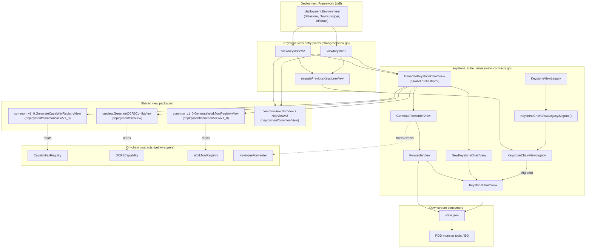
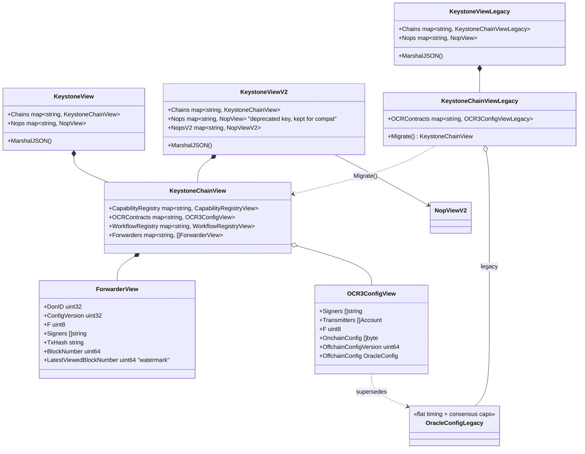
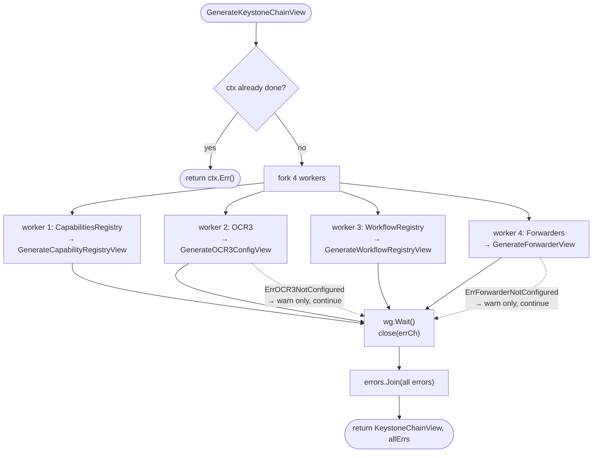
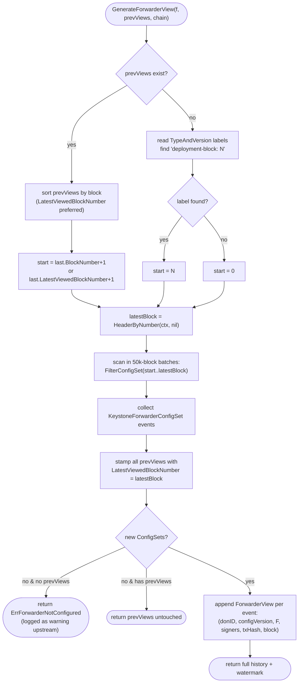
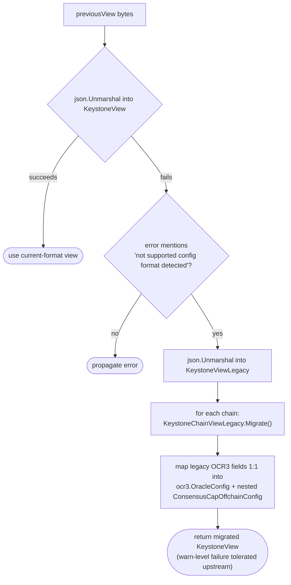

# Keystone State Views

> **Source module:** `chainlink/deployment/keystone/changeset/view_contracts.go`
> **Core components:** `KeystoneChainViewLegacy`, `KeystoneViewLegacy`
> **Part of:** [CRE / Keystone Deployment Suite](../../CRE___Keystone_Deployment_Suite.md) → [keystone](../keystone.md)

## 1. Introduction

The `keystone_state_views` module implements the **read-side of the Keystone deployment lifecycle**. It turns a live deployment environment (a set of on-chain Keystone contracts plus off-chain node-operator metadata) into a hierarchical, JSON-serializable *state view* — the `KeystoneView` / `KeystoneChainView` structures. These views are what the deployment framework serializes into `state.json` after every changeset run, and they are the contract between Keystone deployments and downstream consumers: the RDD "monster" Kafka topic, its BigQuery table, and any consumer reading `state.json` directly.

The two *core components* of this module are the **legacy view containers**:

| Component | Role |
|---|---|
| `KeystoneChainViewLegacy` | Per-chain snapshot using the legacy OCR3 offchain-config schema (`creview.OCR3ConfigViewLegacy`). Exposes `Migrate()` to convert to the current `KeystoneChainView`. |
| `KeystoneViewLegacy` | Top-level container (`Chains` + `Nops`) that unmarshals pre-migration `state.json` files and drives per-chain migration. |

The same file also hosts the **current view model** (`KeystoneChainView`, `KeystoneView`, `KeystoneViewV2`, `ForwarderView`) and the **view-generation engine** (`GenerateKeystoneChainView`, `GenerateForwarderView`), which are documented together here because they form one coherent unit.

### Key properties

- **Best-effort, non-blocking:** a failure to view a single contract logs a warning/error and continues; the other views still populate.
- **Parallel:** the four contract families (Capability Registry, OCR3, Workflow Registry, Forwarders) are viewed concurrently per chain.
- **Context-aware:** every generator honors `context.Context` cancellation/timeouts.
- **Incremental for forwarders:** `SetConfig` log scanning resumes from a block watermark, so repeated view generation stays cheap.
- **Forward/backward compatible:** custom JSON marshaling keeps old keys stable; legacy payloads are auto-migrated on read.

## 2. Where the module fits

The sibling file `view.go` (same package) defines the deployment-framework entry points `ViewKeystone` and `ViewKeystoneV2` (both implement `deployment.ViewStateV2`). Those functions:

1. Discover Keystone contracts per chain from the deployment **datastore** (`getContractsPerChain`), filtering by contract types `OCR3Capability`, `WorkflowRegistry`, `KeystoneForwarder`, and `CapabilitiesRegistry` defined in the package's `internal` module.
2. Load the *previous* view (`state.json` from the prior run), auto-migrating it through this module's legacy types if needed (`migratePreviousKeystoneView`).
3. Call `GenerateKeystoneChainView` (this module) for each chain.
4. Merge in node-operator views (`commonview.GenerateNopsView` / `GenerateNOPsViewV2` from [deployment-common](../../Deployment_Framework_Core___Product_Deployments/deployment-common.md)) and return the final `KeystoneView` / `KeystoneViewV2`.

The on-chain artifacts being *viewed* are produced by sibling modules:

- [keystone_registry_deployment](keystone_registry_deployment.md) — deploys the Capabilities Registry, Workflow Registry, OCR3 contracts and contract sequences.
- [keystone_node_registration](keystone_node_registration.md) — registers nodes, DONs and node operators (content surfaced in the Capability Registry view).
- [keystone_forwarders](keystone_forwarders.md) — deploys and configures Keystone Forwarders (the `SetConfig` events scanned by this module).
- [keystone_workflow_registry_config](keystone_workflow_registry_config.md) — configures allowed DONs and authorized addresses (reflected in the Workflow Registry view).

## 3. Architecture

### 3.1 Component relationships



### 3.2 View model hierarchy



The V2 view deliberately keeps the deprecated `nops` key alongside `nops_v2`: per the in-code comment, tracking every consumer (RDD monster Kafka topic, BigQuery table, direct `state.json` readers) is not feasible, so deprecation is announced gradually via a new key instead of a breaking rename.

## 4. View generation process

### 4.1 Parallel per-chain orchestration

`GenerateKeystoneChainView(ctx, lggr, prevView, contracts, chain)` starts four `errgroup`-style workers (one per contract family), guarded by a mutex and an error channel. All errors are aggregated with `errors.Join` at the end, so partial views are always returned.



Error-handling semantics per family:

| Family | Generator | Failure handling |
|---|---|---|
| Capability Registry | `common_v1_0.GenerateCapabilityRegistryView` | logs + records error, still stores whatever view succeeded |
| OCR3 | `creview.GenerateOCR3ConfigView` | `ErrOCR3NotConfigured` → **warning only** (contract deployed but not yet configured); other errors recorded |
| Workflow Registry | `common_v1_0.GenerateWorkflowRegistryView` | returns `(view, []error)`; each `WorkflowRegistryError` logged and recorded, partial view still stored |
| Forwarders | `GenerateForwarderView` (this module) | `ErrForwarderNotConfigured` → **warning only**; context cancellation and real errors recorded |

### 4.2 Forwarder view: incremental log scan

Forwarders are the only contract family whose state is **event-sourced** rather than read from a single call. `GenerateForwarderView` re-derives the full configuration history (`SetConfig` events) and uses two mechanisms to avoid re-scanning from genesis on every run:

1. **Watermark from the previous view** — if prior `ForwarderView`s exist, scanning resumes at `max(previous.LatestViewedBlockNumber) + 1` (previous views are sorted defensively first).
2. **Deployment-block label** — on first run, the forwarder's `TypeAndVersion` labels are searched for the `deployment-block: <n>` label written by [`cre/forwarder.DeployOp`](../cre-forwarder/cre-forwarder_evm.md) (constant `DeploymentBlockLabel` in `chainlink/deployment/cre/forwarder/deploy.go`); scanning starts at deployment height.



Each emitted `ForwarderView` is a self-contained record of one forwarder configuration change (DON id, config version, quorum `f`, readable signer addresses, originating tx hash and block), and every returned view — old and new — carries the refreshed `LatestViewedBlockNumber`, so the next run resumes correctly.

### 4.3 End-to-end sequence

```mermaid
sequenceDiagram
    participant DF as Deployment framework
    participant VS as ViewKeystone / ViewKeystoneV2
    participant DS as Datastore (address refs)
    participant SV as keystone_state_views
    participant CH as EVM chain (RPC)
    participant VP as cre / common view packages

    DF->>VS: Environment + previousView (json.Marshaler)
    VS->>DS: filter addresses by contract type per chain
    DS-->>VS: viewContracts{OCR3, Forwarder, CapReg, WorkflowReg}
    VS->>VS: migratePreviousKeystoneView(prev bytes)
    Note over VS: current format first; on legacy-format error,<br/>unmarshal KeystoneViewLegacy → Migrate()
    loop per chain
        VS->>SV: GenerateKeystoneChainView(ctx, prev chain view, contracts, chain)
        par capability registry
            SV->>VP: GenerateCapabilityRegistryView
            VP-->>SV: CapabilityRegistryView
        and OCR3
            SV->>VP: GenerateOCR3ConfigView
            VP->>CH: LatestConfigDetails + FilterConfigSet
            VP-->>SV: OCR3ConfigView (or ErrOCR3NotConfigured)
        and workflow registry
            SV->>VP: GenerateWorkflowRegistryView (paged)
            VP-->>SV: WorkflowRegistryView + []error
        and forwarders
            SV->>CH: HeaderByNumber + FilterConfigSet (50k batches)
            SV-->>SV: []ForwarderView + watermark
        end
        SV-->>VS: KeystoneChainView (+ joined errors)
    end
    VS->>VP: GenerateNopsView / GenerateNOPsViewV2
    VS-->>DF: KeystoneView / KeystoneViewV2 (indented JSON) → state.json
```

## 5. Legacy view migration

The OCR3 offchain config schema changed from a flat `OracleConfigLegacy` structure to the new `ocr3.OracleConfig` (which nests a `ConsensusCapOffchainConfig` and carries `Dontime`/`ChainCap` variants — see [cre-core state views](../cre-core/cre-core_state-views.md)). `state.json` files produced before that change cannot be unmarshaled into the current structs, so migration happens on read:



`KeystoneChainViewLegacy.Migrate()` copies the registry, workflow-registry and forwarder maps untouched and only re-shapes the OCR3 entries: timing deltas, `MaxRoundsPerEpoch`, `TransmissionSchedule`, duration caps and `MaxFaultyOracles` move verbatim, while the legacy consensus sizing fields (`MaxQueryLengthBytes` … `RequestTimeout`) are re-homed under `ConsensusCapOffchainConfig`. The matching legacy *contract-level* type, `OCR3ConfigViewLegacy`, lives in the [`cre/view` package](../cre-core/cre-core_state-views.md) and includes a custom `UnmarshalJSON` for its old string-encoded `RequestTimeout` field.

## 6. Error model summary

- **`ErrForwarderNotConfigured`** (this module): a forwarder contract exists but has never received a `SetConfig` and has no prior views. Non-fatal; logged as a warning by the orchestrator.
- **`creview.ErrOCR3NotConfigured`** (imported): an OCR3 capability contract has no `ConfigSet` yet. Non-fatal, warning only.
- **Context cancellation** (`context.Canceled` / `DeadlineExceeded`) inside forwarder scanning is treated as a warning but still propagated into the joined error.
- Everything else is collected per-contract and **joined via `errors.Join`** — the caller receives both a (possibly partial) view and the full error set, and the sibling `view.go` entry points merge those errors into the framework-level result while still emitting the view.

## 7. Dependencies

| Dependency | Used for | Defined in |
|---|---|---|
| `chainlink-deployments-framework` | `cldf.Environment`, `cldf_evm.Chain`, `datastore.AddressRef`, `TypeAndVersion`, `ViewStateV2` | `chainlink/deployment/go.mod` (Go module manifest for the `deployment` module) |
| `chainlink-evm` gethwrappers | `KeystoneForwarder` binding + `ConfigSet` event types | external module, versioned via `chainlink/deployment/go.mod` |
| `deployment/cre/view` (`creview`) | `OCR3ConfigView`, `OCR3ConfigViewLegacy`, `GenerateOCR3ConfigView`, `ErrOCR3NotConfigured` | [cre-core state views](../cre-core/cre-core_state-views.md) |
| `deployment/cre/forwarder` | `DeploymentBlockLabel` / `DeploymentHashLabel` constants written at deploy time | [cre-forwarder](../cre-forwarder.md) |
| `deployment/common/view/v1_0` | `GenerateCapabilityRegistryView`, `GenerateWorkflowRegistryView` | [deployment-common](../../Deployment_Framework_Core___Product_Deployments/deployment-common.md) |
| `deployment/common/view` | `NopView`, `NopViewV2`, `GenerateNopsView`, `GenerateNOPsViewV2` | [deployment-common](../../Deployment_Framework_Core___Product_Deployments/deployment-common.md) |
| `chainlink-common/pkg/logger` | structured logger interface | [logger](../../Shared_Foundation_Libraries___Domain_Types/logger.md) |
| `deployment/cre/ocr3` | `OracleConfig` / `ConsensusCapOffchainConfig` target types of the migration | [cre-ocr3](../cre-ocr3.md) |

## 8. Consumers and operational notes

- **state.json**: the deployment framework serializes the returned `KeystoneView`/`KeystoneViewV2` after each run; custom `MarshalJSON` implementations emit indented JSON (alias types prevent infinite recursion on the named structs).
- **RDD monster pipeline**: the code comment notes the Kafka topic and BigQuery table consume the `nops` entry; hence the dual-key (`nops` + `nops_v2`) strategy in `KeystoneViewV2`.
- **System tests**: CRE system-test libraries build on Keystone deployment state (`KeystoneDON` in [system-tests](../../Dev,_Test___Simulation_Environments/system-tests.md)), which relies on views accurately reflecting registered DONs, nodes and forwarder configurations.
- **Re-runs are cheap**: because forwarder views watermark themselves and other views are single-contract reads, regenerating the full view on a large deployment costs at most one incremental log scan per forwarder.
