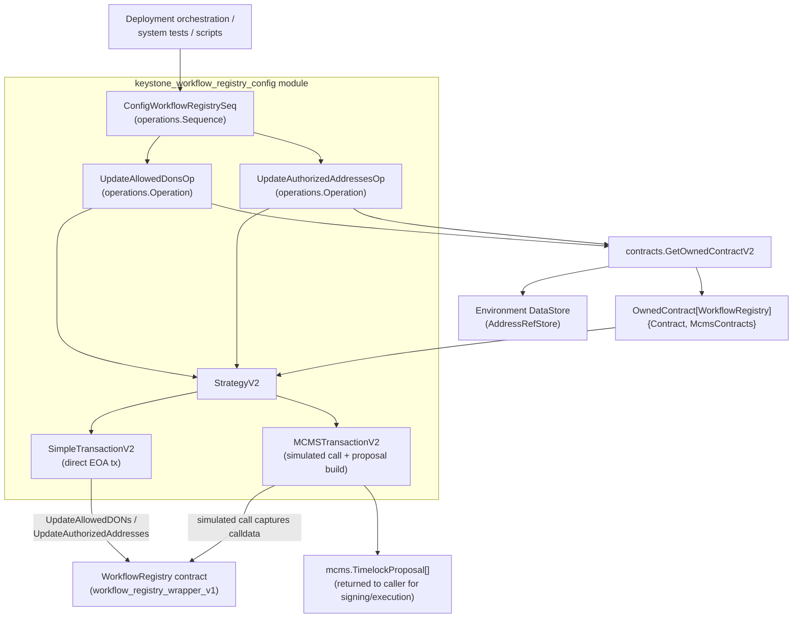
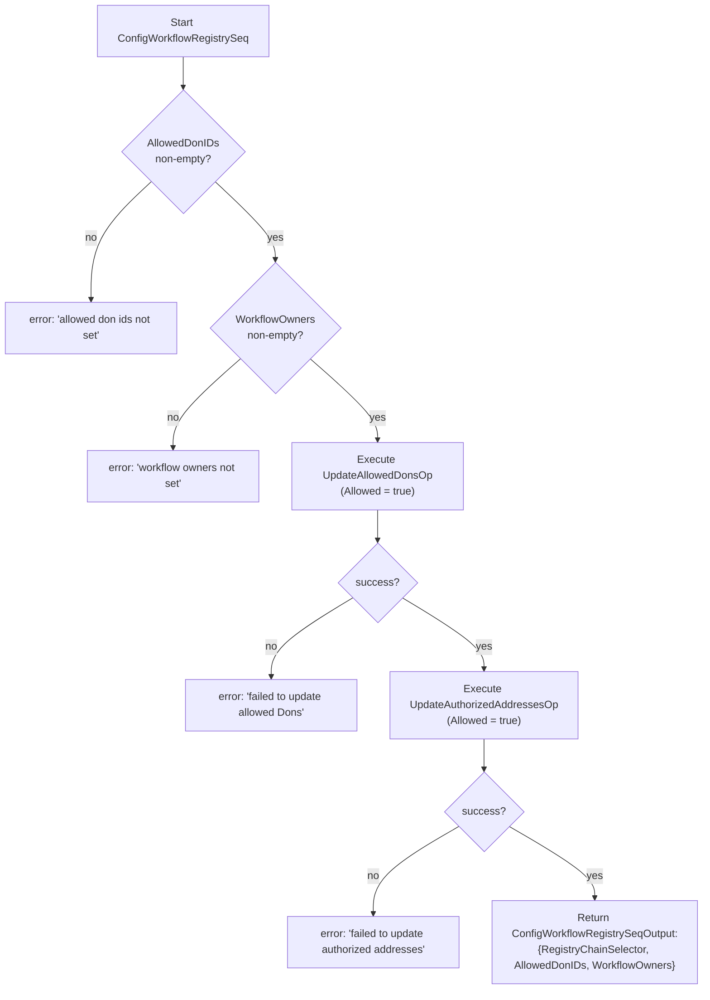
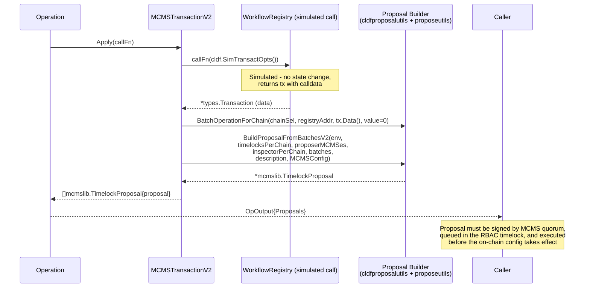
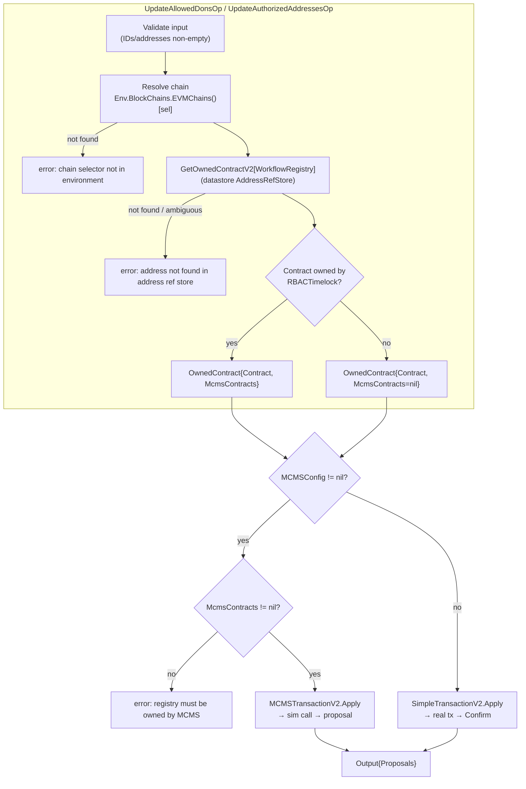

# Keystone Workflow Registry Configuration

> **Module:** `keystone_workflow_registry_config`
> **Packages:**
> - `chainlink/deployment/keystone/changeset/operations/contracts`
> - `chainlink/deployment/keystone/changeset/workflowregistry`

## 1. Introduction

This module implements the **on-chain configuration stage of the Keystone workflow deployment lifecycle**. After a `WorkflowRegistry` contract has been deployed and (optionally) transferred to MCMS governance, this module grants the two pieces of access-control state that a Keystone deployment requires before any workflow can be registered or executed:

1. **Allowed DONs** — the set of Decentralized Operator Network (DON) IDs that are permitted to execute workflows via the registry (`UpdateAllowedDONs`).
2. **Authorized workflow owners** — the set of addresses allowed to register and manage workflows (`UpdateAuthorizedAddresses`).

The module is built on the `chainlink-deployments-framework` **operations model**: a top-level `operations.Sequence` (`ConfigWorkflowRegistrySeq`) composes two `operations.Operation`s (`UpdateAllowedDonsOp`, `UpdateAuthorizedAddressesOp`). Every operation delegates the actual transaction handling to a pluggable **transaction strategy** (`StrategyV2`) that supports two execution modes:

- **Direct mode** — the environment deployer EOA signs, broadcasts, and confirms the transaction immediately.
- **MCMS mode** — the call is *simulated* to capture calldata, which is then packaged into a **Many-Chain Multi-Sig (MCMS) timelock proposal**. No state change occurs until the proposal is signed by the required quorum and executed through the RBAC timelock.

The module is product-specific to **Keystone** but reuses generic contract helpers and strategy utilities from the [CRE Core](../cre-core.md) layer of the deployment suite.

---

## 2. Role in the Deployment Lifecycle

Within the [Keystone](../keystone.md) deployment suite, this module sits between contract deployment and workflow/job provisioning:

| Stage | Module / Component | Notes |
|---|---|---|
| 1. Deploy registry contracts | [Keystone Registry Deployment](keystone_registry_deployment.md) (`DeployRegistryContractsSequence`, `DeployV2RegistryContractsSequence` in `deploy_contracts_seq.go`) | Deploys `CapabilitiesRegistry` + `WorkflowRegistry` |
| 2. Transfer ownership | `accept_ownership.go` (`AcceptAllOwnershipsProposal`) | Moves contracts under MCMS `RBACTimelock` + `ProposerManyChainMultiSig` |
| 3. **Configure workflow registry** | **This module** (`ConfigWorkflowRegistrySeq`) | Allow-lists DONs and workflow owners |
| 4. Register nodes / DONs / capabilities | [Keystone Node Registration](keystone_node_registration.md) | Populates the capabilities registry |
| 5. Propose jobs (OCR3, forwarder, standard capabilities) | [CRE Jobs](../cre-jobs.md) | Offchain job distribution |
| 6. Register/pause/delete workflows | [CRE Workflow Registry](../cre-workflow-registry.md) (v2 user/admin ops) and the `cre-cli` toolchain | Consumes the configuration created here |

Because step 3 is a governance-sensitive mutation, the module always returns the produced `mcms.TimelockProposal` objects to the caller, so MCMS-governed deployments can collect signatures and execute the proposals through their normal proposal pipeline.

---

## 3. Architecture



### Component inventory

| Component | File | Kind | Responsibility |
|---|---|---|---|
| `ConfigWorkflowRegistrySeqDeps` | `changeset/operations/contracts/config_workflow_registry_seq.go` | Deps struct | Carries the `*cldf.Environment` into the sequence |
| `ConfigWorkflowRegistrySeqInput` | same | Input struct | Contract address, chain selector, allowed DON IDs, workflow owners, optional `MCMSConfig` |
| `ConfigWorkflowRegistrySeqOutput` | same | Output struct | Echoes the applied configuration (chain selector, DON IDs, owners) |
| `UpdateAllowedDonsOpDeps/Input/Output` | `changeset/operations/contracts/update_allowed_dons_op.go` | Operation | Calls `WorkflowRegistry.UpdateAllowedDONs` |
| `UpdateAuthorizedAddressesOpDeps/Input/Output` | `changeset/operations/contracts/update_authorized_addresses_op.go` | Operation | Calls `WorkflowRegistry.UpdateAuthorizedAddresses` |
| `StrategyV2` | `changeset/workflowregistry/strategies.go` | Interface | `Apply(callFn) ([]mcmslib.TimelockProposal, error)` |
| `SimpleTransactionV2` | same | Strategy | Direct EOA transaction + confirmation |
| `MCMSTransactionV2` | same | Strategy | Simulated call → calldata → MCMS `TimelockProposal` |
| `strategy`, `simpleTransaction`, `mcmsTransaction` | same | Legacy interface | Pre-V2 changeset variants (`cldf.ChangesetOutput`-based) used by `workflowregistry.UpdateAllowedDons` / `UpdateAuthorizedAddresses` |

---

## 4. The Configuration Sequence

`ConfigWorkflowRegistrySeq` (id `"config-workflow-registry-seq"`, version `1.0.0`) is the single entry point of the module.

**Input (`ConfigWorkflowRegistrySeqInput`)**

| Field | Type | Description |
|---|---|---|
| `ContractAddress` | `common.Address` | Address of the deployed `WorkflowRegistry` contract |
| `RegistryChainSelector` | `uint64` | Chain selector of the chain hosting the registry |
| `AllowedDonIDs` | `[]uint32` | DON IDs to mark as allowed. **Must be non-empty** |
| `WorkflowOwners` | `[]common.Address` | Addresses to mark as authorized workflow owners. **Must be non-empty** |
| `MCMSConfig` | `*changeset.MCMSConfig` | Optional. If non-nil, both operations produce MCMS proposals instead of direct transactions |

**Behavior**



Key properties:

- **Strict allow-listing only.** The sequence hard-codes `Allowed: true` for both operations. To revoke access, callers must use the underlying operations directly with `Allowed: false` (or the changeset-level functions in the `workflowregistry` package).
- **Ordered execution.** DON allow-listing happens before owner authorization; the sequence aborts on the first failure, leaving partial configuration applied (no built-in rollback).
- **Serializable I/O.** Inputs and outputs contain only plain values (addresses as hex strings/`common.Address`, `uint32`/`uint64` IDs), which satisfies the framework requirement that operation/sequence I/O be serializable for reporting.
- **Output echo.** The output repeats the input configuration, acting as a receipt of what was applied. Note that the two generated `TimelockProposal`s (MCMS mode) are consumed inside the sequence's operation reports — callers relying on the proposals should execute the operations individually or read them from the `operations.Bundle` execution reports.

---

## 5. The Configuration Operations

Both operations follow an identical five-step pattern:

1. **Input validation** — reject empty ID/address sets.
2. **Chain resolution** — look up the target chain in `deps.Env.BlockChains.EVMChains()[RegistryChainSel]`; error if the selector is unknown to the environment.
3. **Contract loading** — `contracts.GetOwnedContractV2[*workflow_registry.WorkflowRegistry]` resolves the contract binding from the environment **datastore** (`deps.Env.DataStore.Addresses()`) and returns an `OwnedContract[T]`:
   - `Contract` — the bound `WorkflowRegistry` wrapper (`workflow_registry_wrapper_v1`).
   - `McmsContracts` — non-nil **only if** the registry is owned by an MCMS `RBACTimelock` (detected via the owner address reference in the datastore); contains the `Timelock` and `ProposerMcm` bindings used for proposal construction.
4. **Strategy selection** — see §6.
5. **Call application** — invoke the registry write through the strategy with ABI error decoding via `cldf.DecodeErr(workflow_registry.WorkflowRegistryABI, err)` so that on-chain reverts surface as readable Go errors.

### 5.1 `UpdateAllowedDonsOp` (`"update-allowed-dons-op"`)

| Aspect | Detail |
|---|---|
| Input | `ContractAddress string`, `RegistryChainSel uint64`, `DonIDs []uint32`, `Allowed bool`, `MCMSConfig *changeset.MCMSConfig` |
| Output | `Proposals []mcms.TimelockProposal` — empty in direct mode, one proposal in MCMS mode |
| Validation error | `"must provide at least one DonID"` |
| Contract call | `registry.Contract.UpdateAllowedDONs(opts, input.DonIDs, input.Allowed)` |
| MCMS guard | If `MCMSConfig != nil` but `registry.McmsContracts == nil` → error `"registry must be owned by MCMS"` |
| Proposal description | `"proposal to update allowed dons"` |

### 5.2 `UpdateAuthorizedAddressesOp` (`"update-authorized-addresses-op"`)

| Aspect | Detail |
|---|---|
| Input | `ContractAddress string`, `RegistryChainSel uint64`, `Addresses []string`, `Allowed bool`, `MCMSConfig *changeset.MCMSConfig` |
| Output | `Proposals []mcms.TimelockProposal` |
| Validation error | `"must provide at least 1 address"` |
| Address handling | Each string is normalized with `common.HexToAddress` before the call |
| Contract call | `registry.Contract.UpdateAuthorizedAddresses(opts, addr, input.Allowed)` |
| MCMS guard | Same ownership requirement as §5.1 |
| Proposal description | `"proposal to update authorized addresses"` |

> **Note:** `ConfigWorkflowRegistrySeq` passes addresses as hex strings; the operation converts them. `ContractAddress` is likewise accepted as a string and normalized internally by the contract loader.

---

## 6. Transaction Strategies

The strategy layer is defined in `chainlink/deployment/keystone/changeset/workflowregistry/strategies.go` and abstracts *how* a registry write reaches the chain.

```go
type StrategyV2 interface {
    Apply(callFn func(opts *bind.TransactOpts) (*types.Transaction, error)) ([]mcmslib.TimelockProposal, error)
}
```

### 6.1 `SimpleTransactionV2` (direct mode)

Used when `MCMSConfig == nil`.

1. Calls `callFn(s.Chain.DeployerKey, ...)` — the environment deployer EOA signs and broadcasts immediately.
2. Waits for the receipt with `s.Chain.Confirm(tx)`.
3. Returns an empty proposal slice — the configuration is final once the call returns.

This mode is appropriate for test environments and development chains where the registry is owned by the deployer key.

### 6.2 `MCMSTransactionV2` (governed mode)

Used when `MCMSConfig != nil`. This mirrors the shared `strategies.MCMSTransaction` from the CRE core (`chainlink/deployment/cre/common/strategies/strategies.go`), adapted to take the MCMS contract set from the `OwnedContract` envelope.



Construction details:

- **Contract data is captured by simulation.** `cldf.SimTransactOpts()` produces fake transact opts so the wrapper builds the exact ABI-encoded calldata without touching chain state.
- **Per-chain maps.** The timelock address (`m.MCMSContracts.Timelock.Address()`), proposer MCMS address (`m.MCMSContracts.ProposerMcm.Address()`), and an MCMS inspector (`cldfproposalutils.McmsInspectorForChain`) are provided as single-entry `map[uint64]...` keyed by `ChainSel`.
- **`MCMSConfig`** is an alias chain: `changeset.MCMSConfig` → `contracts.MCMSConfig` → `cldfproposalutils.TimelockConfig` (defined in `chainlink/deployment/cre/contracts/contracts.go`, re-exported in `chainlink/deployment/keystone/changeset/update_nodes.go`). It carries the signing/validation parameters for proposal construction.

### 6.3 Legacy strategy interface

The same file also retains the pre-V2 pair used by the changeset-level API:

- `strategy` — `Apply(callFn) (cldf.ChangesetOutput, error)`
- `simpleTransaction` / `mcmsTransaction` — same behavior as the V2 types, but with `ContractSet *changeset.ContractSet` (from the legacy `GetContractSets` loader) instead of the datastore-backed `OwnedContract`, and returning `cldf.ChangesetOutput` (which embeds `MCMSTimelockProposals`).

These are consumed by `workflowregistry.UpdateAllowedDons` (`update_allowed_dons.go`) and `workflowregistry.UpdateAuthorizedAddresses` (`update_authorized_addresses.go`), which locate the registry through `changeset.GetContractSets(env.ExistingAddresses)` instead of the environment datastore. The operations in this module are the datastore/datastore-ref based successors (V2 style); the changeset functions remain available for callers still organized around address books.

---

## 7. Execution Flow (operations view)



---

## 8. Dependencies

```mermaid
flowchart LR
    subgraph this["keystone_workflow_registry_config"]
        SEQ[ConfigWorkflowRegistrySeq]
        OPS[UpdateAllowedDonsOp /<br/>UpdateAuthorizedAddressesOp]
        STR[strategies.go]
    end

    subgraph cldf["chainlink-deployments-framework (external)"]
        ENV[cldf.Environment]
        OPM[operations: Sequence / Operation / Bundle]
        DS[datastore.AddressRefStore]
        SIM[cldf.SimTransactOpts / DecodeErr]
    end

    subgraph crecore["CRE core deployment packages"]
        GH[contracts.GetOwnedContractV2 /<br/>OwnedContract / MCMSConfig alias]
        CSTR[cre/common/strategies<br/>(reference implementation)]
    end

    subgraph evm["chainlink-evm gethwrappers"]
        WR[workflow_registry_wrapper_v1<br/>.WorkflowRegistry]
    end

    subgraph mcmslib["MCMS libraries"]
        MPROP[mcms.TimelockProposal]
        PUTILS[cldfproposalutils / proposeutils]
    end

    SEQ --> OPS --> STR
    OPS --> ENV
    OPS --> OPM
    OPS --> GH --> DS
    OPS --> WR
    STR --> SIM
    STR --> MPROP
    STR --> PUTILS
    SEQ --> WR
```

Related in-repo modules:

| Dependency | Relation |
|---|---|
| [Deployment Framework Core](../../Deployment_Framework_Core___Product_Deployments.md) | Provides `cldf.Environment`, operations framework, datastore, and the MCMS/timelock contract types (`RBACTimelock`, `ProposerManyChainMultiSig`) this module mutates ownership against. |
| [CRE Workflow Registry](../cre-workflow-registry.md) | The product-generic v2 registry operations (deploy, admin/user lifecycle ops). The keystone module is a product-flavored configuration layer over the same `WorkflowRegistry` contract family. |
| [Keystone Registry Deployment](keystone_registry_deployment.md) | Deploys the registry contracts that this module then configures; `DeployRegistryContractsSequence` in `deploy_contracts_seq.go` is the direct upstream. |
| [Keystone State Views](keystone_state_views.md) | Read-side counterpart (`view_contracts.go`) for inspecting the resulting registry state. |
| [Dev, Test & Simulation Environments](../../Dev,_Test___Simulation_Environments.md) | System-test orchestration (e.g. `chainlink/system-tests/lib/cre`) drives the keystone operations framework, including contract configuration steps, against ephemeral CRE environments. |

---

## 9. Error Handling Summary

| Error | Emitted by | Condition |
|---|---|---|
| `allowed don ids not set` | `ConfigWorkflowRegistrySeq` | Empty `AllowedDonIDs` |
| `workflow owners not set` | `ConfigWorkflowRegistrySeq` | Empty `WorkflowOwners` |
| `must provide at least one DonID` | `UpdateAllowedDonsOp` | Empty `DonIDs` |
| `must provide at least 1 address` | `UpdateAuthorizedAddressesOp` | Empty `Addresses` |
| `registry chain selector %d does not exist in environment` | Both operations | Selector missing from `Env.BlockChains.EVMChains()` |
| `address %s not found in address ref store for chain %d` (via `GetOwnedContractV2`) | Both operations | Registry address absent from datastore, or ambiguous entries |
| `registry must be owned by MCMS` | Both operations | `MCMSConfig` provided but the registry owner is not an `RBACTimelock` |
| Wrapped contract reverts | Both operations | Decoded via `cldf.DecodeErr(WorkflowRegistryABI, ...)` |
| `failed to update allowed Dons` / `failed to update authorized addresses` | `ConfigWorkflowRegistrySeq` | Wraps any operation failure during the sequence |

All errors are wrapped with context (`fmt.Errorf("...: %w", err)`), preserving the cause chain for callers and CI logs.

---

## 10. Usage Example

Typical direct-mode invocation (test/dev environments):

```go
out, err := operations.ExecuteSequence(
    bundle,
    ks_contracts_op.ConfigWorkflowRegistrySeq,
    ks_contracts_op.ConfigWorkflowRegistrySeqDeps{Env: &env},
    ks_contracts_op.ConfigWorkflowRegistrySeqInput{
        ContractAddress:       registryAddr,
        RegistryChainSelector: chainSel,
        AllowedDonIDs:         []uint32{1, 2},
        WorkflowOwners:        []common.Address{owner1, owner2},
        MCMSConfig:            nil, // direct transactions
    },
)
```

MCMS mode requires (a) the registry to have been transferred to an MCMS timelock (see `accept_ownership.go` in the keystone changeset package), (b) the timelock/proposer bindings resolvable from the datastore so `OwnedContract.McmsContracts` is populated, and (c) a valid `changeset.MCMSConfig` (a `cldfproposalutils.TimelockConfig`). The returned proposals then flow into the standard MCMS propose → approve → execute pipeline.

---

## 11. Testing

Covered by:

- `chainlink/deployment/keystone/changeset/workflowregistry/update_allowed_dons_test.go`
- `chainlink/deployment/keystone/changeset/workflowregistry/update_authorized_addresses_test.go`

These exercise the changeset-level equivalents built on the same strategy layer; `workflowregistry/setup_test.go` provisions the environment and registry fixtures. The operations themselves follow the shared keystone operations test patterns (in-memory datastore + simulated chains) used across `changeset/operations/contracts` (see `deploy_capability_registry_op_test.go`, `add_capabilities_op_test.go`).

---

## 12. Related Documentation

- [Keystone](../keystone.md) — parent product module.
- [Keystone Registry Deployment](keystone_registry_deployment.md) — upstream deployment of registry contracts.
- [Keystone Node Registration](keystone_node_registration.md) — node/DON/NOP registration in the capabilities registry.
- [Keystone Forwarders](keystone_forwarders.md) — forwarder deployment/configuration stage.
- [Keystone State Views](keystone_state_views.md) — read-side contract views.
- [CRE Workflow Registry](../cre-workflow-registry.md) — generic v2 workflow registry changesets and operations.
- [CRE Core](../cre-core.md) — shared contract helpers, strategies, and state views.
- [CRE & Keystone Deployment Suite](../../CRE___Keystone_Deployment_Suite.md) — suite overview.
- [Deployment Framework Core](../../Deployment_Framework_Core___Product_Deployments.md) — underlying deployment framework primitives.
