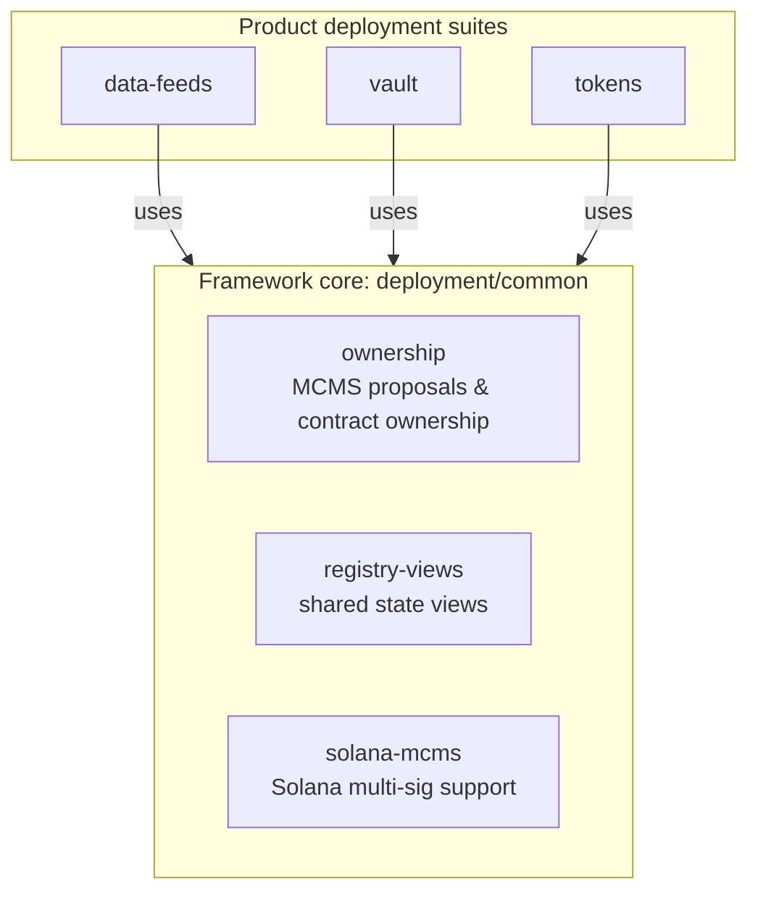
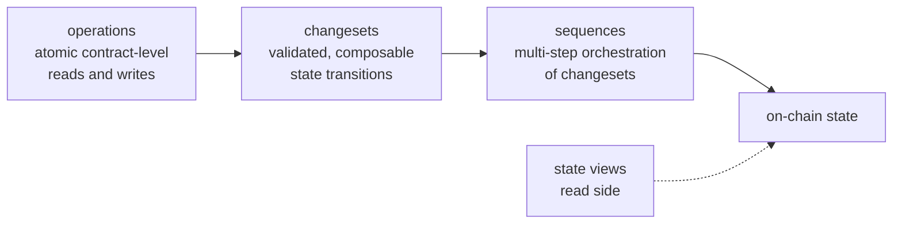
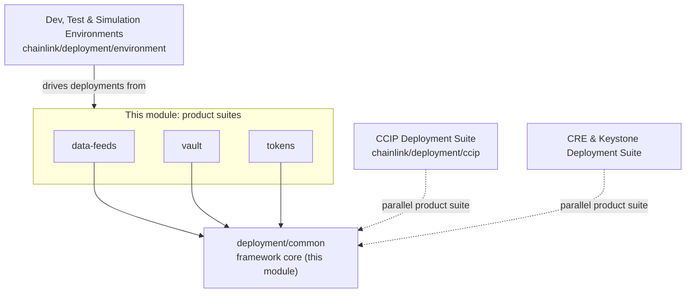

# Deployment Framework Core & Product Deployments

## Purpose

This module, rooted at `chainlink/deployment`, contains the **shared core of Chainlink's deployment framework** together with the **deployment suites for first-party products**: Data Feeds, Vault, and Tokens. It is distinct from the product-specific CCIP and CRE/Keystone deployment suites, which are documented as separate overview modules.

The module is responsible for:

- Providing **product-agnostic framework utilities** (`deployment/common`) used by every deployment suite — contract ownership and MCMS (multi-chain multi-sig) proposal tooling, registry/state views, and Solana MCMS support.
- Shipping **product deployment suites** that follow the framework's canonical layering of `operations` → `changesets` → `sequences`:
  - **Data Feeds** — chain state views, Job Distributor (JD) registration, shared utilities, and Solana price-cache handling.
  - **Vault** — Automation receiver integration, ETH balance monitoring (`ethbalmon`), and treasury contracts.
  - **Tokens** — token launches, organized into changesets, operations, and sequences.
- Serving as the on-chain deployment backbone consumed by the **Dev, Test & Simulation Environments** (e.g. `chainlink/deployment/environment`), which stand up ephemeral multi-chain test environments from these suites.

## Architecture

### Module composition

Product suites build on the shared framework core; the core owns cross-cutting concerns (ownership/MCMS governance, state views) so suites can stay focused on product-specific contract lifecycles.

### Canonical deployment pattern

Each product suite follows the framework's standard structure (most explicitly visible in `tokens`, which is split into `operations`, `changesets`, and `sequences`). Operations are atomic contract-level reads/writes; changesets are validated, composable state transitions built on operations; sequences orchestrate multiple changesets into multi-step deployments; state views read the resulting on-chain state back into typed in-memory representations.

### Position in the deployment ecosystem

## Core components

| Component | Path | Description | Documentation |
|---|---|---|---|
| `deployment-common` | `chainlink/deployment/common` | Framework core shared by all suites: ownership/MCMS proposal tooling, registry views, and Solana MCMS support. | [deployment-common](<Deployment_Framework_Core___Product_Deployments/deployment-common.md>) |
| `data-feeds` | `chainlink/deployment/data-feeds` | Data Feeds deployment suite: chain state views, JD registration, shared utilities, and Solana cache support. | [data-feeds](<Deployment_Framework_Core___Product_Deployments/data-feeds.md>) |
| `vault` | `chainlink/deployment/vault` | Vault deployment suite: Automation receiver, ETH balance monitor, and treasury contracts. | [vault](<Deployment_Framework_Core___Product_Deployments/vault.md>) |
| `tokens` | `chainlink/deployment/tokens` | Token deployment suite, structured into changesets, operations, and sequences. | [tokens](<Deployment_Framework_Core___Product_Deployments/tokens.md>) |

## Related modules

- **CCIP Deployment Suite** — `chainlink/deployment/ccip` — sibling product deployment suite for the CCIP cross-chain protocol, with its own changesets, operations, and sequences.
- **CRE & Keystone Deployment Suite** — `chainlink/deployment/cre`, `chainlink/deployment/keystone` — sibling suite covering CRE/Keystone contract and job deployments.
- **Dev, Test & Simulation Environments** — `chainlink/deployment/environment` and related test harnesses — consume these deployment suites to spin up end-to-end test and simulation environments.