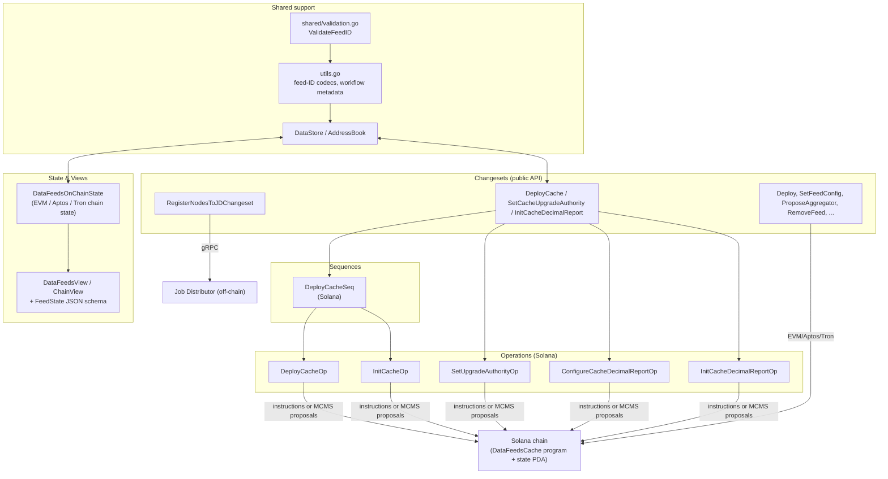
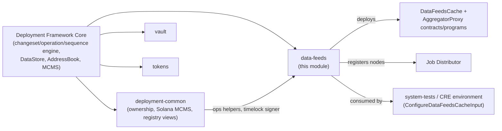
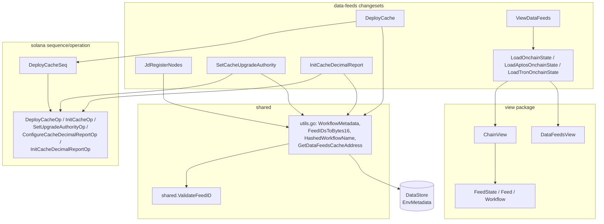

# Data Feeds Deployment Module

> **Location:** `chainlink/deployment/data-feeds/` · **Go module:** `github.com/smartcontractkit/chainlink/deployment` (see [chainlink/deployment/go.mod](https://github.com/smartcontractkit/chainlink/blob/main/chainlink/deployment/go.mod))

## 1. Purpose and Scope

The **data-feeds** module is a product-specific deployment package within the Chainlink Deployment Framework. It packages everything needed to deploy, configure, inspect, and hand over the **Chainlink Data Feeds** product on-chain and off-chain:

- **On-chain artifacts** – the `DataFeedsCache` contract/program and `AggregatorProxy` contracts on EVM, Aptos, Solana, and Tron chains.
- **Feed configuration** – feed ID encoding/validation, feed config JSON handling, and workflow metadata registration.
- **Off-chain integration** – registering nodes into the **Job Distributor (JD)** with product labels so they can serve Data Feeds workflows.
- **Observability** – on-chain state loading ("chain state") and JSON view generation for humans and downstream tooling.

It follows the standard *changeset → sequence → operation* model of the `chainlink-deployments-framework` (imported from `github.com/smartcontractkit/chainlink-deployments-framework`, pinned in `chainlink/deployment/go.mod`), and it reuses shared ownership/MCMS tooling from the sibling [deployment-common](deployment-common.md) module.

### What this module is NOT

This module does **not** implement the Data Feeds runtime (node job execution, OCR pipelines, price feeds). Those live in the node core ([Oracle Engines & Data Pipelines](../Oracle_Engines___Data_Pipelines.md)) and workflow engine ([Workflow & Capability Runtime](../Workflow___Capability_Runtime_(CRE_Engine).md)). This module only orchestrates **deployment and configuration** of the on-chain + off-chain artifacts for the product.

## 2. Architecture Overview



### Layer responsibilities

| Layer | Responsibility | Key types |
|---|---|---|
| **Changesets** | Idempotent, precondition-checked deployment units exposed to the framework CLI | `DeployCache`, `SetCacheUpgradeAuthority`, `InitCacheDecimalReport`, `RegisterNodesToJDChangeset` |
| **Sequences** | Multi-step orchestration of operations with shared deps | `DeployCacheSeq` (deploys program, then initializes state PDA) |
| **Operations** | Single on-chain actions; either confirm directly or emit MCMS timelock proposals | `DeployCacheOp`, `InitCacheOp`, `SetUpgradeAuthorityOp`, `ConfigureCacheDecimalReportOp`, `InitCacheDecimalReportOp` |
| **State/Views** | Read deployed artifacts via `DataStore`/`AddressBook`, bind contract wrappers, produce JSON views | `DataFeedsOnChainState`, `DataFeedsView`, `FeedState` |
| **Support** | Feed-ID byte codecs, workflow name hashing, env-metadata upsert | `WorkflowMetadata`, `ValidateFeedID` |

### Where it fits in the Deployment Framework



Related module documentation:

- [Deployment Framework Core overview](../Deployment_Framework_Core___Product_Deployments.md) and [deployment-common](deployment-common.md) — shared changeset/operation infrastructure, MCMS/ownership helpers (`deployment-common_ownership`, `deployment-common_solana-mcms`).
- [Keystone deployment suite](../CRE___Keystone_Deployment_Suite/keystone.md) — the forwarder programs referenced by the Solana cache are deployed/configured by Keystone workflows.
- [System tests](../Dev,_Test___Simulation_Environments/system-tests.md) — `chainlink/system-tests/lib/cre/types.go::ConfigureDataFeedsCacheInput` drives this module's changesets in end-to-end environments.

## 3. Sub-module Documentation

The module is organized into four sub-modules. Detailed documentation for each is linked below:

| Sub-module | Documentation | Scope |
|---|---|---|
| **JD Registration** | [data-feeds_jd-registration.md](data-feeds/data-feeds_jd-registration.md) | Off-chain node registration into the Job Distributor (`RegisterNodesToJDChangeset`, `DONConfigSchema`), product labeling conventions. |
| **Solana Cache Deployment** | [data-feeds_solana-cache.md](data-feeds/data-feeds_solana-cache.md) | Solana-specific changesets, the `DeployCacheSeq` sequence and the five cache operations, including MCMS timelock proposal generation and PDA derivation. |
| **Chain State & Views** | [data-feeds_chain-state-views.md](data-feeds/data-feeds_chain-state-views.md) | Loading deployed artifacts into typed chain state (EVM/Aptos/Tron) and generating JSON views, including the feed-config JSON schema and validation. |
| **Shared Utilities** | [data-feeds_shared-utilities.md](data-feeds/data-feeds_shared-utilities.md) | Feed-ID encoding/validation, workflow name hashing, cache address resolution, and workflow metadata persistence. |

### Cross-cutting flow: a Solana cache rollout end-to-end

```mermaid
sequenceDiagram
    participant Op as Operator/CLI
    part1 as Changesets (Solana)
    participant Seq as DeployCacheSeq
    participant Ops as Operations
    participant Chain as Solana chain
    participant DS as DataStore
    participant View as Views

    Op->>part1: Apply DeployCache(req)
    part1->>part1: VerifyPreconditions (chain exists, valid semver)
    part1->>part1: Build Solana artifacts (optional)
    part1->>Seq: ExecuteSequence(deploy-cache-seq)
    Seq->>DS: Lookup existing ProgramID?
    alt not deployed
        Seq->>Ops: DeployCacheOp (deploy program)
        Ops->>Chain: Deploy .so program
    end
    Seq->>Ops: InitCacheOp (initialize state)
    Ops->>Chain: Initialize instruction (admins, forwarder)
    Ops-->>Seq: StatePubKey
    Seq-->>part1: ProgramID + State
    part1->>DS: Save AddressRefs (DataFeedsCache, DataFeedsCacheState)
    part1-->>Op: ChangesetOutput
    Note over Op,View: Later: SetCacheUpgradeAuthority / InitCacheDecimalReport (direct or MCMS proposals)
    Op->>View: ViewDataFeeds / state.View
    View->>DS: Resolve addresses
    View->>Chain: Read contract state
    View-->>Op: DataFeedsView JSON (+ feed config from <env>/inputs/feeds/<chain>.json)
```

## 4. Component Interaction Map



## 5. Key Configuration Surfaces

- **Feed config JSON** — `GenerateFeedConfigView` reads `<repo>/<env-name>/inputs/feeds/<chain-name>.json` and validates it with `FeedState.Validate()` (schema: [data-feeds_chain-state-views.md](data-feeds/data-feeds_chain-state-views.md)). This file drives which feeds/workflows are wired to each chain.
- **Node/DON registration JSON** — `RegisterNodeConfig` deserializes DONs and nodes (name, CSA key, bootstrap flag, labels) from a JSON file (see [data-feeds_jd-registration.md](data-feeds/data-feeds_jd-registration.md)).
- **DataStore metadata** — workflow specs are upserted into environment metadata via `UpdateWorkflowMetadataDS` under the `WorkflowMetadata` key (see [data-feeds_shared-utilities.md](data-feeds/data-feeds_shared-utilities.md)).
- **Build configuration** — the module is part of the `chainlink/deployment` Go module (`chainlink/deployment/go.mod`); build/lint conventions for the repository are documented in [build-and-repo-tooling](../Build,_CI___Release_Infrastructure/build-and-repo-tooling.md).

## 6. Further Reading

Sub-module deep dives (all under `data-feeds/`):

- [data-feeds_jd-registration.md](data-feeds/data-feeds_jd-registration.md) — Job Distributor node registration
- [data-feeds_solana-cache.md](data-feeds/data-feeds_solana-cache.md) — Solana cache changesets, sequence, and operations
- [data-feeds_chain-state-views.md](data-feeds/data-feeds_chain-state-views.md) — on-chain state loading and view generation
- [data-feeds_shared-utilities.md](data-feeds/data-feeds_shared-utilities.md) — feed-ID codecs and workflow metadata

Related modules:

- Parent module: [Deployment Framework Core & Product Deployments](../Deployment_Framework_Core___Product_Deployments.md)
- Sibling products: [vault](vault.md), [tokens](tokens.md)
- Underlying framework primitives (changesets, operations, DataStore, MCMS): [deployment-common](deployment-common.md)
- Runtime counterpart (how feeds are actually served): [Oracle Engines & Data Pipelines](../Oracle_Engines___Data_Pipelines.md)
