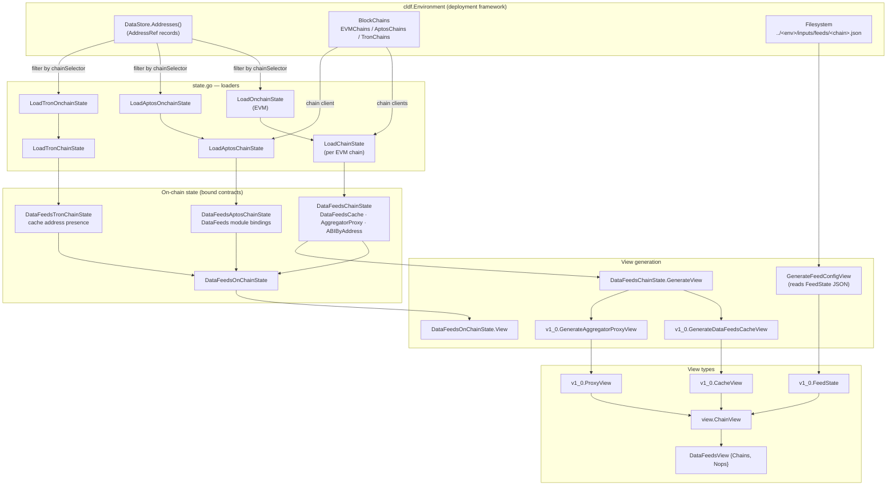
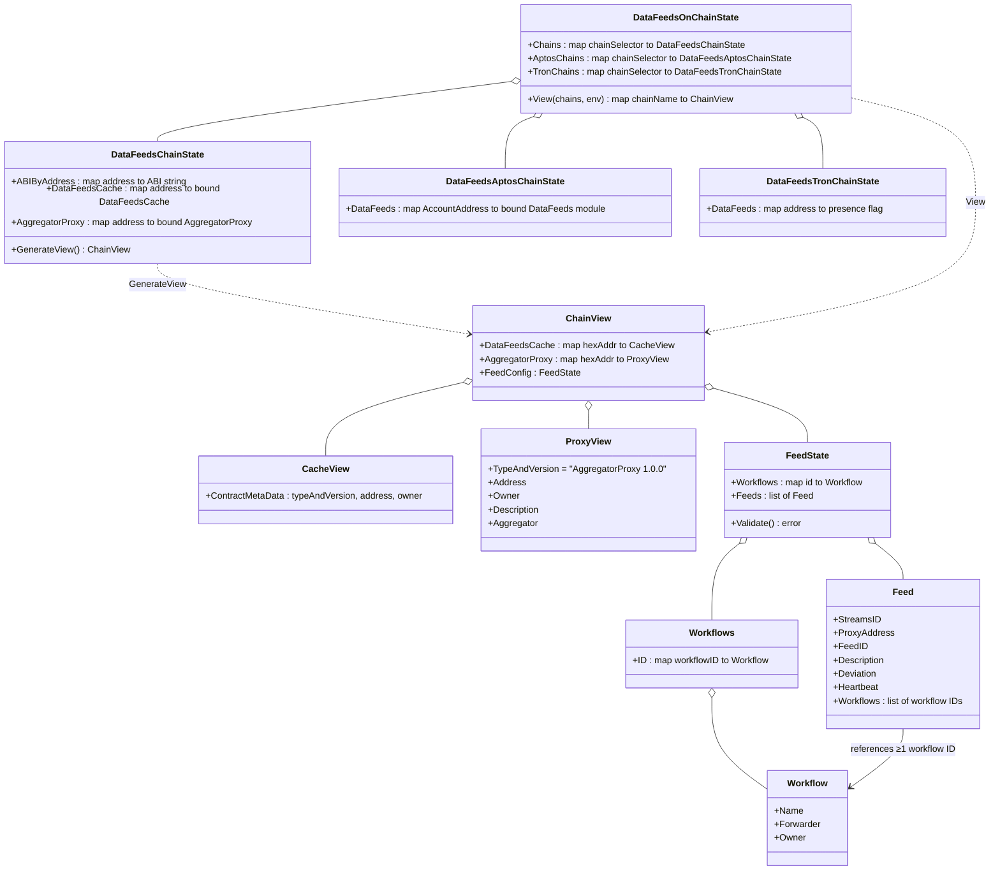
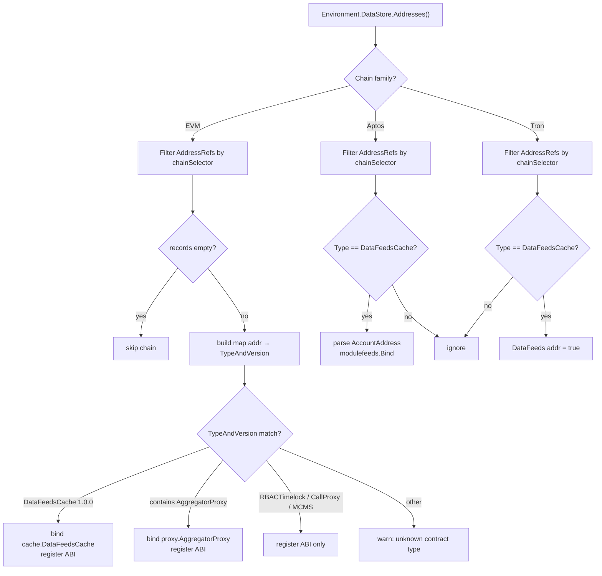
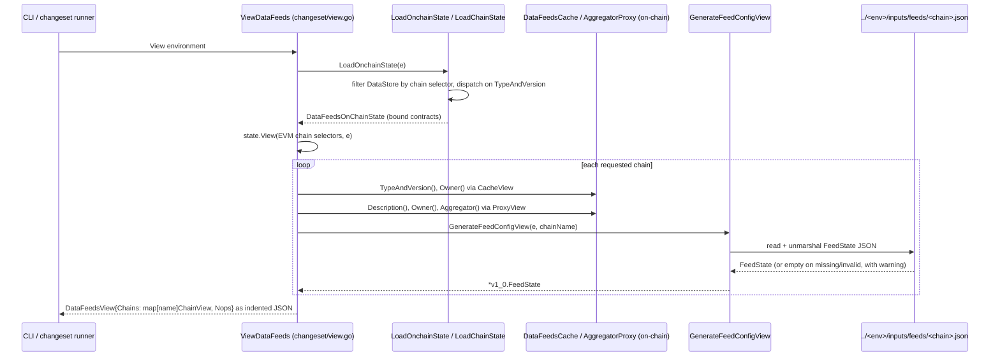

# Data Feeds — Chain State Views

> **Module path in source:** `chainlink/deployment/data-feeds/changeset/state.go`, `chainlink/deployment/data-feeds/view/v1_0/feed_view.go`
> **Parent module:** [Data Feeds](../data-feeds.md) · **Domain:** [Deployment Framework Core & Product Deployments](../../Deployment_Framework_Core___Product_Deployments.md)

## 1. Introduction

The **chain-state-views** module is the read-side of the Data Feeds product deployment suite. It answers two questions that every deployment or operations workflow needs answered before it can act:

1. **What is deployed?** — Given a [chainlink-deployments-framework](https://github.com/smartcontractkit/chainlink-deployments-framework) `Environment`, it reconstructs a typed, bound view of every Data Feeds contract recorded in the datastore/address book, per chain family (EVM, Aptos, Tron).
2. **What is configured?** — It renders those bound contracts into serializable JSON "views" (`ChainView`, `CacheView`, `ProxyView`) and enriches them with the intended feed configuration (`FeedState`) read from the operator's inputs directory.

The module deliberately contains **no transaction logic**. It is consumed by the write-side changesets (deploy, set feed config, migrate feeds, …) which call the loaders to obtain *bound contract handles*, and by the `ViewDataFeeds` changeset which produces the human/CI-readable JSON report. Because the loaders and view generators are the shared substrate for the whole product, changes in this module affect every other Data Feeds changeset.

## 2. Position in the System

```
chainlink/deployment/data-feeds/
├── changeset/
│   ├── state.go          ← THIS MODULE: on-chain state loading + view assembly (EVM/Aptos/Tron)
│   ├── view.go           ← ViewDataFeeds: ViewState entry point, composes Chain views + Nops view
│   ├── utils.go          ← cache-address lookup, feed-ID conversion, workflow metadata (see [Shared Utilities](data-feeds_shared-utilities.md))
│   └── *.go              ← write-side changesets (deploy, set_feed_config, migrate_feeds, …)
├── view/
│   ├── view.go           ← ChainView / DataFeedsView aggregate types
│   └── v1_0/
│       ├── feed_view.go  ← THIS MODULE: FeedState / Feed / Workflow(s) types + validation
│       ├── cache_contract.go  ← CacheView generator (on-chain reads)
│       └── proxy_contract.go  ← ProxyView generator (on-chain reads)
├── changeset/solana/     ← Solana cache deployment (see [Solana Cache](data-feeds_solana-cache.md); not covered by these loaders)
└── offchain/             ← Job Distributor bootstrap helpers
```

- Sibling sub-modules: [JD Registration](data-feeds_jd-registration.md) (node/DON registration via Job Distributor), [Shared Utilities](data-feeds_shared-utilities.md) (feed-ID parsing, workflow-name hashing), [Solana Cache](data-feeds_solana-cache.md) (Solana-specific deploy sequence).
- The MCMS / timelock / proxy ABI metadata surfaced by the EVM loader comes from the [deployment-common](../deployment-common.md) ownership contracts (`RBACTimelock`, `CallProxy`, `Proposer/Canceller/BypasserManyChainMultisig`).

## 3. Architecture



Key structural facts:

- **Loaders are datastore-driven.** `LoadOnchainState` iterates `e.BlockChains.EVMChains()`, filters `e.DataStore.Addresses()` by chain selector, and dispatches on each record's `TypeAndVersion` string. Chains with no recorded addresses are skipped entirely.
- **Type dispatch (EVM).** `LoadChainState` recognizes:
  - `DataFeedsCache 1.0.0` → binds a `*cache.DataFeedsCache` client and registers `DataFeedsCacheABI`.
  - any type containing the substring `AggregatorProxy` (this also matches `BundleAggregatorProxy*` variants) → binds a `*proxy.AggregatorProxy` and registers `AggregatorProxyABI`.
  - `RBACTimelock 1.0.0`, `CallProxy 1.0.0`, and `Proposer/Canceller/Bypasser ManyChainMultiSig 1.0.0` → **ABI registration only** (no binding); these support MCMS proposal building, documented in [deployment-common](../deployment-common.md).
  - anything else → logged as `unknown contract type` and ignored.
- **Chain-family asymmetry.** Aptos binds real module clients (`modulefeeds.Bind`), Tron only records *which addresses are caches* (`map[string]bool`) because no Go contract client is bound — a deliberate degradation, not an omission.
- **`View()` is EVM-only.** `DataFeedsOnChainState.View(chains, e)` looks chains up exclusively in `s.Chains` (EVM). Requesting an Aptos/Tron selector returns `chain not supported %d`.

## 4. Data Model



### 4.1 State structs (`changeset/state.go`)

| Struct | Chain family | Contents |
|---|---|---|
| `DataFeedsChainState` | EVM | `ABIByAddress map[string]string` (ABI per address, for proposal encoding), `DataFeedsCache map[common.Address]*cache.DataFeedsCache`, `AggregatorProxy map[common.Address]*proxy.AggregatorProxy` |
| `DataFeedsAptosChainState` | Aptos | `DataFeeds map[aptos.AccountAddress]*modulefeeds.DataFeeds` (parsed with `ParseStringRelaxed`) |
| `DataFeedsTronChainState` | Tron | `DataFeeds map[string]bool` (cache addresses only) |
| `DataFeedsOnChainState` | aggregate | `{Chains, AptosChains, TronChains}` keyed by chain selector; provides `View(chains []uint64, e)` |

### 4.2 View types (`view/v1_0/feed_view.go`)

- **`Workflows`** — a JSON map of workflow ID → `Workflow{Name, Forwarder, Owner}`. Workflow IDs are the on-chain 10-byte hashed names produced by `HashedWorkflowName` in [Shared Utilities](data-feeds_shared-utilities.md).
- **`FeedState`** — the top-level feed configuration container (`Workflows` + `Feeds`). It doubles as (a) the on-disk input format under `<env>/inputs/feeds/<chain>.json` and (b) the `FeedConfig` field embedded in every `ChainView`.

## 5. Data Flow

### 5.1 Loading state from the datastore



### 5.2 Generating the report (sequence)



Notes on the sequence:

- Chain naming in `View()` uses `cldf_chain_utils.ChainInfo(chainSelector).ChainName`, falling back to the decimal selector string when the name is empty.
- Proxy view generation **tolerates a failed `Description()` read** (logs and continues with `""`), but fails hard on `Owner()` or `Aggregator()` errors.
- Cache views are metadata-only: `TypeAndVersion()` and `Owner()` read on-chain, wrapped by the shared `ContractMetaData` helper (`chainlink/deployment/internal/view/contract.go`).
- The final `DataFeedsView` also embeds `Nops` produced by `commonview.GenerateNopsView` (node-operator registry from `e.NodeIDs`/`e.Offchain`) — see [deployment-common](../deployment-common.md).

## 6. Feed Configuration File Format & Validation

`GenerateFeedConfigView` reads `../<envName>/inputs/feeds/<chainName>.json` (**relative to the process working directory**) and unmarshals it into `FeedState`. Missing files and malformed JSON degrade gracefully to a warning + empty/partial `FeedState` — they never fail the view.

Example input:

```json
{
  "workflows": {
    "abcdef0123456789": { "name": "eth-usd-feed", "forwarder": "0x...", "owner": "0x..." }
  },
  "feeds": [
    {
      "streamsID": "0x...",
      "proxy": "0x...",
      "feedID": "0x0186...0003...",
      "description": "ETH / USD",
      "deviation": "500000000000000000",
      "heartbeat": 60,
      "workflows": ["abcdef0123456789"]
    }
  ]
}
```

`FeedState.Validate()` enforces, per feed:

| Rule | Detail |
|---|---|
| Non-empty | At least one feed; `streamsID`, `proxyAddress`, `feedID`, `description`, `deviation` required; `heartbeat >= 0` |
| Workflow linkage | Every referenced workflow ID must exist in the declared `Workflows` map; at least one workflow per feed |
| Feed ID format | Delegated to `shared.ValidateFeedID`: 32 hex chars (after optional `0x`), format byte `0x01`/`0x02`, attribute bucket `0003` or `0700`, data-type byte `0x00`–`0x04` or `0x20`–`0x60` (the latter encodes decimals, see [Shared Utilities](data-feeds_shared-utilities.md)), reserved bytes 8–15 zero |
| Uniqueness | No duplicate `StreamsID`, `FeedID`, or `Description` |

> **Note:** `Validate()` is exported for input consumers (e.g., changesets that read these JSON files), but the view path itself only unmarshals — it does not run validation.

## 7. Consumers & Integration

| Consumer | How it uses this module |
|---|---|
| `ViewDataFeeds` (`changeset/view.go`, a `deployment.ViewState`) | `LoadOnchainState` → `state.View(EVM selectors, e)` → merges Nops → `DataFeedsView` JSON |
| Write-side changesets (`SetFeedConfigChangeset`, `MigrateFeedsChangeset`, `NewFeedWithProxy`, …) | Call `LoadOnchainState(env)`, then index `state.Chains[sel].DataFeedsCache[addr]` to obtain a **bound contract** for submitting transactions or building MCMS proposals (ABI map supplies the encoding for timelock calls) |
| Address/import tooling | `ImportAddressToDataStoreChangeset` populates the `AddressRef` records that the loaders later read back |
| System tests (`chainlink/system-tests/lib/cre`) | Drive Data Feeds cache configuration through these changesets and validate state via the JSON views |

Lookup helper: `GetDataFeedsCacheAddress` (in [Shared Utilities](data-feeds_shared-utilities.md)) resolves the canonical cache address from the datastore (qualifier `data-feeds` by default) with a legacy `AddressBook` fallback — the mirror-image of what `LoadChainState` binds.

## 8. Dependencies

Declared in `chainlink/deployment/go.mod` (the `chainlink/deployment` Go module):

| Dependency | Role here |
|---|---|
| `chainlink-deployments-framework` | `cldf.Environment`, `datastore` (AddressRef records), EVM/Aptos/Tron chain adapters |
| `chainlink-evm` (gethwrappers) | `DataFeedsCache` / `AggregatorProxy` bindings + ABIs |
| `chainlink-aptos` (bindings) | `data_feeds` Move module client (`modulefeeds.Bind`) |
| `ccip-owner-contracts` (gethwrappers) | `RBACTimelock`, `CallProxy`, `ManyChainMultiSig` ABIs |
| `chain-selectors` | chain names/families for `View()` keys and EVM filtering |
| `go-ethereum`, `aptos-labs/aptos-go-sdk`, `fbsobreira/gotron-sdk` | address types & clients per chain family |

## 9. Operational Notes & Gotchas

- **Working-directory sensitivity.** `GenerateFeedConfigView` hardcodes `baseDir := ".."`, so feed input files are resolved as `../<env>/inputs/feeds/<chain>.json` relative to the directory the deployment tool is run from. Run from a different CWD and feed config silently drops out of the view (warning only).
- **Silent skips.** Unknown contract types and Aptos/Tron records that aren't `DataFeedsCache` are skipped (with a warning on EVM only). If a deployment is missing from the view, check the datastore record's `Type`/`Version` strings first.
- **Substring matching.** The `strings.Contains(tv.String(), "AggregatorProxy")` rule intentionally catches the whole AggregatorProxy family (e.g., `BundleAggregatorProxy`), binding them through the base `AggregatorProxy` ABI.
- **Aptos/Tron views are not implemented.** `DataFeedsOnChainState.View()` returns an error for selectors not present in the EVM `Chains` map; Aptos/Tron state is currently for write-side changesets only.
- **EVM loader skips empty chains.** A chain registered in `BlockChains` but with zero `AddressRef` records produces no `DataFeedsChainState` entry, which will later surface as `chain not supported` if requested in `View()`.
- The twin variables `dfCacheTV`/`devPlatformCacheTV` in `LoadChainState` are intentionally identical (`DataFeedsCache 1.0.0`) — a vestige of separate dev-platform typing kept to avoid touching the match semantics.

## 10. Related Documentation

- [Data Feeds (parent)](../data-feeds.md) — product overview and changeset catalog.
- [Data Feeds — Shared Utilities](data-feeds_shared-utilities.md) — feed-ID codec, workflow-name hashing, cache-address lookup.
- [Data Feeds — JD Registration](data-feeds_jd-registration.md) — node/DON registration consumed alongside cache setup.
- [Data Feeds — Solana Cache](data-feeds_solana-cache.md) — Solana deploy/configure sequence (parallel to the EVM path documented here).
- [Deployment Common](../deployment-common.md) — MCMS/timelock ownership contracts whose ABIs this module registers.
- [Deployment Framework Core & Product Deployments (root)](../../Deployment_Framework_Core___Product_Deployments.md)
